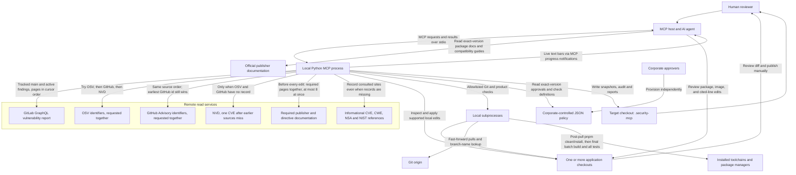
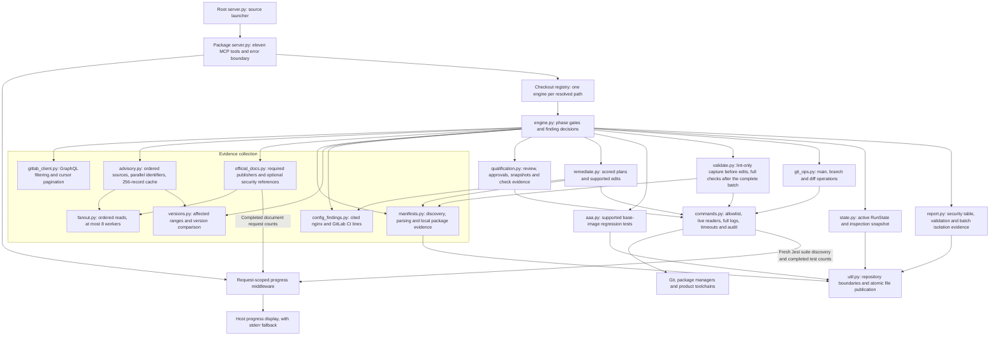
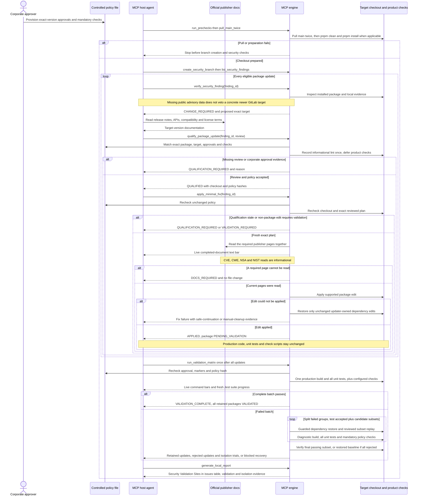

# GitLab Security MCP

An MCP server for evidence-based security remediation in a local GitLab checkout.
It retrieves active findings, verifies installed dependencies against public
advisories, qualifies compatible package updates, applies supported minimal edits,
and produces local Markdown and JSON reports.

The MCP host starts this Python process and calls its eleven tools over stdio.
One process can hold several application checkouts at once. Each checkout keeps
its own run, and later calls select it with `repo_root` when more than one is
active. There is no HTTP listener. "Local" describes execution and where edits
are kept, not offline operation: GitLab, advisory, and publisher-page reads,
Git pulls, and product checks can use the network. Before every edit the server
reads the current required publisher pages. It does not commit, push, open merge
requests, dismiss findings, or write to the GitLab security API. You review and
publish changes.

## Contents

- [Architecture](#architecture)
- [Workflow](#workflow)
- [Safety boundaries](#safety-boundaries)
- [Requirements and qualification](#requirements-and-qualification)
- [Building the local MCP server](#building-the-local-mcp-server)
- [Installing the local MCP server](#installing-the-local-mcp-server)
- [MCP configuration](#mcp-configuration)
- [Running within Cursor](#running-within-cursor)
- [Reading output in Cursor](#reading-output-in-cursor)
- [Run gitlab-security on this repo](#run-gitlab-security-on-this-repo)
- [Running remediation](#running-remediation)
- [Supported fixes](#supported-fixes)
- [Validation](#validation)
- [Development and tests](#development-and-tests)
- [Troubleshooting](#troubleshooting)

## Architecture

These fenced Mermaid diagrams render directly on GitHub. In an editor, use a
Markdown preview with Mermaid support. Arrows represent calls or data flow, not
separate deployed services or background queues.

### System context

The MCP host orchestrates the tools and performs the exact-version API and
license review. The server separately reads the required publisher pages before
every edit. Corporate policies are optional; when configured or present, their
approvals and checks remain mandatory. Neither the server nor the host AI grants
corporate approval. Repository scripts execute locally and must be trusted.



Advisory fallback is not a three-source consensus vote. Identifiers inside one
source are requested together, in the finding's identifier order, with at most
eight requests in flight. The next source starts only after the earlier source
has no usable record. A record can still produce manual review when package
identity, affected versions, or a safe target cannot be established. One failed
or oversized advisory body does not discard the other identifiers from that
source. Responses larger than 2 MB are rejected while they are read.

The host still supplies the exact-version package, API, and license review used
by qualification. Separately, the server reads the required publisher pages
before it writes any package, image, or configuration edit. A failed or
incomplete required publisher read returns `DOCS_REQUIRED` and does not change
the file. Missing or failed security-reference reads are informational, not
permission to claim a finding is safe and not a veto on a concrete GitLab fix. Page
bodies are hashed in full and then discarded. The recorded SHA-256 covers every
response byte. Phrase checks use the first 1 MB. Up to four CVE records, their
NVD detail pages, and four CWE definitions are added when the finding names them.

### Internal components

All components below live in the same Python process. A registry keeps one
`Engine` per checkout. The registry lock covers only that map. Each engine
serializes its own tool calls, so two checkouts can proceed together. Independent
documentation and advisory reads share a short-lived pool of at most eight
workers. GitLab report pages stay in cursor order. Each command runner still
runs one allowlisted command at a time.



The snapshot is not a resume database. A restarted process creates a new
`RunState`; it never reloads the saved snapshot. There is no cross-process lock,
job scheduler, general-purpose rollback, or multi-file transaction. Failed fix
candidates have guarded restoration of unchanged updater-owned files; later user
edits are preserved rather than overwritten.

## Workflow

This is the recommended host-agent flow, not an autonomous loop inside the
server. Stop on a failed run gate or validation requirement. Findings without a
safe fix are recorded and may be followed by other eligible findings.

```mermaid
flowchart TD
  startRun["Host starts or selects one checkout run"] --> prechecks["run_prechecks repo_root: clean main and no Git operation in progress"]
  prechecks --> precheckGate{"Prechecks passed?"}
  precheckGate -->|"No"| stopRun["Stop that checkout and report the failure"]
  precheckGate -->|"Yes"| pulls["pull_main_twice: git pull --ff-only twice"]
  pulls --> pullGate{"Both pulls passed and tree remains clean?"}
  pullGate -->|"No"| stopRun
  pullGate -->|"Yes"| pnpmGate{"Any pnpm projects or workspaces?"}
  pnpmGate -->|"Yes"| clean["pnpm clean at each pnpm project or workspace root"]
  clean --> cleanGate{"Clean succeeded?"}
  cleanGate -->|"No: PREPARATION_FAILED"| stopRun
  cleanGate -->|"Yes"| install["pnpm install in the same directory"]
  install --> installGate{"Every preparation command succeeded?"}
  installGate -->|"No: PREPARATION_FAILED"| stopRun
  installGate -->|"Yes"| branch["create_security_branch: dated name must be unused locally and on origin"]
  pnpmGate -->|"No: preparation not applicable"| branch
  branch --> branchGate{"Branch created?"}
  branchGate -->|"No"| stopRun
  branchGate -->|"Yes"| listing["list_security_findings: active report on tracked main"]
  listing --> retrievalGate{"Retrieval succeeded without truncation?"}
  retrievalGate -->|"No"| stopRun
  retrievalGate -->|"Yes"| moreFindings{"Unprocessed findings remain?"}
  moreFindings -->|"No"| postChecks["run_validation_matrix: one final production build, all unit tests and policy checks"]
  moreFindings -->|"Yes"| verify["verify_security_finding: local evidence, advisory, and config rules"]
  verify --> decisionGate{"Decision?"}
  decisionGate -->|"FALSE_POSITIVE"| retained["Retain evidence and continue"]
  decisionGate -->|"MANUAL_REVIEW or NO_SAFE_FIX"| unresolved["Retain unresolved reason and continue"]
  decisionGate -->|"REPRODUCTION_REQUIRED"| reproduction["Host-led approved local fuzzing reproduction, not a package fix"]
  reproduction --> unresolved
  retained --> moreFindings
  unresolved --> moreFindings
  decisionGate -->|"CHANGE_REQUIRED"| editKind{"What kind of edit?"}
  editKind -->|"Package update"| qualify["Review package docs and policy, then qualify_package_update"]
  qualify --> qualifiedGate{"Review, lint capture and policy evidence complete?"}
  qualifiedGate -->|"No"| unresolved
  qualifiedGate -->|"Yes"| readDocs["Server reads required publisher pages together"]
  editKind -->|"Image tag or cited nginx or GitLab CI line"| readDocs
  readDocs --> docsGate{"Every required page read?"}
  docsGate -->|"No: DOCS_REQUIRED"| unresolved
  docsGate -->|"Yes"| apply["apply_minimal_fix: local edit only"]
  apply --> appliedGate{"APPLIED?"}
  appliedGate -->|"No"| blockedEdit{"Safe restoration permits continuation?"}
  blockedEdit -->|"Yes: retain failure reason"| moreFindings
  blockedEdit -->|"No: manual cleanup required"| reports
  appliedGate -->|"Yes"| regression["Keep package callers unchanged, generate_aaa_test only for supported images"]
  regression --> moreFindings
  postChecks --> validationGate{"VALIDATION_COMPLETE?"}
  validationGate -->|"Yes"| reports["generate_local_report: security table and validation evidence"]
  validationGate -->|"No"| rollbackGate["Engine isolates failed groups and verifies retained subset or baseline"]
  rollbackGate -->|"Retain green subset or report blocked recovery"| reports
  reports --> reviewDiff["Human reviews reports and git diff; commit and push manually"]
```



### Tool reference

Every tool accepts optional `repo_root`. Pass the same absolute checkout on
every call when more than one repository is active. Omit it only while a single
checkout is active.

| Tool | Responsibility and gate |
| --- | --- |
| `run_prechecks(repo_root=None)` | Select the absolute application checkout; require clean `main`; reject merge, rebase, cherry-pick, revert or bisect in progress. |
| `pull_main_twice(repo_root=None)` | Require successful prechecks; perform two fast-forward-only pulls, then `pnpm clean` followed by `pnpm install` in each pnpm project/workspace root before any security checks. Any failure stops the run. |
| `create_security_branch(repo_root=None)` | Require successful pulls; create `security-fixes-Month-dd-YYYY`, for example `security-fixes-November-03-2026`. |
| `list_security_findings(project_id=None, repo_root=None)` | Require the branch; retrieve and normalize filtered findings. Do not relist after decisions or edits. |
| `verify_security_finding(finding_id, repo_root=None)` | Record evidence, decision, proposed plan, and any review prompt. Config proposals also record the publisher pages read for that rule. |
| `qualify_package_update(finding_id, review, repo_root=None)` | Require exact-target API/license review and informational lint capture. Enforce corporate approval evidence now; defer product commands until final validation. |
| `apply_minimal_fix(finding_id, repo_root=None)` | Read the required publisher pages, then apply the supported plan. Package edits also require fresh qualification and validation of prior package edits. `DOCS_REQUIRED` writes nothing. |
| `generate_aaa_test(finding_id, repo_root=None)` | Generate supported base-image tests when a suitable oracle and framework exist; not generic package API tests. |
| `run_validation_matrix(repo_root=None)` | Validate the complete batch once. Only on failure, isolate grouped subsets, revert incompatible updates and prove the retained checkout green. Unchanged successful validation is reused. |
| `generate_local_report(repo_root=None)` | Write local Markdown/JSON reports and return the security table as literal MCP text. Structured content retains `final_summary_markdown`, validation and isolation evidence, and report metadata. |
| `get_run_status(repo_root=None)` | Return phase, counts and package-validation status; retract stale green package evidence. |

### GitLab report filters

Retrieval matches Status = Needs triage or Confirmed, Tracked ref = `main`,
Activity = Still detected. The client resolves the exact tracked branch ID,
requests `DETECTED` and `CONFIRMED`, and sets `hasResolution: false`. If tracked
`main` cannot be resolved, it fails rather than fetching unfiltered findings.
Pagination and per-finding pipeline provenance are retained. Inspect `truncated`
before treating a retrieval as complete; do not claim omitted findings were
verified or resolved.

### Fix eligibility

A finding is auto-fixed only when all of these are true:

- Local evidence shows the vulnerable package or image is present.
- An online advisory publishes a fixed version newer than what is installed, or GitLab explicitly recommends a newer fix for the matching local dependency. Missing data, missing records and failed public lookups do not veto GitLab's recommendation. Positive evidence that the proposed target remains affected is distinct from missing data.
- The edit is a lockfile refresh, a manifest version bump, a package override, an unpinned `FROM` tag bump, or one cited nginx or GitLab CI line that the current publisher page still documents.
- Major package updates are candidates, not automatic skips. They require documented API/caller compatibility without source/test changes and passing post-update checks. Major image-tag changes still require manual review.
- Every package update requires no production/unit-test API adaptations and passing post-update builds and executed unit tests, plus configured corporate checks. Pre-change lint capture is informational only: errors, missing scripts or incomplete capture never block security fixes. Same-major does not prove compatibility.

An advisory that names the identifier but not the package found in the repo does not by itself block a GitLab-recommended dependency update. The finding's package and installed version must match locally, and available target advisory evidence is recorded before the normal qualification workflow. Failed lookups of either the installed or target version are informational when GitLab provides a concrete newer fix. Build and all unit tests still determine product acceptance; failures reject and restore the attempted fix. Without a concrete target, the server does not guess a version. Missing external data is not evidence of a false positive.

CVE, CWE, NSA and NIST security-reference pages are best-effort information,
not an authorization gate for version or supported code/configuration fixes.
Unavailable records, 404/503 responses and missing fix descriptions are recorded
without blocking edits. Publisher directive pages and configured policy checks
remain separate requirements. Validation evidence lists the actual consulted
site URLs; it does not claim CVE, CWE, NSA or another provider was queried merely
because its identifier was present.

Unknown reachability is not treated as a false positive. Secret detection and DAST findings are reported for you to handle. They are not rewritten. SAST findings are not patched by guessing at source changes.

A cited nginx or GitLab CI line can change only when the current line still matches the plan and the live publisher page still contains the documented phrase. Supported line edits are `server_tokens on` to `off`, `autoindex on` to `off`, removal of `TLSv1` and `TLSv1.1` from `ssl_protocols` when `TLSv1.2` or `TLSv1.3` remains, and these GitLab CI variables when set to `true`, `1`, or `yes`: `SAST_DISABLED`, `DEPENDENCY_SCANNING_DISABLED`, `CONTAINER_SCANNING_DISABLED`, `SECRET_DETECTION_DISABLED`, and `DAST_DISABLED`. The replacement is `"false"`. `CODE_QUALITY_DISABLED` is left unchanged. Comments and unmatched lines stay on manual review. A missing configuration file can be a false positive. A path outside the checkout cannot.

Container-scanning Dockerfile findings stay on the image-tag path. Other Dockerfile lines, including `USER root`, are not rewritten unless a later rule names one documented one-line edit. The current Docker reference does not authorize an automatic `ADD` to `COPY` change.

## Safety boundaries

The command runner allows specific argument forms, not arbitrary shell commands.
Direct `git add`, `commit`, `push`, `merge`, `rebase`, `reset`, and unrelated
branch checkouts are rejected. Allowed Git mutations are the fast-forward pulls
and creation of the dated security branch. GitLab calls retrieve data only.

The allowlist is **not an operating-system sandbox**. Product scripts, package
installation hooks, and repository wrappers can execute their own code and use
the network. Review and trust the target repository before running checks. The
hosting AI's editor is also outside the server's command allowlist; its changes
must follow the declared source-edit policy.

Commands have timeouts, capped output, and audit records with output hashes rather
than raw stdout/stderr. Tool results can still contain bounded diagnostic output.
Keep credentials out of source control and avoid secrets in command arguments,
product logs, or reports. GitLab queries and advisory requests send the relevant
project or vulnerability/package identifiers to their configured services.

Snapshots, reports, and the audit log live under `.security-mcp/` in the target
repository. The server does not stage them, and its clean-tree check excludes
that directory. They are local inspection artifacts, not approval credentials
or proof that GitLab considers a finding resolved.

### Robustness

Each checkout's tools are serialized with that engine's lock. Two checkouts in
the same process do not share that lock. Shutdown copies the registry, then
closes every owned client after its in-flight read finishes, and later calls
are rejected. Tool results are detached snapshots rather than live state.

Independent documentation pages and advisory identifiers are fetched together,
at most eight at a time, and returned in request order. A single request stays
on the caller thread. One page or identifier failure is recorded without
dropping the other results from that batch. GitLab pagination stays sequential
because each page needs the previous cursor. OSV, GitHub, and NVD stay in that
order. The command runner still runs one child at a time. Its stdout and stderr
readers publish through a lock so their records cannot interleave. Readers are
daemon threads so a reader that ignores its stop signal cannot keep the process
alive after the join timeout.

Advisory responses larger than 2 MB are refused. The cache holds at most 256
records and is cleared on shutdown. GitLab error text keeps the first 500
characters and discards the rest of the body. Documentation hashes cover the
full page. Phrase checks use only the retained 1 MB prefix.

Malformed advisory responses fail that identifier's lookup. Malformed local
evidence requires manual review instead of being treated as package absence.
Validation read or execution failures produce `VALIDATION_FAILED`.

State, manifests, and individual report files are replaced atomically. Generated
tests are published without replacing existing files. Command readers stop
even when descendants retain inherited pipes. This does not guarantee cleanup
of detached descendant processes, coordinate multiple MCP processes editing
the same checkout, or make the Markdown/JSON report pair a single transaction.

## Requirements and qualification

### Prerequisites

- Python 3.11 or newer and Git on Windows, macOS, or Linux.
- A GitLab token with `read_api` and access to the project's vulnerability report.
- The GitLab project path or numeric ID and a local checkout of its `main` branch.
- The package managers and toolchains required by the target application.
- Meaningful lint/build/unit-test checks and documented license review; independently
  approved corporate policy only when required/configured for your organization.

Point `REPO_ROOT` at the application Git checkout, not this MCP project.
Validation supports split Node/.NET repositories: Node checks run at the
top-level package manifests (using each component's package manager), and .NET
checks run at solution directories or standalone project directories. A root
Node workspace manifest owns its nested packages; define workspace-wide checks
there. Arbitrary mixed monorepos are not automatically orchestrated.
Package lookup reads nested npm, pnpm, and Yarn lockfiles and retains each
component's manifest, manager, and scanner-reported installed version. Node
remediation and qualification checks use the owning component's directory.
For pnpm components with `pnpm-workspace.yaml`, transitive override plans edit
that workspace configuration while preserving comments and unrelated pins;
otherwise they use the component's `package.json`. Discovery does not waive
advisory verification, major-version review, or package qualification.
Node, .NET, Java, NGINX, and Docker
are needed only for the validation paths that apply to that checkout. Platform
support does not mean every toolchain or Python runtime has been certified.

### Package Update Qualification

Every Node, NuGet, Maven, and Gradle package update has four mandatory qualifiers:

1. The AI fully reads the target version's official documentation, release notes,
   API/migration guides, runtime/peer requirements, and license terms. It inspects
   the actual product's frameworks and callers, not only the GitLab suggestion.
2. The update must preserve product build, startup/runtime behavior, and the
   existing unit suite. Review Angular/Node/TypeScript/RxJS/Crystal compatibility,
   Quarkus platform/BOM and extension alignment, Java requirements, and .NET
   target frameworks as applicable. Never force peer resolution or change the
   product framework/runtime/BOM to disguise an incompatible package update.
3. Without a configured/existing policy, provide `review.license` with the
  exact-target license expression, official HTTPS sources, commercial-use and
  no-license-fee assessments, and distribution obligations. This is documented
  terms review, not corporate approval. Unknown/unlicensed terms block editing.
  When a corporate policy is configured or present, independent exact-version
  approval and all its checks remain required; the AI must not invent approvals.
4. Before the first edit, lint runs and all emitted errors, warnings,
  informational and unknown diagnostics, stdout and stderr are saved in
  `.security-mcp/lint-issues.json`. Observed rule names, occurrence counts and
  severities are exported to `.security-mcp/lint-rules.json`, independently of
  the project's lint configuration. Errors, missing lint scripts, timeouts,
  truncated output or lint execution failures never block editing. Completeness
  is recorded honestly; an incomplete capture cannot list unseen rule IDs.
  Apply all reviewed version updates first, then run one final production build
  and all unit tests. Lint-only capture does not install or audit
  dependencies first. Node components must define `build` and `test` scripts.
  Missing, failed, timed-out, skipped or explicitly empty test runs are
  not passing evidence. Initial lint evidence is retained rather than rerun on
  qualification retries or after updates. No sleeps, cooldowns or polling delays
  are required. Corporate approvals remain mandatory; configured commands run
  in the final matrix, sharing exact build/test results rather than rerunning them.
  Corporate-policy mode additionally requires positive, untruncated runtime
  smoke and full resolved-dependency license checks with configured markers.

An incompatible or uncertain target is skipped for review. All major, minor,
revision and build updates require `compatible_without_code_changes: true`
and `source_fixes: []`: neither production nor unit-test callers may need API
changes. No production/test edits, new regression tests, or weakened check
scripts are allowed to support any package version update. This rule applies
even to a one-line adaptation or a nominally backward-compatible release.

A major number alone is not evidence that a caller breaks. For major package
candidates, verification returns a bounded lexical `caller_scan` with a
fingerprint and source-reference locations. The host must read old/target
official APIs and migration guides, inspect those sources and installed
dependency consumers, and distinguish concrete incompatible calls from missing
evidence. No direct imports does not prove transitive compatibility. Static
scans, documentation attestations, builds, and tests cannot establish 100%
compatibility for every execution path.

Automatic major updates permit no source/test adaptations. `source_fixes` must
be empty, reviewed caller files must have current SHA256 evidence, and all
identified source references must be assessed. Transitive npm updates also
require installed `node_modules` consumer source evidence. The server rejects
stale scans and source/test changes, and records the reviewed evidence. A failed
or skipped required build/unit check never becomes a validated fix. Lint is
informational even when missing, failed, timed out or truncated. Configured
corporate checks still apply. Failed attempted updates are rejected and the
plugin restores its own dependency-file edits only when their hashes still
match the applied edit. Later user edits are preserved with a manual-cleanup
message. Previously accepted updates are not automatically undone.

#### Package update sequence

This diagram shows the optional corporate-policy mode and server-enforced checks.
Inspect every failure and rollback result; later edits require manual cleanup.



#### Corporate policy setup

Corporate-policy mode is optional. Set `PACKAGE_UPDATE_POLICY` to a controlled
JSON file's absolute path, or provision `.security-mcp/package-update-policy.json`
under `REPO_ROOT`. An explicit path or an existing default file is enforced;
missing/invalid explicit policy fails closed. When neither exists, qualification
uses documented license review and lint/build/unit checks without creating a policy.
Keep approvals access-controlled, preferably outside the AI-writable checkout.
The AI/server must never create or modify actual approvals. The server reads and
hashes this file; it cannot authenticate a corporate signer or grant legal rights.

The following is a deliberately **unapproved template**, not permission to use
a package. Corporate approvers must supply real version-specific evidence and
approve both Boolean fields before any update is permitted:

```json
{
  "schema_version": 1,
  "approvals": [{
    "ecosystem": "npm",
    "package": "PACKAGE_NAME",
    "target": "TARGET_VERSION",
    "license_expression": "REVIEWED_LICENSE_EXPRESSION",
    "approved_by": "CORPORATE_APPROVER",
    "approval_reference": "CORPORATE_APPROVAL_RECORD",
    "obligations": "REQUIRED_DISTRIBUTION_CONDITIONS",
    "commercial_distribution_approved": false,
    "no_license_fees": false,
    "license_sources": ["https://publisher.example/license"]
  }],
  "checks": {
    "npm": {
      "build": {"argv": ["npm", "run", "build"], "success_marker": "PRODUCT_BUILD_PASSED"},
      "unit_tests": {"argv": ["npm", "test"], "success_marker": "PRODUCT_UNIT_TESTS_PASSED"},
      "runtime": {"argv": ["npm", "run", "security:smoke"], "success_marker": "PRODUCT_RUNTIME_SMOKE_PASSED"},
      "license_audit": {"argv": ["npm", "run", "security:licenses"], "success_marker": "APPROVED_RESOLVED_LICENSES_PASSED"}
    }
  }
}
```

Use ecosystem keys exactly `npm`, `NuGet`, or `Maven` (Gradle also uses `Maven`).
Every entry must contain exactly the four check kinds above, using the detected
manager. Configure real repository-owned scripts/profiles/tests before starting
on clean main; they are not supplied automatically by this MCP server. Markers
must be emitted only after meaningful tests and complete license-policy checks,
never by a placeholder `echo`, an empty test run, or a generic build-success line.
In corporate-policy mode, missing tools, checks, markers, or approvals block edits.

| Manager | Build | Unit Tests | Runtime Smoke | Resolved-Graph License Audit |
| --- | --- | --- | --- | --- |
| npm/pnpm/yarn | `MANAGER run build` | `MANAGER test` | `MANAGER run security:smoke` | `MANAGER run security:licenses` |
| NuGet/.NET | `dotnet build --configuration Release --nologo` | `dotnet test --configuration Release --nologo` | Same test prefix plus category filter `SecurityRuntimeSmoke` | Same test prefix plus category filter `LicenseCompliance` |
| Maven/mvnw | `TOOL --batch-mode clean verify` | `TOOL --batch-mode test` | `TOOL --batch-mode -Psecurity-smoke verify` | `TOOL --batch-mode -Psecurity-licenses verify` |
| Gradle/gradlew | `TOOL --no-daemon build` | `TOOL --no-daemon test` | `TOOL --no-daemon securitySmoke` | `TOOL --no-daemon securityLicenses` |

For .NET, use the filter matching the actual framework: `--filter Category=NAME`
for xUnit/VSTest, `--filter TestCategory=NAME` for MSTest/NUnit,
`--filter-trait Category=NAME` for native MTP/xUnit v3, or
`--treenode-filter /*/*/*/*[Category=NAME]` for native MTP/TUnit. Native MTP
qualification filters target SDK 10+ without the SDK 8/9 `--` separator; other
unsupported platform/command combinations require manual validation. Java
wrappers are resolved inside the checkout using the current OS's wrapper form.

#### Documentation review input

Call `qualify_package_update(finding_id, review)` only after completing the
actual review. This illustrative input is not evidence for a real package:

```json
{
  "ecosystem": "npm",
  "package": "PACKAGE_NAME",
  "target": "TARGET_VERSION",
  "documentation": {
    "complete": true,
    "sources": ["https://publisher.example/version-specific-docs"],
    "summary": "Actual findings from the complete official documentation review"
  },
  "license": {
    "expression": "ACTUAL_TARGET_LICENSE_EXPRESSION",
    "sources": ["https://publisher.example/target-license"],
    "commercial_use_permitted": true,
    "no_license_fees": true,
    "obligations": "Actual distribution obligations from the reviewed terms",
    "assessment": "Actual target-version license review, not corporate approval"
  },
  "compatible": true,
  "compatible_without_code_changes": true,
  "api_changes": "Actual API changes and the smallest required caller adaptations",
  "frameworks": [{
    "name": "ACTUAL_PRODUCT_FRAMEWORK_OR_RUNTIME",
    "version": "INSTALLED_VERSION",
    "source_url": "https://publisher.example/compatibility",
    "assessment": "Evidence that the target supports this installed version"
  }],
  "source_fixes": []
}
```

Include every relevant framework/runtime/BOM and publisher source. Keep
`source_fixes: []` for every version increment. Confirm that both production
and unit-test APIs need no adaptations. If either requires changes, reject the
package update with the concrete API incompatibility instead of editing code.
Guessed SAST rewrites remain unsupported.

For `proposed_fix.major_upgrade=true`, also include the following review object.
Use the scan ID returned by verification and actual SHA256 hashes of the files
read. These example values are placeholders, not compatibility evidence:

```json
{
  "major_upgrade": {
    "scan_id": "FROM_PROPOSED_FIX_CALLER_SCAN",
    "compatible_without_code_changes": true,
    "caller_breakages_found": false,
    "migration_sources": ["https://publisher.example/migration-to-target"],
    "api_comparison": "Reviewed changes from installed to target; APIs actually used remain supported",
    "caller_assessment": "Actual arguments, options, callbacks and return-value usage reviewed",
    "dependency_assessment": "Actual transitive consumers and their runtime requirements reviewed",
    "reviewed_files": [{
      "path": "frontend/src/actual-caller.ts",
      "sha256": "ACTUAL_FILE_SHA256",
      "assessment": "Concrete API compatibility findings for this caller"
    }]
  }
}
```

For transitive packages, include the relevant installed dependency source files
as well as repository references, not only an application file. Supply this
object alongside the normal exact-target documentation/framework review and
`source_fixes: []`. Evidence is checked again after lint/policy review and
before applying the plan; reverify if the checkout/callers change.

`QUALIFICATION_REQUIRED` blocks an edit. `QUALIFIED` authorizes only the exact
reviewed plan on the unchanged pruned source checkout and unchanged policy.
Requalify before application if either changes. `APPLIED` means local edits only;
the package qualifier remains `PENDING_VALIDATION` until all post-checks pass.
Reports keep pending/failed updates unresolved, retain documentation/approval
references, and retract green results after later source or policy changes.
Failed post-update checks reject attempted updates and safely restore owned
dependency edits. Inspect preserved files/manual-cleanup notices. Partial
application failures still require local inspection.

These gates enforce reviewed evidence and repository-owned checks, not a proof
of every possible runtime behavior. The server does read the required publisher
pages before an edit, and that read is separate from the host's exact-version
package review. Their assurance depends on test coverage, truthful review,
correct configured license auditing and authentic corporate approvals when used. Snapshot
checks prune dependency/build/cache directories and stop at the file/size cap;
they are not cross-process locks or verification of all generated binaries.

Qualification policy reads are capped at 1 MiB and caller evidence reads at
512 KiB. Dependency rollback originals and checkout hashes are bounded by
100 MiB. Package qualification permits no production/test source migrations.
Each status refresh hashes the checkout once for all validated packages.
The advisory cache retains at most 256 records and releases them on shutdown.
Unreadable directories fail evidence collection rather than proving absence.

Official references: [Angular compatibility](https://angular.dev/reference/versions),
[Quarkus platform/BOM alignment](https://quarkus.io/guides/platform),
[npm package requirements and licenses](https://docs.npmjs.com/cli/v11/configuring-npm/package-json),
and [NuGet license metadata](https://learn.microsoft.com/en-us/nuget/reference/nuspec#license).
Read the specific updated package's documentation too; these general references
do not establish compatibility or commercial approval for an individual update.

### Repository Compatibility

| Repository | Automatic dependency fixes | Validation |
| --- | --- | --- |
| Node.js | npm, pnpm, Yarn Classic and modern Yarn; direct version bumps, supported lock refreshes, overrides/resolutions | Install, advisory audit, declared lint/build/test scripts |
| .NET 10 | NuGet project references and existing central `Directory.Packages.props` versions | SDK compatibility check, restore, Release build/test; `.sln`, `.slnx`, C#, F#, and VB project detection |
| Java 17 | Maven direct versions/properties and Gradle coordinates/supported version-catalog entries | Java 17 check, Maven verify/dependency tree or Gradle dependencies/test/build; wrappers preferred |

These are safe dependency-remediation paths, not a promise to fix every security
finding. A matching advisory or locally verified GitLab recommendation, a compatible
fix, and a supported local edit are required. Unresolved Java/NuGet transitive dependencies require review;
SAST, DAST, secrets, unsupported dependency formats, and breaking upgrades are
not patched by guessing.

Required tools must be on the server process's PATH. A missing required tool produces
`VALIDATION_INCOMPLETE`; an incompatible Java runtime or an SDK too old for
`net10.0` produces `VALIDATION_FAILED`. Install/configure the required tools and
rerun validation. A .NET SDK 10 or newer is needed for `net10.0`; Java validation
requires a Java 17 toolchain, not merely any installed Java version.

### Fuzzing Findings

API and coverage fuzzing findings describe observed application behavior, not
package advisories. `verify_security_finding` returns `REPRODUCTION_REQUIRED`
and a `fuzzing_workflow` instead of looking for a CVE or skipping the finding.
Reports retain these findings as unresolved and include their workflow.

The findings GraphQL query reads `latestSecurityReportFinding.evidence`,
including the full request body and URL, response body/status, and supporting
request/response exchanges. It also selects text, code, Markdown, and diff
details to retain scanner-provided payload information. Normalized findings
keep these as `scannerEvidence` and `scannerDetails`, separate from assessment
notes. Verification exposes them in `fuzzing_workflow.scanner_evidence` and
`scanner_details`; JSON reports and local snapshots retain them too.

Authentication/cookie headers are redacted, but bodies and URLs are preserved
for analysis and may contain sensitive application data. Treat tool output,
snapshots and JSON reports accordingly; do not commit or publish them. An
empty body is preserved. Missing latest findings or absent scanner bodies
remain missing evidence, never automatic proof of a false positive. GraphQL
errors fail retrieval instead of silently discarding evidence.

The host must obtain the scanner artifact, mutated input, request/response or
crash evidence, and expected contract. It then inspects the local handler or
fuzz target and reproduces the same failure using synthetic data in an
explicitly approved local environment. Never replay payloads against the
reported remote hostname. An API route is not a local source-file path.

After reproduction and review, the host may apply a scoped application-code
fix and regression test separately from dependency updates. It must retain
before/after reproduction evidence, valid and boundary cases, and passing
lint, production build and executed unit tests. Missing artifacts or an
unavailable environment block this workflow. Scanner text is not a patch.

The server does not apply arbitrary source patches or validate fuzzing-specific
fix receipts. `apply_minimal_fix` returns `REPRODUCTION_REQUIRED` for fuzzing;
server reports remain unresolved. Host-applied fixes require separate reviewed
evidence and do not change GitLab state automatically.

## Building the local MCP server

Python source execution needs no compilation or wheel. Use the source
installation below for local development and restart-only hotfixes. Build a
wheel when you want an installable local package or a deployment artifact.

From this MCP project's root, create the virtual environment if it does not
already exist, install dependencies, check the source, and build:

### Windows build

```powershell
python -m venv .venv
.\.venv\Scripts\python.exe -m pip install -r requirements-dev.txt
.\.venv\Scripts\python.exe -m ruff check gitlab_security_mcp server.py tests
.\.venv\Scripts\python.exe -m ruff format --check gitlab_security_mcp server.py tests
.\.venv\Scripts\python.exe -W error::DeprecationWarning -W error::ResourceWarning -m pytest -q -W error::pytest.PytestUnhandledThreadExceptionWarning
.\.venv\Scripts\python.exe -m pip wheel --no-deps --wheel-dir dist .
Get-ChildItem .\dist\*.whl
```

### macOS and Linux build

```bash
python3 -m venv .venv
.venv/bin/python -m pip install -r requirements-dev.txt
.venv/bin/python -m ruff check gitlab_security_mcp server.py tests
.venv/bin/python -m ruff format --check gitlab_security_mcp server.py tests
.venv/bin/python -W error::DeprecationWarning -W error::ResourceWarning -m pytest -q -W error::pytest.PytestUnhandledThreadExceptionWarning
.venv/bin/python -m pip wheel --no-deps --wheel-dir dist .
ls dist/*.whl
```

Stop if a check fails; building the wheel does not itself run these checks.
Live GitLab tests remain opt-in. The current version produces
`dist/gitlab_security_mcp-1.0.0-py3-none-any.whl`; use the newly built filename if
the project version changes. `--no-deps` builds only this project's artifact,
not a bundle of its dependencies. Build isolation may download build tools.
Building does not install the wheel or start an MCP process.

## Installing the local MCP server

Run these commands from this MCP project's directory, not the application
checkout. The source launcher needs the runtime dependencies; it does not need
an installed copy of this project.

### Source installation on Windows

```powershell
python -m venv .venv
.\.venv\Scripts\python.exe -m pip install -r requirements.txt
```

### Source installation on macOS and Linux

```bash
python3 -m venv .venv
.venv/bin/python -m pip install -r requirements.txt
```

Activation is optional when commands use the virtual environment's executable.
Use absolute paths in the MCP configuration so the host's working directory and
global Python installation cannot select the wrong server.

### Installing a built wheel

For an installed-package deployment, first create the virtual environment and
install runtime dependencies using the source-installation commands above.
Then install the wheel into that same environment:

```powershell
.\.venv\Scripts\python.exe -m pip install --force-reinstall --no-deps .\dist\gitlab_security_mcp-1.0.0-py3-none-any.whl
.\.venv\Scripts\python.exe -m pip show gitlab-security-mcp
.\.venv\Scripts\python.exe -m pip check
Get-Item .\.venv\Scripts\gitlab-security-mcp.exe
```

On macOS/Linux:

```bash
.venv/bin/python -m pip install --force-reinstall --no-deps dist/gitlab_security_mcp-1.0.0-py3-none-any.whl
.venv/bin/python -m pip show gitlab-security-mcp
.venv/bin/python -m pip check
ls .venv/bin/gitlab-security-mcp
```

`--force-reinstall` replaces an existing copy even if the local version number
has not changed. `--no-deps` relies on the runtime-dependency setup above; do
not skip it. Update runtime requirements when dependencies change. The installed
entry point is `gitlab-security-mcp`, not the root source launcher.

For Cursor, replace the source configuration's `command` and `args` with:

```json
{
  "command": "C:\\path\\to\\security-mcp-fixer\\.venv\\Scripts\\gitlab-security-mcp.exe",
  "args": []
}
```

This is a fragment inside the existing `mcpServers.gitlab-security` object;
retain its `env` settings. On macOS/Linux, use the absolute path to
`.venv/bin/gitlab-security-mcp`. Do not pass `server.py` to this entry point.
Restart Cursor's MCP server after installation. Wheel deployments require
rebuilding, reinstalling and restarting for code updates; source deployments
require only restarting for source-only updates. Use one launch method per
connection, not both.

## MCP configuration

The MCP host launches and owns the server process. Do not also run a separate
`python server.py` terminal instance for that connection. Stdout is reserved for
MCP messages; the server does not open a port.

### VS Code

Add the following to the target project's `.vscode/mcp.json`. Replace both local
paths and `group/project`. The password input keeps the token out of the JSON
example; enter it through VS Code's input prompt, not through agent chat. Keep
actual credential storage consistent with your organization's policy.

```json
{
  "servers": {
    "gitlab-security": {
      "type": "stdio",
      "command": "C:\\path\\to\\security-mcp-fixer\\.venv\\Scripts\\python.exe",
      "args": ["C:\\path\\to\\security-mcp-fixer\\server.py"],
      "env": {
        "GITLAB_TOKEN": "${input:gitlabToken}",
        "GITLAB_PROJECT_ID": "group/project",
        "REPO_ROOT": "C:\\path\\to\\application-repo"
      }
    }
  },
  "inputs": [
    {
      "id": "gitlabToken",
      "type": "promptString",
      "description": "GitLab read_api token",
      "password": true
    }
  ]
}
```

Start/restart the server using VS Code's MCP server controls and enable its tools
for the agent. Review any host trust prompt before permitting execution. On
macOS/Linux, use `/path/to/security-mcp-fixer/.venv/bin/python` and POSIX paths.

### Cursor

Create or edit the project file `.cursor/mcp.json` in the repository you want to remediate, or edit your user MCP config at `%USERPROFILE%\.cursor\mcp.json` on Windows (`~/.cursor/mcp.json` on macOS or Linux).

Do not put a real token in a committed project config. The examples deliberately
omit `GITLAB_TOKEN`: supply it securely in the environment inherited by Cursor,
or use an uncommitted user configuration according to corporate policy.

#### Windows configuration

```json
{
  "mcpServers": {
    "gitlab-security": {
      "command": "C:\\path\\to\\security-mcp-fixer\\.venv\\Scripts\\python.exe",
      "args": [
        "C:\\path\\to\\security-mcp-fixer\\server.py"
      ],
      "env": {
        "GITLAB_PROJECT_ID": "group/project",
        "GITLAB_API_URL": "https://gitlab.com/api/v4",
        "REPO_ROOT": "C:\\path\\to\\the\\repo\\to\\fix"
      }
    }
  }
}
```

#### macOS and Linux configuration

```json
{
  "mcpServers": {
    "gitlab-security": {
      "command": "/path/to/security-mcp-fixer/.venv/bin/python",
      "args": ["/path/to/security-mcp-fixer/server.py"],
      "env": {
        "GITLAB_PROJECT_ID": "group/project",
        "GITLAB_API_URL": "https://gitlab.com/api/v4",
        "REPO_ROOT": "/path/to/the/repo/to/fix"
      }
    }
  }
}
```

Reload MCP servers using Cursor's MCP settings/refresh control and enable
`gitlab-security`. Configuration formats differ between hosts: VS Code uses
`servers`; Cursor uses `mcpServers`. Do not interchange the two examples.

Use a literal absolute `REPO_ROOT` in user-level Cursor configuration. Do not
assume `${workspaceFolder}` is expanded: a server launched outside the active
project cannot infer that project's directory. For example, study-service uses
`C:\Users\James.Prejsnar\source\repos\study-service`, not its `backend` or
`frontend` subdirectory.

Alternatively, have the agent call
`run_prechecks(repo_root="C:\\Users\\James.Prejsnar\\source\\repos\\study-service")`.
This overrides `REPO_ROOT` for that checkout, including an unresolved
placeholder. Each checkout keeps its own run, so pass the same `repo_root`
on later tool calls when more than one repository is active. Omit it only
when a single checkout is active.

Engine configuration is deferred until a tool is called, so invalid paths or
settings do not prevent MCP initialization or tool discovery. Tool errors
include the stage, repository (when available), server working directory, and
corrective action. Git precheck errors include the attempted checkout and
recovery instructions. Diagnostic logs go to stderr, never MCP stdout. If the
Python executable or dependencies prevent startup altogether, consult Cursor's
MCP server log and verify the configured interpreter and installed requirements.

### Reload code changes

Use the source launcher shown above: the virtualenv's Python with the absolute
path to `server.py`. It imports the adjacent `gitlab_security_mcp` source tree,
not an older installed copy. After changing code, restart/reload the
`gitlab-security` MCP server in your host to load the changes. No rebuild or package
reinstallation is needed for source-only changes.

This restarts the process, rather than updating an active run in place. Reload
between remediation runs: in-memory state is reset, and a new run must pass
prechecks again. Dependency changes still require installing the updated
requirements into the configured virtual environment before restarting.

### Environment variables

| Variable | Required | Purpose |
| --- | --- | --- |
| `GITLAB_TOKEN` | yes | Personal access token. `GITLAB_PERSONAL_ACCESS_TOKEN` is also accepted. |
| `GITLAB_PROJECT_ID` | yes | Path such as `group/project`, or a numeric id. |
| `REPO_ROOT` | set explicitly in the host | Absolute path of the git repo to remediate. Defaults to the process working directory. |
| `GITLAB_API_URL` | no | REST base URL. Defaults to `https://gitlab.com/api/v4`. GraphQL is derived from it. |
| `GITHUB_TOKEN` or `GH_TOKEN` | no | Raises the GitHub Advisory rate limit. |
| `NVD_API_KEY` | no | Raises the NVD rate limit. OSV is tried first and does not need a key. |
| `VALIDATION_TIMEOUT_SEC` | no | Per validation command. Defaults to 600. |
| `PACKAGE_UPDATE_POLICY` | optional | Enforce corporate exact-version approvals and checks at this absolute path. Existing default `.security-mcp/package-update-policy.json` also enables enforcement. If neither exists, use documented license review and lint/build/unit checks. |

For a self-hosted GitLab instance, set `GITLAB_API_URL` to `https://gitlab.example.com/api/v4`.

Use the server's actual process environment, not only a terminal opened after
the host started. GitLab credentials are required for retrieval; startup alone
does not prove authentication or project access. Configure
`VALIDATION_TIMEOUT_SEC` as a positive integer. Configure `PACKAGE_UPDATE_POLICY`
only when using independently provisioned corporate approval/check requirements.

## Running within Cursor

1. Open the application repository to remediate in Cursor, not just this MCP
  project's folder. Confirm `REPO_ROOT` points to that application checkout.
2. Add the [Cursor configuration](#cursor) to the project or user MCP config.
  Choose either the absolute source launcher or installed console entry point.
3. Supply GitLab credentials securely to the Cursor process and set the project
  ID. Configure the independently provisioned policy before package updates.
4. In Cursor's MCP settings, enable/reload `gitlab-security`. Review startup
  errors there if it does not connect; UI labels vary by Cursor release.
5. Open Agent chat and enable the server's tools. Review tool approval prompts
  according to your organization's policy.
6. First use the read-only status request below to verify the connection.
7. Prepare clean `main`, approvals and product checks, then use the
  [remediation request](#running-remediation) to run the gated workflow.

Connection check in Agent chat:

```text
Use only gitlab-security.get_run_status. Show the returned status, branch,
counts and package_updates. Do not pull, create branches, retrieve findings,
apply fixes or run product commands yet.
```

For a fresh process, expect `NOT_STARTED`, no branch, and zero findings/changes.
This confirms a tool response, not GitLab access or successful remediation.
Cursor starts the server itself; no separate terminal server or URL is needed.
Do not restart in the middle of a run, because active state is not resumed.

## Reading output in Cursor

### Tool results and agent summary

Expand a tool call in Agent chat to inspect its returned structured result.
If your Cursor version hides the raw result, ask the agent to display the
relevant fields without credentials. Read the tool result as evidence rather
than relying only on a short natural-language success message.

| Result | Fields to inspect |
| --- | --- |
| Finding retrieval | `count`, `truncated`, `findings`, and pipeline provenance. A truncated list is incomplete. |
| Finding verification | `decision`, `reason`, `evidence`, `proposed_fix`, and `qualification_required`. Config evidence includes each publisher page name, URL, and SHA-256. |
| Package qualification | `status`, approval evidence, `baseline_results`, or the blocking `reason`. |
| Fix application | `status`, `change.files`, `change.detail`, `change.documentation`, and `change.qualification_status`. `DOCS_REQUIRED` means nothing was written. `APPLIED` is not validated. |
| Validation | Overall `status` and each row in `results`, including `required`, command, status and detail. |
| Report generation | `human_report`, `json_report`, `unresolved_issues`, and `unresolved_issues_table`. Saved JSON also contains `batch_isolation` trials. |
| Current status | `status`, `stop_stage`, counts, `report_path`, and `package_updates`. |

### Live progress and HTTP timings

The server emits progress immediately to stderr, never protocol stdout. Each
item log identifies the checkout, finding ID, package, and current step. Steps
include local evidence, public advisories, target planning, compatibility/license
review, lint/policy checks, official documentation, application, and post-update
validation. Tool start/finish messages include the outcome and elapsed time;
unexpected exceptions produce a failure message. The host AI's own reasoning
and browsing between tool calls are not visible to this server.

Long commands also emit live text bars through MCP `notifications/progress`
when the client supplies a progress token, with the same command messages on
stderr as a fallback. Updates are driven by output, not sleeps or elapsed-time
percentages. Documentation reads count completed requests, including unsuccessful
informational lookups. Commands with no reported total show activity and output
bytes rather than a fabricated percentage. Progress rendering is rate-limited
without delaying commands; command exit codes still determine success.

On Windows, a stdio launch whose stderr is not an interactive terminal opens
a separate **GitLab Security Progress** console automatically. Progress bars
and stage messages appear there during the tool call, even when the editor
hides server stderr or does not request MCP progress. The console uses an
isolated text-only child process; human messages never enter protocol stdout.
It closes when the server exits. Set `PROGRESS_CONSOLE=off` in the MCP server's
environment for CI/headless runs, `on` to force the Windows console, or leave
the default `auto` to retain ordinary terminal output when stderr is interactive.
Restart the MCP server after changing code or this setting.

Every tool call that emits progress also returns its most recent 64 messages
in `progress_output`, with each message capped at 2,000 characters. MCP text
results include an **Execution Progress** block before their ordinary result.
This completion-time transcript is a fallback, not a claim that the host showed
live updates. The final security report remains last.
The host controls whether MCP progress/log notifications appear in chat;
notifications alone cannot force an editor console to become visible. Full raw
command stdout/stderr remain available in `.security-mcp/command-logs`.

For a plain Jest `test` script, the server first runs the package manager's
`test --listTests --json` (with npm's required `--` separator). This discovers
the current test files without executing them. PASS/FAIL events advance a
suite-based bar; individual case results are counted when emitted. Jest cannot
reliably enumerate every dynamically generated case before execution, so the
suite denominator is explicitly labeled, not presented as a case total. Fresh
discovery handles added/removed files. Failed or unavailable discovery falls back
to honest unknown-total progress and never prevents the real tests from running.

Example live message:

```text
pnpm test: [##########..........] 170/339 test suites (50%); 2500 test cases reported; case total unavailable
```

When a host starts the server, use its MCP/server output or diagnostic logs to
see these messages, or the Windows progress console described above. They do
not appear automatically in an unrelated application terminal.

HTTP requests made by the server also append JSON records to
`.security-mcp/http-timings.jsonl` and emit the same records to stderr. Each
record includes `source` (GitLab, advisory or documentation), `method`, sanitized
`url` and `final_url`, UTC `started_at`/`finished_at`, monotonic `duration_ms`,
`status_code`, exception-class `error`, and `worker`. Timing covers the complete
streaming request, including redirects and body consumption, not just headers.
Only log appends are locked; fan-out requests remain concurrent.

For performance analysis, sort by `duration_ms`, group by URL/source, and compare
start/end spans to confirm overlap. Do not sum concurrent spans as wall time.
Advisory cache hits make no HTTP request and create no request record. These
logs cover new server requests only, not host browsing, model inference, shell
package-manager traffic or historical calls. Credentials, query strings,
fragments, headers, payloads and bodies are not recorded. URLs still expose
endpoint paths; keep these logs local. A timing-log write failure is reported
but never changes the request result. Report results expose `http_timings_path`.

Fan-out uses up to eight workers and preserves input order. Repeated advisory
identifiers and OSV follow-up IDs are deduplicated before dispatch, avoiding
duplicate concurrent cache misses. Publisher pages are still freshly read
before each edit; concurrency never bypasses required evidence.

### Reading local report files

Open the returned `human_report` path in Cursor and use Markdown preview for
the human-readable report. Open `json_report` for structured evidence. The
files are in the application checkout's `.security-mcp/reports/`, not under
the MCP project unless both roots intentionally match.

To list reports from a terminal in the application checkout:

```powershell
Get-ChildItem .\.security-mcp\reports\security-remediation-report-*
```

To read a known report path returned by the tool:

```powershell
Get-Content -LiteralPath 'C:\path\to\application-repo\.security-mcp\reports\security-remediation-report-security-fixes-November-03-2026.md'
Get-Content -LiteralPath 'C:\path\to\application-repo\.security-mcp\reports\security-remediation-report-security-fixes-November-03-2026.json' -Raw | ConvertFrom-Json
```

On macOS/Linux, use `ls .security-mcp/reports/` and `cat` with the actual
returned Markdown/JSON path. The dated filename is illustrative; use your
run's returned path. Inspect changes in Cursor's Source Control diff view or
with `git diff` before staging anything yourself.

### Interpreting success, pending work and errors

`REPORT_GENERATED` means files were written, not that every finding is fixed.
Check validation evidence and require `VALIDATED` for applied package updates.
`PENDING_VALIDATION`, `QUALIFICATION_REQUIRED`, `VALIDATION_REQUIRED`, failed
checks, and incomplete required checks must not be summarized as resolved.
Review false positives separately from unresolved and unverified findings.

Example output-review request:

```text
Show the report paths and validation status. Display unresolved_issues_table
from generate_local_report verbatim at the end of your response. Include
pending package updates, failed/incomplete required checks and unverified
findings. Do not claim GitLab findings were changed, and do not commit or push.
```

For startup or transport failures, inspect Cursor's MCP connection details/log
controls. Server diagnostics are separate from structured MCP tool results;
ordinary terminal stdout is not the report channel. Never add print-based
debugging to the server's protocol stdout. Audit output hashes are not raw
command transcripts, and absence of an audit record does not prove a fix passed.

## Run gitlab-security on this repo

1. Open the application repository you want to scan in your MCP-enabled editor.
2. Configure and enable the `gitlab-security` MCP server and its tools using
  [MCP configuration](#mcp-configuration). Restart it after source updates.
3. Prepare clean `main`, valid GitLab access and the repository's toolchains.
  A pnpm project must have an existing `clean` script and pnpm available on PATH.
4. In the editor's agent chat, enter:

```text
run gitlab-security on this repo
```

This is a natural-language request to the MCP host, not a PowerShell, Bash or
standalone CLI command. The host resolves the active application's absolute Git
checkout root and passes it as `repo_root`; it must not select the MCP server's
installation directory. A nested `frontend` is discovered automatically.
When multiple repositories are open, identify the intended checkout explicitly.

The host runs prechecks, two pulls, then automatic `pnpm clean` followed by
`pnpm install` for each pnpm project/workspace before branching or security
checks. Non-pnpm checkouts skip that preparation. A failed pull, missing pnpm or
clean script, or failed clean/install stops the run; no deletion workaround or
duplicate host-issued preparation is needed.

Follow the live MCP progress notifications or the server output/log panel.
Apply all reviewed version updates first, then run one final production build
and all unit tests. Additional diagnostic runs occur only when that batch fails.
There is no pre-edit product suite or timer-based progress estimate. The final
response displays unresolved findings and consulted security sites. Review local
reports and `git diff`; commit and push yourself.

The installed `gitlab-security-mcp` executable starts the stdio server. It is not
a command-line replacement for the agent request above.

## Running remediation

1. Install runtime dependencies and configure your MCP host.
2. Review exact-target license terms and provide lint/build/unit checks; provision corporate approvals/checks if configured or required by your organization.
3. Check out clean `main` in `REPO_ROOT`; finish any in-progress Git operation.
4. Start/reload `gitlab-security` and enable its tools.
5. Ask the host agent to follow the workflow below.
6. Review the returned unresolved table, validation/isolation evidence, local reports, and `git diff`.
7. Commit and push manually only after reviewing the evidence and changes.

Example agent request:

```text
Use the gitlab-security MCP tools in order for one checkout. Pass the same
absolute repo_root on every call when more than one checkout is active. Run
prechecks and pull main twice. Let pull_main_twice run pnpm clean followed by
pnpm install in each pnpm project/workspace root before any security checks;
do not issue duplicate preparation commands. Stop on PREPARATION_FAILED.
Then create the security branch, list findings, and
verify each finding. For package updates, review the exact target docs and call
qualify_package_update with compatibility and documented license evidence,
obeying any configured corporate policy. Let the server read the required
publisher pages before every edit. Treat DOCS_REQUIRED as no change. Cited
nginx and GitLab CI lines may change only when the current page still documents
that one-line edit. Never invent approvals or force incompatible framework
versions. Never change production code, unit tests or check scripts to support
any package version. Run lint before changes and retain every diagnostic and
raw output in .security-mcp/lint-issues.json and observed violation rule IDs in
.security-mcp/lint-rules.json. Lint capture is best-effort and never gates a fix,
including missing scripts, execution failures and incomplete output. Apply all
reviewed version updates first, then run the production build and all unit tests
once for the complete batch, including mandatory configured policy checks.
Do not run a pre-fix build/test suite. Keep live MCP progress
bars visible; never insert sleeps, polling waits or elapsed-time percentages.
Accept only with passing builds and executed unit tests.
Only a failed final batch permits diagnostic build/test reruns. The server
splits failed groups, replays reviewed subsets with guarded dependency restores,
and retains a passing combination. Reject incompatible updates and interactions.
Require a green final build and all unit tests, even when every update is
rejected and the original baseline is restored. Never claim a broken baseline
is recovered. Do not retry rejected targets blindly or adapt source/tests.
Generate the local report and display final_summary_markdown verbatim at the
end of your final response: the six-column security issues table. Inspect
isolation_trials, retained_updates and rejected_updates after recovery.
If validation returns FIX_REJECTED with continue_with_next_finding true,
all candidates were rejected and the baseline proved green. Otherwise
stop on run-level failures, incomplete validation or unsafe rollback. Retain finding-level
manual-review and no-safe-fix reasons; continue only with eligible findings.
Do not commit, push, dismiss findings, or claim pending edits are resolved.
```

### Reports and local artifacts

All paths below are relative to the target `REPO_ROOT`, not this MCP project.

| Artifact | Purpose |
| --- | --- |
| `.security-mcp/run-state.json` | Atomic inspection snapshot of the active run; never reloaded for resume. |
| `.security-mcp/audit.jsonl` | Command metadata and output hashes, not raw output logs. |
| `.security-mcp/http-timings.jsonl` | Concurrent HTTP request spans with sanitized endpoint URLs, UTC times, milliseconds, status, failure type and worker. New GitLab/advisory/documentation calls only. |
| `.security-mcp/command-logs/*.stdout.log` / `*.stderr.log` | Full local preparation and product-check output. In-memory previews retain the beginning and final summary; clipping a successful build/test preview does not fail validation. |
| `.security-mcp/lint-issues.json` | Best-effort initial lint diagnostics and raw output, with completeness recorded. Informational only; never gates security fixes. |
| `.security-mcp/lint-rules.json` | Observed violation rule names, counts and severities for managing project lint configuration. Not a configuration file or an acceptance gate. |
| `.security-mcp/reports/security-remediation-report-*.md` | Human-readable findings, changes, validation and review evidence. |
| `.security-mcp/reports/security-remediation-report-*.json` | Machine-readable companion evidence. |

The report includes these review categories:

- False positives, with the finding id and the evidence-based reason
- Issues with no solution at this time
- Findings skipped because they need your input

Those skipped findings are also returned by `verify_security_finding` and `apply_minimal_fix` as `MANUAL_REVIEW` / `SKIPPED_USER_PROMPT`. Tell the agent how you want them handled. The server uses an explicit, locally matched GitLab recommendation when public advisory metadata is incomplete, but does not guess a version when neither GitLab nor public advisories supply one.

The final report block starts with an **Unresolved Security Issues** table: severity, package,
installed version, issue identifiers/title, the reason no package or code
update was applied, and **Security Validation Sites**. The new column lists
distinct URLs for advisory/security-reference and publisher sites actually
consulted, including missing-record or failed lookups. Unqueried sites are never
invented; no captured sites displays `Not recorded`. JSON rows include
`security_validation_sites`, and the report also maps sites for all findings,
including successfully addressed findings. It includes no-safe-fix, manual-review, and failed-fix
outcomes, but excludes false positives and successfully validated fixes.
Pending/unqualified edits remain unresolved, including configuration edits
awaiting validation. Rejected fixes include the failed check and rollback reason. The MCP
result returns the complete `final_summary_markdown` as literal MCP text, not
an escaped field inside JSON. Machine-readable structured content retains
`unresolved_issues`, `final_summary_markdown`, batch isolation evidence and report paths.
The host must reproduce the tool text at the end of its final assistant response;
it must not replace the text with a report link. The `unresolved_issues_table`
field contains only the security table and must be displayed in full. Unverified findings remain
listed separately; they are not assumed to be resolved or unfixable.

Report generation is not a validation gate: `REPORT_GENERATED` does not mean
`VALIDATION_COMPLETE`. Inspect the saved validation status and per-package
qualification evidence. Later source or policy changes retract validated
package results when status/report is refreshed. GitLab findings stay unchanged
until your normal publication and scanning process updates them.

## Supported fixes

| Strategy | When | Score |
| --- | --- | --- |
| Lockfile refresh | The declared npm, pnpm, or Yarn range already allows the fixed version | 1 |
| Manifest bump | `package.json`, `pom.xml`, Gradle, `libs.versions.toml`, or a NuGet `PackageReference` | 2 |
| Override or direct pin | A transitive npm, pnpm, Yarn, or NuGet package | 3 |
| Image tag | An unpinned `FROM image:tag` whose name matches the finding. Digest-pinned references stay unchanged. | 3 |
| Cited configuration line | The current line is `server_tokens on`, `autoindex on`, obsolete TLS in `ssl_protocols`, or a documented GitLab security-disable variable set to true | 2 |

The server applies plans scoring at most 3. It does not perform arbitrary source
rewrites or production/unit-test adaptations for any package version increment.
A configuration edit changes only the cited line and keeps its line ending.
Unsupported edits and breaking upgrades remain for manual review.

Lockfile refreshes use the package manager already selected by the repo (`npm`, `pnpm`, or `yarn`) and pass `--ignore-scripts` on that refresh. Validation then runs the project's own install and test commands.

## Validation

| Stack | Commands |
| --- | --- |
| Node | After pulls, pnpm projects run `pnpm clean` then `pnpm install`. Before edits, capture lint once without install/audit/build/test commands. After all version updates, frozen dependency install, one production `build`, all `test` cases and informational advisory audit. Missing/failed lint never gates a fix. |
| .NET | Restore, `dotnet format --verify-no-changes --no-restore` for package lint, Release production build and test. A non-`net10.0` target is reported. |
| Java | Informational pre-edit Checkstyle capture. Post-fix Maven `clean verify` and `dependency:tree`; or Gradle `test` and `build`. JDK 17 is required. Missing/failed Checkstyle capture never gates a fix. |
| NGINX | `nginx -t` when `nginx` is installed and a config file is present |
| Container | `FROM` is required. `docker build --check` runs when Docker is available. A missing daemon is recorded as skipped. |

A failed required command sets `VALIDATION_FAILED`; a missing required tool or
incomplete required evidence yields `VALIDATION_INCOMPLETE`. Neither permits
claiming a security fix is validated. Policy checks remain mandatory. A rejected
candidate restores only updater-owned files still matching their applied hashes;
later user edits are never overwritten. Batch diagnosis returns
`VALIDATION_COMPLETE` for a tested green subset, or `FIX_REJECTED` with
`continue_with_next_finding: true` when all candidates were rejected and the
restored baseline proved green. Retain every rejection reason in the report. Unsafe
restoration sets `manual_cleanup_required` and blocks further edits until cleanup
and validation succeed. The Node audit is informational, not a substitute for
the mandatory compatibility and resolved-license checks.

The engine attempts lint once before any edit, retaining the issues and an
observed-rule inventory. No lint result gates a fix, including missing scripts,
execution failures, timeouts or truncated output. It never reruns lint during
post-fix validation or qualification retries. The complete batch must then
pass a production build and all unit tests, plus configured policy checks.
Node build failure stops downstream tests within that component; missing
mandatory scripts also stop later checks. Unexecuted checks are explicitly
skipped, never passed. The validator's standalone strict mode still treats lint
failure as a blocking check; the remediation engine uses baseline-recording mode.

Apply every reviewed version update before final validation. A build alone is
insufficient. Initial lint output remains unchanged for the run. Configured
corporate checks remain mandatory in the final matrix; identical commands at
the same working directory share one execution while each success marker is
checked independently. An unchanged successful matrix is reused on repeat calls.
On failure only, grouped subset testing identifies offending updates and
interactions without exhaustively enumerating combinations. The retained subset
must pass the final build and all unit tests. If none pass, verify the restored
baseline too; an already-broken baseline remains a failed run. Later edits are
preserved and unsafe recovery requires manual cleanup. Diagnostic trials retain
failed commands, details and log paths in the JSON report's `batch_isolation`
and the Markdown **Batch Isolation** section. This is a tested compatible subset,
not a claim to have found the globally largest passing combination.
New checkout or policy changes invalidate accepted package receipts.

Verbose build/unit-test output exceeding the preview cap is not a product
failure. Actual command exit codes determine success, with explicit empty test
runs still rejected. Complete local stdout/stderr logs and bounded beginning/end
previews preserve final summaries. Rejection details include the failed command,
exit code, final diagnostics and log paths. A failure reproduced on the original
baseline is not evidence that a proposed package alone caused it.

`generate_local_report` returns `final_summary_markdown`: display the complete
security table at the end of the final response, not only file paths.

## Development and tests

Run development commands from this MCP project's root. Use the equivalent
`.venv/bin/python` executable on macOS/Linux.

```powershell
.\.venv\Scripts\python.exe -m pip install -r requirements-dev.txt
.\.venv\Scripts\python.exe -m ruff check gitlab_security_mcp server.py tests
.\.venv\Scripts\python.exe -m ruff format --check gitlab_security_mcp server.py tests
.\.venv\Scripts\python.exe -W error::DeprecationWarning -W error::ResourceWarning -m pytest -q -W error::pytest.PytestUnhandledThreadExceptionWarning
```

### Python and AAA standards

The support floor remains Python 3.11. Follow [PEP 8](https://peps.python.org/pep-0008/),
[PEP 257](https://peps.python.org/pep-0257/), the official
[docstring guidance](https://docs.python.org/3/tutorial/controlflow.html#documentation-strings),
and [Python porting guidance](https://docs.python.org/3/whatsnew/3.15.html#porting-to-python-3-15)
without introducing newer-only syntax or APIs. Text I/O uses explicit UTF-8;
injected clients stay caller-owned.

Modules/classes have docstrings. Public APIs document purpose and relevant
ownership, side effects, failures, and limits. Private and nested helpers have
docstrings or leading intent comments. Tests follow Arrange-Act-Assert (AAA);
comments explain non-obvious intent instead of narrating every statement.

The standards suite checks lint, formatter compliance, Python 3.11 source
syntax, and documentation on named definitions in maintained source and tests:

```powershell
.\.venv\Scripts\python.exe -m pytest tests/test_python_standards.py -q
.\.venv\Scripts\python.exe -m ruff format gitlab_security_mcp server.py tests
```

The formatter targets 88 columns. Existing long evidence literals, templates,
and docstrings retain the line-length lint exemption; this is a project
convention, not strict 79-column standard-library formatting. Syntax checks
are not runtime certification on every supported Python version.

The offline behavioral suite covers cleanup, concurrent checkout shutdown,
ordered fan-out, documentation hashes past the retained prefix, oversized
advisory bodies, GitLab error excerpts, inherited pipes, worker startup failure,
command timeouts, qualification bounds, cited-line edits, manifest changes, and
report outcomes. Fatal resource and thread warnings expose regressions; they do
not prove the absence of every possible leak/race on arbitrary workloads or
certify free-threaded Python.

### Patient-web live integration checks

Live tests are skipped unless `--patient-web-live` is supplied. Set `GITLAB_TOKEN`
or `GITLAB_PERSONAL_ACCESS_TOKEN` securely in the test process environment with
`read_api` and report access. The project path is fixed to
`clario-clinical/NxT/ecoa-swift/patient-web/patient-web`; this is a specific
integration fixture, not a restriction on the server's configurable project.

Retrieval only:

```powershell
.\.venv\Scripts\python.exe -m pytest tests/test_patient_web_live.py::test_retrieve_patient_web_security_findings --patient-web-live -v -s
```

Retrieval plus local-checkout/advisory verification:

```powershell
$env:PATIENT_WEB_REPO_ROOT = 'C:\path\to\patient-web'
.\.venv\Scripts\python.exe -m pytest tests/test_patient_web_live.py --patient-web-live -v -s
```

The retrieval test requires a nonempty, untruncated active report; revise that
expectation intentionally once the project is clean. The verification test
prints decisions and fails on manual-review/no-safe-fix outcomes or proposed
targets that advisories cannot confirm are unaffected. Evidence-backed false
positives need no edit. These tests do not apply fixes, execute Git/package
commands, or write MCP state/reports into patient-web. They require real access
and network connectivity; offline unit results do not substitute for them.

### MCP inspection

For interactive inspection, activate the environment and use the MCP Inspector
when Node.js and the MCP development CLI are available:

```powershell
.\.venv\Scripts\Activate.ps1
mcp dev server.py
```

Running `python server.py` alone waits for an MCP client on stdin; silence does
not mean the server has hung. Do not send ordinary text to its protocol stream.

Source files in `gitlab_security_mcp/` are authoritative. Generated copies in
`build/` are refreshed through [wheel construction](#building-the-local-mcp-server),
not manually maintained. See [local installation](#installing-the-local-mcp-server)
for deployment and restart differences.

## Troubleshooting

| Symptom or result | Action |
| --- | --- |
| Server does not start | Check absolute launcher/Python paths, installed runtime dependencies, and host logs. Stdout must contain only MCP messages. |
| Retrieval fails or tracked main is unavailable | Check token scope/access, exact project path, GitLab URL and tracked branch. Do not use an unfiltered fallback. |
| `truncated: true` | Treat retrieval/discovery as incomplete; do not claim all findings or absent packages were verified. |
| `PRECHECK_FAILED` | Return to clean `main` and finish Git operations manually. The MCP does not discard your work. |
| `PREPARATION_FAILED` | Inspect post-pull `pnpm clean` / `pnpm install` results and full command logs. Provide the repository's existing clean script and pnpm on PATH; resolve failures before security checks. Do not invent a clean script or delete directories as a workaround. |
| Dated branch already exists | Review, rename or remove it manually; the server refuses to reuse another run's branch name. |
| `MANUAL_REVIEW` or `NO_SAFE_FIX` | Inspect local/advisory evidence and the unresolved table. Unknown reachability, a package-name mismatch, or an undocumented configuration line does not prove a false positive. |
| `DOCS_REQUIRED` | The required publisher pages were not read completely. Nothing was written. Retry when those pages can be fetched. Do not apply the edit from memory. |
| More than one repository is active | Pass `repo_root` on every tool call. Omitting it is valid only while one checkout is active. |
| `QUALIFICATION_REQUIRED` | Complete exact-version API/license review and configured corporate approval evidence; requalify after checkout/policy changes. Product checks run in the final matrix. |
| `VALIDATION_REQUIRED` or `PENDING_VALIDATION` | Validate the previous package edit before attempting another; do not report it as resolved. |
| `FIX_REJECTED` with `continue_with_next_finding: true` | Candidate failed checks and was safely restored. Keep earlier successes, skip this finding, continue, and include its failure reason in the final report. |
| `VALIDATION_INCOMPLETE` or `VALIDATION_FAILED` | Inspect failures and rollback results. Do not adapt production/tests. Provision missing checks before requalification; preserved user edits require manual cleanup. |
| Restart loses the active run | Expected: snapshots are inspection-only. Review existing edits/branch before preparing a new clean-main run; no automatic resume or rollback exists. |
| Source hotfix appears ignored | Confirm the host uses the root source launcher and restart the MCP process between runs. |
