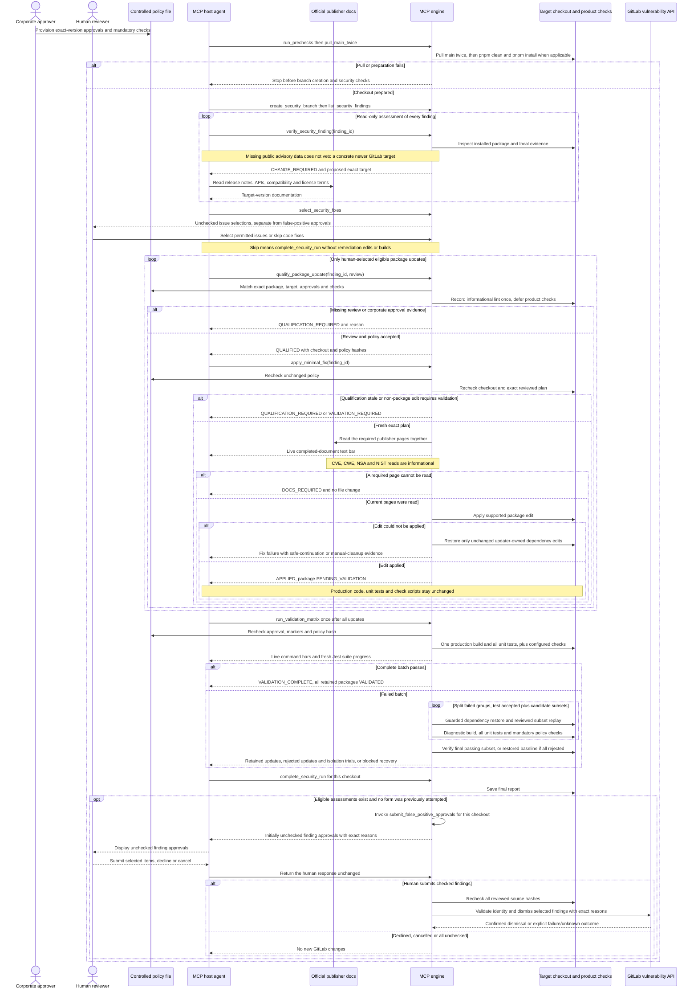

# GitLab Security MCP

An MCP server for evidence-based security remediation in a local GitLab checkout.
It retrieves active findings, verifies installed dependencies against public
advisories, qualifies compatible package updates, applies supported minimal edits,
and produces local Markdown and JSON reports.

The MCP host starts this Python process and calls its fifteen tools over stdio.
One process can hold several application checkouts at once. Each checkout keeps
its own run, and later calls select it with `repo_root` when more than one is
active. There is no HTTP listener. "Local" describes execution and where edits
are kept, not offline operation: GitLab, advisory, and publisher-page reads,
Git pulls, and product checks can use the network. Before every edit the server
reads the current required publisher pages. It does not commit, push, open merge
requests, or publish code changes. GitLab findings remain read-only except for
the optional human-approved false-positive dismissal flow described below.

**Current release: 1.0.17.** In either VS Code/Copilot or Cursor Agent chat, use:

```text
run gitlab-security on this repo
```

This is one chat request, not a terminal command. The host AI analyzes findings
and source, applies eligible fixes, validates the batch, and calls
`complete_security_run` to list eligible false positives and write the final
report, then automatically offer native approval checkboxes. No extra
"ready to submit" message is required. Cancel to continue reviewing and
explicitly request `submit_false_positive_approvals` to reopen the form later.
Only explicitly selected findings are dismissed in GitLab.

On Windows, release 1.0.11 opens a separate local checkbox window and returns
`AWAITING_HUMAN` as soon as the window is shown. Human review has **no timeout**:
it does not wait inside Cursor's or VS Code's MCP tool request. Only clicking
**Dismiss checked items** submits checked findings; Cancel or closing the window
changes nothing. Keep the MCP server running while reviewing. Saved reports update
after the window closes; the host must not poll or repeat completion while waiting.
Server shutdown closes its own approval window without authorizing new dismissals.

Release 1.0.13 wraps the text in both approval columns, **Issue** and **Why this
is a false positive**. Rows grow to fit their contents and reflow when the window
is resized; long lists scroll vertically. The duplicate lower description pane
has been removed. Source explanations still cite the reviewed file/line. Full
audit comments remain in the saved reports and are retained for GitLab submission.

Release 1.0.14 preserves typed numeric GitLab CWE identifiers, so `601` tagged as
`cwe` becomes `CWE-601` and its actual record page is checked. Source false positives
require successful receipts for every named CVE/CWE record URL: missing receipts,
catalog home pages and references omitted by the bounded fetch limit cannot pass.
Concurrent approval requests reserve one native window per checkout before startup;
cancelled startup is recorded explicitly, and stale startup responses cannot replace
a newer run's receipt. Rejected startup windows are closed and reaped.

Release 1.0.17 removes unused helper inputs, throwaway validation objects,
unsupported pre-3.11 TOML fallbacks and obsolete sampling test scaffolding.
All fifteen MCP tool schemas and workflow instructions are unchanged. Cleanup
validation completed with **880 passed, 3 skipped**, with native Windows tests
enabled and strict lifecycle warnings; lint and formatting passed.

Release 1.0.16 supports code-fix selection on modern MCP hosts without a
server-request back-channel. MCP 2026-07-28 and newer use `input_required` and
the client's form/retry flow; older hosts retain `elicitation/create`. All
checkboxes remain unchecked, and no AI approval arguments are added. Retried
answers must match the original live question and candidate snapshot; changed
findings, a replaced question or a fresh run cannot inherit old approval.

Read-only source assessments now share a bounded 128-entry documentation-receipt
cache within the current live run. Concurrent assessments do not refetch the
same successful pages, and cache hits do not create HTTP worker tasks. Reused
receipts are marked `reused`; no response bodies or finding verdicts are cached.
Failed required pages and named CVE/CWE records remain retryable. Unavailable
informational catalog pages are retained honestly instead of being requested
for every finding. A new run cannot reuse an old run's receipts, and actual
pre-edit publisher/rule reads still bypass this cache entirely.

An offline replay of 157 archived Java finding-reference sets required
**24 transfers for 24 URLs**. The supplied run had 2,762 documentation transfers,
including repeat assessments, and 159 informational NSA HTTP 403 responses;
the replay required one NSA attempt. This measures duplicate-request removal,
not total AI reasoning time or a promised wall-clock speedup. No application
verdicts were reassessed by that replay.

The legacy `generate_local_report` MCP tool also routes through
the same saved-report and human-approval flow. Neither finishing tool silently
leaves eligible dismissals without a form attempt. Cancellation is still respected.
The running server version is recorded in `get_run_status`, run snapshots and reports.

Start with [installation](#installing-the-local-mcp-server), choose your
[host configuration](#mcp-configuration), then follow the
[VS Code/Copilot run guide](#running-within-vs-code-and-github-copilot) or
[Cursor run guide](#running-within-cursor). Existing users should follow
[the upgrade guide](#updating-the-mcp-server-in-vs-code-and-cursor).

## Contents

- [Changes delivered on November 13, 2026](#changes-delivered-on-november-13-2026)
- [Architecture](#architecture)
- [Workflow](#workflow)
- [Safety boundaries](#safety-boundaries)
- [Reducing AI context overhead](#reducing-ai-context-overhead)
- [Requirements and qualification](#requirements-and-qualification)
- [Building the local MCP server](#building-the-local-mcp-server)
- [Installing the local MCP server](#installing-the-local-mcp-server)
- [MCP configuration](#mcp-configuration)
- [Updating the MCP server in VS Code and Cursor](#updating-the-mcp-server-in-vs-code-and-cursor)
- [Running within VS Code and GitHub Copilot](#running-within-vs-code-and-github-copilot)
- [Running within Cursor](#running-within-cursor)
- [Reading output in VS Code and Cursor](#reading-output-in-vs-code-and-cursor)
- [Run gitlab-security on this repo](#run-gitlab-security-on-this-repo)
- [Running remediation](#running-remediation)
- [Supported fixes](#supported-fixes)
- [Validation](#validation)
- [Development and tests](#development-and-tests)
- [Troubleshooting](#troubleshooting)

## Changes delivered on November 13, 2026

This summary covers changes through 1.0.17. Earlier wheels do not contain
all of these changes; updating source files does not update an installed wheel.

| Area | Current behavior |
| --- | --- |
| One-request completion | `select_security_fixes` obtains separate human consent before remediation edits. `complete_security_run` saves the report, automatically invokes the false-positive checkbox form once, and refreshes the report with actual outcomes. It reuses current assessments without another scan. There are fifteen tools. |
| Source-backed AI assessments | The calling host AI reviews Java, .NET/C#, TypeScript/Node.js, Python, JavaScript, Dockerfiles and nginx configurations against the current Oracle Java, Microsoft C#/.NET, TypeScript, JavaScript, Node.js, Python, Dockerfile and nginx pages. TypeScript reviews also apply the utility-type limits (Partial, Pick, Omit, and the rest are compile-time only). A conclusion is accepted only after those pages and any cited CVE and CWE pages are read. Missing source, a scanner flag, or an advisory miss never proves a false positive. |
| Deprecated sampling removed | Source review always uses the calling host AI and its code tools, not deprecated MCP sampling or a separate model/API key. `HOST_REVIEW_REQUIRED` means the AI must continue the workflow, not ask the user to analyze code. |
| Human-only GitLab dismissal | Completion automatically offers initially unchecked approvals for eligible assessments. Cancel to keep reviewing, then explicitly request `submit_false_positive_approvals` to reopen. Only selected findings are dismissed as `FALSE_POSITIVE`, using the exact displayed reason. Identity, project, source freshness and mutation results are checked; unknown outcomes are not automatically retried. |
| Honest reports | Finding Assessments distinguish local assessment from confirmed GitLab dismissal. Reports retain per-finding pipeline provenance, unapplied fix candidates, pending approvals, unfinished source reviews, exact unresolved reasons, consulted sites and validation/isolation outcomes. |
| Automatic repository selection | The server uses Git's resolved origin to discover `namespace/project`; numeric project IDs are optional. The trusted GitLab API URL and credentials remain independently configured. |
| Same-day branch reuse | Today's exact clean security branch can start fresh, including after a prior failed run. Cleanup removes recognized generated untracked/ignored artifacts and empty directories, not tracked files, policies, configuration or unrelated work. Unsafe filesystem state still blocks cleanup. |
| Resolved-on-main branch findings | Other tracked branches are checked for GitLab-confirmed main resolution at this run's pulled main commit. Eligible entries require human checkbox approval and fresh remote main/ref/resolution checks; an absent finding alone is not proof. |
| VPN and dependency preparation | Corporate DNS is checked before work, each pull and pnpm preparation. The server runs `pnpm clean` then `pnpm install` once per pnpm root; reused branches are prepared after their checkout. |
| Progress visibility | Separate critical/high/medium/low/info positions, such as `Processing 5 of 21 criticals`, appear in console/notification/transcript channels. Owned Windows log consoles close after completion/failure and reopen for later work; unrelated prompts remain untouched. |
| Advisory robustness | Plural GitLab fix-version lists retain all explicit alternatives. Missing NVD version bounds require review, not a no-fix verdict. Ordered OSV/GitHub fallback, shared NVD pacing and bounded retries respect `Retry-After`; identical advisory requests share a bounded cache. GitLab Maven `group/artifact` names match local `group:artifact` coordinates. |
| Dependency edits | The minimal qualified plan may refresh only the lockfile, bump the owning `package.json`, or add a pnpm override in `pnpm-workspace.yaml` when present. Compatibility/license checks and final production build/all-unit-test validation still apply. |
| Bounded fan-out | Up to eight independent finding verifications overlap within a checkout; the same finding remains serialized and snapshots commit under the engine lock. Independent documentation/advisory batches use at most eight workers, bounded submissions, isolated request contexts and input-ordered results. Checkout edits, validation/rollback and dismissals wait for active verifications. |
| Resource cleanup | Pools join workers; responses and owned clients close; cancellation/startup failures clean up owned command trees, pipes, logs and Windows job handles. Hung progress delivery has a one-second completion drain limit; late callbacks cannot reuse a finished request. |
| Distribution and upgrades | Share the wheel and Windows installer helper. The helper detects a locked launcher before pip changes the environment; it never kills IDEs or servers. Source and installed-package deployments have different update steps below. |
| Python quality | Python 3.11 remains the minimum. Ruff formatting/lint, docstrings, AAA tests and warning-strict lifecycle regressions enforce the repository's standards; no newer-only syntax is required. |

The 1.0.16 full-suite validation completed with **890 passed, 3 skipped**, with
native Windows tests enabled and deprecation, resource, unraisable-exception and
background-thread warnings treated as errors. New regressions exercise actual
modern MCP input rounds, selected-only consent, invalid/cancelled/stale answers,
concurrent bounded receipt reuse, failed-required-page retries, run isolation
and fresh pre-edit reads. Ruff lint, formatting and repository standards passed.

The 1.0.14 full-suite validation completed with **861 passed, 3 skipped**, including
the two opt-in native Windows tests (`SECURITY_MCP_DESKTOP_TESTS=1`). Those tests
measured multiline text and row heights in both columns, verified reflow after
narrowing the window, vertical scrolling, removal of the lower pane, initially
unchecked boxes, selected-only submissions and cancellation. The no-timeout
workflow and full audit comments remain covered by the regression suite.
Additional cases cover typed numeric CWE identifiers, missing/wrong/bounded-away
record receipts, simultaneous approval snapshots, cancellation before and after
the window is shown, and stale-run cleanup. Real concurrent stdio probes using
Cursor and VS Code client identities each created one native window and recorded
cancellation without GitLab changes. The full suite passed with resource,
deprecation, unraisable-exception and background-thread warnings treated as errors;
the stdio test harness also closes its pipes and reaps its child on timeout.
These are regression
results, not live-host UI certification, a benchmark, or proof that arbitrary workloads cannot
leak resources. Rebuild and reinstall the wheel to deploy source fixes.

## Reducing AI context overhead

Release 1.0.15 shortens duplicate tool descriptions while keeping the complete
server workflow instructions unchanged. All fifteen tool names, input/output
schemas and approval annotations remain unchanged. The MCP response middleware
also compacts canonical SDK JSON text without removing fields, truncating
evidence or changing string contents. Custom Markdown, exact number spellings
that cannot round-trip, error flags and structured results are preserved.
It handles both typed and serialized SDK result envelopes, so compaction and
the bounded progress fallback work on actual stdio calls, not only direct tests.
Live progress remains available.

Measured before/after using the same JSON serialization:

| Context | Before (characters) | After (characters) | Reduction |
| --- | ---: | ---: | ---: |
| Advertised tool catalog, including schemas | 15,323 | 10,529 | 31.3% |
| Workflow instructions plus tool catalog | 35,437 | 30,643 | 13.5% |
| Synthetic 20-finding JSON text response | 5,931 | 3,879 | 34.6% |

These are character counts, **not billed token measurements**. Actual token and
cost savings depend on the host, model, caching and workload. Required source
reads, publisher/security documentation, human selection, compatibility checks,
validation and complete final report tables have not been shortened or skipped.

Official guidance reviewed for this change:

- [GitHub Copilot MCP guidance](https://docs.github.com/en/copilot/concepts/customizations/mcp)
  recommends enabling only needed toolsets.
- [Microsoft's VS Code token-efficiency guidance](https://code.visualstudio.com/blogs/2026/06/17/improving-token-efficiency-in-github-copilot)
  explains deferred tool discovery and prompt-prefix caching. These are
  host/model capabilities, not settings this stdio server can force.
- [VS Code tool management](https://code.visualstudio.com/docs/agents/run/tools)
  explains tool selection for each harness. Limit unrelated tools through the
  appropriate tool picker/customization UI; keep this workflow's required tools
  and source-analysis tools enabled. Some selections persist across sessions.
- [Cursor MCP documentation](https://cursor.com/docs/mcp) explains disabling
  unused servers in **Customize**. Keep this server running during the scan and
  while a human approval window is open.
- [Microsoft Learn MCP best practices](https://learn.microsoft.com/en-us/training/support/mcp-best-practices)
  describes response budgets. Its `maxTokenBudget` query parameter applies to
  Learn MCP search, **not** to this server or its required full-page reads.

Do not repeatedly poll `AWAITING_HUMAN`, repeat completed phases or reverify
findings merely to open approvals. Use the existing completion flow once.
No IDE settings are changed automatically, and no model API or tokenizer
dependency is added.

Release 1.0.15 validation: **308 related server and consent tests passed**,
including sixteen new context-budget/compaction cases and both native Windows
approval tests. Resource, deprecation, unraisable-exception and background-thread
warnings were treated as errors. Ruff lint/format and whitespace checks passed.

## Architecture

These fenced Mermaid diagrams render directly on GitHub. In an editor, use a
Markdown preview with Mermaid support. Arrows represent calls or data flow, not
separate deployed services or background queues.

### System context

The MCP host orchestrates the tools and performs the exact-version API and
license review. The server separately reads the required publisher pages before
every edit. Corporate policies are optional; when configured or present, their
approvals and checks remain mandatory. Neither the server nor the host AI grants
corporate approval. Repository scripts execute locally and must be trusted.

```mermaid
flowchart TB
  reviewer["Human reviewer"] --> host["MCP host and AI agent"]
  host <-->|"MCP requests and results over stdio"| server["Local Python MCP process"]
  host -->|"Read exact-version package docs and compatibility guides"| publisher["Official publisher documentation"]
  host -->|"Read complete source and trace callers, inputs and controls"| checkout["One or more application checkouts"]
  host -->|"Submit per-finding review with full-byte hashes"| server
  server -->|"Unchecked approval form through host elicitation"| reviewer
  reviewer -->|"Explicit checkbox selections only"| approval["Human-approved false-positive dismissal"]
  approval -->|"Fixed GitLab mutation and exact assessment reason"| gitlab

  subgraph remoteServices["Remote services: reads and explicit approved dismissals"]
    gitlab["GitLab vulnerability report and approved dismissals"]
    osv["OSV identifiers, requested together"]
    github["GitHub Advisory identifiers, requested together"]
    nvd["NVD fallback with shared pacing and bounded retries"]
    publisherPages["Required publisher and directive documentation"]
    securityPages["Informational CVE, CWE, NSA and NIST references"]
  end

  server -->|"Tracked main and active findings, pages in cursor order"| gitlab
  server -->|"Try OSV, then GitHub, then NVD"| osv
  server -->|"Same source order; earliest GitHub id still wins"| github
  server -->|"Only when OSV and GitHub have no record"| nvd
  server -->|"Before every edit: bounded batches, at most 8 workers each"| publisherPages
  server -->|"Record consulted sites even when records are missing"| securityPages
  server -->|"Live text bars via MCP progress notifications"| host
  server -->|"Inspect and apply supported local edits"| checkout
  server -->|"Allowlisted checks; server API tokens removed from the child environment"| commands["Local subprocesses"]
  commands --> checkout
  commands -->|"Resolved origin selects project path; trusted API stays configured"| origin["Git origin"]
  commands -->|"Two fast-forward pulls and guarded same-day branch reuse"| checkout
  commands -->|"Post-pull pnpm clean/install, then final batch build and all tests"| product["Installed toolchains and package managers"]
  server -->|"Read exact-version approvals and check definitions"| policy["Corporate-controlled JSON policy"]
  approver["Corporate approvers"] -->|"Provision independently"| policy
  server -->|"After approval outcome: final reports, snapshots and audit"| artifacts["Target checkout: .security-mcp"]
  artifacts --> reviewer
  checkout -->|"Review diff and publish manually"| reviewer
```



Advisory fallback is not a three-source consensus vote. Identifiers inside one
source are requested together, in the finding's identifier order, with at most
eight requests in flight. The next source starts only after the earlier source
has no usable record. A record can still produce manual review when package
identity, affected versions, or a safe target cannot be established. One failed
or oversized advisory body does not discard the other identifiers from that
source. Responses larger than 2 MB are rejected while they are read.

The host still supplies the exact-version package, API, and license review used
by qualification. Separately, the server reads the required publisher pages
before it writes any package, image, or configuration edit. A failed or
incomplete required publisher read returns `DOCS_REQUIRED` and does not change
the file. Missing or failed security-reference reads are informational, not
permission to claim a finding is safe and not a veto on a concrete GitLab fix. Page
bodies are hashed in full and then discarded. The recorded SHA-256 covers every
response byte. Phrase checks use the first 1 MB. Up to four CVE records, their
NVD detail pages, and four CWE definitions are added when the finding names them.

### Internal components

All components below live in the same Python process. A registry keeps one
`Engine` per checkout. The registry lock covers only that map. Each engine
serializes mutations while allowing independent finding evidence reads to overlap,
so two checkouts can also proceed together. Independent
documentation and advisory reads share a short-lived pool of at most eight
workers. GitLab report pages stay in cursor order. Each command runner still
runs one allowlisted command at a time.

```mermaid
flowchart TB
  launcher["Root server.py: source launcher"] --> tools["Package server.py: fifteen MCP tools and error boundary"]
  tools --> progress["Request-scoped progress middleware"]
  progress --> hostDisplay["Severity positions, Windows console, notifications and bounded transcript"]
  progress --> progressCleanup["Bounded drain; cancel and await sender; reject late callbacks"]
  tools --> registry["Checkout registry: one engine per resolved path"]
  registry --> engine["engine.py: phase gates and finding decisions"]

  subgraph evidenceLayer["Evidence collection"]
    gitlabClient["gitlab_client.py: GraphQL filtering and cursor pagination"]
    advisoryClient["advisory.py: ordered sources, parallel identifiers, 256-record cache"]
    officialDocs["official_docs.py: required publishers and optional security references"]
    fanout["fanout.py: bounded submissions, at most 8 workers, copied request context"]
    manifests["manifests.py: discovery, parsing and local package evidence"]
    versions["versions.py: affected ranges and version comparison"]
    configFindings["config_findings.py: cited nginx and GitLab CI lines"]
    sourceFindings["source_findings.py: source workflows, hash-bound review and stale-evidence checks"]
    sourceEvidence["ai_source_review.py: bounded complete cited source for host AI"]
  end

  engine --> gitlabClient
  engine --> advisoryClient
  engine --> officialDocs
  advisoryClient --> fanout
  officialDocs --> fanout
  engine --> manifests
  advisoryClient --> versions
  engine --> versions
  engine --> configFindings
  engine --> sourceFindings
  tools --> sourceEvidence
  sourceEvidence --> hostReview["Calling host AI traces source; no MCP sampling"]
  hostReview -->|"Submit source_review for each finding"| tools
  engine --> artifactsReview["security_artifacts.py: inspect logs before guarded cleanup"]
  engine --> qualification["qualification.py: review, approvals, snapshots and check evidence"]
  engine --> remediation["remediate.py: scored plans and supported edits"]
  remediation --> configFindings
  remediation --> manifests
  engine --> aaa["aaa.py: supported base-image regression tests"]
  engine --> validation["validate.py: lint-only capture before edits, full checks after the complete batch"]
  validation --> manifests
  engine --> gitOps["git_ops.py: main, branch and diff operations"]

  gitOps --> runner["commands.py: allowlist, live readers, full logs, timeouts and audit"]
  qualification --> runner
  remediation --> runner
  validation --> runner
  runner --> processes["Owned command trees, stdout/stderr readers and full logs"]
  processes --> processCleanup["Timeout, cancellation or exit: reap descendants and close handles"]
  runner -->|"Fresh Jest suite discovery and completed test counts"| progress
  officialDocs -->|"Completed document request counts"| progress

  engine --> state["state.py: active RunState and inspection snapshot"]
  engine --> report["report.py: security table, validation and batch isolation evidence"]
  tools --> completion["complete_security_run: candidate list and report"]
  tools --> submit["submit_false_positive_approvals: human checkbox form"]
  completion --> dismissal["Engine checks identity, source freshness and selected dismissal intent"]
  dismissal --> report
  state --> atomic["util.py: repository boundaries and atomic file publication"]
  report --> atomic
  manifests --> atomic
  aaa --> atomic
```



The snapshot is not a resume database. A restarted process creates a new
`RunState`; it never reloads the saved snapshot. There is no cross-process lock,
job scheduler, general-purpose rollback, or multi-file transaction. Failed fix
candidates have guarded restoration of unchanged updater-owned files; later user
edits are preserved rather than overwritten.
Raw dependency rollback text stays in memory. Inspection snapshots instead expose
`dependency_backup_manifest` with UTF-8 byte counts and SHA-256 hashes, or `null`
for a previously absent file. They cannot restore files after a restart.

## Workflow

This is the recommended host-agent flow, not an autonomous loop inside the
server. Stop on a failed run gate or validation requirement. Findings without a
safe fix are recorded and may be followed by other eligible findings.

```mermaid
flowchart TD
  startRun["Host starts or selects one checkout run"] --> prechecks["run_prechecks repo_root: clean main or today's security branch; no Git operation in progress"]
  prechecks --> dns["Resolve corporate DNS and review prior logs for branch reuse"]
  dns --> precheckGate{"Prechecks passed?"}
  precheckGate -->|"No"| stopRun["Stop that checkout and report the failure"]
  precheckGate -->|"Yes"| pulls["pull_main_twice: git pull --ff-only twice"]
  pulls --> pullGate{"Both pulls passed and tree remains clean?"}
  pullGate -->|"No"| stopRun
  pullGate -->|"Yes"| pnpmGate{"New branch run with pnpm roots?"}
  pnpmGate -->|"Yes"| clean["pnpm clean at each pnpm project or workspace root"]
  clean --> cleanGate{"Clean succeeded?"}
  cleanGate -->|"No: PREPARATION_FAILED"| stopRun
  cleanGate -->|"Yes"| install["pnpm install in the same directory"]
  install --> installGate{"Every preparation command succeeded?"}
  installGate -->|"No: PREPARATION_FAILED"| stopRun
  installGate -->|"Yes"| branch["create_security_branch: create or safely reuse today's exact dated branch"]
  pnpmGate -->|"No: skip or defer preparation"| branch
  branch --> reusePrep["For reuse: review logs, guarded cleanup, then pnpm clean/install on reused branch"]
  reusePrep --> branchGate{"Branch and applicable preparation passed?"}
  branchGate -->|"No"| stopRun
  branchGate -->|"Yes"| listing["list_security_findings: active main and explicitly resolved non-main findings"]
  listing --> retrievalGate{"Retrieval succeeded without truncation?"}
  retrievalGate -->|"No"| stopRun
  retrievalGate -->|"Yes"| moreFindings{"Unprocessed findings remain?"}
  moreFindings -->|"No"| fixSelection["select_security_fixes: human receives unchecked issue selections"]
  fixSelection --> approvedFixes{"Human selected any issues?"}
  approvedFixes -->|"No: skip code, continue independent false positives"| reports
  approvedFixes -->|"Yes: selected issues only"| editKind
  moreFindings -->|"Yes"| verify["verify_security_finding: source workflow or local package/advisory evidence"]
  verify --> decisionGate{"Decision?"}
  decisionGate -->|"SOURCE_REVIEW_REQUIRED"| sourceReview["Host AI reads complete source and relevant callers/configuration"]
  sourceReview --> sourceGate{"Sufficient evidence available?"}
  sourceGate -->|"Yes: submit hash-bound source_review"| verify
  sourceGate -->|"No: explicit blocker"| unresolved
  decisionGate -->|"CONFIRMED_VULNERABILITY without a supported plan"| sourceDefect["Retain confirmed source issue for later human fix selection"]
  sourceDefect --> unresolved
  decisionGate -->|"FALSE_POSITIVE"| retained["Retain evidence and continue"]
  decisionGate -->|"MANUAL_REVIEW or NO_SAFE_FIX"| unresolved["Retain unresolved reason and continue"]
  decisionGate -->|"REPRODUCTION_REQUIRED"| reproduction["Host-led approved local fuzzing reproduction, not a package fix"]
  reproduction --> unresolved
  retained --> moreFindings
  unresolved --> moreFindings
  decisionGate -->|"CHANGE_REQUIRED"| queued["Retain verified plan for human selection, no edits yet"]
  queued --> moreFindings
  editKind{"What kind of selected edit?"}
  editKind -->|"Confirmed source defect"| sourceFix["Host applies annotation-first surgical fix only with sufficient evidence and reproduction"]
  sourceFix --> nextFix
  editKind -->|"Package update"| qualify["Review package docs and policy, then qualify_package_update"]
  qualify --> qualifiedGate{"Exact-target review and required policy accepted?"}
  qualifiedGate -->|"No: incomplete target review or required policy"| nextFix
  qualifiedGate -->|"Yes"| readDocs["Server reads required publisher pages together"]
  editKind -->|"Image tag or cited nginx or GitLab CI line"| readDocs
  readDocs --> docsGate{"Every required page read?"}
  docsGate -->|"No: DOCS_REQUIRED"| nextFix
  docsGate -->|"Yes"| apply["apply_minimal_fix: local edit only"]
  apply --> appliedGate{"APPLIED?"}
  appliedGate -->|"No"| blockedEdit{"Safe restoration permits continuation?"}
  blockedEdit -->|"Yes: retain failure reason"| nextFix
  blockedEdit -->|"No: manual cleanup required"| reports
  appliedGate -->|"Yes"| regression["Keep package callers unchanged, generate_aaa_test only for supported images"]
  regression --> nextFix{"More selected fixes? Retain exact reasons for rejected edits."}
  nextFix -->|"Yes"| editKind
  nextFix -->|"No"| postChecks["run_validation_matrix: one final production build, all unit tests and policy checks"]
  postChecks --> validationGate{"VALIDATION_COMPLETE?"}
  validationGate -->|"Yes"| reports["complete_security_run: reuse current assessments"]
  validationGate -->|"No"| rollbackGate["Engine isolates failed groups and verifies retained subset or baseline"]
  rollbackGate -->|"Retain green subset or report blocked recovery"| reports
  reports --> eligible{"Eligible false positives and host form support?"}
  eligible -->|"Yes"| form["Human receives initially unchecked checkbox form"]
  form --> selected{"Human submitted checked selections?"}
  selected -->|"Yes"| dismiss["Validate identity and fresh source; dismiss only selected findings with exact reasons"]
  selected -->|"No: decline, cancel or unchecked"| finalReport["Generate final report with actual approval and validation outcomes"]
  eligible -->|"No: include the blocker or no-candidate status"| finalReport
  dismiss --> finalReport
  finalReport --> reviewDiff["Human reviews reports and git diff; commit and push manually"]
```



### Tool reference

Every tool accepts optional `repo_root`. Pass the same absolute checkout on
every call when more than one repository is active. Omit it only while a single
checkout is active.

| Tool | Responsibility and gate |
| --- | --- |
| `run_prechecks(repo_root=None)` | Require clean `main` or today's exact security branch; reject Git operations in progress. Prior runtime errors block same-day reuse without overwriting the previous snapshot. |
| `pull_main_twice(repo_root=None)` | Perform two fast-forward-only pulls on `main`. For a new branch, run pnpm clean/install afterward; for a reused branch, defer preparation until its checkout. |
| `create_security_branch(repo_root=None)` | Create or reuse today's exact `security-fixes-Month-dd-YYYY` branch, review logs, safely clean generated untracked outputs, and prepare pnpm on a reused branch. |
| `list_security_findings(project_id=None, repo_root=None)` | Require the branch; retrieve and normalize filtered findings. Do not relist after decisions or edits. |
| `verify_security_finding(finding_id, repo_root=None, source_review=None)` | Record package evidence or return the cited path, full-file hash, line, and short window for host-AI review. Submit the host's hash-bound source/input-flow assessment through `source_review`; no deprecated sampling is used. Config proposals also record publisher-page evidence. |
| `select_security_fixes(repo_root=None)` | Open unchecked human issue-selection boxes after read-only assessment. No AI selection arguments. MCP qualification, edit, test-generation and validation tools enforce the selected findings. Skip/decline/cancel/unavailable means no remediation edits; continue to independent false-positive review. |
| `qualify_package_update(finding_id, review, repo_root=None)` | Require human issue selection, exact-target API/license review and informational lint capture. Enforce corporate approval evidence now; defer product commands until final validation. |
| `apply_minimal_fix(finding_id, repo_root=None)` | For human-selected issues only, read the required publisher pages, then apply the supported plan. Package edits also require fresh qualification and validation of prior package edits. `DOCS_REQUIRED` writes nothing. |
| `generate_aaa_test(finding_id, repo_root=None)` | For human-selected issues only, generate supported base-image tests when a suitable oracle and framework exist; not generic package API tests. |
| `run_validation_matrix(repo_root=None)` | Validate the human-authorized batch once; skip remediation checks when code fixes were declined. Only on failure, isolate grouped subsets, revert incompatible updates and prove the retained checkout green. Unchanged successful validation is reused. |
| `review_false_positives(repo_root=None)` | List eligible assessments for verification. Returns immediately and dismisses nothing. |
| `submit_false_positive_approvals(repo_root=None)` | Open human approval checkboxes, automatically invoked by completion or explicitly requested to reopen. Only selected findings are dismissed; no AI approval argument is accepted. |
| `complete_security_run(repo_root=None)` | Save reports, automatically offer human approval checkboxes once, then refresh reports with actual outcomes. Does not rescan or rerun verification. |
| `generate_local_report(repo_root=None)` | Legacy finishing name: save Markdown/JSON reports, offer the same human-only false-positive approvals as `complete_security_run`, and refresh actual outcomes. It is not a report-only bypass. |
| `get_run_status(repo_root=None)` | Return phase, counts and package-validation status; retract stale green package evidence. |

### Human selection and surgical fixes

After read-only verification, call `select_security_fixes` before qualification
or any remediation edits. Only the human may select issues; all checkboxes start
unchecked. The selection binds to the current in-memory run and finding identities;
stale form responses do not authorize a new run or different findings. Selection
does not prove a safe fix, waive reproduction or compatibility requirements, or
approve GitLab dismissals. A dependency edit can incidentally resolve other
findings on that same dependency, but permits no separate edits for unchecked issues.

For a selected source issue, first consider documented framework annotations
that actually enforce security or validation. Use one only if it fixes the root
cause. Never substitute scanner suppressions, ignore attributes, comments or
compile-time types for a security control. Otherwise use the smallest proven
change: no major rewrites, unrelated refactors, invented issues or speculative
fixes. Dependency-only updates retain the existing no-caller-adaptation rules.

The host must also obey selection for its own editor/source/test operations;
the MCP server cannot intercept edits made by external tools. Its own remediation
entry points are gated atomically. Selection cannot be replaced after MCP edits
have been recorded; finish validating that batch before a fresh clean run.
Inspection snapshots are never reloaded as authorization.

Keep provider assessment and completion calls in the same live MCP server.
Do not construct a separate Python `Engine`, hydrate saved `RunState` JSON, or
overwrite the snapshot from a host-side batch. Those processes cannot synchronize
the server's in-memory assessments or deliver its human form. A saved report alone
is not an approval request. Use the finishing MCP tool in the active connection.

If the human selects nothing, declines/cancels, or the host lacks form support,
skip remediation edits and remediation builds/tests and call `complete_security_run`.
This still offers separate approval for independently evidenced false positives.
Skipped findings stay unresolved, not false positives. Do not automatically
reopen a declined/cancelled selection. Reports and status expose `fix_selection`
and `NOT_RUN_NO_APPROVED_FIXES` rather than claiming validation passed.

### Reusing today's security branch

Only the exact branch name matching the server's current local date is reused.
An existing local branch is checked out without force; an origin-only branch is
fetched and checked out with its upstream. A clean checkout is required. Starting
on today's branch temporarily checks out `main` for the two fast-forward pulls;
the existing branch's commits are not reset, merged, rebased or overwritten.
Dependency preparation then runs on the reused branch's manifests.

On a clean reused branch, prior `.log`/`.jsonl` files and run state are inspected
before cleanup. Prior runtime failures do not block a fresh run: diagnostics
are returned in `previous_run_errors`/`previous_run_error_count`, and cleanup
emits a warning before removing disposable generated artifacts. This does not
certify the previous run as successful or resume its approvals.
Unreadable files, links/reparse points, or artifacts changing during inspection
still block cleanup. Modified or staged tracked metadata makes the tree dirty.

Branch creation removes only generated **untracked/ignored** audit/HTTP
logs, command stdout/stderr logs, run state, lint outputs and generated remediation
reports. Git-tracked/staged files, policies, configuration, unknown files, and
unrelated untracked work are never deleted. Cleanup unlinks individual files,
then removes empty generated directories and the metadata root only if empty.
It never runs `git clean` or recursively deletes a directory. Preserved policies
or tracked files therefore keep the folder present.

The new run starts fresh: a successful clean precheck resets prior in-memory
assessments and form outcomes, including in a persistent MCP process. It retrieves
and re-verifies findings instead of loading old approvals. New logs/state are
written as the run continues.

### GitLab report filters

The remediation report matches Status = Needs triage or Confirmed, Tracked ref
= `main`, Activity = Still detected. The client resolves the exact tracked
branch ID, requests `DETECTED` and `CONFIRMED`, and sets `hasResolution: false`.
If tracked
`main` cannot be resolved, it fails rather than fetching unfiltered findings.
Pagination and per-finding pipeline provenance are retained. Inspect `truncated`
before treating a retrieval as complete; do not claim omitted findings were
verified or resolved.

The client also retrieves `hasResolution: true` findings on other tracked
**branches**, not tags, for already-resolved-on-main review. Mere absence from
main is not a false-positive verdict. GitLab must explicitly report
`resolvedOnDefaultBranch: true`, its actual default branch must be `main`,
and its main commit must match the commit pulled by this run. Conflicting
active main finding UUIDs or incomplete evidence remain manual review.
Branch-scoped vulnerability IDs prevent equal finding UUIDs on different refs
from sharing an assessment or approval.

Eligible descriptions include the original branch/ref, finding, location,
identifiers, verified main SHA and scope limitation: an older branch may
still be vulnerable even though main is fixed. These entries use the same
initially unchecked human approval form. Immediately before a selected
dismissal, GitLab identity, branch, resolution flag, default branch and main
SHA are rechecked. Changed evidence blocks the mutation.
See GitLab's [resolution-filter definition](https://gitlab.com/gitlab-org/gitlab/-/blob/master/ee/app/graphql/resolvers/vulnerabilities_resolver.rb)
and [vulnerability fields](https://gitlab.com/gitlab-org/gitlab/-/blob/master/ee/app/graphql/types/vulnerability_type.rb).

### Fix eligibility

A finding is auto-fixed only when all of these are true:

- Local evidence shows the vulnerable package or image is present.
- An online advisory publishes a fixed version newer than what is installed, or GitLab explicitly recommends a newer fix for the matching local dependency. Missing data, missing records and failed public lookups do not veto GitLab's recommendation. Positive evidence that the proposed target remains affected is distinct from missing data.
- The edit is a lockfile refresh, a manifest version bump, a package override, an unpinned `FROM` tag bump, or one cited nginx or GitLab CI line that the current publisher page still documents.
- Major package updates are candidates, not automatic skips. They require documented API/caller compatibility without source/test changes and passing post-update checks. Major image-tag changes still require manual review.
- Every package update requires no production/unit-test API adaptations and passing post-update builds and executed unit tests, plus configured corporate checks. Pre-change lint capture is informational only: errors, missing scripts or incomplete capture never block security fixes. Same-major does not prove compatibility.

An advisory that names the identifier but not the package found in the repo does not by itself block a GitLab-recommended dependency update. The finding's package and installed version must match locally, and available target advisory evidence is recorded before the normal qualification workflow. Failed lookups of either the installed or target version are informational when GitLab provides a concrete newer fix. Build and all unit tests still determine product acceptance; failures reject and restore the attempted fix. Without a concrete target, the server does not guess a version. Missing external data is not evidence of a false positive.

CVE, CWE, NSA and NIST security-reference pages are best-effort information,
not an authorization gate for version or supported code/configuration fixes.
Unavailable records, 404/503 responses and missing fix descriptions are recorded
without blocking edits. Publisher directive pages and configured policy checks
remain separate requirements. Validation evidence lists the actual consulted
site URLs; it does not claim CVE, CWE, NSA or another provider was queried merely
because its identifier was present.

Unknown reachability is not treated as a false positive. Secret detection and DAST findings are reported for you to handle. They are not rewritten. SAST findings are not patched by guessing at source changes.

A cited nginx or GitLab CI line can change only after a source-bound AI review confirms the finding, the current line still matches the plan, and the live publisher page still contains the documented phrase. Supported line edits are `server_tokens on` to `off`, `autoindex on` to `off`, removal of `TLSv1` and `TLSv1.1` from `ssl_protocols` when `TLSv1.2` or `TLSv1.3` remains, and these GitLab CI variables when set to `true`, `1`, or `yes`: `SAST_DISABLED`, `DEPENDENCY_SCANNING_DISABLED`, `CONTAINER_SCANNING_DISABLED`, `SECRET_DETECTION_DISABLED`, and `DAST_DISABLED`. The replacement is `"false"`. `CODE_QUALITY_DISABLED` is left unchanged. Comments and unmatched lines stay on manual review. Missing configuration files and paths outside the checkout remain unresolved; neither establishes a false positive.

Container-scanning Dockerfile findings stay on the image-tag path. Other Dockerfile lines, including `USER root`, are not rewritten unless a later rule names one documented one-line edit. The current Docker reference does not authorize an automatic `ADD` to `COPY` change.

## Safety boundaries

The command runner allows specific argument forms, not arbitrary shell commands.
Direct `git add`, `commit`, `push`, `merge`, `rebase`, `reset`, and unrelated
branch checkouts are rejected. Allowed Git mutations are the fast-forward pulls
and creation of the dated security branch. GitLab calls retrieve data only,
except `submit_false_positive_approvals`. That tool requires explicit human
checkbox approval before dismissing selected vulnerabilities with their
recorded reasons. `review_false_positives` only lists candidates.
`complete_security_run` saves reports and invokes the same human-only submit
gate automatically; its tool metadata therefore declares possible remote writes.

### Approving false positives in Finding Assessments

After verification and validation, the host calls
`complete_security_run(repo_root=...)`. This finishing tool lists eligible
false positives, saves the report, and automatically invokes
`submit_false_positive_approvals` once. It does not wait for another readiness
message. Review the initially unchecked findings and their exact reasons in
the native form. The report already exists if you need more time: cancel,
continue reviewing, then explicitly request `submit_false_positive_approvals`
to reopen it. Hosts may time out unanswered forms; neither cancellation nor a
timeout authorizes a remote write. After the response the report is refreshed
with actual outcomes. Decline/cancel or an unsupported/failed host form writes
nothing remotely. Do not separately call the review or report tool in the
standard workflow, and do not reopen a declined form automatically.
Standalone review/report tools remain available for explicit follow-up requests.
Reports expose
`false_positive_approval` separately from source `review_status`: `COMPLETE`
means the source-review queue is empty, not that GitLab findings were dismissed.
Unverified SAST findings remain in that queue even if no excerpt was collected;
they cannot silently produce a completed review status.
Pending approval is highlighted before the assessment table with the count of
local false positives lacking a confirmed dismissal.
On Windows with the standard Windows PowerShell runtime and an interactive desktop,
`submit_false_positive_approvals` opens a local Windows checkbox window, independent
of the host's elicitation UI. It returns `AWAITING_HUMAN` after the window is shown,
without waiting for a human response. There is **no selection deadline**. Reports
refresh asynchronously after submission or cancellation. Do not poll, restart the
server, or repeatedly request completion while reviewing. A late response cannot
authorize a new run or different finding snapshots.

The window has two columns: **Issue** (including its unchecked approval box) and
**Why this is a false positive**. GitLab already names the file and line. The
host opens that code, reads it, and writes `source_review.reason` for a
non-developer: at most 2 sentences and 400 characters, saying what the warning
claims and why that code does not do it. The column shows that reason without
a path or line number. Generic assurances, invented controls and missing
advisories are not supporting evidence.
An overlong explanation remains `SOURCE_REVIEW_REQUIRED` until reassessed; it
is never silently truncated. Detailed analysis belongs in `finding_analysis`,
`reachability_analysis`, `input_origin` and the reviewed-file assessments.
Previously accepted reviews are rechecked against current full-file hashes before
offering or accepting approval. These checks audit the host's assessment, not an
independent proof of semantic correctness.

Both columns wrap their complete text, and each row grows to fit the taller cell.
Resizing the window reflows both columns; long lists scroll vertically. There is
no duplicate lower description pane. Only checking an issue and submitting grants
approval. The full audit comment, including evidence and documentation references,
remains in the saved reports and is the unchanged GitLab submission text.
Advisory-only findings use their existing assessed
reason; resolved-on-main descriptions explicitly preserve their branch scope
and never claim the older branch is safe.

Window startup is reserved atomically per checkout. A simultaneous request returns
`REQUESTED` while the first window is starting, or `AWAITING_HUMAN` after it opens,
rather than launching a duplicate. Cancellation before background ownership starts
records `APPROVAL_INTERRUPTED`; a response from an old run cannot recreate approval
state or refresh a newer run's report.

On other platforms, hosts supporting **MCP form elicitation** display an in-chat
form; those requests remain subject to the host's own deadlines. Both presentations
display one initially unchecked boolean/checkbox per eligible assessment, including finding ID,
location and exact reason. Select the findings you approve and submit the form.
Submission immediately dismisses only selected findings in GitLab with
`dismissalReason: FALSE_POSITIVE` and the displayed reason as `comment`, using
[`vulnerabilityDismiss`](https://docs.gitlab.com/api/graphql/reference/mutations/#vulnerabilitydismiss).
The host controls the in-chat form appearance. Only the human should answer it;
the AI must never synthesize approvals. A source false positive is stored as an
audit description: the cited file and line, the code analysis, input origin,
reachability, each reviewed file, the publisher pages read for that file, and
every CVE or CWE record GitLab named with whether that page was available.
When GitLab names no CVE or CWE, the description says no issue-specific record
page was available. A short label is not accepted.

Declining, cancelling, or leaving all boxes unchecked makes no remote changes.
Both explicit `elicitation.form: {}` and legacy `elicitation: {}` advertise
form support under the
[MCP compatibility rule](https://modelcontextprotocol.io/specification/2025-11-25/client/elicitation#capabilities).
URL-only elicitation is not form support.
Outside the Windows dialog path, hosts without advertised form support return `APPROVAL_UNAVAILABLE`; use a
form-capable host or the GitLab UI. Static Markdown report checkboxes cannot
execute API calls. The tool accepts no AI-supplied approval list.
`false_positive_approval_form` in the run snapshot and reports records the
advertised elicitation capability, candidate IDs, presentation, request/outcome status and
any reported form error. `REQUESTED` without a later outcome does not prove a
response or dismissal. `AWAITING_HUMAN` means the Windows window is open, not that
a dismissal occurred. Interrupted in-chat forms record `APPROVAL_INTERRUPTED`
instead of remaining `REQUESTED`. These diagnostics are never reusable authorization.
Completion does not automatically retry a previously attempted form in the
same run, including failed, cancelled or unchecked submissions.

If all findings were previously confirmed dismissed, the tool returns
`ALREADY_DISMISSED` instead of opening another form. Otherwise an empty approval
list returns `ASSESSMENT_REQUIRED`, with each excluded finding's blocker and next
action (missing assessment, invalid reason, or missing GitLab vulnerability ID).
These responses make no new GitLab changes; they do not recheck remote status.

For source/configuration SAST and IaC, reading the cited excerpt is only evidence collection, not a verdict.
`SOURCE_REVIEW_REQUIRED` returns a `source_review_queue`, grouped by file, through
the approval tool, run status, and reports. The host AI must read the source and
relevant callers/configuration, assess each finding separately, and call
`verify_security_finding` with `source_review` before asking for dismissal approval.
Reports explicitly mark unfinished source review rather than implying all findings
were fully assessed.

`verify_security_finding` uses `ai_source_review.status=HOST_REVIEW_REQUIRED`:
the calling Copilot/Cursor AI receives the cited path, full-file SHA-256, line,
and a short window. It reads the file in the checkout.
The deprecated MCP sampling API is never called, even if a host advertises it.
No separate AI account, API key, provider endpoint, or autonomous GitLab dismissal
is added. Host permission and model selection remain controlled by VS Code/Cursor.
The calling AI reads the cited file in the checkout and must finish the
code/input-flow analysis with its own code tools, then submit `source_review`
in the same workflow. This is unfinished AI work, not a request for the user
to analyze code. The server still hashes the whole file, up to 256,000 bytes,
and returns that hash with the cited line; the host reads callers with its own
code tools.
The server rechecks full-byte hashes and requires a separate assessment for every
finding before recording conclusions. These are audited host attestations, not
proof that the host actually read the files. Denied access, missing/oversized files,
invalid reviews, or changed source stay unresolved with an explicit reason.
The Python server does not contain an independent language model, and AI
assessments are not formal proofs.

The same evidence-bound review supports Java, .NET/C#, TypeScript/Node.js,
JavaScript, Python, Dockerfiles (including named variants), and nginx
configurations (including recognized include files). The connected AI examines
actual local files, not just scanner descriptions. For nginx it must consider
includes, inheritance and the active server/location; for Dockerfiles, build
stages, the final image and runtime controls. Matching a directive does not
bypass AI review. A confirmed configuration defect may retain a supported
documented one-line fix; all reviewed hashes are rechecked before editing.
Its pre-fix review is archived with the applied change, not treated as a verdict
about the modified file. Container image/package advisories retain their
existing dependency-verification path; secrets, DAST and findings lacking
sufficient evidence stay unresolved rather than receiving invented verdicts.

Source reviews accept `FALSE_POSITIVE`, `CONFIRMED_VULNERABILITY`, or `MANUAL_REVIEW`,
with `reason`, `input_origin`, rule-specific `finding_analysis`, `reachability_analysis`,
and `reviewed_files` containing `path`, full-byte `sha256`, and `assessment`.
Legacy `pattern_analysis` remains supported for regex reviews. Only evidenced
`FALSE_POSITIVE` outcomes can enter the checkbox form; confirmed defects and
uncertainty stay unresolved. Changed reviewed files invalidate all source-review
outcomes. An endpoint listing, scanner flag, missing advisory, or Unicode operation
alone never establishes a false positive.

`GITLAB_TOKEN` must have `api` scope and belong to a user permitted to change
vulnerability status; read-only tokens cannot dismiss findings. Never place
tokens in reports or form fields. Retrieval and assessment never dismiss
findings on their own. Restart/reconnect the MCP server after installing this
update, and list/verify findings in that process: old snapshots are not reloaded.

Before writing, the server rechecks source-review hashes, rejects assessments
changed while the form was open, and checks the remote vulnerability global ID,
finding UUID, project and active state. It records each pending attempt before
the request and each result afterward in the run snapshot. Requests are not
retried automatically. Partial failures are returned per finding, and a lost
response may leave the remote outcome unknown: inspect GitLab before retrying.
Confirmed dismissals are excluded from later approval forms in the same run.
Regenerate the report after approval to include `gitlab_dismissals` and the
confirmed/failed outcomes. Source changes can retract a local assessment but
do not automatically reopen a previously dismissed GitLab vulnerability.

The allowlist is **not an operating-system sandbox**. Product scripts, package
installation hooks, and repository wrappers can execute their own code and use
the network. Review and trust the target repository before running checks. The
hosting AI's editor is also outside the server's command allowlist; its changes
must follow the declared source-edit policy.

Commands have timeouts, capped output, and audit records with output hashes rather
than raw stdout/stderr. Tool results can still contain bounded diagnostic output.
Product checks and dependency audits also retain complete stdout/stderr under
`.security-mcp/command-logs/`, including failed registry audit responses.
Keep credentials out of source control and avoid secrets in command arguments,
product logs, or reports. GitLab queries and advisory requests send the relevant
project or vulnerability/package identifiers to their configured services.

Snapshots, reports, and the audit log live under `.security-mcp/` in the target
repository. The server does not stage them, and its clean-tree check excludes
that directory. They are local inspection artifacts, not approval credentials
or proof that GitLab considers a finding resolved.

### Robustness

NVD requests share a process-wide rate limiter across checkouts: at least 6.1
seconds between anonymous requests, or 0.61 seconds for requests using
`NVD_API_KEY`, reflecting [NVD's published API limits](https://nvd.nist.gov/developers/start-here).
Transient timeouts, connection failures and HTTP 429/500/502/503/504 responses
receive at most three total attempts with backoff and `Retry-After` support
(seconds or HTTP date). A server cooldown longer than 60 seconds is reported
explicitly and blocks further NVD requests until it can be honored; it is not
silently ignored. Pacing is visible in progress output. Successful records and
ordinary 404 misses are cached; failed reads are not cached as valid evidence.
Persistent outages remain unresolved unless an independently verified GitLab
target can proceed through the normal qualification/validation gates.
An NVD identifier record without usable package/version bounds is incomplete
evidence, not proof that no fix exists or that the installed version is safe.
It requires manual review. A no-fix assessment requires confirmed affected-version
evidence; explicit GitLab fix candidates still use the normal target checks.
GitLab solution lists such as `Upgrade to versions 7.30.2, 8.12.4 or above.`
retain every explicit fixed version. The smallest version newer than the local
dependency is checked as a candidate; plural wording does not discard the fix,
and unrelated version numbers elsewhere in the prose are not treated as fixes.

GitLab Maven package names in either `group:artifact` or `group/artifact`
format are matched to canonical Maven/Gradle coordinates, including version
catalogs. Artifact names from a different group are not treated as a match.
Packages that are genuinely absent or only transitively referenced still need
dependency-tree evidence; coordinate normalization does not invent a local match.
For unresolved Gradle coordinates, verification invokes the allowlisted wrapper
or `gradle --no-daemon dependencies` for the scanner-cited component. Concurrent
findings share one parsed report while the checkout and tool remain unchanged,
with a bounded eight-component cache. Project/configuration selections stay
separate: a Checkstyle dependency can differ from the application classpath.
When several versions are resolved, the scanner version must actually appear
in a resolved configuration; it is not guessed. State and reports retain all
configuration versions. An unaffected result for one version cannot dismiss
unassessed versions on other classpaths.
Selected versions, not requested versions or BOM constraint-only rows, provide
local evidence. Failed inspections, conflicts within one configuration,
unresolved selections, missing complete logs, or source-changing inspections cannot prove absence or
authorize a fix. Complete stdout/stderr logs and per-finding inspection outcomes
are retained in state and reports; full-log parsing is bounded to 8 MiB.
Gradle deprecation notices are included once in final report caveats even when
multiple findings share the same command. They do not imply failed dependency
resolution or passed product validation.
Failures are shared across different findings, but re-verifying the same
unresolved finding retries inspection instead of permanently caching the error.
Public advisory checks still run when Java/NuGet local resolution is incomplete.
Unresolved packages remain manual review even if an online lookup says unaffected.
Resolved Gradle transitives with available fixes require a reviewed parent/BOM
update or constraint; the server does not blindly add force rules.

An advisory that explicitly says upgrading alone does not fix affected code is
manual review, even when it names a fixed release. A version-only plan cannot
establish remediation for such an issue.

Independent finding verifications within a checkout may overlap, up to eight
at a time. They assess detached finding copies and commit decisions/snapshots
under the engine lock. Repeat verification of the same finding waits its turn.
Other tools, checkout edits, reports, and shutdown wait for active verifications;
they never consume a half-committed assessment. Two checkouts in
the same process do not share the engine lock. Shutdown copies the registry, then
closes every owned client after its in-flight read finishes, and later calls
are rejected. Tool results are detached snapshots rather than live state.
Advisory reads keep consulted sites request-local, share in-flight/cache results
for identical GETs and package/version POST queries, and retain the bounded
256-entry cache. Cache hits do not invent new HTTP timing records. NVD pacing
and source priority are unchanged.

Reports retain pipeline IDs, SHAs, and refs per finding instead of showing an
unknown global pipeline when GitLab returned individual provenance. Verified
but unapplied fix candidates remain in the unresolved-issues table.
The final summary and JSON `validation_caveats` explicitly disclose non-green
pre-change lint and optional checks, including unavailable dependency audits and
missing optional runtimes. Required product validation can pass without claiming
a clean security audit. An unavailable corporate registry audit is not retried
against a public registry.

Independent documentation pages and advisory identifiers are fetched together,
at most eight at a time per batch, and returned in request order. Submission is
bounded too: large inputs do not create an unbounded queue of futures. Workers
inherit an isolated copy of the active request context, including its progress
callback. Pending work is cancelled on failure and running workers are joined
before the call returns. A single request stays
on the caller thread. One page or identifier failure is recorded without
dropping the other results from that batch. GitLab pagination stays sequential
because each page needs the previous cursor. OSV, GitHub, and NVD stay in that
order. Required Git pulls, edits, validation/rollback, and human-approved GitLab
mutations stay serialized; parallelizing those steps could corrupt evidence or
the checkout. Host AI instructions permit bounded fan-out of independent
read-only evidence work and reuse of complete-file reads, never verdicts.
MCP notification draining is limited to one second after tool completion.
Unresponsive hosts cannot indefinitely hold a completed tool open; sender tasks
are cancelled and awaited, and the bounded transcript remains in the result.
Late progress from a cancelled worker is ignored after request cleanup.
The command runner still runs one child at a time. Its stdout and stderr
readers publish through a lock so their records cannot interleave. Readers are
daemon threads so a reader that ignores its stop signal cannot keep the process
alive after the join timeout. On Windows, children start suspended and enter an
owned kill-on-close job before running. Descendants are terminated even after a
successful parent exit, rather than surviving to retain pipes or file locks.
Cancellation and partial reader startup also terminate and reap the owned
process tree and release its pipes, logs and job handle. Containment failures
are explicit errors, not an uncontained fallback.
Child processes do not receive `GITLAB_TOKEN`,
`GITLAB_PERSONAL_ACCESS_TOKEN`, `GITHUB_TOKEN`, `GH_TOKEN`, or `NVD_API_KEY`.
Other environment variables, including a private-registry token the build
needs, are copied. Logged and returned text also redacts those secrets after
percent-encoding.

Advisory responses larger than 2 MB are refused. The cache holds at most 256
records and is cleared on shutdown. GitLab error text keeps the first 500
characters and discards the rest of the body. Documentation hashes cover the
full page. Phrase checks use only the retained 1 MB prefix.

Malformed advisory responses fail that identifier's lookup. Malformed local
evidence requires manual review instead of being treated as package absence.
Validation read or execution failures produce `VALIDATION_FAILED`.

State, manifests, and individual report files are replaced atomically. Generated
tests are published without replacing existing files. Command readers stop
even when descendants retain inherited pipes. This does not guarantee cleanup
of detached descendant processes, coordinate multiple MCP processes editing
the same checkout, or make the Markdown/JSON report pair a single transaction.

## Requirements and qualification

### Prerequisites

- Python 3.11 or newer and Git on Windows, macOS, or Linux.
- Runtime floors: `mcp[cli]>=2.3.0,<3`, `httpx>=0.28.1`, `packaging>=26.3`,
  `pydantic>=2.14.3,<3`, and `ruamel.yaml>=0.19.1,<0.20`. Development floors are
  `anyio>=4.16.0,<5`, `pytest>=9.2.0` and `ruff>=0.17.5,<1`.
  Isolated wheel builds use `setuptools>=84.2.1` through the declared PEP 517
  backend. Pydantic and AnyIO are explicit dependencies because production and
  test code import them directly, respectively.
- A GitLab token with `read_api` and access to the project's vulnerability report.
  Optional false-positive dismissal requires `api` write scope and a GitLab role
  permitted to dismiss the finding; a read-only token does not enable writes.
- A local checkout with tracked `main` and an origin matching the configured
  trusted GitLab API host. The server discovers the project path from Git;
  an explicit project path or numeric ID is an optional override, not a prerequisite.
- The package managers and toolchains required by the target application.
- Meaningful lint/build/unit-test checks and documented license review; independently
  approved corporate policy only when required/configured for your organization.

Point `REPO_ROOT` at the application Git checkout, not this MCP project.
Validation supports split Node/.NET repositories: Node checks run at the
top-level package manifests (using each component's package manager), and .NET
checks run at solution directories or standalone project directories. A root
Node workspace manifest owns its nested packages; define workspace-wide checks
there. Arbitrary mixed monorepos are not automatically orchestrated.
Package lookup reads nested npm, pnpm, and Yarn lockfiles and retains each
component's manifest, manager, and scanner-reported installed version. Node
remediation and qualification checks use the owning component's directory.
For pnpm components with `pnpm-workspace.yaml`, transitive override plans edit
that workspace configuration while preserving comments and unrelated pins;
otherwise they use the component's `package.json`. Discovery does not waive
advisory verification, major-version review, or package qualification.
Node, .NET, Java, NGINX, and Docker
are needed only for the validation paths that apply to that checkout. Platform
support does not mean every toolchain or Python runtime has been certified.

### Package Update Qualification

Every Node, NuGet, Maven, and Gradle package update has four mandatory qualifiers:

1. The AI fully reads the target version's official documentation, release notes,
   API/migration guides, runtime/peer requirements, and license terms. It inspects
   the actual product's frameworks and callers, not only the GitLab suggestion.
2. The update must preserve product build, startup/runtime behavior, and the
   existing unit suite. Review Angular/Node/TypeScript/RxJS/Crystal compatibility,
   Quarkus platform/BOM and extension alignment, Java requirements, and .NET
   target frameworks as applicable. Never force peer resolution or change the
   product framework/runtime/BOM to disguise an incompatible package update.
3. Without a configured/existing policy, provide `review.license` with the
  exact-target license expression, official HTTPS sources, commercial-use and
  no-license-fee assessments, and distribution obligations. This is documented
  terms review, not corporate approval. Unknown/unlicensed terms block editing.
  When a corporate policy is configured or present, independent exact-version
  approval and all its checks remain required; the AI must not invent approvals.
4. Before the first edit, lint runs and all emitted errors, warnings,
  informational and unknown diagnostics, stdout and stderr are saved in
  `.security-mcp/lint-issues.json`. Observed rule names, occurrence counts and
  severities are exported to `.security-mcp/lint-rules.json`, independently of
  the project's lint configuration. Errors, missing lint scripts, timeouts,
  truncated output or lint execution failures never block editing. Completeness
  is recorded honestly; an incomplete capture cannot list unseen rule IDs.
  Apply all reviewed version updates first, then run one final production build
  and all unit tests. Lint-only capture does not install or audit
  dependencies first. Node components must define `build` and `test` scripts.
  Missing, failed, timed-out, skipped or explicitly empty test runs are
  not passing evidence. Initial lint evidence is retained rather than rerun on
  qualification retries or after updates. No sleeps, cooldowns or polling delays
  are required. Corporate approvals remain mandatory; configured commands run
  in the final matrix, sharing exact build/test results rather than rerunning them.
  Corporate-policy mode additionally requires positive, untruncated runtime
  smoke and full resolved-dependency license checks with configured markers.

When separately qualified findings propose the exact same package plan, the server
can associate them with an already-applied edit only while every backed-up
dependency path still matches its applied hash. The change records `reused_from`;
it does not rewrite files or repeat the lockfile command. Only this no-write path
can reuse successful common publisher evidence; each finding's CVE/CWE and
rule-specific pages are still read freshly. Actual edits always require fresh
publisher reads. Each association still requires its own qualification and final
validation, and retains guarded rollback evidence.

An incompatible or uncertain target is skipped for review. All major, minor,
revision and build updates require `compatible_without_code_changes: true`
and `source_fixes: []`: neither production nor unit-test callers may need API
changes. No production/test edits, new regression tests, or weakened check
scripts are allowed to support any package version update. This rule applies
even to a one-line adaptation or a nominally backward-compatible release.

A major number alone is not evidence that a caller breaks. For major package
candidates, verification returns a bounded lexical `caller_scan` with a
fingerprint and source-reference locations. The host must read old/target
official APIs and migration guides, inspect those sources and installed
dependency consumers, and distinguish concrete incompatible calls from missing
evidence. No direct imports does not prove transitive compatibility. Static
scans, documentation attestations, builds, and tests cannot establish 100%
compatibility for every execution path.

Automatic major updates permit no source/test adaptations. `source_fixes` must
be empty, reviewed caller files must have current SHA256 evidence, and all
identified source references must be assessed. Transitive npm updates also
require installed `node_modules` consumer source evidence. The server rejects
stale scans and source/test changes, and records the reviewed evidence. A failed
or skipped required build/unit check never becomes a validated fix. Lint is
informational even when missing, failed, timed out or truncated. Configured
corporate checks still apply. Failed attempted updates are rejected and the
plugin restores its own dependency-file edits only when their hashes still
match the applied edit. Later user edits are preserved with a manual-cleanup
message. Previously accepted updates are not automatically undone.

#### Package update sequence

This diagram shows the optional corporate-policy mode and server-enforced checks.
Inspect every failure and rollback result; later edits require manual cleanup.



#### Corporate policy setup

Corporate-policy mode is optional. Set `PACKAGE_UPDATE_POLICY` to a controlled
JSON file's absolute path, or provision `.security-mcp/package-update-policy.json`
under `REPO_ROOT`. An explicit path or an existing default file is enforced;
missing/invalid explicit policy fails closed. When neither exists, qualification
uses documented license review and lint/build/unit checks without creating a policy.
Keep approvals access-controlled, preferably outside the AI-writable checkout.
The AI/server must never create or modify actual approvals. The server reads and
hashes this file; it cannot authenticate a corporate signer or grant legal rights.

The following is a deliberately **unapproved template**, not permission to use
a package. Corporate approvers must supply real version-specific evidence and
approve both Boolean fields before any update is permitted:

```json
{
  "schema_version": 1,
  "approvals": [{
    "ecosystem": "npm",
    "package": "PACKAGE_NAME",
    "target": "TARGET_VERSION",
    "license_expression": "REVIEWED_LICENSE_EXPRESSION",
    "approved_by": "CORPORATE_APPROVER",
    "approval_reference": "CORPORATE_APPROVAL_RECORD",
    "obligations": "REQUIRED_DISTRIBUTION_CONDITIONS",
    "commercial_distribution_approved": false,
    "no_license_fees": false,
    "license_sources": ["https://publisher.example/license"]
  }],
  "checks": {
    "npm": {
      "build": {"argv": ["npm", "run", "build"], "success_marker": "PRODUCT_BUILD_PASSED"},
      "unit_tests": {"argv": ["npm", "test"], "success_marker": "PRODUCT_UNIT_TESTS_PASSED"},
      "runtime": {"argv": ["npm", "run", "security:smoke"], "success_marker": "PRODUCT_RUNTIME_SMOKE_PASSED"},
      "license_audit": {"argv": ["npm", "run", "security:licenses"], "success_marker": "APPROVED_RESOLVED_LICENSES_PASSED"}
    }
  }
}
```

Use ecosystem keys exactly `npm`, `NuGet`, or `Maven` (Gradle also uses `Maven`).
Every entry must contain exactly the four check kinds above, using the detected
manager. Configure real repository-owned scripts/profiles/tests before starting
on clean main; they are not supplied automatically by this MCP server. Markers
must be emitted only after meaningful tests and complete license-policy checks,
never by a placeholder `echo`, an empty test run, or a generic build-success line.
In corporate-policy mode, missing tools, checks, markers, or approvals block edits.

| Manager | Build | Unit Tests | Runtime Smoke | Resolved-Graph License Audit |
| --- | --- | --- | --- | --- |
| npm/pnpm/yarn | `MANAGER run build` | `MANAGER test` | `MANAGER run security:smoke` | `MANAGER run security:licenses` |
| NuGet/.NET | `dotnet build --configuration Release --nologo` | `dotnet test --configuration Release --nologo` | Same test prefix plus category filter `SecurityRuntimeSmoke` | Same test prefix plus category filter `LicenseCompliance` |
| Maven/mvnw | `TOOL --batch-mode clean verify` | `TOOL --batch-mode test` | `TOOL --batch-mode -Psecurity-smoke verify` | `TOOL --batch-mode -Psecurity-licenses verify` |
| Gradle/gradlew | `TOOL --no-daemon build` | `TOOL --no-daemon test` | `TOOL --no-daemon securitySmoke` | `TOOL --no-daemon securityLicenses` |

For .NET, use the filter matching the actual framework: `--filter Category=NAME`
for xUnit/VSTest, `--filter TestCategory=NAME` for MSTest/NUnit,
`--filter-trait Category=NAME` for native MTP/xUnit v3, or
`--treenode-filter /*/*/*/*[Category=NAME]` for native MTP/TUnit. Native MTP
qualification filters target SDK 10+ without the SDK 8/9 `--` separator; other
unsupported platform/command combinations require manual validation. Java
wrappers are resolved inside the checkout using the current OS's wrapper form.

#### Documentation review input

Call `qualify_package_update(finding_id, review)` only after completing the
actual review. This illustrative input is not evidence for a real package:

```json
{
  "ecosystem": "npm",
  "package": "PACKAGE_NAME",
  "target": "TARGET_VERSION",
  "documentation": {
    "complete": true,
    "sources": ["https://publisher.example/version-specific-docs"],
    "summary": "Actual findings from the complete official documentation review"
  },
  "license": {
    "expression": "ACTUAL_TARGET_LICENSE_EXPRESSION",
    "sources": ["https://publisher.example/target-license"],
    "commercial_use_permitted": true,
    "no_license_fees": true,
    "obligations": "Actual distribution obligations from the reviewed terms",
    "assessment": "Actual target-version license review, not corporate approval"
  },
  "compatible": true,
  "compatible_without_code_changes": true,
  "api_changes": "Actual API changes and the smallest required caller adaptations",
  "frameworks": [{
    "name": "ACTUAL_PRODUCT_FRAMEWORK_OR_RUNTIME",
    "version": "INSTALLED_VERSION",
    "source_url": "https://publisher.example/compatibility",
    "assessment": "Evidence that the target supports this installed version"
  }],
  "source_fixes": []
}
```

Include every relevant framework/runtime/BOM and publisher source. Keep
`source_fixes: []` for every version increment. Confirm that both production
and unit-test APIs need no adaptations. If either requires changes, reject the
package update with the concrete API incompatibility instead of editing code.
Guessed SAST rewrites remain unsupported.

For `proposed_fix.major_upgrade=true`, also include the following review object.
Use the scan ID returned by verification and actual SHA256 hashes of the files
read. These example values are placeholders, not compatibility evidence:

```json
{
  "major_upgrade": {
    "scan_id": "FROM_PROPOSED_FIX_CALLER_SCAN",
    "compatible_without_code_changes": true,
    "caller_breakages_found": false,
    "migration_sources": ["https://publisher.example/migration-to-target"],
    "api_comparison": "Reviewed changes from installed to target; APIs actually used remain supported",
    "caller_assessment": "Actual arguments, options, callbacks and return-value usage reviewed",
    "dependency_assessment": "Actual transitive consumers and their runtime requirements reviewed",
    "reviewed_files": [{
      "path": "frontend/src/actual-caller.ts",
      "sha256": "ACTUAL_FILE_SHA256",
      "assessment": "Concrete API compatibility findings for this caller"
    }]
  }
}
```

For transitive packages, include the relevant installed dependency source files
as well as repository references, not only an application file. Supply this
object alongside the normal exact-target documentation/framework review and
`source_fixes: []`. Evidence is checked again after lint/policy review and
before applying the plan; reverify if the checkout/callers change.

`QUALIFICATION_REQUIRED` blocks an edit. `QUALIFIED` authorizes only the exact
reviewed plan on the unchanged pruned source checkout and unchanged policy.
Requalify before application if either changes. `APPLIED` means local edits only;
the package qualifier remains `PENDING_VALIDATION` until all post-checks pass.
Reports keep pending/failed updates unresolved, retain documentation/approval
references, and retract green results after later source or policy changes.
Failed post-update checks reject attempted updates and safely restore owned
dependency edits. Inspect preserved files/manual-cleanup notices. Partial
application failures still require local inspection.

These gates enforce reviewed evidence and repository-owned checks, not a proof
of every possible runtime behavior. The server does read the required publisher
pages before an edit, and that read is separate from the host's exact-version
package review. Their assurance depends on test coverage, truthful review,
correct configured license auditing and authentic corporate approvals when used. Snapshot
checks prune dependency/build/cache directories and stop at the file/size cap;
they are not cross-process locks or verification of all generated binaries.

Qualification policy reads are capped at 1 MiB and caller evidence reads at
512 KiB. Dependency rollback originals and checkout hashes are bounded by
100 MiB. Package qualification permits no production/test source migrations.
Each status refresh hashes the checkout once for all validated packages.
The advisory cache retains at most 256 records and releases them on shutdown.
Unreadable directories fail evidence collection rather than proving absence.

Official references: [Angular compatibility](https://angular.dev/reference/versions),
[Quarkus platform/BOM alignment](https://quarkus.io/guides/platform),
[npm package requirements and licenses](https://docs.npmjs.com/cli/v11/configuring-npm/package-json),
and [NuGet license metadata](https://learn.microsoft.com/en-us/nuget/reference/nuspec#license).
Read the specific updated package's documentation too; these general references
do not establish compatibility or commercial approval for an individual update.

### Repository Compatibility

| Repository | Automatic dependency fixes | Validation |
| --- | --- | --- |
| Node.js | npm, pnpm, Yarn Classic and modern Yarn; direct version bumps, supported lock refreshes, overrides/resolutions | Install, advisory audit, declared lint/build/test scripts |
| .NET 10 | NuGet project references and existing central `Directory.Packages.props` versions | SDK compatibility check, restore, Release build/test; `.sln`, `.slnx`, C#, F#, and VB project detection |
| Java 17 | Maven direct versions/properties and Gradle coordinates/supported version-catalog entries | Java 17 check, Maven verify/dependency tree or Gradle dependencies/test/build; wrappers preferred |

These are safe dependency-remediation paths, not a promise to fix every security
finding. A matching advisory or locally verified GitLab recommendation, a compatible
fix, and a supported local edit are required. Unresolved Java/NuGet transitive dependencies require review;
SAST, DAST, secrets, unsupported dependency formats, and breaking upgrades are
not patched by guessing.

Required tools must be on the server process's PATH. A missing required tool produces
`VALIDATION_INCOMPLETE`; an incompatible Java runtime or an SDK too old for
`net10.0` produces `VALIDATION_FAILED`. Install/configure the required tools and
rerun validation. A .NET SDK 10 or newer is needed for `net10.0`; Java validation
requires a Java 17 toolchain, not merely any installed Java version.

### Fuzzing Findings

API and coverage fuzzing findings describe observed application behavior, not
package advisories. `verify_security_finding` returns `REPRODUCTION_REQUIRED`
and a `fuzzing_workflow` instead of looking for a CVE or skipping the finding.
Reports retain these findings as unresolved and include their workflow.

The findings GraphQL query reads `latestSecurityReportFinding.evidence`,
including the full request body and URL, response body/status, and supporting
request/response exchanges. It also selects text, code, Markdown, and diff
details to retain scanner-provided payload information. Normalized findings
keep these as `scannerEvidence` and `scannerDetails`, separate from assessment
notes. Verification exposes them in `fuzzing_workflow.scanner_evidence` and
`scanner_details`; JSON reports and local snapshots retain them too.

Authentication/cookie headers are redacted, but bodies and URLs are preserved
for analysis and may contain sensitive application data. Treat tool output,
snapshots and JSON reports accordingly; do not commit or publish them. An
empty body is preserved. Missing latest findings or absent scanner bodies
remain missing evidence, never automatic proof of a false positive. GraphQL
errors fail retrieval instead of silently discarding evidence.

The host must obtain the scanner artifact, mutated input, request/response or
crash evidence, and expected contract. It then inspects the local handler or
fuzz target and reproduces the same failure using synthetic data in an
explicitly approved local environment. Never replay payloads against the
reported remote hostname. An API route is not a local source-file path.

After reproduction and review, the host may apply a scoped application-code
fix and regression test separately from dependency updates. It must retain
before/after reproduction evidence, valid and boundary cases, and passing
lint, production build and executed unit tests. Missing artifacts or an
unavailable environment block this workflow. Scanner text is not a patch.

The server does not apply arbitrary source patches or validate fuzzing-specific
fix receipts. `apply_minimal_fix` returns `REPRODUCTION_REQUIRED` for fuzzing;
server reports remain unresolved. Host-applied fixes require separate reviewed
evidence and do not change GitLab state automatically.

## Building the local MCP server

Python source execution needs no compilation or wheel. Use the source
installation below for local development and restart-only hotfixes. Build a
wheel when you want an installable local package or a deployment artifact.

From this MCP project's root, create the virtual environment if it does not
already exist, install dependencies, check the source, and build:

### Windows build

```powershell
py -3 -m venv .venv
.\.venv\Scripts\python.exe -m pip install -r requirements-dev.txt
.\.venv\Scripts\python.exe -m ruff check gitlab_security_mcp server.py tests
.\.venv\Scripts\python.exe -m ruff format --check gitlab_security_mcp server.py tests
.\.venv\Scripts\python.exe -W error::DeprecationWarning -W error::ResourceWarning -m pytest -q -W error::pytest.PytestUnraisableExceptionWarning -W error::pytest.PytestUnhandledThreadExceptionWarning
.\.venv\Scripts\python.exe -m pip wheel --no-deps --wheel-dir dist .
Get-ChildItem .\dist\*.whl
```

### macOS and Linux build

```bash
python3 -m venv .venv
.venv/bin/python -m pip install -r requirements-dev.txt
.venv/bin/python -m ruff check gitlab_security_mcp server.py tests
.venv/bin/python -m ruff format --check gitlab_security_mcp server.py tests
.venv/bin/python -W error::DeprecationWarning -W error::ResourceWarning -m pytest -q -W error::pytest.PytestUnraisableExceptionWarning -W error::pytest.PytestUnhandledThreadExceptionWarning
.venv/bin/python -m pip wheel --no-deps --wheel-dir dist .
ls dist/*.whl
```

Stop if a check fails; building the wheel does not itself run these checks.
Live GitLab tests remain opt-in. The current version produces
`dist/gitlab_security_mcp-1.0.17-py3-none-any.whl`; use the newly built filename if
the project version changes. `--no-deps` builds only this project's artifact,
not a bundle of its dependencies. Build isolation may download build tools.
Building does not install the wheel or start an MCP process.

## Installing the local MCP server

This is a Python stdio MCP server, not a VSIX extension or a Cursor-specific
plugin installer. The same installed server works with either host. Choose
**one** deployment method per connection:

| Deployment | Best for | Launcher | How updates take effect |
| --- | --- | --- | --- |
| Shared wheel and installer helper | Testers and other users; no source checkout required | Installed `gitlab-security-mcp` entry point | Install the new wheel into the configured environment, then restart the host connection. |
| Source checkout | Development and source-only hotfixes | That checkout's virtualenv Python plus the absolute root `server.py` | Update source and any changed requirements, then restart the host connection. |

For distribution, share `gitlab_security_mcp-1.0.17-py3-none-any.whl` and
[Install-GitLabSecurityMcp.ps1](Install-GitLabSecurityMcp.ps1), optionally together
in a ZIP. Extract them before installing. Do not share virtual environments,
tokens, application source, or `.security-mcp` reports/logs as part of the installer.
The wheel is not an offline dependency bundle: initial installation may need
approved access to Python package indexes.

The source commands below run from this MCP project's directory, not the
application checkout. Wheel users can skip directly to
[Installing a built wheel](#installing-a-built-wheel).

### Source installation on Windows

```powershell
py -3 -m venv .venv
.\.venv\Scripts\python.exe -m pip install -r requirements.txt
```

### Source installation on macOS and Linux

```bash
python3 -m venv .venv
.venv/bin/python -m pip install -r requirements.txt
```

Activation is optional when commands use the virtual environment's executable.
Use absolute paths in the MCP configuration so the host's working directory and
global Python installation cannot select the wrong server.

### Installing a built wheel

**Windows upgrades:** close **all instances of VS Code and Cursor**, including
Agents/background windows, before installing. Use a standalone PowerShell window.
A running `gitlab-security-mcp.exe` is locked by Windows (`WinError 32`); the
executable cannot intercept an external pip install to shut itself down.

Share [Install-GitLabSecurityMcp.ps1](Install-GitLabSecurityMcp.ps1) alongside the
wheel and run it instead of the raw pip command:

```powershell
& "$HOME\Downloads\Install-GitLabSecurityMcp.ps1" -WheelPath "$HOME\Downloads\gitlab_security_mcp-1.0.17-py3-none-any.whl"
```

The helper defaults to `$HOME\Tools\gitlab-security-mcp`, creates the environment
if needed, and checks for a locked launcher **before** pip can alter the
installation. A lock produces the explicit close-all-windows message; the helper
never kills applications or server processes. It reinstalls the package to repair
an interrupted upgrade and checks dependencies. Use `-InstallDirectory` for a
different environment, or `-WhatIf` for a preflight-only preview.
Follow your organization's execution policy for downloaded scripts.

For a first installation or upgrade on macOS/Linux, after stopping the host's
server connection, use the equivalent dedicated environment:

```bash
python3 -m venv "$HOME/Tools/gitlab-security-mcp"
"$HOME/Tools/gitlab-security-mcp/bin/python" -m pip install --upgrade --force-reinstall "$HOME/Downloads/gitlab_security_mcp-1.0.17-py3-none-any.whl"
"$HOME/Tools/gitlab-security-mcp/bin/python" -m pip show gitlab-security-mcp
"$HOME/Tools/gitlab-security-mcp/bin/python" -m pip check
```

Configure the host to launch
`$HOME/Tools/gitlab-security-mcp/bin/gitlab-security-mcp` using its actual
absolute path. Installing a wheel requires no clone of this MCP repository.

`Ignoring invalid distribution ~itlab-security-mcp` indicates temporary package
directories left by an interrupted pip operation, not a finding or MCP error.
The helper reports any remaining exact paths without deleting recovery files.
The notice about a newer pip release is informational and does not cause the lock.
Direct pip commands do not run this precheck and retain pip's own error messages.

For developers installing a wheel into this source checkout's `.venv` instead
of the helper's dedicated environment, first create the virtual environment and
install runtime dependencies using the source-installation commands above.
Then install the wheel into that same environment:

```powershell
.\.venv\Scripts\python.exe -m pip install --force-reinstall --no-deps .\dist\gitlab_security_mcp-1.0.17-py3-none-any.whl
.\.venv\Scripts\python.exe -m pip show gitlab-security-mcp
.\.venv\Scripts\python.exe -m pip check
Get-Item .\.venv\Scripts\gitlab-security-mcp.exe
```

On macOS/Linux:

```bash
.venv/bin/python -m pip install --force-reinstall --no-deps dist/gitlab_security_mcp-1.0.17-py3-none-any.whl
.venv/bin/python -m pip show gitlab-security-mcp
.venv/bin/python -m pip check
ls .venv/bin/gitlab-security-mcp
```

`--force-reinstall` replaces an existing copy even if the local version number
has not changed. `--no-deps` relies on the runtime-dependency setup above; do
not skip it. Update runtime requirements when dependencies change. The installed
entry point is `gitlab-security-mcp`, not the root source launcher.

For either IDE, an installed-package connection uses the installed entry point
with no source-script argument. For the Windows helper's default location:

```json
{
  "command": "C:\\Users\\YOUR_USER\\Tools\\gitlab-security-mcp\\Scripts\\gitlab-security-mcp.exe",
  "args": []
}
```

Replace `YOUR_USER`; JSON does not expand PowerShell's `$HOME`. This is a
fragment inside the selected host's `gitlab-security` object; retain its
environment and host-specific fields. On macOS/Linux, use the dedicated
environment's absolute `bin/gitlab-security-mcp` path. Do not pass `server.py`
to this entry point. Restart the correct IDE/harness connection after installation.
Wheel deployments require
rebuilding, reinstalling and restarting for code updates; source deployments
require only restarting for source-only updates. Use one launch method per
connection, not both.

## MCP configuration

The MCP host launches and owns the server process. Do not also run a separate
`python server.py` terminal instance for that connection. Stdout is reserved for
MCP messages; the server does not open a port.

Configuration depends on the IDE **and the selected agent harness**:

| Host | Personal configuration | Workspace configuration | Top-level server key |
| --- | --- | --- | --- |
| Current VS Code Copilot harness | `%USERPROFILE%\.copilot\mcp-config.json`, or `mcp-config.json` under `COPILOT_HOME` when set | `.mcp.json` at the application workspace root | `mcpServers` |
| VS Code editor-managed/legacy Local configuration | User-profile `mcp.json`, opened through the editor's MCP controls | `.vscode/mcp.json` | `servers`; editor-managed `inputs` are supported here |
| Cursor | `%USERPROFILE%\.cursor\mcp.json` | `.cursor/mcp.json` | `mcpServers` |

On macOS/Linux, personal locations use `~/.copilot` or `~/.cursor`. For Remote
SSH/WSL/Dev Containers, install the runtime and configure paths and credentials
where the selected harness actually runs. Do not register duplicate connections
to the same installation unintentionally.

The examples below use the Windows helper's installed entry point. For a source
deployment, replace only `command` and `args` with:

```json
{
  "command": "C:\\path\\to\\security-mcp-fixer\\.venv\\Scripts\\python.exe",
  "args": ["C:\\path\\to\\security-mcp-fixer\\server.py"]
}
```

Keep the enclosing host-specific format and environment. Supply credentials
through your approved secret-management process to the host **before it starts**;
a terminal opened afterward does not update an already-running IDE's environment.
Never paste real tokens into agent chat or commit them in configuration files.

### VS Code

#### Current Copilot harness

1. Open the application repository and select **Copilot** as the chat session
   target/harness.
2. Run **Chat: Open Customizations**, then select **MCP Servers** and **Add Server**.
   Choose **Command (stdio)**. For personal setup choose **Global > Copilot Global**.
   Alternatively, edit the personal `mcp-config.json` or workspace-root `.mcp.json`.
3. Use the configuration below, replacing the executable and application paths.
   `${GITLAB_TOKEN}` is a native Copilot environment reference, not a VS Code input
   prompt. Provide that variable securely to the host first.

```json
{
  "mcpServers": {
    "gitlab-security": {
      "type": "stdio",
      "command": "C:\\Users\\YOUR_USER\\Tools\\gitlab-security-mcp\\Scripts\\gitlab-security-mcp.exe",
      "args": [],
      "tools": ["*"],
      "env": {
        "GITLAB_TOKEN": "${GITLAB_TOKEN}",
        "GITLAB_API_URL": "https://gitlab.com/api/v4",
        "REPO_ROOT": "C:\\path\\to\\application-repo"
      }
    }
  }
}
```

4. Review the trust request and enable the tools. In that session's MCP controls,
   start `gitlab-security`; inspect its output if startup fails.
5. Continue with [Running within VS Code and GitHub Copilot](#running-within-vs-code-and-github-copilot).

Native Copilot configuration does not accept editor-only `inputs` or
`${input:gitlabToken}` secret prompts. Workspace-root configuration forms may
restrict variable entry; use **Other Properties** to edit the JSON reference
when necessary. Organization policies and available actions can vary by version.

#### Editor-managed or legacy VS Code configuration

Existing `.vscode/mcp.json` setups use the editor-managed `servers` format.
Use this example only for that configuration path, not native Copilot files.
The password input keeps the token out of the JSON; enter it in the editor's
prompt, not agent chat. Forwarding to a Copilot harness has compatibility
restrictions, especially for prompted inputs: do not assume it works unchanged.

```json
{
  "servers": {
    "gitlab-security": {
      "type": "stdio",
      "command": "C:\\Users\\YOUR_USER\\Tools\\gitlab-security-mcp\\Scripts\\gitlab-security-mcp.exe",
      "args": [],
      "env": {
        "GITLAB_TOKEN": "${input:gitlabToken}",
        "REPO_ROOT": "C:\\path\\to\\application-repo"
      }
    }
  },
  "inputs": [
    {
      "id": "gitlabToken",
      "type": "promptString",
      "description": "GitLab token; api scope is needed only for approved dismissals",
      "password": true
    }
  ]
}
```

Start/restart the editor-managed server using its MCP controls and enable its
tools for the agent. On macOS/Linux, use the matching absolute interpreter,
entry-point and application paths.

See the official [VS Code MCP configuration reference](https://code.visualstudio.com/docs/agents/reference/mcp-configuration)
and [server management guide](https://code.visualstudio.com/docs/agents/run/manage-mcp-servers)
for current harness-specific actions and forwarding restrictions.

### Cursor

Create or edit the project file `.cursor/mcp.json` in the repository you want to remediate, or edit your user MCP config at `%USERPROFILE%\.cursor\mcp.json` on Windows (`~/.cursor/mcp.json` on macOS or Linux).

Do not put a real token in a committed project config. The examples deliberately
omit `GITLAB_TOKEN`: supply it securely in the environment inherited by Cursor,
or use an uncommitted user configuration according to corporate policy.

#### Windows configuration

```json
{
  "mcpServers": {
    "gitlab-security": {
      "type": "stdio",
      "command": "C:\\Users\\YOUR_USER\\Tools\\gitlab-security-mcp\\Scripts\\gitlab-security-mcp.exe",
      "args": [],
      "env": {
        "GITLAB_API_URL": "https://gitlab.com/api/v4",
        "REPO_ROOT": "C:\\path\\to\\the\\repo\\to\\fix"
      }
    }
  }
}
```

#### macOS and Linux configuration

```json
{
  "mcpServers": {
    "gitlab-security": {
      "type": "stdio",
      "command": "/home/YOUR_USER/Tools/gitlab-security-mcp/bin/gitlab-security-mcp",
      "args": [],
      "env": {
        "GITLAB_API_URL": "https://gitlab.com/api/v4",
        "REPO_ROOT": "/path/to/the/repo/to/fix"
      }
    }
  }
}
```

Open Cursor's **Customize** page or its MCP settings area, locate
`gitlab-security`, and enable/reload it. Labels vary by release. The Command
Palette does not itself open MCP settings; use the relevant MCP/Customize
command if offered, or navigate through Cursor settings.
Cursor and native Copilot both use `mcpServers`, but variable syntax and
additional fields differ. The editor-managed VS Code format uses `servers`.
Do not paste the legacy VS Code `inputs` example into Cursor.

The examples inherit the token from Cursor's environment. If using an explicit
Cursor environment reference instead, use `"GITLAB_TOKEN": "${env:GITLAB_TOKEN}"`,
not Copilot's `${GITLAB_TOKEN}` syntax. See the official
[Cursor MCP documentation](https://cursor.com/docs/mcp).

Use a literal absolute `REPO_ROOT` in user-level Cursor configuration. Do not
assume `${workspaceFolder}` is expanded: a server launched outside the active
project cannot infer that project's directory. For example, study-service uses
`C:\Users\James.Prejsnar\source\repos\study-service`, not its `backend` or
`frontend` subdirectory.

Alternatively, have the agent call
`run_prechecks(repo_root="C:\\Users\\James.Prejsnar\\source\\repos\\study-service")`.
This overrides `REPO_ROOT` for that checkout, including an unresolved
placeholder. Each checkout keeps its own run, so pass the same `repo_root`
on later tool calls when more than one repository is active. Omit it only
when a single checkout is active.

Engine configuration is deferred until a tool is called, so invalid paths or
settings do not prevent MCP initialization or tool discovery. Tool errors
include the stage, repository (when available), server working directory, and
corrective action. Git precheck errors include the attempted checkout and
recovery instructions. Diagnostic logs go to stderr, never MCP stdout. If the
Python executable or dependencies prevent startup altogether, consult Cursor's
MCP server log and verify the configured interpreter and installed requirements.

### Reload code changes

Use the source launcher shown above: the virtualenv's Python with the absolute
path to `server.py`. It imports the adjacent `gitlab_security_mcp` source tree,
not an older installed copy. After changing code, restart/reload the
`gitlab-security` MCP server in your host to load the changes. No rebuild or package
reinstallation is needed for source-only changes.

This restarts the process, rather than updating an active run in place. Reload
between remediation runs: in-memory state is reset, and a new run must pass
prechecks again. Dependency changes still require installing the updated
requirements into the configured virtual environment before restarting.

### Environment variables

| Variable | Required | Purpose |
| --- | --- | --- |
| `GITLAB_TOKEN` | yes for retrieval | Personal access token with report access and `read_api`; optional approved dismissals require `api` and sufficient GitLab permissions. `GITLAB_PERSONAL_ACCESS_TOKEN` is also accepted. |
| `GITLAB_PROJECT_ID` | no | Optional fixed project override: `group/project` or a numeric ID. Leave unset to select the project from each checkout's Git origin. |
| `REPO_ROOT` | set explicitly in the host | Absolute path of the git repo to remediate. Defaults to the process working directory. |
| `GITLAB_API_URL` | no | REST base URL. Defaults to `https://gitlab.com/api/v4`. GraphQL is derived from it. |
| `GITHUB_TOKEN` or `GH_TOKEN` | no | Raises the GitHub Advisory rate limit. |
| `NVD_API_KEY` | no | Raises the NVD rate limit. OSV is tried first and does not need a key. |
| `VALIDATION_TIMEOUT_SEC` | no | Per validation command. Defaults to 600. |
| `PACKAGE_UPDATE_POLICY` | optional | Enforce corporate exact-version approvals and checks at this absolute path. Existing default `.security-mcp/package-update-policy.json` also enables enforcement. If neither exists, use documented license review and lint/build/unit checks. |
| `PROGRESS_CONSOLE` | no | Windows live progress: `auto` by default, `on` to force a console, or `off` for CI/headless runs. Restart the connection after changes. |

For a self-hosted GitLab instance, set `GITLAB_API_URL` to `https://gitlab.example.com/api/v4`.

### Automatic per-repository project selection

- Remove any old `GITLAB_PROJECT_ID` setting once, then restart the MCP server.
- Have the agent pass the active checkout's absolute `repo_root` on tool calls.
  This overrides a fixed `REPO_ROOT`; no configuration edits are needed when
  switching checkouts.
- The server uses `git remote get-url --all origin`, not direct `.git/config`
  parsing. Linked worktrees, submodules, config includes and Git URL rewrites
  are supported. HTTPS and SSH origins can include nested subgroups.
- Git metadata normally contains the namespace/project path, **not the numeric
  GitLab project ID**. GitLab accepts the path directly, so no numeric ID entry
  or extra project-ID lookup is needed.
- Configure your token separately, and configure the trusted `GITLAB_API_URL`
  once for self-hosted GitLab. Origin must match that host; HTTPS origins must
  also match the scheme, port and any installation prefix, such as `/gitlab`.
  SSH transport ports may differ; SSH host aliases must use a canonical host
  or an explicit project override. Git metadata cannot redirect the API token.
- Missing, local-file, unsupported, mismatched or multiple origin URLs return an
  actionable error rather than selecting a different repository. No credentials
  are inferred from Git URLs or credential stores.
- Selection precedence is the tool's explicit `project_id`, then
  `GITLAB_PROJECT_ID`, then the selected checkout's origin. Explicit overrides
  intentionally bypass origin discovery; do not retain a fixed project setting
  if you want automatic selection across repositories.

Use the server's actual process environment, not only a terminal opened after
the host started. GitLab credentials are required for retrieval; startup alone
does not prove authentication or project access. Configure
`VALIDATION_TIMEOUT_SEC` as a positive integer. Configure `PACKAGE_UPDATE_POLICY`
only when using independently provisioned corporate approval/check requirements.

## Updating the MCP server in VS Code and Cursor

Update **between runs**, not while a tool, source review or checkbox form is
pending. Restarting resets in-memory assessments; snapshots do not resume a run,
and restarting does not undo edits or confirmed GitLab dismissals.

### Deployment-specific update commands

| What the connection launches | Update procedure |
| --- | --- |
| Installed `gitlab-security-mcp` entry point | Obtain the new trusted wheel; stop all connections using that environment; install the wheel into that exact environment; check version/dependencies; start the connection again. Updating the source clone alone has no effect. |
| Virtualenv Python plus the absolute source `server.py` | Obtain reviewed source changes in that clone; install changed runtime requirements into its configured virtualenv if needed; stop/start the connection. Source-only changes need no wheel build or reinstall. |

For Windows wheel deployments, close all VS Code/Cursor windows, including
Agents/background windows, and use **standalone PowerShell**:

```powershell
& "$HOME\Downloads\Install-GitLabSecurityMcp.ps1" -WheelPath "$HOME\Downloads\gitlab_security_mcp-1.0.17-py3-none-any.whl"
& "$HOME\Tools\gitlab-security-mcp\Scripts\python.exe" -m pip show gitlab-security-mcp
& "$HOME\Tools\gitlab-security-mcp\Scripts\python.exe" -m pip check
```

These are separate commands. Do not concatenate a `venv` command and a quoted
pip path into one expression. The helper creates the environment when needed,
so no separate `venv` command is necessary. For an existing custom environment,
add `-InstallDirectory "C:\path\to\the\configured\environment"` to the helper
invocation and use that environment's Python for the checks.

For macOS/Linux wheel deployments, stop the connections and use the dedicated
environment commands in [Installing a built wheel](#installing-a-built-wheel).
For source deployments with changed dependencies, run the matching command
from the MCP source clone, not the application repository:

```powershell
.\.venv\Scripts\python.exe -m pip install -r requirements.txt
.\.venv\Scripts\python.exe -m pip check
```

Use `.venv/bin/python` on macOS/Linux. Do not run these source commands against
an unrelated environment or install the application into the MCP environment.

### VS Code and Copilot upgrade steps

1. In the intended Copilot session, open **Chat: Open Customizations > MCP Servers**.
   Select `gitlab-security`, use **Stop Server**, and temporarily disable it if
   necessary to prevent automatic restarts. **MCP: List Servers** is an alternative
   route. An editor-managed connection and a Copilot-runtime connection can be
   separate processes; stop every connection using the installation.
2. For a Windows wheel upgrade, close all VS Code and Cursor windows before
   running the shared update commands above. The helper detects locks but
   **does not stop servers or kill applications for you**.
3. Apply the deployment-specific update and verify installed version **1.0.17**
   (or the newer wheel you intentionally selected) and a successful `pip check`.
4. Reopen VS Code, select the same harness/workspace, and enable/start the server.
   For a native Copilot connection, stop/start is the restart operation; for an
   editor-managed connection, use **Restart Server** when available.
5. Check that tool discovery includes `complete_security_run` and
   `review_false_positives` among the fifteen tools. Run the read-only status
   check in the [VS Code run guide](#running-within-vs-code-and-github-copilot).
   A fresh process normally reports `NOT_STARTED`; review any existing local
   edits before requesting a new run. Its `server_version` must be `1.0.17`
   for this release. Missing version/approval fields identify older output;
   checking pip alone does not prove a running MCP process was restarted.

### Cursor upgrade steps

1. Finish or cancel the current run/form, then open Cursor's **Customize/MCP**
   controls and disable or stop `gitlab-security` in every affected workspace.
2. For Windows wheel upgrades, close all Cursor and VS Code windows, including
   Agents/background windows. Run the shared update commands from standalone
   PowerShell; do not install over a running launcher.
3. Verify that the configured `command` points to the environment you updated.
   A wheel connection uses `gitlab-security-mcp` with `args: []`; a source
   connection uses its virtualenv Python with the absolute `server.py` argument.
4. Reopen Cursor and enable/reload the server. Review connection logs and trust
   prompts. If a conversation still has a stale tool list after restarting,
   start a fresh Agent chat; do not treat an old chat response as tool discovery.
5. Confirm the fifteen tools include `select_security_fixes`, `complete_security_run` and
   `submit_false_positive_approvals`, then run the read-only status check below. Start a
   new remediation run only after reviewing preserved edits and prechecks.

An IDE upgrade, MCP package upgrade and model change are different operations.
Updating this package does not update the IDE, enable form support, grant
GitLab permissions or clear the host's internal conversation errors.

## Running within VS Code and GitHub Copilot

1. Open the **application repository**, not this server's installation folder.
   Connect to corporate VPN and ensure clean `main` or today's allowed security
   branch, GitLab access and the application's required toolchains.
2. Follow the [VS Code configuration](#vs-code) for the actual selected harness.
   Provide credentials securely before starting the host. Leave
   `GITLAB_PROJECT_ID` unset for origin-based selection.
3. Open an agent-capable Copilot chat, select the intended model, and enable
   `gitlab-security` and its tools. Review startup trust and tool approvals.
   The host AI performs source and compatibility review; there is no separate
   server-side model or deprecated sampling call.
4. Verify the connection with this low-impact request, replacing the path:

   ```text
   Use only gitlab-security.get_run_status with
   repo_root="C:\path\to\application-repo". Show status, branch and counts.
   Do not pull, list findings, edit files or run product commands yet.
   ```

   Confirm an actual MCP tool response, not just an AI statement. For a fresh
   process, `NOT_STARTED` and zero findings are normal. This does not test GitLab
   authentication or prove that a remediation run will pass.
5. In that Agent chat, enter:

   ```text
   run gitlab-security on this repo
   ```

   For multiple workspaces, specify the absolute application checkout; the AI
   must pass the same `repo_root` on subsequent calls.
6. Follow tool progress and approval prompts. The calling AI must finish
   `HOST_REVIEW_REQUIRED` source analysis and submit hash-bound assessments,
   not hand that task to the user. At completion, select only the false positives
   you want dismissed in the automatically offered checkbox form. The report
   is saved before the form opens. Cancel if you need more time, then explicitly
   request `submit_false_positive_approvals` to reopen it.
   Do not authorize the AI to answer it.
7. Review the final Finding Assessments, actual dismissal outcomes, unresolved
   findings, build/test evidence and local diff. Commit/push manually if accepted.

**If the Command Palette does not show MCP controls:** use the Chat view's
**Open Customizations > MCP Servers** navigation when available. Check the
selected harness, installed/enabled Copilot features and organization policy.
`Ctrl+Shift+P` only opens the palette; it does not itself open MCP settings.
For editor-managed configurations, open the relevant `mcp.json` and use its
available server actions. Do not switch JSON formats merely to hide a startup
error; inspect the configured executable and server output first.

If a host cannot display the required human form, `submit_false_positive_approvals`
returns `APPROVAL_UNAVAILABLE`. The report is still generated. No findings are
dismissed by that call; use a form-capable host or the GitLab UI.

## Running within Cursor

1. Open the application repository to remediate in Cursor, not just this MCP
  project's folder. Confirm `REPO_ROOT` points to that application checkout.
2. Add the [Cursor configuration](#cursor) to the project or user MCP config.
  Choose either the absolute source launcher or installed console entry point.
3. Supply GitLab credentials securely to the Cursor process. Leave
  `GITLAB_PROJECT_ID` unset for origin-based discovery; set the trusted
  `GITLAB_API_URL` once for self-hosted GitLab. Provision corporate policy only
  when it is configured/present or required by your organization.
4. In Cursor's Customize/MCP settings, enable/reload `gitlab-security`. Review startup
  errors there if it does not connect; UI labels vary by Cursor release.
5. Open Agent chat and enable the server's tools. Review tool approval prompts
  according to your organization's policy.
6. First use the read-only status request below to verify the connection.
7. Connect to corporate VPN, prepare clean `main` or today's allowed branch and
  product checks, then enter `run gitlab-security on this repo` in Agent chat.
  Cursor's selected host model performs source/input-flow review; deprecated MCP
  sampling is not used. Do not stop at `HOST_REVIEW_REQUIRED`.
8. Use the automatically offered checkbox form; the report is saved first.
  Cancel to keep reviewing and explicitly request `submit_false_positive_approvals`
  to reopen it later. The AI must not select boxes for you. If the host cannot show the form,
  `APPROVAL_UNAVAILABLE` means no new dismissals.
9. Review the reports, unresolved reasons, final validation and local diff.
  Publish reviewed changes manually; the MCP never commits, pushes or opens a
  merge request.

Connection check in Agent chat:

```text
Use only gitlab-security.get_run_status. Show the returned status, branch,
counts and package_updates. Do not pull, create branches, retrieve findings,
apply fixes or run product commands yet.
```

For a fresh process, expect `NOT_STARTED`, no branch, and zero findings/changes.
This confirms a tool response, not GitLab access or successful remediation.
Cursor starts the server itself; no separate terminal server or URL is needed.
Do not restart in the middle of a run, because active state is not resumed.

## Reading output in VS Code and Cursor

These result fields and local artifacts are the same in either IDE. The host
controls chat rendering, form layout and notification visibility.

### Tool results and agent summary

Expand a tool call in Agent chat to inspect its returned structured result.
If your Cursor version hides the raw result, ask the agent to display the
relevant fields without credentials. Read the tool result as evidence rather
than relying only on a short natural-language success message.

| Result | Fields to inspect |
| --- | --- |
| Finding retrieval | `count`, `truncated`, `findings`, and pipeline provenance. A truncated list is incomplete. |
| Finding verification | `decision`, `reason`, `evidence`, `proposed_fix`, `qualification_required`, and `ai_source_review`. `HOST_REVIEW_REQUIRED` includes complete cited source for continued AI analysis, not a finished verdict. |
| Package qualification | `status`, approval evidence, `baseline_results`, or the blocking `reason`. |
| Fix application | `status`, `change.files`, `change.detail`, `change.documentation`, and `change.qualification_status`. `DOCS_REQUIRED` means nothing was written. `APPLIED` is not validated. |
| Validation | Overall `status` and each row in `results`, including `required`, command, status and detail. |
| Report generation | `human_report`, `json_report`, `unresolved_issues`, and `unresolved_issues_table`. Saved JSON also contains `batch_isolation` trials. |
| Combined completion | `false_positive_review` holds the form/dismissal status; `false_positive_approval_form` persists capability/request/outcome diagnostics. Report `false_positive_approval` distinguishes pending and confirmed outcomes from local `review_status`. A completed source assessment alone does not mean GitLab was changed. |
| Current status | `status`, `stop_stage`, counts, `report_path`, and `package_updates`. |

### Live progress and HTTP timings

The server emits progress immediately to stderr, never protocol stdout. Each
item log identifies the checkout, finding ID, package, and current step. Steps
include local evidence, public advisories, target planning, compatibility/license
review, lint/policy checks, official documentation, application, and post-update
validation. Tool start/finish messages include the outcome and elapsed time.
Each tool call and allowlisted command also writes one stderr performance
record: wall-clock duration, process CPU time and percent, working-set memory
and its change, and garbage-collection counts, objects collected, and
uncollectable objects for each generation. Contended engine, command, and
registry locks log their wait. Fan-out batches log worker count, item count,
duration, and the exception class when a worker fails. Command-reader and
uncaught thread failures log the exception class and thread name. A logging
failure does not fail the task. Child-process CPU is not included.
Unexpected exceptions produce a failure message. The host AI's own reasoning
and browsing between tool calls are not visible to this server.

Finding updates include per-severity positions, for example
`Processing 5 of 21 criticals`. Criticals, highs, mediums, lows and infos are
counted separately in the order distinct findings are first processed, not their
position in the retrieved list. Repeated steps and source-review retries retain
the finding's original position. Counts are scoped to the checkout and reset on
a successful fresh finding list. They indicate processing position, not completed
remediation; totals describe retrieved findings and may be partial when retrieval
is flagged as truncated. These messages appear in the Windows progress console,
stderr, MCP notifications and returned progress transcripts.

Long commands also emit live text bars through MCP `notifications/progress`
when the client supplies a progress token, with the same command messages on
stderr as a fallback. Updates are driven by output, not sleeps or elapsed-time
percentages. Documentation reads count completed requests, including unsuccessful
informational lookups. Commands with no reported total show activity and output
bytes rather than a fabricated percentage. Progress rendering is rate-limited
without delaying commands; command exit codes still determine success.

On Windows, a stdio launch whose stderr is not an interactive terminal opens
a separate **GitLab Security Progress** console automatically. Progress bars
and stage messages appear there during the tool call, even when the editor
hides server stderr or does not request MCP progress. The console uses an
isolated text-only child process; human messages never enter protocol stdout.
It opens lazily for run work and closes when completion/reporting finishes,
a run fails, or the server exits. Active concurrent tool calls drain before
the owned console is reaped. A later run opens a new console; unrelated command
prompts are never closed. Read-only status requests do not create a window.
Set `PROGRESS_CONSOLE=off` in the MCP server's
environment for CI/headless runs, `on` to force the Windows console, or leave
the default `auto` to retain ordinary terminal output when stderr is interactive.
Restart the MCP server after changing code or this setting.

Completed tools drain queued MCP progress for at most one second. If a host
stops acknowledging notifications, the server logs the timeout, cancels and
awaits its sender task, and retains the bounded transcript in the result.
Late progress from a worker whose request has ended is ignored. This is separate
from the product-command timeout and does not change validation success.

Every tool call that emits progress also returns its most recent 64 messages
in `progress_output`, with each message capped at 2,000 characters. MCP text
results include an **Execution Progress** block before their ordinary result.
This completion-time transcript is a fallback, not a claim that the host showed
live updates. The final security report remains last.
The host controls whether MCP progress/log notifications appear in chat;
notifications alone cannot force an editor console to become visible. Full raw
command stdout/stderr remain available in `.security-mcp/command-logs`.

For a plain Jest `test` script, the server first runs the package manager's
`test --listTests --json` (with npm's required `--` separator). This discovers
the current test files without executing them. PASS/FAIL events advance a
suite-based bar; individual case results are counted when emitted. Jest cannot
reliably enumerate every dynamically generated case before execution, so the
suite denominator is explicitly labeled, not presented as a case total. Fresh
discovery handles added/removed files. Failed or unavailable discovery falls back
to honest unknown-total progress and never prevents the real tests from running.

Example live message:

```text
pnpm test: [##########..........] 170/339 test suites (50%); 2500 test cases reported; case total unavailable
```

When a host starts the server, use its MCP/server output or diagnostic logs to
see these messages, or the Windows progress console described above. They do
not appear automatically in an unrelated application terminal.

HTTP requests made by the server also append JSON records to
`.security-mcp/http-timings.jsonl` and emit the same records to stderr. Each
record includes `source` (GitLab, advisory or documentation), `method`, sanitized
`url` and `final_url`, UTC `started_at`/`finished_at`, monotonic `duration_ms`,
`status_code`, exception-class `error`, and `worker`. Timing covers the complete
streaming request, including redirects and body consumption, not just headers.
Only log appends are locked; fan-out requests remain concurrent.

For performance analysis, sort by `duration_ms`, group by URL/source, and compare
start/end spans to confirm overlap. Do not sum concurrent spans as wall time.
Advisory cache hits make no HTTP request and create no request record. These
logs cover new server requests only, not host browsing, model inference, shell
package-manager traffic or historical calls. Credentials, query strings,
fragments, headers, payloads and bodies are not recorded. URLs still expose
endpoint paths; keep these logs local. A timing-log write failure is reported
but never changes the request result. Report results expose `http_timings_path`.

Fan-out uses up to eight workers and preserves input order. Repeated advisory
identifiers and OSV follow-up IDs are deduplicated before dispatch, avoiding
duplicate concurrent cache misses. Publisher pages are still freshly read
before each edit; concurrency never bypasses required evidence.

### Reading local report files

Open the returned `human_report` path in Cursor and use Markdown preview for
the human-readable report. Open `json_report` for structured evidence. The
files are in the application checkout's `.security-mcp/reports/`, not under
the MCP project unless both roots intentionally match.

To list reports from a terminal in the application checkout:

```powershell
Get-ChildItem .\.security-mcp\reports\security-remediation-report-*
```

To read a known report path returned by the tool:

```powershell
Get-Content -LiteralPath 'C:\path\to\application-repo\.security-mcp\reports\security-remediation-report-security-fixes-November-03-2026.md'
Get-Content -LiteralPath 'C:\path\to\application-repo\.security-mcp\reports\security-remediation-report-security-fixes-November-03-2026.json' -Raw | ConvertFrom-Json
```

On macOS/Linux, use `ls .security-mcp/reports/` and `cat` with the actual
returned Markdown/JSON path. The dated filename is illustrative; use your
run's returned path. Inspect changes in Cursor's Source Control diff view or
with `git diff` before staging anything yourself.

### Interpreting success, pending work and errors

`REPORT_GENERATED` means files were written, not that every finding is fixed.
Check validation evidence and require `VALIDATED` for applied package updates.
`PENDING_VALIDATION`, `QUALIFICATION_REQUIRED`, `VALIDATION_REQUIRED`, failed
checks, and incomplete required checks must not be summarized as resolved.
Review false positives separately from unresolved and unverified findings.

Example output-review request:

```text
Show the report paths and validation status. Display unresolved_issues_table
from generate_local_report verbatim at the end of your response. Include
pending package updates, failed/incomplete required checks and unverified
findings. Claim GitLab findings were changed only for confirmed human-approved
dismissals in gitlab_dismissals, and do not commit or push.
```

For startup or transport failures, inspect Cursor's MCP connection details/log
controls. Server diagnostics are separate from structured MCP tool results;
ordinary terminal stdout is not the report channel. Never add print-based
debugging to the server's protocol stdout. Audit output hashes are not raw
command transcripts, and absence of an audit record does not prove a fix passed.

## Run gitlab-security on this repo

Connect to corporate VPN first. Before any precheck work, before each Git pull,
and before pnpm clean/install preparation, the server requires DNS resolution of
`nexus.ert.com`. If DNS fails, it stops and tells you to connect to corporate VPN
first; reconnect and rerun `run_prechecks`. DNS resolution is a prerequisite,
not proof that VPN, Nexus authentication, or downloads are working. Earlier
successful pulls are not undone if DNS subsequently fails.

1. Open the application repository you want to scan in your MCP-enabled editor.
2. Configure and enable the `gitlab-security` MCP server and its tools using
  [MCP configuration](#mcp-configuration). Restart it after source updates.
3. Prepare clean `main`, valid GitLab access and the repository's toolchains.
  A pnpm project must have an existing `clean` script and pnpm available on PATH.
4. In the editor's agent chat, enter:

```text
run gitlab-security on this repo
```

That single request includes the candidate list and final report: after analysis,
fixes and validation, `complete_security_run` saves the report and automatically
offers native approval checkboxes once. Cancel to continue reviewing, then
explicitly request `submit_false_positive_approvals` to reopen the form later.
Hosts may time out unanswered forms, so do not leave a form open during a long review.
No findings are dismissed without your selected checkboxes.

This is a natural-language request to the MCP host, not a PowerShell, Bash or
standalone CLI command. The host resolves the active application's absolute Git
checkout root and passes it as `repo_root`; it must not select the MCP server's
installation directory. A nested `frontend` is discovered automatically.
When multiple repositories are open, identify the intended checkout explicitly.

The host runs prechecks and two pulls. For a fresh security branch, the server
runs `pnpm clean` followed by `pnpm install` for each pnpm project/workspace
after the pulls and before branching. For today's reused branch, it defers those
commands until that branch is checked out and prior logs pass review; preparation
uses the reused branch's own manifests. Finding checks start after applicable
preparation. Non-pnpm checkouts skip that preparation. A failed pull, missing pnpm or
clean script, or failed clean/install stops the run; no deletion workaround or
duplicate host-issued preparation is needed.

Follow the live MCP progress notifications or the server output/log panel.
Apply all reviewed version updates first, then run one final production build
and all unit tests. Additional diagnostic runs occur only when that batch fails.
There is no pre-edit product suite or timer-based progress estimate. The final
response displays unresolved findings and consulted security sites. Review local
reports and `git diff`; commit and push yourself.

The installed `gitlab-security-mcp` executable starts the stdio server. It is not
a command-line replacement for the agent request above.

## Running remediation

1. Install runtime dependencies and configure your MCP host.
2. Review exact-target license terms and provide lint/build/unit checks; provision corporate approvals/checks if configured or required by your organization.
3. Use clean `main` or today's allowed security branch in `REPO_ROOT`; finish
   any in-progress Git operation. Prior errors block same-day reuse.
4. Start/reload `gitlab-security` and enable its tools.
5. Ask the host agent to follow the workflow below.
6. Review the returned unresolved table, validation/isolation evidence, local reports, and `git diff`.
7. Commit and push manually only after reviewing the evidence and changes.

Example agent request:

```text
Use the gitlab-security MCP tools in order for one checkout. Pass the same
absolute repo_root on every call when more than one checkout is active. Run
prechecks and pull main twice. Let pull_main_twice run pnpm clean followed by
pnpm install in each pnpm project/workspace root before any security checks;
do not issue duplicate preparation commands. Stop on PREPARATION_FAILED.
Then create the security branch, list findings, and
verify each finding. For package updates, review the exact target docs and call
qualify_package_update with compatibility and documented license evidence,
obeying any configured corporate policy. Let the server read the required
publisher pages before every edit. Treat DOCS_REQUIRED as no change. Cited
nginx and GitLab CI lines may change only when the current page still documents
that one-line edit. Never invent approvals or force incompatible framework
versions. Never change production code, unit tests or check scripts to support
any package version. Run lint before changes and retain every diagnostic and
raw output in .security-mcp/lint-issues.json and observed violation rule IDs in
.security-mcp/lint-rules.json. Lint capture is best-effort and never gates a fix,
including missing scripts, execution failures and incomplete output. Apply all
reviewed version updates first, then run the production build and all unit tests
once for the complete batch, including mandatory configured policy checks.
Do not run a pre-fix build/test suite. Keep live MCP progress
bars visible; never insert sleeps, polling waits or elapsed-time percentages.
Accept only with passing builds and executed unit tests.
Only a failed final batch permits diagnostic build/test reruns. The server
splits failed groups, replays reviewed subsets with guarded dependency restores,
and retains a passing combination. Reject incompatible updates and interactions.
Require a green final build and all unit tests, even when every update is
rejected and the original baseline is restored. Never claim a broken baseline
is recovered. Do not retry rejected targets blindly or adapt source/tests.
Finish with complete_security_run to save the local report and automatically
offer the human checkbox form once. Do not wait for an additional readiness message.
Do not open the submit form during verification. Display final_summary_markdown verbatim at the
end of your final response: the six-column security issues table. Inspect
isolation_trials, retained_updates and rejected_updates after recovery.
If validation returns FIX_REJECTED with continue_with_next_finding true,
all candidates were rejected and the baseline proved green. Otherwise
stop on run-level failures, incomplete validation or unsafe rollback. Retain finding-level
manual-review and no-safe-fix reasons; continue only with eligible findings.
Do not commit, push, or claim pending edits are resolved. Dismiss false positives
only through submit_false_positive_approvals after the human checks and submits
the form. Completion invokes that gate automatically; only explicitly reopen it on human request.
Do not open that form during verification, and do not make
a separate review/report call in this standard workflow.
```

### Reports and local artifacts

All paths below are relative to the target `REPO_ROOT`, not this MCP project.

| Artifact | Purpose |
| --- | --- |
| `.security-mcp/run-state.json` | Atomic inspection snapshot of the active run; never reloaded for resume. |
| `.security-mcp/audit.jsonl` | Command metadata and output hashes, not raw output logs. |
| `.security-mcp/http-timings.jsonl` | Concurrent HTTP request spans with sanitized endpoint URLs, UTC times, milliseconds, status, failure type and worker. New GitLab/advisory/documentation calls only. |
| `.security-mcp/command-logs/*.stdout.log` / `*.stderr.log` | Full local preparation and product-check output. In-memory previews retain the beginning and final summary; clipping a successful build/test preview does not fail validation. |
| `.security-mcp/lint-issues.json` | Best-effort initial lint diagnostics and raw output, with completeness recorded. Informational only; never gates security fixes. |
| `.security-mcp/lint-rules.json` | Observed violation rule names, counts and severities for managing project lint configuration. Not a configuration file or an acceptance gate. |
| `.security-mcp/reports/security-remediation-report-*.md` | Human-readable findings, changes, validation and review evidence. |
| `.security-mcp/reports/security-remediation-report-*.json` | Machine-readable companion evidence. |

The report includes these review categories:

- False positives, with the finding id and the evidence-based reason
- Issues with no solution at this time
- Findings skipped because they need your input

Those skipped findings are also returned by `verify_security_finding` and `apply_minimal_fix` as `MANUAL_REVIEW` / `SKIPPED_USER_PROMPT`. Tell the agent how you want them handled. The server uses an explicit, locally matched GitLab recommendation when public advisory metadata is incomplete, but does not guess a version when neither GitLab nor public advisories supply one.

The final report block starts with **Finding Assessments**: every unique finding's
ID, source location, decision and reason, including evidence-backed false positives
and unverified findings. This prevents identical titles from becoming indistinguishable
rows. It ends with an **Unresolved Security Issues** table: severity, package,
installed version, issue identifiers/title, the reason no package or code
update was applied, and **Security Validation Sites**. The new column lists
distinct URLs for advisory/security-reference and publisher sites actually
consulted, including missing-record or failed lookups. Unqueried sites are never
invented; no captured sites displays `Not recorded`. JSON rows include
`security_validation_sites`, and the report also maps sites for all findings,
including successfully addressed findings. It includes no-safe-fix, manual-review, and failed-fix
outcomes, but excludes false positives and successfully validated fixes.
Pending/unqualified edits remain unresolved, including configuration edits
awaiting validation. Rejected fixes include the failed check and rollback reason. The MCP
result returns the complete `final_summary_markdown` as literal MCP text, not
an escaped field inside JSON. Machine-readable structured content retains
`unresolved_issues`, `final_summary_markdown`, batch isolation evidence and report paths.
The host must reproduce the tool text once at the end of its final assistant response;
it must not replace the text with a report link. The `unresolved_issues_table`
field contains only the security table and must be displayed in full. Unverified findings remain
listed separately; they are not assumed to be resolved or unfixable.

Report generation is not a validation gate: `REPORT_GENERATED` does not mean
`VALIDATION_COMPLETE`. Inspect the saved validation status and per-package
qualification evidence. Later source or policy changes retract validated
package results when status/report is refreshed. GitLab findings stay unchanged
unless the human approves false-positive dismissal through
`submit_false_positive_approvals`, or your normal publication/scanning process updates them.

### Source SAST findings

Source-code findings such as **Regular expression with non-literal value** are
not package-advisory findings. `verify_security_finding` returns
`SOURCE_REVIEW_REQUIRED` with `source_workflow`; the MCP tool additionally returns
the cited path, full-byte SHA256, line, and a short window in
`ai_source_review.cited_source`, with `status: "HOST_REVIEW_REQUIRED"`.
The file body is not returned.
The calling host AI must read that source and trace configuration,
callers, mutation paths and possible untrusted inputs. Neither a test filename,
missing source nor missing CVE proves safety.

For a proven false positive, call `verify_security_finding` again with
`source_review` containing `decision: "FALSE_POSITIVE"`, `reason`, `input_origin`,
`finding_analysis` (legacy `pattern_analysis` is accepted),
`reachability_analysis`, and `reviewed_files` entries with
`path`, current full-byte `sha256`, and `assessment`. Include the cited source
and every configuration/caller file relied on. The server validates file
boundaries, hashes and review completeness; the reasoning remains an audited
host attestation, not automatic data-flow proof. Status/report refresh retracts
false positives if reviewed files change. These decisions alone do not dismiss
GitLab findings; `submit_false_positive_approvals` is required after the human
finishes verification. The AI continues analysis and records the review in the same user
request, without deprecated sampling.

| Source or configuration | What the host AI must inspect |
| --- | --- |
| Java 17+ and .NET/C# | Cited code, actual inputs, callers, framework/runtime configuration and relevant controls. |
| TypeScript/Node.js, JavaScript and Python | Complete cited code and callers/configuration, including input origin, mutation and reachability. |
| Dockerfile variants | Build stages, final image, runtime controls and the exact scanner-cited issue. |
| nginx.conf and recognized include files | Includes, directive inheritance, active server/location and actual exposure. |

These are source-review paths, not a promise of arbitrary automatic source
rewrites or package upgrades for every language. Each finding needs its own
reason and evidence. Uncertainty becomes `MANUAL_REVIEW`, not a guessed
false positive.

For a reproduced defect, the host applies a scoped source fix and regression
test separately from package updates, then runs the same reproduction, boundary
cases, lint, production build and all unit tests. `apply_minimal_fix` does not
rewrite arbitrary source code. Do not blanket-escape intentional regular
expressions or replace test assertions merely to remove a scanner warning.
Unreviewed source findings remain unresolved with an actionable reason in the
summary, not a misleading package-advisory failure.

## Supported fixes

| Strategy | When | Score |
| --- | --- | --- |
| Lockfile refresh | The declared npm, pnpm, or Yarn range already allows the fixed version | 1 |
| Manifest bump | `package.json`, `pom.xml`, a Gradle coordinate, a Gradle plugin id, `libs.versions.toml`, or a NuGet `PackageReference` | 2 |
| Override or direct pin | A transitive npm, pnpm, Yarn, or NuGet package | 3 |
| Image tag | An unpinned `FROM image:tag` whose name matches the finding. Digest-pinned references stay unchanged. | 3 |
| Cited configuration line | The current line is `server_tokens on`, `autoindex on`, obsolete TLS in `ssl_protocols`, or a documented GitLab security-disable variable set to true | 2 |

The server applies plans scoring at most 3. It does not perform arbitrary source
rewrites or production/unit-test adaptations for any package version increment.
A configuration edit changes only the cited line and keeps its line ending.
Unsupported edits and breaking upgrades remain for manual review.

Lockfile refreshes use the package manager already selected by the repo (`npm`, `pnpm`, or `yarn`) and pass `--ignore-scripts` on that refresh. Validation then runs the project's own install and test commands.

### Node and pnpm security version updates

When a concrete security target is available and the local package matches, the
server chooses the smallest supported qualified plan. It does **not** always
edit both a manifest and a workspace file:

| Situation | File or field that may change |
| --- | --- |
| The declared direct dependency range already allows the fixed version | Only the applicable lockfile may need refreshing; `package.json` and `pnpm-workspace.yaml` can remain unchanged. |
| A direct dependency needs a supported version-range bump | Its owning component's dependency entry in `package.json`, plus its lockfile when applicable. |
| A pnpm transitive override is required and the owning component has `pnpm-workspace.yaml` | The top-level `overrides` mapping in that workspace file, plus the applicable lockfile. Comments and unrelated overrides are preserved. |
| A pnpm override is required without that workspace file | `pnpm.overrides` in the owning `package.json`, plus the applicable lockfile. |
| An npm or Yarn transitive override is required | npm `overrides` or Yarn `resolutions` in the owning `package.json`, plus the applicable lockfile. |
| No compatible supported plan or sufficient evidence exists | Keep the finding unresolved with its exact reason; do not fabricate a version or rewrite unsupported declarations. |

An available version alone does not authorize an edit. Exact-target
compatibility/license review, any configured corporate policy, fresh publisher
documentation and final production build/all-unit-test validation still apply.
The host must not modify production or unit-test APIs to make a package upgrade
pass. Review `change.files`, qualification evidence, lockfile diff and final
validation before publishing.

A Gradle plugin edit changes one `id ... version` declaration in `build.gradle`, `build.gradle.kts`, `settings.gradle`, or `settings.gradle.kts`, or the matching `[plugins]` entry in `libs.versions.toml`. A version catalog reference updates the `[versions]` key and leaves the plugin id in place. Neighboring plugin declarations stay unchanged.

## Validation

| Stack | Commands |
| --- | --- |
| Node | After pulls, pnpm projects run `pnpm clean` then `pnpm install`. Before edits, capture lint once without install/audit/build/test commands. After all version updates, frozen dependency install, one production `build`, all `test` cases and informational advisory audit. Missing/failed lint never gates a fix. |
| .NET | Restore, `dotnet format --verify-no-changes --no-restore` for package lint, Release production build and test. A non-`net10.0` target is reported. |
| Java | Informational pre-edit Checkstyle capture. Post-fix Maven `clean verify` and `dependency:tree`; or Gradle `test` and `build`. JDK 17 is required. Missing/failed Checkstyle capture never gates a fix. |
| NGINX | `nginx -t` when `nginx` is installed and a config file is present |
| Container | `FROM` is required. `docker build --check` runs when Docker is available. A missing daemon is recorded as skipped. |

A failed required command sets `VALIDATION_FAILED`; a missing required tool or
incomplete required evidence yields `VALIDATION_INCOMPLETE`. Neither permits
claiming a security fix is validated. Policy checks remain mandatory. A rejected
candidate restores only updater-owned files still matching their applied hashes;
later user edits are never overwritten. Batch diagnosis returns
`VALIDATION_COMPLETE` for a tested green subset, or `FIX_REJECTED` with
`continue_with_next_finding: true` when all candidates were rejected and the
restored baseline proved green. Retain every rejection reason in the report. Unsafe
restoration sets `manual_cleanup_required` and blocks further edits until cleanup
and validation succeed. The Node audit is informational, not a substitute for
the mandatory compatibility and resolved-license checks.

The engine attempts lint once before any edit, retaining the issues and an
observed-rule inventory. No lint result gates a fix, including missing scripts,
execution failures, timeouts or truncated output. It never reruns lint during
post-fix validation or qualification retries. The complete batch must then
pass a production build and all unit tests, plus configured policy checks.
Node build failure stops downstream tests within that component; missing
mandatory scripts also stop later checks. Unexecuted checks are explicitly
skipped, never passed. The validator's standalone strict mode still treats lint
failure as a blocking check; the remediation engine uses baseline-recording mode.

Apply every reviewed version update before final validation. A build alone is
insufficient. Initial lint output remains unchanged for the run. Configured
corporate checks remain mandatory in the final matrix; identical commands at
the same working directory share one execution while each success marker is
checked independently. An unchanged successful matrix is reused on repeat calls.
On failure only, grouped subset testing identifies offending updates and
interactions without exhaustively enumerating combinations. The retained subset
must pass the final build and all unit tests. If none pass, verify the restored
baseline too; an already-broken baseline remains a failed run. Later edits are
preserved and unsafe recovery requires manual cleanup. Diagnostic trials retain
failed commands, details and log paths in the JSON report's `batch_isolation`
and the Markdown **Batch Isolation** section. This is a tested compatible subset,
not a claim to have found the globally largest passing combination.
New checkout or policy changes invalidate accepted package receipts.

Verbose build/unit-test output exceeding the preview cap is not a product
failure. Actual command exit codes determine success, with explicit empty test
runs still rejected. Complete local stdout/stderr logs and bounded beginning/end
previews preserve final summaries. Rejection details include the failed command,
exit code, final diagnostics and log paths. A failure reproduced on the original
baseline is not evidence that a proposed package alone caused it.

`complete_security_run` (or standalone `generate_local_report`) returns
`final_summary_markdown`: display the complete
security table at the end of the final response, not only file paths.

## Development and tests

Keep transport and forms in [the MCP server](gitlab_security_mcp/server.py),
live workflow/authorization in [the engine](gitlab_security_mcp/engine.py), and
discovery, evidence validation and product checks in their existing helper modules.
Helpers take only the inputs they use; package review validates evidence without
returning a source-edit plan. Python 3.11+ supplies `tomllib` directly.
Retain tests for active safety contracts; remove obsolete scaffolding and tests
for deleted behavior, not callbacks or platform paths merely absent from one run.

Run development commands from this MCP project's root. Use the equivalent
`.venv/bin/python` executable on macOS/Linux.

```powershell
.\.venv\Scripts\python.exe -m pip install -r requirements-dev.txt
.\.venv\Scripts\python.exe -m ruff check gitlab_security_mcp server.py tests
.\.venv\Scripts\python.exe -m ruff format --check gitlab_security_mcp server.py tests
.\.venv\Scripts\python.exe -W error::DeprecationWarning -W error::ResourceWarning -m pytest -q -W error::pytest.PytestUnraisableExceptionWarning -W error::pytest.PytestUnhandledThreadExceptionWarning
```

The native wrapping tests are opt-in and require an interactive Windows desktop.
They open clearly marked synthetic windows, verify both columns wrap and reflow
after resizing, check scrolling and pane removal, then automatically cancel or
submit a synthetic checkbox selection. They make no GitLab calls.

```powershell
$env:SECURITY_MCP_DESKTOP_TESTS = "1"
.\.venv\Scripts\python.exe -m pytest -q tests\test_false_positives.py -k native_approval_wraps
Remove-Item Env:\SECURITY_MCP_DESKTOP_TESTS
```

### Python and AAA standards

The support floor remains Python 3.11. Follow [PEP 8](https://peps.python.org/pep-0008/),
[PEP 257](https://peps.python.org/pep-0257/), the official
[docstring guidance](https://docs.python.org/3/tutorial/controlflow.html#documentation-strings),
and [Python porting guidance](https://docs.python.org/3/whatsnew/3.15.html#porting-to-python-3-15)
without introducing newer-only syntax or APIs. Text I/O uses explicit UTF-8;
injected clients stay caller-owned.

Modules/classes have docstrings. Public APIs document purpose and relevant
ownership, side effects, failures, and limits. Private and nested helpers have
docstrings or leading intent comments. Tests follow Arrange-Act-Assert (AAA);
comments explain non-obvious intent instead of narrating every statement.

The standards suite checks lint, formatter compliance, Python 3.11 source
syntax, and documentation on named definitions in maintained source and tests:

```powershell
.\.venv\Scripts\python.exe -m pytest tests/test_python_standards.py -q
.\.venv\Scripts\python.exe -m ruff format gitlab_security_mcp server.py tests
```

The formatter targets 88 columns. Existing long evidence literals, templates,
and docstrings retain the line-length lint exemption; this is a project
convention, not strict 79-column standard-library formatting. Syntax checks
are not runtime certification on every supported Python version.

The offline behavioral suite covers cleanup, concurrent checkout shutdown,
ordered fan-out, documentation hashes past the retained prefix, oversized
advisory bodies, GitLab error excerpts, inherited pipes, worker startup failure,
command timeouts, qualification bounds, cited-line edits, manifest changes, and
report outcomes. Fatal resource and thread warnings expose regressions; they do
not prove the absence of every possible leak/race on arbitrary workloads or
certify free-threaded Python.

### Patient-web live integration checks

Live tests are skipped unless `--patient-web-live` is supplied. Set `GITLAB_TOKEN`
or `GITLAB_PERSONAL_ACCESS_TOKEN` securely in the test process environment with
`read_api` and report access. The project path is fixed to
`clario-clinical/NxT/ecoa-swift/patient-web/patient-web`; this is a specific
integration fixture, not a restriction on the server's configurable project.

Retrieval only:

```powershell
.\.venv\Scripts\python.exe -m pytest tests/test_patient_web_live.py::test_retrieve_patient_web_security_findings --patient-web-live -v -s
```

Retrieval plus local-checkout/advisory verification:

```powershell
$env:PATIENT_WEB_REPO_ROOT = 'C:\path\to\patient-web'
.\.venv\Scripts\python.exe -m pytest tests/test_patient_web_live.py --patient-web-live -v -s
```

The retrieval test requires a nonempty, untruncated active report; revise that
expectation intentionally once the project is clean. The verification test
prints decisions and fails on manual-review/no-safe-fix outcomes or proposed
targets that advisories cannot confirm are unaffected. Evidence-backed false
positives need no edit. These tests do not apply fixes, execute Git/package
commands, or write MCP state/reports into patient-web. They require real access
and network connectivity; offline unit results do not substitute for them.

### MCP inspection

For interactive inspection, activate the environment and use the MCP Inspector
when Node.js and the MCP development CLI are available:

```powershell
.\.venv\Scripts\Activate.ps1
mcp dev server.py
```

Running `python server.py` alone waits for an MCP client on stdin; silence does
not mean the server has hung. Do not send ordinary text to its protocol stream.

Source files in `gitlab_security_mcp/` are authoritative. Generated copies in
`build/` are refreshed through [wheel construction](#building-the-local-mcp-server),
not manually maintained. See [local installation](#installing-the-local-mcp-server)
for deployment and restart differences.

## Troubleshooting

| Symptom or result | Action |
| --- | --- |
| Server does not start | Check absolute launcher/Python paths, installed runtime dependencies, and host logs. Stdout must contain only MCP messages. |
| Retrieval fails or tracked main is unavailable | Check token scope/access, exact project path, GitLab URL and tracked branch. Do not use an unfiltered fallback. |
| `truncated: true` | Treat retrieval/discovery as incomplete; do not claim all findings or absent packages were verified. |
| `PRECHECK_FAILED` | Use clean `main` or today's exact security branch and finish Git operations manually. Tracked metadata modifications are dirty work; unsafe artifact paths also block reuse. Prior execution errors alone do not block a fresh run. |
| `PREPARATION_FAILED` | Inspect post-pull `pnpm clean` / `pnpm install` results and full command logs. Provide the repository's existing clean script and pnpm on PATH; resolve failures before security checks. Do not invent a clean script or delete directories as a workaround. |
| Dated branch already exists | Today's exact clean branch is reused after guarded generated-artifact cleanup, including failed-run output. Policies, configuration, tracked and unknown files are preserved. Other dated branches are not reused. |
| `MANUAL_REVIEW` or `NO_SAFE_FIX` | Inspect local/advisory evidence and the unresolved table. Unknown reachability, a package-name mismatch, or an undocumented configuration line does not prove a false positive. |
| `DOCS_REQUIRED` | The required publisher pages were not read completely. Nothing was written. Retry when those pages can be fetched. Do not apply the edit from memory. |
| More than one repository is active | Pass `repo_root` on every tool call. Omitting it is valid only while one checkout is active. |
| `QUALIFICATION_REQUIRED` | Complete exact-version API/license review and configured corporate approval evidence; requalify after checkout/policy changes. Product checks run in the final matrix. |
| `VALIDATION_REQUIRED` or `PENDING_VALIDATION` | Validate the previous package edit before attempting another; do not report it as resolved. |
| `FIX_REJECTED` with `continue_with_next_finding: true` | Candidate failed checks and was safely restored. Keep earlier successes, skip this finding, continue, and include its failure reason in the final report. |
| `VALIDATION_INCOMPLETE` or `VALIDATION_FAILED` | Inspect failures and rollback results. Do not adapt production/tests. Provision missing checks before requalification; preserved user edits require manual cleanup. |
| Restart loses the active run | Expected: snapshots are inspection-only. Review existing edits/branch before preparing a new clean-main run; no automatic resume or rollback exists. |
| Source hotfix appears ignored | Confirm the host uses the root source launcher and restart the MCP process between runs. |
| An installed wheel still shows old behavior or fewer than fifteen tools | Verify `pip show gitlab-security-mcp` in the exact configured environment, confirm the launcher path, and stop/start the correct host/harness connection. A source-clone update does not replace an installed wheel. Start a fresh Agent chat if discovery remains stale. |
| `WinError 32` during installation | Close all VS Code/Cursor windows, including Agents/background windows, and retry the helper from standalone PowerShell. It detects a lock before pip changes the installation; it never terminates applications automatically. |
| `Unexpected token 'install'` or a quoted pip path in PowerShell | Use the installer helper as one command, or run venv creation and pip installation as separate commands. An executable path in quotes needs PowerShell's `&` invocation operator. Do not join the two examples into one expression. |
| `Ignoring invalid distribution ~itlab-security-mcp` | An interrupted install left recovery directories. The helper reports exact leftover paths without deleting them; resolve the file lock and repair the installation before manually reviewing any leftovers. A newer-pip notice is informational. |
| Copilot cannot use a `.vscode/mcp.json` example | Check the selected harness. Native Copilot uses `mcpServers` in its user `mcp-config.json` or workspace `.mcp.json`; the editor-managed file uses `servers` and has separate compatibility/forwarding rules. |
| `Ctrl+Shift+P` does not open MCP settings | It opens the Command Palette only. In VS Code use **Chat: Open Customizations > MCP Servers** or **MCP: List Servers** when available; in Cursor use Customize/MCP settings. Verify the IDE features and organization policy. |
| `APPROVAL_UNAVAILABLE` | The host did not advertise form support or could not open the form. No new findings are dismissed by that call. Use a form-capable host or the GitLab UI; do not generate AI approval values or repeatedly reopen a declined form. |
| No eligible false-positive assessments | Inspect `SOURCE_REVIEW_REQUIRED`, `ASSESSMENT_REQUIRED` or `ALREADY_DISMISSED` and the excluded-finding blockers. The host AI must finish source review and submit valid current evidence first; a scanner flag alone is insufficient. Do not relist or rescan merely to open approvals. |
| `HOST_REVIEW_REQUIRED` | The calling Copilot/Cursor AI must read the supplied complete source, trace inputs/callers/configuration and submit `source_review` within the same request. This is not a request for the user to analyze code. Deprecated sampling is intentionally disabled. |
| Assessment says false positive but GitLab is unchanged | Compare local `review_status` with `false_positive_approval` and completion's `false_positive_review`. Only checked human submissions with confirmed successful mutations establish dismissal. Pending, failed or unknown outcomes remain explicit; do not automatically retry unknown writes. |
| NVD returns 429/503 or times out | Review recorded errors and pacing/retry progress. Bounded retries honor shared cooldowns and `Retry-After`; long cooldowns fail explicitly. Do not bypass rate limits or treat an outage as proof of safety. |
| Windows command containment cannot be established | The command fails explicitly before its suspended child resumes; owned resources are cleaned up. Inspect the error and host/job/security-policy restrictions with your administrator rather than disabling containment or launching an uncontained fallback. |
| Cursor says a background task finished but chat could not resume | Inspect Cursor's Agent Host log, not just command logs. `AgentLoopError` / `Agent Looping Detected` means the model repeated its response. Switch models or start a new conversation and request status/report only; do not rerun pulls or clean/install blindly. Reports identify each finding by ID/location and should be displayed once without repeated rows. This MCP cannot repair Cursor's internal chat state. |
| `SOURCE_REVIEW_REQUIRED` | Read `source_workflow`, trace the cited source and input origins, and supply source-bound review evidence or reproduce/fix/validate the source defect. Missing advisories are not a SAST disposition. |
