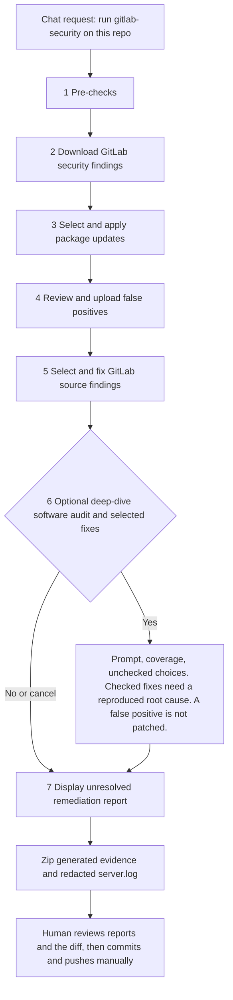
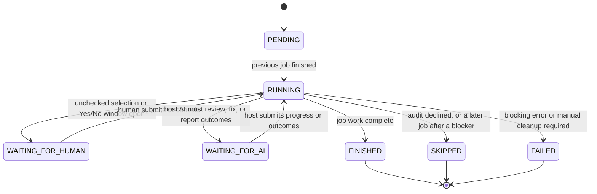
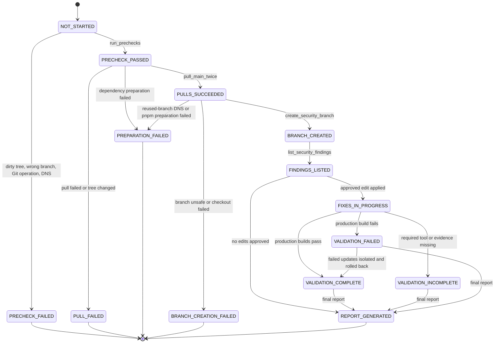
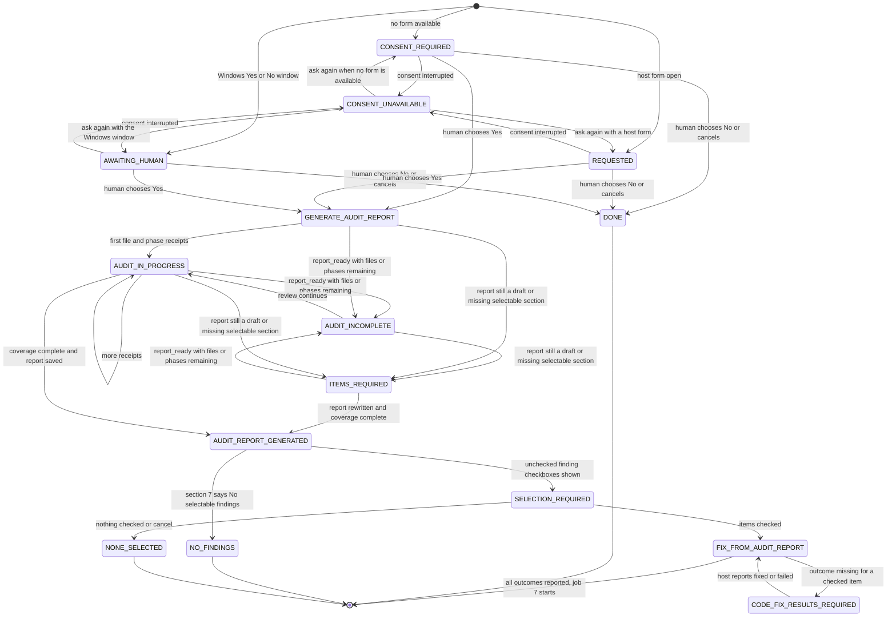
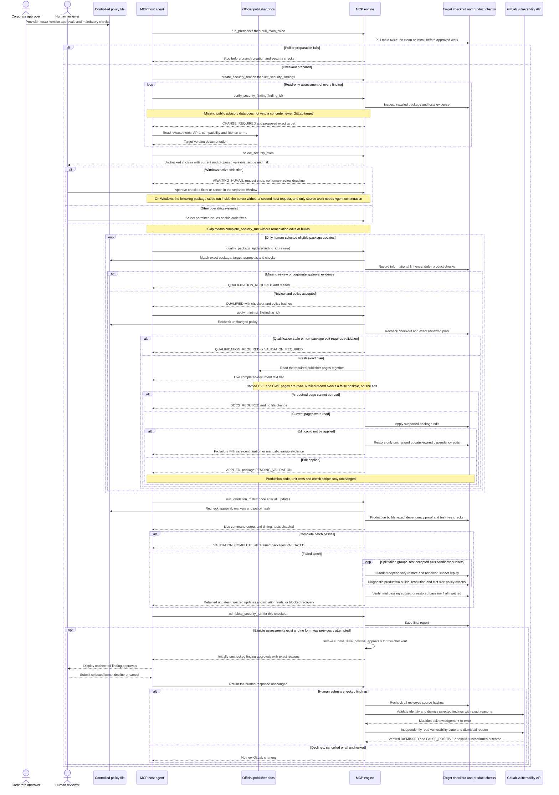

# GitLab Security MCP

An MCP server for evidence-based security remediation in a local GitLab checkout.
It retrieves active findings, verifies installed dependencies against public
advisories, qualifies compatible package updates, applies supported minimal edits,
and produces local Markdown and JSON reports.

The MCP host starts this Python process and calls its seventeen tools over stdio.
One process can hold several application checkouts at once. Each checkout keeps
its own run, and later calls select it with `repo_root` when more than one is
active. There is no HTTP listener. "Local" describes execution and where edits
are kept, not offline operation: GitLab, advisory, and publisher-page reads,
Git pulls, and product checks can use the network. Before every edit the server
reads the current required publisher pages. It does not commit, push, open merge
requests, or publish code changes. GitLab findings remain read-only except for
the optional human-approved false-positive dismissal flow described below.

The release version is written in one place, `__version__` in
[gitlab_security_mcp/__init__.py](gitlab_security_mcp/__init__.py). The wheel, the
`server_version` field, and the bundled progress extension all take it from
there; `<version>` below means that value. See
[Increasing the version number](#increasing-the-version-number). In either VS Code/Copilot or Cursor Agent chat, use:

```text
run gitlab-security on this repo
```

This is one chat request, not a terminal command. The workflow runs these
**seven separate jobs, one at a time**:

1. **Pre-checks**, including safe preparation of `main` or today's `security-fixes-YYYY-MM-DD` branch.
2. **Download security findings from GitLab.**
3. **Package updates:** unchecked GUI choices for frontend/backend packages,
   followed by only the approved updates and their validation.
4. **False positives:** evidence-backed explanations, then separate unchecked
   GUI approvals. Upload only approved dismissals with their displayed reasons;
   verify GitLab's persisted result independently.
5. **GitLab source fixes:** a new unchecked source/config-only GUI. The host AI
   fixes only selected findings and records successful or unsuccessful outcomes.
6. **Optional deep-dive audit:** ask **Yes / No** first. Yes generates the
   coverage-checked report before showing unchecked audit-fix choices. A checked
   fix needs a reproduced root cause and a test that fails before the change and
   passes after it. A selected item that is not a defect is left unchanged.
7. **Final unresolved report:** write and display
   `.security-mcp/reports/<project>-unresolved-remediation.md`, with package current/target
   versions and blockers, plus unsuccessful code attempts and their reasons.
   Confirmed software-audit findings that were not selected for an AI fix are
   listed under **Software audit findings not fixed** with severity, location
   and problem, sorted by severity, and a link to the audit report. Each location
   that names an existing checkout file links to that file and line from the
   report's folder.
   All generated evidence and the redacted server log are then zipped under
   `~/softwareSecurityAuditReports/`. Only checkout log copies are removed.
   Reports and inspection state stay available and are also in the ZIP.

Canceling a selection authorizes nothing and continues to the next job.
Declining the audit still generates the final report. Jobs cannot be started
out of order. An interrupted or unavailable approval never implies consent.

Failed dependency edits retain the package-manager rejection and rollback detail
in both their step receipt and batch failure reason. When application fails before
any production validation can run, validation is marked
`NOT_RUN_FIX_APPLICATION_FAILED`, not a build/test failure or an absence of human
approval. Skipping a later source selection preserves that outcome. Progress
does not promise production validation for a rejected edit. pnpm provenance
rejections remain blocking; the server does not disable supply-chain checks or
automatically discard and regenerate the lockfile.

**In-editor progress requires both release files:** install the Python wheel.
Reloading the MCP server on Windows, macOS, or Linux installs the progress
extension into that VS Code or Cursor window. The wheel alone cannot force an
editor status bar or persistent notification. See [the progress extension](editor-progress/README.md).
The server also mirrors progress to `~/.cache/gitlab-security-mcp/progress/`.
A window with open folders shows a run only when that checkout is one of those
folders, or a directory inside one of them. A window with no open folder still
shows the newest mirror for each checkout. Another VS Code or Cursor window can
run a different repository at the same time.

Release 1.0.61 keeps one version source and names the report files:
- Package reviews: the `PACKAGE_REVIEW_REQUIRED` reason and server instructions
  no longer tell the AI to call `qualify_package_update` before human selection.
  That call was refused by the approval gate and caused a retry loop.
- Audit continuation: an unrelated tool failure no longer pauses the audit, and
  up to two turns without new receipts are continued before stopping.
- Progress extension: an already-installed version is not reinstalled, and an
  upgrade shows a one-time reload notice with the new version.
- Progress extension: its snapshot size limit, workflow job count, meter width,
  and poll interval are named constants; behavior is unchanged.
- One version file: `__version__` in `gitlab_security_mcp/__init__.py` is the only
  place to change the release number. `pyproject.toml` reads it, and the VSIX
  build stamps it on the progress extension, so both `package.json` copies keep
  the placeholder `0.0.0` and never need editing. No versioned VSIX is kept in
  the checkout; the Windows installer writes
  `gitlab-security-progress-<version>.vsix` into the install directory from the
  installed package for manual fallback.
- Report names start with the GitLab project name and `-`, for example
  `patient-web-unresolved-remediation.md` and
  `patient-web-security-remediation-report-<branch>.md`/`.json`. The progress
  extension opens the newest `*unresolved-remediation.md` in `reports`.
- Code quality: limits, timeouts, HTTP statuses, Windows API codes, and log and
  error messages are named module constants; text and behavior are unchanged.

Release 1.0.60 removes manual nudges and shows versions:
- When the false-positive window opens, the AI makes one waiting
  `choose_software_audit_action` call that returns the next job's work, including
  the audit prompt, after the human answers the windows.
- If the audit prompt is still undelivered, the progress view says
  **Software audit: send a chat message to start** instead of "waiting for the host AI".
- The progress panel and status-bar tooltip show the MCP server and progress
  extension versions (progress extension 1.0.52).
- A blocked package shows `None eligible (blocked; advisory floor <version>)`
  instead of the rejected version as its proposed target.

Release 1.0.59 enforces the audit report format once and links unresolved locations:
- At `report_ready`, a report missing the nine required sections or linked
  selectable locations gets one restructuring request with `format_issues`;
  the next `report_ready` proceeds and records any remaining issues.
- Each location under **Software audit findings not fixed** links to the
  checkout file and line from the unresolved report's folder.

Release 1.0.58 improves the software audit and its final report:
- The audit reads the official documentation for the project's exact stack
  versions first, then applies a per-file checklist to every source file:
  performance, scalability, concurrency and threading, locking and deadlocks,
  unbounded CPU/memory growth, resources not closed, exception and error
  handling, deprecated or unsupported APIs, PHI/PII in logs and errors,
  non-ISO 8601 date-time values, and general defects. The evidence bar is unchanged.
- Confirmed audit findings that were not selected for an AI fix are listed in
  the unresolved report with severity, location, problem, and an audit-report link.
- A release review that excludes every eligible release is accepted in one call
  with honest values, instead of forcing contradictory resubmissions.

Release 1.0.57 fixes a missing log ZIP: a `progress.json` or `run-state.json`
rewrite by background work finishing during job 7 no longer aborts archival.
Only the checkout logs that archival removes must stay unchanged.

Release 1.0.56 fixes issues found in two more real runs:
- Container OS packages (for example Ubuntu `libkrb5-3`) skip GitHub and the
  paced NVD API, and an upstream version range never marks a backported
  distribution build unaffected.
- During pre-checks, an out-of-order call names the missing step
  (`pull_main_twice` or `create_security_branch`).
- Repeated checkout snapshots reuse unchanged file digests, so parallel
  Gradle-backed finding checks no longer queue behind full re-hashing.
- `run-state.json`, the JSON report and the report tool's output record each
  whole-checkout hash map as a file count and digest instead of every file hash.
- The unresolved report prints "None reported" instead of an empty table.

Release 1.0.55 fixes issues from a real run:
- An unchanged Node side library with no lockfile, next to a locked project, is
  skipped instead of failing `npm ci` and rejecting every package fix.
- A registry that rejects the advisory audit endpoint is not queried again for
  that project.
- `PACKAGE_REVIEW_REQUIRED` lists every missing review piece at once.
- Windows `progress.json` replacement retries longer, and a retry that succeeds
  is not a warning.
- New `-ApproveToolsForRepository` option and `gitlab_security_mcp.host_permissions`
  module let VS Code Copilot run this server's tools without prompts, as Cursor
  does. See [Run the tools without approval prompts](#run-the-tools-without-approval-prompts-like-cursor).
- The installer no longer asks you to install the VSIX by hand. The server still
  installs the bundled progress extension when an editor starts it.

Release 1.0.48 adds a persistent editor tab with a real graphical progress bar,
counts, percentage, current activity and seven-job checklist. **Show Task
Progress** and the status-bar click reveal that view; **Show Progress Log**
opens diagnostic text separately. The graphical view opens automatically for
an active run even if native notifications are muted. Waiting states use a
clock rather than claiming the host AI is actively working.

Automatic progress-extension installation supports both legacy editor layouts
and Windows VS Code's versioned application directories. It reads the owning
editor's installed CLI launcher to select the active version, without running
the wrapper or guessing among old version directories. If no supported editor
CLI is found, the server logs a warning with the manual VSIX installation option.

An unfinished review does not open audit-fix checkboxes. Progress responses
explicitly return `continue_review`, the remaining file count, next paths and
remaining phases. The host must continue after delegated reviews, save the
complete report, and call `report_ready=True`; a partial chat summary is not a
report. Resume a paused audit in its existing agent conversation. Restarting
the MCP discards its in-memory review receipts and is not a resume operation.

Release 1.0.47 fixes audit-stage visibility and host timeouts. Native audit
consent and audit-fix checklists are owned background dialogs, so the opening
tool returns before the human decides. Repeated/cancelled host waits do not
reopen or discard the live window; collect its saved handoff with
`choose_software_audit_action(repo_root=...)`.

During report generation the status bar prioritizes **Software audit** and
its actual reviewed-file count. A separate five-second heartbeat survives
returned tool calls. It reports server liveness and time since the last AI
update, not fictional AI activity or time-based percentages. **Waiting for AI**,
**Waiting for you**, and **No recent updates** are distinct. A canceled consent
request is recorded as interrupted, never left claiming that a scan is running.
Once every selected audit fix has an explicit outcome, including failed fixes,
the audit becomes terminal, its heartbeat stops, and the saved progress no longer
claims it is waiting for AI. Failed and unselected findings remain explicit in
the final report; terminal progress does not mean every finding was fixed.

Release 1.0.46 replaces the earlier automatic audit with explicit human consent.
Per-file hash/assessment receipts and all five audit review phases are
required; partial reviews cannot silently finish. A genuinely complete audit
may still find zero or one defect. Package and source permissions are separate.
The companion extension displays the current **Job N/7** when the finished-job
count is known, plus that count, the current finding or activity, and the full
job checklist. Without a finished-job count it shows the task label. Unknown command
durations remain indeterminate; job progress is not elapsed-time estimation.

Release 1.0.23 makes the earlier **fix selection** precise: each package option
shows its name, current version and evidence source, exact proposed version,
affected files, rationale, major-upgrade risk and production-build acceptance
requirements. An unknown current version is explicitly marked, never invented.
Source choices show file/line and the proposed scoped action instead of raw
dictionaries. Approval binds the displayed package versions and file scope;
changed findings or proposed targets require fresh consent.

Release 1.0.44 fixes scan-then-select when the audit report does not yet exist.
The host AI receives an explicit scan/progress/report-ready continuation before
unchecked audit findings are shown. Background Windows approvals and package
workers retain a separate progress console with current activity, elapsed time,
and completed execution-step counts in both Cursor and VS Code. Unknown totals
remain indeterminate; an ended tool request is not a completed audit.

Release 1.0.43 automatically offers the software-audit choice at completion and
after Windows false-positive approvals close. Documented no-safe-release outcomes
continue to reporting instead of repeating package review. Gradle and advisory
comparisons now recognize Maven's stable Final/RELEASE/GA suffixes.

Release 1.0.42 adds clickable file-and-line links to software audit reports and
requires reachable-path evidence, ordered review, calibrated severity, and
separate unfinished-work and rejected-lead sections in the audit prompt.
Only findings from sections 2 and 3 are selectable for fixes.

Release 1.0.41 ignores withdrawn advisories, fills missing NVD version bounds
from package-matched CVE CNA records, keeps concise false-positive reasons
separate from full GitLab audit comments, registers
`choose_software_audit_action`, and requires explicit text encodings so
Python 3.11 and 3.15 decode identically.

Release 1.0.40 takes the Alpine release for apk pins from the Docker image itself.
The `study-config-service` run on 1.0.39 left the KICS busybox finding on manual
review: one brief `ConnectError` from `dl-cdn.alpinelinux.org` (the three index
downloads failed within 120 ms) aborted the plan, which had to read every
supported branch to infer the release from other pins. The server now reads the
stage image's linux/amd64 metadata from its public registry
(`mcr.microsoft.com/dotnet/sdk:10.0-alpine` reports `alpine-minirootfs-3.24.4`),
so the pin is the latest version compatible with that image —
`busybox=1.37.0-r31` from Alpine v3.24 — even when GitLab supplies no version and
no other package is pinned. That needs one package index instead of up to six.
Existing pins remain the fallback for private registries. Transient connection
errors, timeouts, 429 and 5xx responses are retried four times with backoff, and
the underlying error text is logged.

Release 1.0.39 fixes approved configuration fixes stalling after the Windows
selection window. In `study-config-service`, the KICS busybox pin was approved
(`fix_selection.status = APPROVED`) but nothing was edited: the window starts
server-owned execution only for package updates, while the host AI had already
been told to stop. Approved Dockerfile, nginx and GitLab CI line fixes are now
applied by the server after submission, one at a time, each with a fresh read of
the required documentation, the source-review hash check, an exact-line match and
a validation run. The run then saves reports and offers false-positive approvals
when no other host-led source fixes remain. Approval now binds the exact displayed
edit (file, lines, replacement and target version), so a re-planned edit cannot
be applied under earlier consent. Host-form (non-Windows) selections are unchanged.

Release 1.0.38 automatically pins KICS **Unpinned Package Version in Apk Add**
findings in Dockerfiles to the current Alpine package version, even when no
version is named in the finding or the file. In `study-config-service`, the
`mig-build` stage's existing pins (`git=2.54.1-r0`, `icu-libs`/`icu-data-full=78.1-r0`)
are published only by Alpine v3.24, so `busybox` is planned as
`busybox=1.37.0-r31`. Previously every Dockerfile KICS line stayed manual review.
The plan reads the KICS rule, Docker's version-pinning guidance and Alpine's
release page, plus the Dockerfile reference, before assessment and again before
the write. Configuration plans can now edit several lines of one instruction,
all or nothing. See [Safety boundaries](#safety-boundaries) for the evidence rules.

Release 1.0.37 keeps tracebacks for programming-error types that a handler
turns into a result. Previously, advisory reads (OSV, GitHub, NVD), report
retrieval, prechecks, pulls, branch preparation, finding verification, package
qualification/application, batch validation and isolation, the validation matrix,
source-review validation and AAA generation saved only the exception message
(for example `'NoneType' object has no attribute 'get'`), without its file and
line. A `TypeError`, `AttributeError`, `KeyError` or other unexpected type now
logs `Converted <type> into a failed result during <context>; traceback follows`
at WARNING. Expected OSError, ValueError, RuntimeError, subprocess and HTTP
failures remain recorded in the result only. Saved results, statuses and
approval behavior are unchanged; a package-validation freshness failure is
no longer silent.

Release 1.0.36 forwards Windows approval-window diagnostics to the server log.
Previously, a dialog that opened successfully discarded its PowerShell stderr,
including the "using the active monitor" placement fallback. That text is now
logged as a warning with the dialog's process ID. Window start, visibility,
close action and forced close are logged. Unreadable dialog output reports the
process ID, byte count and exit code instead of only a JSON parser message.
Approval semantics are unchanged: nothing is selected or dismissed by logging.

Release 1.0.35 closes approval pipes even when process termination fails, records
unexpected background approval failures without authorizing edits/dismissals,
and observes cleanup-task exceptions with checkout/request context. Command
cleanup no longer silently accepts an unreaped child; spawn/reader failures
retain diagnostic tracebacks, and failed remote-branch reads no longer mean
"branch absent." Cancellation is identified in HTTP and parallel-worker spans.
Stderr records include UTC time and thread names and redact known server
environment credentials, including encoded values and tracebacks. This is not
a general-purpose scrubber for arbitrary secrets in application output.
Reliability lint rules and existing formatting/documentation standards are
enforced while retaining Python 3.11 support.

Release 1.0.34 fixes transitive Gradle overrides in builds that explicitly use
`enforcedPlatform(...)`. A strict constraint can conflict with the enforced BOM.
For these overrides, the reviewed plan instead discloses a coordinate-specific
`configurations.configureEach { resolutionStrategy.force(...) }`, backed by the
existing centralized security-version property. The BOM and other coordinates
are not edited. Comments and quoted examples do not enable this strategy.
Non-runtime scoped overrides and ordinary non-enforced constraints are unchanged.
Production builds and exact resolution in the originally observed configurations
remain mandatory; this is not proof of runtime compatibility with the platform.
Start a fresh run and review the new plan rather than reusing an older approval.

Failed-batch isolation now groups findings with identical qualified plans and
policy hashes. One shared dependency update is tested as a unit, avoiding
redundant builds for duplicate findings while retaining per-finding qualification,
resolution checks, outcomes and guarded rollback.

Release 1.0.33 processes independently approved false-positive dismissals with at
most eight workers instead of serializing the entire batch. Each target still
requires an identity check, a single non-retried mutation and independent
read-back proof. Concurrent calls for the same target are serialized, and client
shutdown waits for admitted requests. Pending intents are saved before dispatch;
completed outcomes are persisted on the calling thread as they arrive, while
returned results retain selection order. Partial failures remain explicit.
Reports now distinguish MCP-managed edits/tests from host/developer activity:
an empty managed-change list does not mean the working tree is unchanged, and
missing MCP test evidence does not establish whether someone ran tests separately.

Release 1.0.32 positions both Windows checkbox dialogs on the MCP host/editor's
monitor instead of the default screen. It follows the server's parent processes,
prefers an active host window, and otherwise uses the nearest ancestor with a
main window. The dialog is centered and sized to that monitor's working area,
including monitors to the left/above the primary screen. If the host window
cannot be found, it uses the active monitor and logs that diagnostic as a server
warning with the dialog's process ID (1.0.36 and later).
Selection and submission still require explicit human input.

Release 1.0.31 corrects container assessment reporting. When an advisory supplies
a fixed package version but the server has no supported automatic container edit,
the finding requires manual review; it is not listed as having no safe fix.
The explanation requests a reviewed package/base-image update followed by a
rebuild and rescan, never an unrelated image tag guessed from a package version.
NVD false-positive explanations now identify the installed version and affected
ranges, rather than only naming the fixed-version bound. Existing request
deduplication, bounded concurrency and NVD rate limiting are unchanged.

Release 1.0.30 adds a version-alignment exception to package qualification.
Existing in-checkout linked paths to an approved file are treated as the same
edit, not extra unauthorized changes. Existing AI Markdown/rules documents may
also synchronize exact reviewed current-to-target versions, without changing
any other text. Supported locations include `.github/instructions`, skills and
prompts; Cursor, Claude, Windsurf and `.agents` rules/skills; `AGENTS.md`,
`CLAUDE.md`, `GEMINI.md`, legacy Cursor/Windsurf rule files and GitHub version/
Copilot instruction documents. Executable skill files, new/deleted documents,
unknown or ambiguous package versions and unrelated instruction edits still
require review. Production/test code and build/check scripts remain protected.

The exception permits existing host/rule-driven synchronization; it does not
execute repository AI instructions. Start a fresh run so qualification can
capture the original documents. Accepted version-only edits are recorded in the
report. If a batch fails, selective rollback restores those edits and replays
only the documented versions for retained packages; later unrelated edits are
preserved for manual review. Production builds and exact Gradle resolution remain
mandatory. This does not bypass enforced-platform conflicts.

Release 1.0.29 adds Gradle security resolution overrides for dependencies outside
`runtimeClasspath`. After a scoped miss, the server inspects all configurations
in the owning project with `dependencies`, sharing that report across findings.
The approval describes the current/target versions and actual affected
configurations. After approval, Groovy/Kotlin build files receive scoped
`configurations.named(...).resolutionStrategy.force(...)` rules backed by the
central security-version property. A production build and exact target resolution
in **every originally observed configuration** are required; a dependency that
disappears from one of those configurations fails validation. Existing selective
rollback retains passing updates. No application tests are run.

Release 1.0.28 clarified unresolved Gradle update descriptions: they identify the
limited lookup, distinguish it from an unavailable/incompatible version, and
give the next investigation step. This wording change does not add configuration
discovery or authorize an unverified dependency edit.

Release 1.0.27 fixes a misleading approval path: packages with `blocked_reason`
are disabled, not selectable promises of an update. A forged selection of a
disabled package invalidates the response before any edit. An entirely blocked
batch returns `PACKAGE_REVIEW_REQUIRED` instead of opening unusable checkboxes.

Non-major upgrades with uncertain transitive caller behavior can now use an
explicit **BUILD-ONLY TRIAL**. The host must still read current documentation,
review frameworks and license terms, declare no known incompatibilities, and
disclose what remains unverified before approval. Production builds, exact Gradle
version proof and existing selective rollback decide retention; runtime/test
compatibility is not claimed. Known incompatibilities, required source changes
and major upgrades cannot use this mode. Separate advisories on the same package
are assessed independently: a documentation-only fix for one issue must not block
a real version fix for another, nor be reported as fixing the code-dependent issue.

Release 1.0.26 supersedes earlier test-running policies: remediation performs
production builds and necessary dependency checks, **not unit or integration
tests**, including during selective rollback and restored-baseline validation.
It also removes eager pnpm clean/install and pre-edit informational lint.
Installation disables Node lifecycle scripts; build scripts are checked for
known test runners and nested test scripts. An owned Gradle initialization script
suppresses Gradle `Test` tasks, including integration-test tasks attached to builds.
Repository build code remains trusted executable code, not a sandbox.

Every Gradle coordinate update requires an observed dependency before planning
and the **exact target** in the approved configuration(s) after the build.
The initial configuration is scanner-supplied or defaults to `runtimeClasspath`;
a miss now triggers an all-configuration report for that same project.
A literal `force` line alone proves neither presence nor remediation.
A module absent from that report remains manual review: inspect other subprojects,
the buildscript classpath or the scanned artifact rather than introducing a
dependency to make the finding match. Normal runtime/compile transitive floors
use strict dependency constraints; discovered non-runtime/custom classpaths use
scoped resolution rules instead of guessing an `implementation` constraint bucket.
Both approaches use
a collision-checked `securityMcp.<group>.<artifact>.version` property in
`gradle.properties`, and the existing `.github/versions.md` pins table when present.
Existing explicit property/catalog references are preserved; ambiguous mappings
require review. Constraints do not add dependencies.

An unresolved Gradle update description names the package, initial configuration
and all-configuration lookup already attempted. It distinguishes missing graph
evidence from a version-availability or compatibility rejection and explains what
to investigate next. It explicitly states that no update was applied; the blocker
is not a false-positive assessment. Resolution rules, like constraints, do not add
a missing dependency.

Manager-specific current official documentation is mandatory: Gradle constraints,
resolution, inspection and properties; Microsoft TypeScript and pnpm settings
plus the selected Node manager; VS Code/Rider NuGet workflows and Microsoft
PackageReference/central package management. The host review must cite these
pages and explain the actual strategy; the server independently fetches current
pages before editing. Fetching pages alone is not an API/compatibility assessment.
pnpm overrides target root `pnpm-workspace.yaml`, preserving prior pins.
Modern Yarn recursive lockfile-only refresh is blocked because its documented
command cannot guarantee suppression of install hooks; supported manifest and
resolution refresh paths remain available.

Release 1.0.25 introduced validation latency reporting.
Reports now record approval-execution phase durations and dependency-edit/
lockfile-refresh durations separately. Pre-edit Checkstyle can compile sources;
compilation and dependency resolution are not file-writing time.
Tool-discovery descriptions remain within the existing context budget without
removing tools, required review fields or human-approval safeguards.

Release 1.0.24 fixes a continuation gap in 1.0.23: checking packages recorded
approval but did not execute updates until the host received another request.
The host now supplies exact-target documentation/API/framework/license reviews
before opening the Windows form. Missing evidence returns
`PACKAGE_REVIEW_REQUIRED`, not an approval window that cannot proceed. An
explicit `blocked_reason` can identify an unqualifiable target without inventing
evidence or preventing other updates; the window labels that choice **BLOCKED**.
On human submission, the server qualifies and applies only selected eligible
packages, shares identical dependency edits, and validates the whole batch once.
Failures use the existing selective rollback path. Reports record execution
steps and blockers; approval alone is never reported as an applied update.
The server then offers the separate false-positive approval flow.

On **Windows, both VS Code/Copilot and Cursor** now use a separate unchecked
fix-selection window with **no human-review timeout**, even without in-chat form
support. The tool returns `AWAITING_HUMAN` after the window opens; the IDE's timed
request does not stay open. Read as long as needed, then click **Approve checked
fixes**. Selected, reviewed package updates now execute automatically; **no second
"continue" request is needed for packages**. Only selected source-code fixes still
need the host AI to continue its scoped work. Keep the MCP server running.
Cancelling/closing before submission authorizes nothing. After submission, shutdown
signals the owned worker and waits for its in-flight bounded step; interrupted,
unvalidated edits are not accepted and require review. The native window is closed
before package commands begin. Duplicate edits, completion and new runs are blocked
while the owned package batch is queued/running. Other operating
systems retain the host form, whose IDE-controlled deadline cannot be removed
by this server. False-positive dismissal still requires separate consent.

On Windows, release 1.0.11 opens a separate local checkbox window and returns
`AWAITING_HUMAN` as soon as the window is shown. Human review has **no timeout**:
it does not wait inside Cursor's or VS Code's MCP tool request. Only clicking
**Dismiss checked items** submits checked findings; Cancel or closing the window
changes nothing. Keep the MCP server running while reviewing. Saved reports update
after the window closes; the host must not poll or repeat completion while waiting.
Server shutdown closes its own approval window without authorizing new dismissals.

Release 1.0.13 wraps the text in both approval columns, **Issue** and **Why this
is a false positive**. Rows grow to fit their contents and reflow when the window
is resized; long lists scroll vertically. The duplicate lower description pane
has been removed. Source explanations still cite the reviewed file/line. Full
audit comments remain in the saved reports and are retained for GitLab submission.

Release 1.0.14 preserves typed numeric GitLab CWE identifiers, so `601` tagged as
`cwe` becomes `CWE-601` and its actual record page is checked. Source false positives
require successful receipts for every named CVE/CWE record URL: missing receipts,
catalog home pages and references omitted by the bounded fetch limit cannot pass.
Concurrent approval requests reserve one native window per checkout before startup;
cancelled startup is recorded explicitly, and stale startup responses cannot replace
a newer run's receipt. Rejected startup windows are closed and reaped.

Release 1.0.22 introduced batch isolation; its unit-test requirement is superseded
by 1.0.26. Approved updates are retained after production builds, dependency checks
and applicable test-free policy checks pass. A failed batch is diagnosed using guarded
dependency-file restores and reviewed subset reapplication; the final checkout
retains passing updates and reverts offending updates, without overwriting later
user edits. If the restored baseline also fails, the run remains blocked.
Known fixed transitive Java dependencies can now receive a coordinate-specific
Gradle strict constraint or Maven dependency-management entry, subject to documentation,
license and resolved-version verification. BOM versions and application/test
source stay unchanged. No commits, pushes or unrelated GitLab writes are added.

Release 1.0.21 independently reads GitLab after each approved dismissal and
requires persisted `DISMISSED` state with `FALSE_POSITIVE` reason before reporting
success. Already-dismissed findings can be confirmed without another mutation.
Legacy acknowledgement-only receipts remain unverified. Per-selection progress,
confirmation counts, timing and safe GraphQL operation names make partial failures
visible; uncertain writes are never automatically retried. Direct API requests
reject unrelated mutations, including project tags, notes, labels and remote
branches. The approved dismissal still records its reason in vulnerability activity.
See [dismissal verification](#dismissal-verification-and-troubleshooting) before
interpreting scanner flags or historical pipeline reports as human dismissal state.

Release 1.0.20 fixes nested Gradle and Maven validation. Build, dependency and
corporate checks use the owning Java component or reactor, including Gradle
version-catalog edits. The nearest wrapper inside the checkout is preferred.
Declared Maven modules and Gradle settings-based subprojects build together,
while independent builds are still checked separately. JDK 17+ is accepted;
the actual wrapper, compiler and project toolchain must still build successfully.
That release used `assemble` and Maven `clean package -Dmaven.test.skip=true`
without unit tests; **1.0.26 again uses build-only validation**.
Java source false-positive review retains
the same cited-source evidence and human-dismissal approval requirements.

Release 1.0.19 fixes NuGet lockfile refreshes in split repositories such as
`frontend/` (Node.js) and `backend/` (.NET 10/C#). Restore runs in the owning
backend project's directory, including nested projects, rather than assuming a
project at the checkout root. Package discovery, builds and source-backed
false-positive review support both components in one run. Configure `REPO_ROOT`
to the common Git checkout root, not either component directory. GitLab
false-positive dismissal still requires human approval.

Historically, release 1.0.18 disabled application unit-test execution during security remediation.
**Release 1.0.26 restores the following no-test execution policy.**
Production builds and non-test checks remain required. Reports explicitly state
**Test compatibility was not verified**; a green build is not a tested-compatibility
claim. This also applies to batch isolation, restored-baseline checks and host-led
source fixes. Missing Node test scripts no longer block package qualification.
If an independently configured corporate policy requires unit tests or a lifecycle
that runs them, remediation reports a blocker: it neither runs nor silently
waives those checks. Only the policy owner may resolve that conflict.
Plugin developer regression tests remain separate; wheel installation does not
run them or application tests.

Release 1.0.17 removes unused helper inputs, throwaway validation objects,
unsupported pre-3.11 TOML fallbacks and obsolete sampling test scaffolding.
All fifteen MCP tool schemas and workflow instructions are unchanged. Cleanup
validation completed with **880 passed, 3 skipped**, with native Windows tests
enabled and strict lifecycle warnings; lint and formatting passed.

Release 1.0.16 supports code-fix selection on modern MCP hosts without a
server-request back-channel. MCP 2026-07-28 and newer use `input_required` and
the client's form/retry flow; older hosts retain `elicitation/create`. All
checkboxes remain unchecked, and no AI approval arguments are added. Retried
answers must match the original live question and candidate snapshot; changed
findings, a replaced question or a fresh run cannot inherit old approval.

Read-only source assessments now share a bounded 128-entry documentation-receipt
cache within the current live run. Concurrent assessments do not refetch the
same successful pages, and cache hits do not create HTTP worker tasks. Reused
receipts are marked `reused`; no response bodies or finding verdicts are cached.
Failed required pages and named CVE/CWE records remain retryable. Unavailable
informational catalog pages are retained honestly instead of being requested
for every finding. A new run cannot reuse an old run's receipts, and actual
pre-edit publisher/rule reads still bypass this cache entirely.

An offline replay of 157 archived Java finding-reference sets required
**24 transfers for 24 URLs**. The supplied run had 2,762 documentation transfers,
including repeat assessments, and 159 informational NSA HTTP 403 responses;
the replay required one NSA attempt. This measures duplicate-request removal,
not total AI reasoning time or a promised wall-clock speedup. No application
verdicts were reassessed by that replay.

The legacy `generate_local_report` MCP tool also routes through
the same saved-report and human-approval flow. Neither finishing tool silently
leaves eligible dismissals without a form attempt. Cancellation is still respected.
The running server version is recorded in `get_run_status`, run snapshots and reports.

Start with [installation](#installing-the-local-mcp-server), choose your
[host configuration](#mcp-configuration), then follow the
[VS Code/Copilot run guide](#running-within-vs-code-and-github-copilot) or
[Cursor run guide](#running-within-cursor). Existing users should follow
[the upgrade guide](#updating-the-mcp-server-in-vs-code-and-cursor).

## Contents

- [Changes delivered on November 13, 2026](#changes-delivered-on-november-13-2026)
- [How it works: complete flow and state transitions](#how-it-works-complete-flow-and-state-transitions)
- [Architecture](#architecture)
- [Workflow](#workflow)
- [Safety boundaries](#safety-boundaries)
- [Reducing AI context overhead](#reducing-ai-context-overhead)
- [Requirements and qualification](#requirements-and-qualification)
- [Building the local MCP server](#building-the-local-mcp-server)
- [Installing the local MCP server](#installing-the-local-mcp-server)
- [MCP configuration](#mcp-configuration)
- [Updating the MCP server in VS Code and Cursor](#updating-the-mcp-server-in-vs-code-and-cursor)
- [Running within VS Code and GitHub Copilot](#running-within-vs-code-and-github-copilot)
- [Running within Cursor](#running-within-cursor)
- [Reading output in VS Code and Cursor](#reading-output-in-vs-code-and-cursor)
- [Run gitlab-security on this repo](#run-gitlab-security-on-this-repo)
- [Running remediation](#running-remediation)
- [Supported fixes](#supported-fixes)
- [Validation](#validation)
- [Development and tests](#development-and-tests)
- [Troubleshooting](#troubleshooting)

## Changes delivered on November 13, 2026

This summary covers changes through 1.0.40. Earlier wheels do not contain
all of these changes; updating source files does not update an installed wheel.

| Area | Current behavior |
| --- | --- |
| One-request completion | `select_security_fixes` obtains separate human consent before remediation edits. `complete_security_run` saves the report, automatically invokes the false-positive checkbox form once, and refreshes the report with actual outcomes. It reuses current assessments without another scan. There are sixteen tools. |
| Source-backed AI assessments | The calling host AI reviews Java, .NET/C#, TypeScript/Node.js, Python, JavaScript, Dockerfiles and nginx configurations against the current Oracle Java, Microsoft C#/.NET, TypeScript, JavaScript, Node.js, Python, Dockerfile and nginx pages. TypeScript reviews also apply the utility-type limits (Partial, Pick, Omit, and the rest are compile-time only). A conclusion is accepted only after those pages and any cited CVE and CWE pages are read. Missing source, a scanner flag, or an advisory miss never proves a false positive. |
| Deprecated sampling removed | Source review always uses the calling host AI and its code tools, not deprecated MCP sampling or a separate model/API key. `HOST_REVIEW_REQUIRED` means the AI must continue the workflow, not ask the user to analyze code. |
| Human-only GitLab dismissal | Completion automatically offers initially unchecked approvals for eligible assessments. Cancel to keep reviewing, then explicitly request `submit_false_positive_approvals` to reopen. Only selected findings are dismissed as `FALSE_POSITIVE`, using the exact displayed reason. Identity, project, source freshness and independently read-back state/reason are checked; unknown outcomes are not automatically retried. |
| Honest reports | Finding Assessments distinguish local assessment from confirmed GitLab dismissal. Reports retain per-finding pipeline provenance, unapplied fix candidates, pending approvals, unfinished source reviews, exact unresolved reasons, consulted sites and validation/isolation outcomes. |
| Automatic repository selection | The server uses Git's resolved origin to discover `namespace/project`; numeric project IDs are optional. The trusted GitLab API URL and credentials remain independently configured. |
| Same-day branch reuse | Today's exact clean security branch can start fresh, including after a prior failed run. Cleanup removes recognized generated untracked/ignored artifacts and empty directories, not tracked files, policies, configuration or unrelated work. Unsafe filesystem state still blocks cleanup. |
| Resolved-on-main branch findings | Other tracked branches are checked for GitLab-confirmed main resolution at this run's pulled main commit. Eligible entries require human checkbox approval and fresh remote main/ref/resolution checks; an absent finding alone is not proof. |
| VPN and dependency preparation | Corporate DNS is checked before work and pulls. No eager pnpm clean/install runs; dependency preparation occurs only when an approved update/build needs it. |
| Progress visibility | Separate critical/high/medium/low/info positions, such as `Processing 5 of 21 criticals`, appear in console/notification/transcript channels. Owned Windows log consoles close after completion/failure and reopen for later work; unrelated prompts remain untouched. |
| Advisory robustness | Plural GitLab fix-version lists retain all explicit alternatives. Incomplete NVD data falls back to authoritative, package-matched CVE CNA version data; missing bounds still require review. Withdrawn OSV records do not supply active bounds or prove a false positive. Ordered OSV/GitHub fallback, shared NVD pacing and bounded retries respect `Retry-After`; identical advisory requests share a bounded cache. GitLab Maven `group/artifact` names match local `group:artifact` coordinates. |
| Dependency edits | Qualified plans may refresh lockfiles, update manifests or add supported transitive constraints/overrides. Current manager documentation, compatibility/license review, passing production builds and resolution checks remain mandatory. Tests are not executed. Failed updates are isolated; passing updates remain. |
| Bounded fan-out | Up to eight independent finding verifications overlap within a checkout; the same finding remains serialized and snapshots commit under the engine lock. Independent documentation/advisory batches and human-approved GitLab dismissals use at most eight workers, bounded submissions, isolated request contexts and input-ordered results. Dismissal intents are saved before dispatch, each completion is saved on the caller thread, the same vulnerability is never written concurrently, and mutations are never retried. Checkout edits, validation/rollback and dismissals wait for active verifications. |
| Resource cleanup | Pools join workers; responses and owned clients close; cancellation/startup failures clean up owned command trees, pipes, logs and Windows job handles. Approval-window pipes close even if terminating the window fails. A command child that cannot be reaped is reported as a cleanup failure rather than a normal result. Background approval tasks persist unexpected failures and their completion callbacks log any exception escaping cleanup. Hung progress delivery has a one-second completion drain limit; late callbacks cannot reuse a finished request. |
| Distribution and upgrades | Share the wheel and Windows installer helper. The helper detects a locked launcher before pip changes the environment; it never kills IDEs or servers. Source and installed-package deployments have different update steps below. |
| Python quality | Python 3.11 remains the minimum. Ruff formatting/lint, docstrings, AAA tests and warning-strict lifecycle regressions enforce the repository's standards; no newer-only syntax is required. |

The 1.0.16 full-suite validation completed with **890 passed, 3 skipped**, with
native Windows tests enabled and deprecation, resource, unraisable-exception and
background-thread warnings treated as errors. New regressions exercise actual
modern MCP input rounds, selected-only consent, invalid/cancelled/stale answers,
concurrent bounded receipt reuse, failed-required-page retries, run isolation
and fresh pre-edit reads. Ruff lint, formatting and repository standards passed.

The 1.0.14 full-suite validation completed with **861 passed, 3 skipped**, including
the two opt-in native Windows tests (`SECURITY_MCP_DESKTOP_TESTS=1`). Those tests
measured multiline text and row heights in both columns, verified reflow after
narrowing the window, vertical scrolling, removal of the lower pane, initially
unchecked boxes, selected-only submissions and cancellation. The no-timeout
workflow and full audit comments remain covered by the regression suite.
Additional cases cover typed numeric CWE identifiers, missing/wrong/bounded-away
record receipts, simultaneous approval snapshots, cancellation before and after
the window is shown, and stale-run cleanup. Real concurrent stdio probes using
Cursor and VS Code client identities each created one native window and recorded
cancellation without GitLab changes. The full suite passed with resource,
deprecation, unraisable-exception and background-thread warnings treated as errors;
the stdio test harness also closes its pipes and reaps its child on timeout.
These are regression
results, not live-host UI certification, a benchmark, or proof that arbitrary workloads cannot
leak resources. Rebuild and reinstall the wheel to deploy source fixes.

## Reducing AI context overhead

Current tool discovery stays below a 12,000-character regression budget,
including the structured source-review schema. It omits redundant SDK-generated
schema titles on copies of the advertised metadata; explicit human titles,
field descriptions, required fields and validation constraints remain intact.
The SDK's own validation schemas are not modified.

Release 1.0.15 shortens duplicate tool descriptions while keeping the complete
server workflow instructions unchanged. All fifteen tool names, input/output
schemas and approval annotations remain unchanged. The MCP response middleware
also compacts canonical SDK JSON text without removing fields, truncating
evidence or changing string contents. Custom Markdown, exact number spellings
that cannot round-trip, error flags and structured results are preserved.
It handles both typed and serialized SDK result envelopes, so compaction and
the bounded progress fallback work on actual stdio calls, not only direct tests.
Live progress remains available.

Measured before/after using the same JSON serialization:

| Context | Before (characters) | After (characters) | Reduction |
| --- | ---: | ---: | ---: |
| Advertised tool catalog, including schemas | 15,323 | 10,529 | 31.3% |
| Workflow instructions plus tool catalog | 35,437 | 30,643 | 13.5% |
| Synthetic 20-finding JSON text response | 5,931 | 3,879 | 34.6% |

These are character counts, **not billed token measurements**. Actual token and
cost savings depend on the host, model, caching and workload. Required source
reads, publisher/security documentation, human selection, compatibility checks,
validation and complete final report tables have not been shortened or skipped.

Official guidance reviewed for this change:

- [GitHub Copilot MCP guidance](https://docs.github.com/en/copilot/concepts/customizations/mcp)
  recommends enabling only needed toolsets.
- [Microsoft's VS Code token-efficiency guidance](https://code.visualstudio.com/blogs/2026/06/17/improving-token-efficiency-in-github-copilot)
  explains deferred tool discovery and prompt-prefix caching. These are
  host/model capabilities, not settings this stdio server can force.
- [VS Code tool management](https://code.visualstudio.com/docs/agents/run/tools)
  explains tool selection for each harness. Limit unrelated tools through the
  appropriate tool picker/customization UI; keep this workflow's required tools
  and source-analysis tools enabled. Some selections persist across sessions.
- [Cursor MCP documentation](https://cursor.com/docs/mcp) explains disabling
  unused servers in **Customize**. Keep this server running during the scan and
  while a human approval window is open.
- [Microsoft Learn MCP best practices](https://learn.microsoft.com/en-us/training/support/mcp-best-practices)
  describes response budgets. Its `maxTokenBudget` query parameter applies to
  Learn MCP search, **not** to this server or its required full-page reads.

Do not repeatedly poll `AWAITING_HUMAN`, repeat completed phases or reverify
findings merely to open approvals. Use the existing completion flow once.
No IDE settings are changed automatically, and no model API or tokenizer
dependency is added.

Software-audit continuation responses omit the already-delivered prompt,
full inventory, and past receipts. They return up to 20 next paths, the actual
remaining count/phases, and registered generated exclusions. Incomplete-report
responses also bound their path list and explicitly flag when more paths remain;
changed-file gaps remain review targets. Initial audit handoffs still include
the full prompt and inventory. Nothing is removed from live/saved audit evidence:
after context loss, `get_run_status(repo_root=..., include_audit_details=True)`
recovers the complete
`software_audit` context. Do not poll that large snapshot for routine progress.
The audit prompt recommends related-file batches, batched local hashes,
reuse of unchanged evidence, and section-level report edits, without reducing
required source coverage, evidence, approvals, or completion checks.

A synthetic resumed audit with 495 inventory files and 140 existing review
receipts decreased from **91,012 to 2,273 characters (97.5%)**, using compact JSON
serialization before and after the change. This measures the repeated handoff,
not the initial prompt, required source reads, or billed model tokens.

Release 1.0.15 validation: **308 related server and consent tests passed**,
including sixteen new context-budget/compaction cases and both native Windows
approval tests. Resource, deprecation, unraisable-exception and background-thread
warnings were treated as errors. Ruff lint/format and whitespace checks passed.

## How it works: complete flow and state transitions

This section summarizes everything the server does in one run, from the chat
request `run gitlab-security on this repo` to the final unresolved report. The
server enforces job order: a tool called out of order returns
`JOB_ORDER_REQUIRED` instead of skipping a job. Every human choice starts
unchecked; cancel or an empty selection authorizes nothing and moves to the next
job. Nothing is committed, pushed, or merged.

### End-to-end flowchart

The picture is the job order. Decisions, empty selections, and failures do not
jump over a later job. Those outcomes are named under the chart and in the three
state diagrams that follow.



What each job still does:

- **Job 1.** `run_prechecks` requires a Git checkout on `main` or today's exact
  security branch, a clean tree, no merge or rebase, and corporate DNS.
  `pull_main_twice` runs `git pull --ff-only` twice. `create_security_branch`
  creates `security-fixes-YYYY-MM-DD` or reuses that exact name after log
  review and guarded cleanup. `PRECHECK_FAILED`, `PULL_FAILED`,
  `PREPARATION_FAILED`, and `BRANCH_CREATION_FAILED` set the job blocked. The
  failing tool stops there. The next `complete_security_run` marks that job
  `FAILED`, marks jobs 2–6 `SKIPPED`, and writes the job 7 report.
- **Job 2.** `list_security_findings` loads tracked `main` findings in Needs
  triage or Confirmed that are still detected, plus non-main findings GitLab
  reports resolved on `main`. Each GraphQL page asks for 100 records and stops
  after 20 pages or 1,000 kept findings, which sets `truncated`. A success body
  larger than 8 MiB is rejected. Read requests retry transport failures and HTTP
  429, 500, 502, 503, and 504 up to four times, waiting 1, 2, then 4 seconds.
  A `Retry-After` longer than 4 seconds fails on that first response. Dismissal
  writes are not retried. A successful list advances to job 3. The tool
  result is an index of id, title, severity, category, package, and location.
  Descriptions, solutions, and scanner bodies stay on the server.
  `verify_security_finding` loads one full record. `ERROR` or a status ending
  in `_FAILED` blocks the run the same way as job 1. Verification starts in
  job 3, not in this job.
- **Job 3.** Package findings are assessed here. `verify_security_finding` may
  overlap for up to eight findings. Each one uses local manifests, lockfiles,
  Gradle or Maven trees, then OSV, GitHub, and NVD, plus named CVE and CWE
  pages. The same finding stays serialized. Source and config findings loop
  until the host submits a `source_review` with a path and an assessment for each
  file. The server hashes those files. A supplied hash that does not match the
  current bytes is rejected. `CHANGE_REQUIRED`,
  `FALSE_POSITIVE`, confirmed source or config issues, `MANUAL_REVIEW`,
  `NO_SAFE_FIX`, and `REPRODUCTION_REQUIRED` stay recorded for the later job
  that handles them. `select_package_version` chooses the latest supported
  stable release. The host reviews that exact version's docs, API compatibility,
  and license. `select_security_fixes` shows unchecked package boxes.
  `PACKAGE_SELECTION_REQUIRED` means the boxes are not done.
  `PACKAGE_FIXES_REQUIRED` means a checked update is not applied or recorded as
  blocked. Checked updates are qualified and applied, then production builds
  run. Unit tests are not executed. A build failure isolates failing groups,
  rolls back incompatible updates, and keeps the passing subset
  (`VALIDATION_FAILED`, then `VALIDATION_COMPLETE` when recovery holds).
  `VALIDATION_REQUIRED` waits for `run_validation_matrix`. Nothing checked writes
  no package edits and the job still finishes into job 4. Manual cleanup required
  during package execution marks this job `FAILED`, skips the rest, and goes to
  job 7. The same cleanup stop applies if it happens in a later job.
- **Job 4.** Remaining source and config reviews finish here.
  `verify_security_finding` is still accepted while a decision is
  `SOURCE_REVIEW_REQUIRED`. `FINDING_REVIEW_REQUIRED` is returned until that
  review is recorded. `review_false_positives` lists evidence-backed candidates.
  `submit_false_positive_approvals` shows unchecked boxes with the exact
  comment. Checked findings are dismissed in GitLab as `FALSE_POSITIVE` and
  read back. Cancel or nothing checked dismisses nothing. The job still
  finishes into job 5.
- **Job 5.** `select_security_fixes` opens a new unchecked form for source and
  config findings. `SOURCE_SELECTION_REQUIRED` means that form is not done. The
  server applies documented Dockerfile, nginx, and GitLab CI line fixes after a
  fresh docs read, then validates them. `generate_aaa_test` adds an
  Arrange-Act-Assert test only for a supported base-image fix. The host fixes
  the other checked source findings and reports each as `fixed` or `failed`
  with a reason. Leave `validation` empty. The server runs the production
  build, records it, and marks that outcome `failed` when the build does not
  pass. A validation string the host already supplied is kept, and the server
  does not run a second build.
  `CODE_FIX_RESULTS_REQUIRED` waits until every checked host item has an
  outcome. Nothing checked fixes nothing. The job still finishes into job 6.
- **Job 6.** Consent is `CONSENT_REQUIRED` when no form is available,
  `REQUESTED` while a host form is open, or `AWAITING_HUMAN` for the Windows
  window. **No** or cancel records `DONE`, leaves no audit file, marks the job
  `SKIPPED`, and starts job 7.
  `CONSENT_UNAVAILABLE` authorizes no scan. **Yes** records
  `GENERATE_AUDIT_REPORT`, prints the prompt, and creates an `INCOMPLETE` draft
  at `~/Project_YYYY-MM-DDTHHMMSSZ_<checkout>_software_audit_report.md`. That stamp is UTC
  ISO 8601 basic time, without colons, so it is a legal Windows file name. The host reads build dependencies and
  their official docs, then reviews inventoried files in batches.
  `AUDIT_IN_PROGRESS` accepts more receipts. `AUDIT_INCOMPLETE` means gaps
  remain and review continues. `ITEMS_REQUIRED` means the report is still a
  draft or has no selectable section. Coverage complete records
  `AUDIT_REPORT_GENERATED`. `NO_FINDINGS` means section 7 says there is nothing
  to select. Otherwise `SELECTION_REQUIRED` shows one unchecked box per
  finding. `NONE_SELECTED` fixes nothing. Checked items are
  `FIX_FROM_AUDIT_REPORT`. The host applies only those items. A change needs a
  reproduced root cause and an Arrange-Act-Assert test that fails before the
  change and passes after it. Each changed code, Dockerfile, nginx, or
  build/script line carries a comment that states what the change corrects
  and why. A selected item that investigation shows is a
  false positive is left unchanged and reported as `failed`, with the evidence
  in `reason` and the investigation in `validation`. The host then shows those
  items as unchecked choices. A box the human checks is recorded on that failed result. It can update
  GitLab only when it is the same downloaded vulnerability and only through
  `submit_false_positive_approvals` in job 4. Job 6 does not call that tool
  and does not open a second dismissal form. Language findings follow the
  version the repo declares, including Java 17 or newer and .NET 10 when
  those are the declared targets. A selected fix does not retarget the
  language and does not add compiler warnings. `CODE_FIX_RESULTS_REQUIRED`
  waits for each outcome.
  A Yes path finishes the job as `FINISHED` because the report path exists.
  See [Software audit states (job 6)](#software-audit-states-job-6).
- **Job 7.** Writes and opens `.security-mcp/reports/<project>-unresolved-remediation.md`
  plus the Markdown and JSON reports. It then zips every `.log` and `.jsonl`
  beneath `.security-mcp/`, including nested tool logs, along with generated
  reports, run state, progress, lint evidence, the Gradle no-tests helper,
  any optional software-audit report, and redacted server diagnostics as `server.log`, to
  `~/softwareSecurityAuditReports/<GitLab project>_YYYY-MM-DDTHHMMSSZ_<checkout>.zip`
  and deletes only the checkout log copies. Reports, run state, progress, helper, and
  lint files stay available and are also archived. User policies and unknown
  user files are not included. The same server lines still go to stderr. A process temp
  spool holds them until the process exits; it is not a home log file. The
  zip is written when there is generated evidence or spool text. The
  human reviews the reports and
  `git diff`, then commits and pushes manually. A repeated
  `complete_security_run` returns the saved report. If archival failed, completion
  retries the same archive name, retaining previously archived members rather than
  creating another ZIP. Checkout logs are removed only after a stable snapshot is
  archived; failed writes or changing artifacts preserve the checkout evidence.
  The same ZIP is refreshed after saving its completion receipt, so archived
  run state includes the final archive result.
  Reverted package updates name the actual failed check, expected and resolved
  dependency versions/configurations, production-build outcome and log paths.
  They explicitly say unit/integration tests were not run. Successful checks
  on the restored baseline do not replace failed-update trial evidence.
  Gradle targets are checked before production builds: ineffective overrides
  fail immediately without building each doomed trial. A restored baseline
  still receives its required build, and passing candidates still require a
  production build and current resolved-version evidence.
  A single known root configuration uses `--configuration` instead of dumping
  every configuration; missing, multiple, or subproject scopes retain the
  all-configuration fallback. Scoped/forced Gradle overrides register an exact
  coordinate `eachDependency` rule after existing rules, because Gradle applies
  those rules after `force`. Shared family pins, sibling coordinates and the
  enclosing framework BOM are not rewritten.
  Ordered background package completion reports its actual execution outcome
  and names `complete_security_run` as the next handoff, rather than a generic
  instruction to inspect status. Human and host idle time is not command execution.
  Findings already assessed as requiring changes or manual review are not
  mislabeled as missing assessments during false-positive approval. With no
  eligible dismissals, `NO_FALSE_POSITIVES` continues remediation rather than
  asking the host to repeat verification; genuinely unassessed findings still block.

A tool called out of order returns `JOB_ORDER_REQUIRED` with
`next_tool=complete_security_run`, except during pre-checks: there it names the
missing step, `pull_main_twice` after `run_prechecks` passes or
`create_security_branch` after the pulls succeed. It does not create edit or
dismissal permission.

Running alongside every job:

- **Progress:** each update is written to `.security-mcp/progress.json` and a
  per-user mirror. The editor extension shows a status-bar meter, notification,
  and a **GitLab Security Progress** tab. On Windows, a separate console window
  shows text progress. Atomic writes retry temporary Windows reader locks for a
  bounded interval, log the retry, and surface persistent failures.
- **Evidence logs:** command output goes to `.security-mcp/command-logs/`,
  hashes and exit codes to `audit.jsonl`, HTTP timings to `http-timings.jsonl`,
  and an inspection snapshot to `run-state.json`. Snapshots are never reloaded
  as permission. In that file and in the JSON report, each whole-checkout hash
  map (`tree`, `validated_tree`, `lint_baseline.tree`) is written as its file
  count and one SHA-256 digest, not one hash per file. INFO and higher server logs go to stderr and to a process
  temp spool. Job 7 copies the checkout logs and that spool into the home zip
  named above, as `server.log`, then deletes the checkout files. The spool is
  removed when the process exits.
- **Audit continuation hooks (opt-in):** Cursor and Copilot stop hooks continue
  an unfinished approved audit for the same session, up to 24 turns (8 for
  Copilot), and stop when no new progress is recorded.

### Workflow job states

Each of the seven jobs moves through these states. Only one job is `RUNNING` at
a time, and finishing a job starts the next one.



The checklist item stays `RUNNING` while progress reports `WAITING_FOR_HUMAN` or
`WAITING_FOR_AI`. An empty or cancelled selection finishes that job as
`FINISHED` and writes nothing. `SKIPPED` is the declined audit, and every job
after a blocker. If manual checkout cleanup is required, or a precheck, pull,
branch, or listing failure set the run blocked, the current job is marked
`FAILED`, the remaining jobs are marked `SKIPPED`, and the run goes straight to
the final report.

### Run status transitions

`get_run_status` reports these run-level statuses. Failure states stop the run
for that checkout; rerun `run_prechecks` after resolving the cause.



### Software audit states (job 6)



False positives found while fixing a checked item stay inside
`FIX_FROM_AUDIT_REPORT`. They are not a separate server state. The host reports
each one `failed` and shows an unchecked list. GitLab dismissal remains the job
4 tool.

The first host-visible audit result delivers the full prompt and file inventory
once, including a progress receipt or an unfinished `report_ready` result. A
failed save of that delivery does not consume it. Later responses are compact.
A status poll before that delivery stays compact and does not count as the
delivery. The full prompt, inventory and receipts stay on disk and are returned
only by `get_run_status(..., include_audit_details=True)` after context loss.

The server hashes every reviewed file, so a progress receipt and a source review
do not include `sha256`. It returns the cited source in the verification result,
and the host does not open that file again. A package qualification stored by
`qualify_package_update` is reused by the fix form; the host does not paste that
review or re-read its pages. A source fix reported as `fixed` with an empty
`validation` field is checked by the server's production build, and the host
does not run that build or paste its log. The accepted audit report gets a
server coverage appendix, so the host does not restate the inventory or phases.

## Architecture

These fenced Mermaid diagrams render directly on GitHub. In an editor, use a
Markdown preview with Mermaid support. Arrows represent calls or data flow, not
separate deployed services or background queues.

### System context

The MCP host orchestrates the tools and performs the exact-version API and
license review. The server separately reads the required publisher pages before
every edit. Corporate policies are optional; when configured or present, their
approvals and checks remain mandatory. Neither the server nor the host AI grants
corporate approval. Repository scripts execute locally and must be trusted.

```mermaid
flowchart TB
  reviewer["Human reviewer"] --> host["MCP host and AI agent"]
  host <-->|"MCP requests and results over stdio"| server["Local Python MCP process"]
  host -->|"Read exact-version package docs and compatibility guides"| publisher["Official publisher documentation"]
  host -->|"Open a caller only when the verification result does not include it"| checkout["One or more application checkouts"]
  host -->|"Submit path and assessment; the server hashes each file"| server
  server -->|"Windows checkbox windows, or a host form when Windows is unavailable"| reviewer
  reviewer -->|"Checked boxes only"| approval["Human-approved false-positive dismissal"]
  approval -->|"Fixed GitLab mutation and exact assessment reason"| gitlab
  gitlab -->|"Independent state and dismissal-reason read-back"| server

  subgraph remoteServices["Remote services: reads and explicit approved dismissals"]
    gitlab["GitLab vulnerability report and approved dismissals"]
    osv["OSV identifiers, requested together"]
    github["GitHub Advisory identifiers, requested together"]
    nvd["NVD fallback with shared pacing and bounded retries"]
    publisherPages["Required publisher and directive documentation"]
    securityPages["Named CVE records and CWE definitions"]
  end

  server -->|"Tracked main pages, 8 MiB cap, bounded read retries; dismissal writes once"| gitlab
  server -->|"Try OSV, then GitHub, then NVD"| osv
  server -->|"Same source order; earliest GitHub id still wins"| github
  server -->|"Only when OSV and GitHub have no record"| nvd
  server -->|"Cited language, manifest, or config pages; at most 8 workers"| publisherPages
  server -->|"Record consulted sites even when records are missing"| securityPages
  server -->|"Live text bars via MCP progress notifications"| host
  server -->|"Inspect and apply supported local edits"| checkout
  server -->|"Allowlisted checks; server API tokens removed from the child environment"| commands["Local subprocesses"]
  commands --> checkout
  commands -->|"Resolved origin selects project path; trusted API stays configured"| origin["Git origin"]
  commands -->|"Two fast-forward pulls and reuse of security-fixes-YYYY-MM-DD"| checkout
  commands -->|"Necessary dependency refresh and production builds; no test execution"| product["Installed toolchains and package managers"]
  server -->|"Read exact-version approvals and check definitions"| policy["Corporate-controlled JSON policy"]
  approver["Corporate approvers"] -->|"Provision independently"| policy
  server -->|"After approval outcome: final reports, snapshots and audit"| artifacts["Target checkout: .security-mcp"]
  server -->|"Final report: zip generated evidence and redacted server.log"| logZip["~/softwareSecurityAuditReports"]
  artifacts --> reviewer
  logZip --> reviewer
  checkout -->|"Review diff and publish manually"| reviewer
```



Advisory fallback is not a three-source consensus vote. Identifiers inside one
source are requested together, in the finding's identifier order, with at most
eight requests in flight. The next source starts only after the earlier source
has no usable record. A record can still produce manual review when package
identity, affected versions, or a safe target cannot be established. One failed
or oversized advisory body does not discard the other identifiers from that
source. Responses larger than 2 MB are rejected while they are read.

The host still supplies the exact-version package, API, and license review used
by qualification. Separately, the server reads the required publisher pages
before it writes any package, image, or configuration edit. Every Dockerfile and
nginx edit reads its live pages when the plan is assessed and again immediately
before the write; cached receipts are never reused for a write. Dockerfile edits
read the [Dockerfile reference](https://docs.docker.com/reference/dockerfile/);
apk pins also read the [KICS rule](https://docs.kics.io/latest/queries/dockerfile-queries/d3499f6d-1651-41bb-a9a7-de925fea487b/),
Docker's [version-pinning guidance](https://docs.docker.com/build/building/best-practices/)
and Alpine's [release branches](https://alpinelinux.org/releases/). nginx edits read
the [nginx documentation](https://nginx.org/en/docs/) and the module page for the
directive. A failed or
incomplete required publisher read returns `DOCS_REQUIRED` and does not change
the file. Missing or failed security-reference reads are informational, not
permission to claim a finding is safe and not a veto on a concrete GitLab fix. Page
bodies are hashed in full and then discarded. The recorded SHA-256 covers every
response byte. Phrase checks use the first 1 MB. Up to four CVE records, their
NVD detail pages, and four CWE definitions are added when the finding names them.
NSA catalog homes are not requested. A named CVE or CWE page that fails to load
blocks a false-positive conclusion; it does not block a concrete code edit.

### Internal components

All components below live in the same Python process. A registry keeps one
`Engine` per checkout. The registry lock covers only that map. Each engine
serializes mutations while allowing independent finding evidence reads to overlap,
so two checkouts can also proceed together. Independent
documentation and advisory reads share a short-lived pool of at most eight
workers. GitLab report pages stay in cursor order. Each command runner still
runs one allowlisted command at a time.

```mermaid
flowchart TB
  launcher["Root server.py: source launcher"] --> tools["Package server.py: seventeen MCP tools and error boundary"]
  tools --> desktop["desktop_approval.py: Windows fix-selection and false-positive windows"]
  tools --> progress["Request-scoped progress middleware"]
  progress --> hostDisplay["Severity positions, Windows console, notifications and bounded transcript"]
  progress --> progressCleanup["Bounded drain; cancel and await sender; reject late callbacks"]
  tools --> registry["Checkout registry: one engine per resolved path"]
  registry --> engine["engine.py: phase gates and finding decisions"]

  subgraph evidenceLayer["Evidence collection"]
    gitlabClient["gitlab_client.py: GraphQL pages, 8 MiB cap, read retries, one-shot dismissal"]
    advisoryClient["advisory.py: ordered sources, parallel identifiers, 256-record cache"]
    officialDocs["official_docs.py: required publishers and optional security references"]
    fanout["fanout.py: bounded submissions, at most 8 workers, copied request context"]
    manifests["manifests.py: discovery, parsing and local package evidence"]
    versions["versions.py: affected ranges and version comparison"]
    configFindings["config_findings.py: cited nginx, GitLab CI and Dockerfile apk lines"]
    alpinePackages["alpine_packages.py: image Alpine release, releases.json and APKINDEX current versions"]
    sourceFindings["source_findings.py: source workflows; the server hashes each reviewed file"]
    sourceEvidence["ai_source_review.py: cited line and a short window, not the whole file"]
  end

  engine --> gitlabClient
  engine --> advisoryClient
  engine --> officialDocs
  advisoryClient --> fanout
  officialDocs --> fanout
  engine --> manifests
  advisoryClient --> versions
  engine --> versions
  engine --> configFindings
  configFindings --> alpinePackages
  alpinePackages --> fanout
  engine --> sourceFindings
  tools --> sourceEvidence
  sourceEvidence --> hostReview["Calling host AI traces source; no MCP sampling"]
  hostReview -->|"Submit source_review for each finding"| tools
  engine --> artifactsReview["security_artifacts.py: inspect logs before guarded cleanup"]
  engine --> qualification["qualification.py: review, approvals, snapshots and check evidence"]
  engine --> remediation["remediate.py: scored plans and supported edits"]
  remediation --> configFindings
  remediation --> manifests
  engine --> aaa["aaa.py: supported base-image regression tests"]
  engine --> validation["validate.py: informational lint before edits; production builds after the batch"]
  validation --> manifests
  engine --> gitOps["git_ops.py: main, branch and diff operations"]

  gitOps --> runner["commands.py: allowlist, live readers, full logs, timeouts and audit"]
  qualification --> runner
  remediation --> runner
  validation --> runner
  runner --> processes["Owned command trees, stdout/stderr readers and full logs"]
  processes --> processCleanup["Timeout, cancellation or exit: reap descendants and close handles"]
  runner -->|"Production-build progress; unit and integration tests stay off"| progress
  officialDocs -->|"Completed document request counts"| progress

  engine --> state["state.py: active RunState and inspection snapshot"]
  engine --> report["report.py: security table, validation and batch isolation evidence"]
  tools --> completion["complete_security_run: candidate list and report"]
  tools --> submit["submit_false_positive_approvals: human checkbox form"]
  completion --> dismissal["Engine checks identity, source freshness and selected dismissal intent"]
  dismissal --> readback["Independent GitLab read: DISMISSED and FALSE_POSITIVE"]
  readback -->|"Verified receipt or explicit unconfirmed outcome"| report
  state --> atomic["util.py: repository boundaries and atomic file publication"]
  report --> atomic
  manifests --> atomic
  aaa --> atomic
```



The snapshot is not a resume database. A restarted process creates a new
`RunState`; it never reloads the saved snapshot. There is no cross-process lock,
job scheduler, general-purpose rollback, or multi-file transaction. Failed fix
candidates have guarded restoration of unchanged updater-owned files; later user
edits are preserved rather than overwritten.
Raw dependency rollback text and original AI version-alignment documents stay in
memory. Inspection snapshots instead expose
`dependency_backup_manifest` with UTF-8 byte counts and SHA-256 hashes, or `null`
for a previously absent file, and `version_alignment_backup_manifest` for the
original AI documents. They do not repeatedly serialize document contents and
cannot restore files after a restart.

## Workflow

The host follows the [end-to-end flowchart](#end-to-end-flowchart). That sequence
is not an autonomous loop inside the server. Call the tool named by the current
job. A call out of order returns `JOB_ORDER_REQUIRED` and creates no edit or
dismissal permission. Stop when a run gate returns `PRECHECK_FAILED`,
`PULL_FAILED`, `PREPARATION_FAILED`, or `BRANCH_CREATION_FAILED`; the next
`complete_security_run` records that job `FAILED`, skips the remaining jobs, and
writes the unresolved report. Findings without a safe fix stay recorded for that
report. They do not skip jobs 3 through 6. Empty or cancelled selections write
nothing and still advance one job. Job 6 **No** or cancel records `DONE` and
marks that job `SKIPPED`. Nothing is committed or pushed.

### Tool reference

Every tool accepts optional `repo_root`. Pass the same absolute checkout on
every call when more than one repository is active. Omit it only while a single
checkout is active.

| Tool | Responsibility and gate |
| --- | --- |
| `run_prechecks(repo_root=None)` | Require clean `main` or today's exact `security-fixes-YYYY-MM-DD` branch; reject Git operations in progress. Prior log errors are reported and do not block a fresh run or preserve the previous snapshot as permission. |
| `pull_main_twice(repo_root=None)` | Perform two fast-forward-only pulls on `main`. Dependency preparation is deferred until an approved update/build needs it. |
| `create_security_branch(repo_root=None)` | Create or reuse today's exact `security-fixes-YYYY-MM-DD` branch, review logs, safely clean generated untracked outputs, and prepare pnpm on a reused branch. |
| `list_security_findings(project_id=None, repo_root=None)` | Require the branch; retrieve and normalize filtered findings. A successful tool result is an index of id, title, severity, category, package, and location. Descriptions, solutions, and scanner bodies stay on the server. Do not relist after decisions or edits. |
| `verify_security_finding(finding_id, repo_root=None, source_review=None)` | Record package evidence, or return the cited path, the server's full-file SHA-256, line, cited text, and a short window. The host does not open that file again and does not send `sha256`. Open a caller only when the result does not include it. Submit `source_review` with path and assessment; the server hashes each path. No deprecated sampling is used. Config proposals also record publisher-page evidence. |
| `select_security_fixes(repo_root=None, package_reviews=None)` | Job 3 shows package-only unchecked GUI choices; job 5 shows a fresh source/config-only GUI after false-positive review. On Windows, supply exact-target package reviews before selection. No AI selection arguments. Only checked findings authorize edits; source fixes remain host-led. |
| `select_package_version(finding_id, review=None, repo_root=None)` | Read the public npm/NuGet/Maven stable-release catalog, then submit documented publisher-support/runtime exclusions to select the latest eligible version before human fix approval. Paid exclusions are reported for investigation. |
| `qualify_package_update(finding_id, review, repo_root=None)` | Require human issue selection, exact-target API/license review and informational lint capture. Enforce corporate approval evidence now; defer product commands until final validation. |
| `apply_minimal_fix(finding_id, repo_root=None)` | For human-selected issues only, read the required publisher pages, then apply the supported plan. Package edits also require fresh qualification and validation of prior package edits. `DOCS_REQUIRED` writes nothing. |
| `generate_aaa_test(finding_id, repo_root=None)` | For human-selected issues only, generate supported base-image tests when a suitable oracle and framework exist; not generic package API tests. |
| `run_validation_matrix(repo_root=None)` | Validate the human-authorized batch once; skip remediation checks when code fixes were declined. Only on failure, isolate grouped subsets, revert incompatible updates and prove the retained checkout green. Unchanged successful validation is reused. |
| `review_false_positives(repo_root=None)` | List eligible assessments for verification. Returns immediately and dismisses nothing. |
| `submit_false_positive_approvals(repo_root=None)` | Open human approval checkboxes, automatically invoked by completion or explicitly requested to reopen. Only selected findings are dismissed; no AI approval argument is accepted. |
| `complete_security_run(repo_root=None, code_results=None, progress=None)` | Advance the seven sequential jobs. Report each selected host code outcome as `{id,status:"fixed" or "failed",reason}`. Leave `validation` empty. The server runs the production build for a `fixed` outcome that has none, records that log, and changes the outcome to `failed` when the build does not pass. A validation string already supplied is kept. Send `{id,message}` in `progress` while fixing a selected item. Ask audit consent after source work; finish with displayed unresolved Markdown, including failed audit fixes. |
| `generate_local_report(repo_root=None)` | Legacy alias for `complete_security_run`; follows the same ordered job gates. It is not a report-only or approval-order bypass. |
| `choose_software_audit_action(repo_root=None, choice=None, selected_ids=None, report_ready=False, progress=None)` | Await owned work and collect the next sequential job handoff. In job 6 obtain Yes/No consent, then submit file/phase coverage and write the reserved audit report. `report_ready=True` checks coverage before opening unchecked findings. Cancel/empty selection proceeds to the final report. |
| `get_run_status(repo_root=None, include_audit_details=False)` | Return phase, counts, package-validation status, and compact audit/workflow summaries without resending saved package reviews or final-report Markdown. Pass `include_audit_details=True` only after context loss to recover the full audit prompt, inventory and receipts, including workflow evidence. During owned background work, return a nonblocking activity snapshot and finished execution steps instead of waiting behind a build's engine lock. Completed steps do not imply successful validation. |

Software audit reports use clickable filename-and-line links (`#L12`) for VS Code
and Cursor. The host resolves links from the saved report's home-directory
location to the audited checkout, including URL-encoding paths with spaces.
Open the Markdown preview and click a filename, or Ctrl+click the link in the
Markdown source. Links refer to local files; regenerate the report if the
checkout or report moves.

After `AWAITING_HUMAN` or `REMEDIATION_RUNNING`, the host calls
`choose_software_audit_action(repo_root=...)` once, without a choice, to await
the owned background work. This keeps an AI request attached to the eventual
audit handoff; native background windows alone cannot start a new AI turn.
Do not poll or duplicate the server's edits. Human windows have no server
review deadline; the editor can still interrupt an active tool request.
If interrupted, call the handoff tool again to collect the saved result.

In an ordered run, a native `select_security_fixes` response with
`AWAITING_HUMAN` directs the host to call `choose_software_audit_action` once,
with only the returned `repo_root`. That call waits for the owned native work and
returns the live source/audit handoff; it does not reopen selection or grant
consent. Duplicate selection responses provide the same route. Do not end the
AI turn just because the selection-startup call returned: the MCP server executes
approved package/config edits, but the host AI must perform an approved software
audit. A waiting audit with zero receipts is not completed or necessarily busy.
Recover an interrupted handoff in the existing chat without restarting MCP or
creating another run.

`GENERATE_AUDIT_REPORT` is an instruction for the **host AI**, not a claim that
the server scanned code. At consent the server creates an explicitly INCOMPLETE
Markdown progress draft at the reserved home-directory `output_path`; file
existence alone never proves that the audit is complete. Progress is persisted
without overwriting host-written findings. Each handoff returns up to 20
`next_files`. The host reads only those files and submits their receipts in one
call. It does not reread the audit prompt, the draft report, or files that
already have receipts. Candidate findings, with exact lines, go in each receipt's
assessment. After the last batch the host writes the report once, replacing the
draft, and completes coverage before `report_ready=True`.
The AI scans the returned `repo_root`, periodically
calls the same tool with
`progress={"message": "Reviewing controller/caller", "files": [{"path": "src/Controller.java", "assessment": "<behavior traced>"}], "completed_phases": ["entry_points"]}`,
and writes the exact `output_path`. Inventory paths are in `coverage.files`.
Complete every first-party inventory file and all five phases: `entry_points`,
`data_access`, `errors_logs`, `resource_lifetime`, and `ui_siblings`.
The host must recursively discover and review `Dockerfile` and `nginx.conf`
across every frontend/backend product and nested deployment directory, including
hidden `.docker` folders. It records discovered paths and deployment consumers
in the report. Missing Docker/nginx executables do not excuse file discovery or
static review; unavailable execution checks remain explicit limitations.
Resource review also traces bounded work, queues, caches, retries and teardown.
Zero confirmed findings remains valid after complete coverage: passing tests or
comments alone do not disprove a candidate defect, and static review is not proof
of the absence of runtime CPU/memory growth.
Generated source is not code-reviewed, even as supporting evidence. The inventory
excludes known generated directories and filenames, plus files with explicit
generator markers in their leading comments (checked within the first 8 KiB).
Before reviewing implementations, the host must inspect every project's build
and generator configuration, including nested projects and copied outputs.
Custom generated files/folders are registered through
`progress.generated_exclusions=[{"path":"backend/custom-client","evidence":{"path":"backend/build.gradle","assessment":"<generator and resolved output declaration>"}}]`.
The server hashes that evidence file. A supplied hash that does not match the
current bytes is rejected. It prunes these concrete paths before opening their
source, keeps same-named handwritten sibling folders, and excludes them from
coverage and review receipts. Exclusions are host attestations backed by the
server's current configuration hashes; stale evidence, paths outside the checkout, and exclusions hiding the
checkout or their evidence are rejected. Refresh the declaration if its
configuration changes. Unresolved generator boundaries block completion rather
than authorizing review of possibly generated code.
Review handwritten callers, generator inputs/templates and handwritten tests
instead. Vendored, build, coverage and lockfile inputs are also excluded as
primary review targets. The audit inventory does not inherit dependency discovery's
5,000-file ceiling. Actual coverage receipts determine file counts.
To prevent a host from ending a partial audit with "say continue", install the
editor hooks once using `Install-GitLabSecurityMcp.ps1 -WheelPath <wheel>
-EnableAuditContinuation`, or run the installed Python with
`-m gitlab_security_mcp.audit_host --install`. This is opt-in because it enables
automatic additional AI turns and can consume credits. Existing hooks are
preserved. Cursor's `afterMCPExecution`/`stop` hooks and the VS Code **Copilot
harness** `PostToolUse`/`Stop` hooks bind continuation to the session that actually
used the live audit tool. Saved run state alone cannot start continuation or
approve a scan/fix. A new user prompt, cancellation, error, human selection, or
completed report is not overridden. Only a failure of the audit tools
(`choose_software_audit_action`, `complete_security_run`) ends continuation;
Cursor's `postToolUseFailure` also fires for unrelated tools such as a failed
shell read, and those failures no longer pause the audit. A turn that ends
without a new review receipt, phase, or report content is continued up to two
more times, because a turn can end in the middle of a file. A third such turn
stops with an explicit diagnostic instead of looping. Each stop records
`last_stop` (ISO 8601 time, host status, stop reason) in the binding under
`~/.cache/gitlab-security-mcp/audit-hosts/` for diagnosis. Cursor's script-level cap is replaced by a
progress-bounded guard; Copilot's native eight-block safeguard remains in force.
Enterprise-disabled hooks, unsupported editor harnesses, tool permission
requests, host context/credit limits, and native safety caps cannot be bypassed.
The legacy VS Code Local hook response is available with `--host vscode-local`;
configure it in that harness's supported hook locations rather than assuming
that Copilot user-hook discovery applies to Local.

Approval windows run in the background. When the false-positive window opens,
the response names `choose_software_audit_action(repo_root=...)` as the single
`next_tool`: the AI makes that one call and waits. It stays open with heartbeats
while you answer that window and any that follow (source-fix selection, audit
consent), then returns the next job's work, including the audit prompt, so no
chat message is needed. If the AI ends its turn anyway, the server prepares the
prompt but cannot deliver it: MCP has no way to start an AI turn, and no hook
event fires without one. If the prompt is still undelivered after one heartbeat, the
progress view shows **Software audit: send a chat message to start** and asks
you to send `continue the gitlab-security run` in that repository's AI chat.
The AI's next `complete_security_run` receives the full prompt and inventory.
It must then call `choose_software_audit_action(repo_root=..., report_ready=True)`.
`AUDIT_INCOMPLETE` means continue the review, not show fix checkboxes. File hashes
are rechecked; changed files need fresh receipts. These are host-attested review
records, not an independent proof of semantic correctness. No finding quota applies.
Only after coverage acceptance does the developer see native unchecked findings
or the host form. Cancel/empty selection keeps the report without approving
fixes and continues to the final unresolved report. The server never substitutes an older
report for the reserved output.
An empty section 7 must say `No selectable findings.`; a missing or malformed
section is not treated as a successful empty audit.

The audit prompt requires reachable-path evidence, a caller or template,
triggering input, and a sufficient surgical fix before reporting confirmed
findings. It records reviewed entry points and authorization rules, keeps
Conditional items in the security section, and separates Unfinished work and
Investigated and rejected leads from findings. Only findings from sections 2
and 3 appear in section 7's fix-selection checkboxes.

Before reviewing any file, the AI reads the official online documentation for
the exact versions of the project's stack. It then applies a per-file checklist
to every reviewed source file: performance, scalability, concurrency and
threading, locking and deadlocks, unbounded CPU/memory growth, resources not
closed, exceptions and errors handled incorrectly, deprecated or unsupported
APIs (replaced by the current API in the declared version), PHI/PII in logs and
errors, date-time values that are not ISO 8601, and general defects. Every
checklist candidate still needs the same evidence. Formats that an external
standard requires, such as JWT NumericDate or HTTP-date headers, are not ISO 8601
findings. The report never copies a PHI, PII, credential, or token value, and a
selected fix must itself follow the checklist.

At `report_ready`, the server checks the report once against the prompt's
output format: the nine section titles and a `[path:line](...#L<line>)` link for
every selectable location. A report that departs from it returns
`ITEMS_REQUIRED` with `format_issues`, asking the host to restructure the same
findings without reviewing files again. The second `report_ready` proceeds even
if issues remain, and records them as `format_issues` on the audit result, so the
check can never loop.

Always finish with `complete_security_run`, even if every package is blocked or
no fix was approved. `NO_SAFE_FIX` is a per-package outcome, not the end of the
run. A documented release review that excludes every target is carried into
selection automatically; when all updates are blocked, selection skips edits,
saves the blockers, and proceeds to false-positive review instead of asking for
the same review again. Source selection follows false-positive review; audit
consent follows source outcomes. Repeated completion does not repeat completed jobs.

Follow each completion response's `status` and `next_tool`. Only after the human
accepts auditing does `GENERATE_AUDIT_REPORT` provide `audit_prompt` and
`output_path`. If a form cannot be displayed, ask the human before passing
`choice="generate_report"` (Yes) or `"done"` (No); never infer consent.
`get_run_status` retains the workflow checklist and audit result
after a native approval callback. A server restart is not a request to resume
saved run state.

Gradle's resolved Maven versions retain stable suffixes such as `.Final`,
`.RELEASE`, and `.GA` in reports and edits; comparisons recognize those suffixes
as final releases. Unrecognized qualifiers and missing advisory bounds still
require investigation, not an automatic false-positive dismissal.

### Human selection and surgical fixes

After read-only verification, call `select_security_fixes` before qualification
or any remediation edits. Only the human may select issues; all checkboxes start
unchecked. The selection binds to the current in-memory run and finding identities;
stale form responses do not authorize a new run or different findings. Selection
does not prove a safe fix, waive reproduction or compatibility requirements, or
approve GitLab dismissals. A dependency edit can incidentally resolve other
findings on that same dependency, but permits no separate edits for unchecked issues.

Package options identify **current version -> proposed version**, distinguish
resolved/plan evidence from scanner-reported versions, and list affected files,
reason, compatibility risk and acceptance checks. Code options show the precise
location and scoped action, explicitly admitting when a verified plan is absent.
On Windows, selection uses the no-deadline native window in either IDE. After
submitting, reviewed package updates run automatically; no additional host request
is needed. The host must supply `package_reviews` before opening the form using
the evidence schema of `qualify_package_update`; collecting reviews is read-only,
not consent. If evidence cannot establish safety, supply the exact package/target
and an honest `blocked_reason`; that choice is labeled blocked and never edited.
A `PACKAGE_REVIEW_REQUIRED` reason lists every missing piece at once: the review
itself, the complete package documentation fields, and each required manager
documentation source, so one corrected call can satisfy it. The reason also says
to resend `select_security_fixes` with `package_reviews` keyed by finding ID and
not to call `qualify_package_update` before the human selects, because the
approval gate refuses qualification until then.
Only selected source-code work still needs the agent to continue. Read
`get_run_status` when requested; never reopen approved selections. While
`REQUESTED`/`AWAITING_HUMAN` or `package_execution.status=QUEUED/RUNNING`,
do not poll, duplicate edits/checks, restart the run or complete it.
This keeps the human's reading time outside the host tool-request deadline;
server startup and command timeouts remain unchanged.

For a selected source issue, first consider documented framework annotations
that actually enforce security or validation. Use one only if it fixes the root
cause. Never substitute scanner suppressions, ignore attributes, comments or
compile-time types for a security control. Otherwise use the smallest proven
change: no major rewrites, unrelated refactors, invented issues or speculative
fixes. Dependency-only updates retain the existing no-caller-adaptation rules.

The host must also obey selection for its own editor/source/test operations;
the MCP server cannot intercept edits made by external tools. Its own remediation
entry points are gated atomically. Selection cannot be replaced after MCP edits
have been recorded; finish validating that batch before a fresh clean run.
Inspection snapshots are never reloaded as authorization.

Keep provider assessment and completion calls in the same live MCP server.
Do not construct a separate Python `Engine`, hydrate saved `RunState` JSON, or
overwrite the snapshot from a host-side batch. Those processes cannot synchronize
the server's in-memory assessments or deliver its human form. A saved report alone
is not an approval request. Use the finishing MCP tool in the active connection.

If the human selects nothing, declines/cancels, or neither a Windows dialog nor host form is available,
skip remediation edits and remediation builds/tests and call `complete_security_run`.
This still offers separate approval for independently evidenced false positives.
Skipped findings stay unresolved, not false positives. Do not automatically
reopen a declined/cancelled selection. Reports and status expose `fix_selection`
and `NOT_RUN_NO_APPROVED_FIXES` rather than claiming validation passed.

### Reusing today's security branch

Only `security-fixes-YYYY-MM-DD`, using the machine's current local calendar date, is reused.
An existing local branch is checked out without force; an origin-only branch is
fetched and checked out with its upstream. A clean checkout is required. Starting
on today's branch temporarily checks out `main` for the two fast-forward pulls;
the existing branch's commits are not reset, merged, rebased or overwritten.
Dependency preparation then runs on the reused branch's manifests.

On a clean reused branch, prior `.log`/`.jsonl` files and run state are inspected
before cleanup. Prior runtime failures do not block a fresh run: diagnostics
are returned in `previous_run_errors`/`previous_run_error_count`, and cleanup
emits a warning before removing disposable generated artifacts. This does not
certify the previous run as successful or resume its approvals.
Unreadable files, links/reparse points, or artifacts changing during inspection
still block cleanup. Modified or staged tracked metadata makes the tree dirty.

Branch creation removes only generated **untracked/ignored** audit/HTTP
logs, command stdout/stderr logs, run state, lint outputs and generated remediation
reports. Git-tracked/staged files, policies, configuration, unknown files, and
unrelated untracked work are never deleted. Cleanup unlinks individual files,
then removes empty generated directories and the metadata root only if empty.
It never runs `git clean` or recursively deletes a directory. Preserved policies
or tracked files therefore keep the folder present.

The new run starts fresh: a successful clean precheck resets prior in-memory
assessments and form outcomes, including in a persistent MCP process. It retrieves
and re-verifies findings instead of loading old approvals. New logs/state are
written as the run continues.

### GitLab report filters

The remediation report matches Status = Needs triage or Confirmed, Tracked ref
= `main`, Activity = Still detected. The client resolves the exact tracked
branch ID, requests `DETECTED` and `CONFIRMED`, and sets `hasResolution: false`.
If tracked
`main` cannot be resolved, it fails rather than fetching unfiltered findings.
Each page requests 100 records. Lookup stops after 20 pages or 1,000 kept
findings and sets `truncated`. A success body over 8 MiB is rejected. Read
requests retry transport failures and HTTP 429, 500, 502, 503, and 504 at most
four times, waiting 1, 2, then 4 seconds. A `Retry-After` longer than 4 seconds
fails on the first response. The false-positive dismissal is one request and is
not retried. Pagination and per-finding pipeline provenance are retained.
Inspect `truncated` before treating a retrieval as complete; omitted findings
were not verified or resolved.

The client also retrieves `hasResolution: true` findings on other tracked
**branches**, not tags, for already-resolved-on-main review. Mere absence from
main is not a false-positive verdict. GitLab must explicitly report
`resolvedOnDefaultBranch: true`, its actual default branch must be `main`,
and its main commit must match the commit pulled by this run. Conflicting
active main finding UUIDs or incomplete evidence remain manual review.
Branch-scoped vulnerability IDs prevent equal finding UUIDs on different refs
from sharing an assessment or approval.

Eligible descriptions include the original branch/ref, finding, location,
identifiers, verified main SHA and scope limitation: an older branch may
still be vulnerable even though main is fixed. These entries use the same
initially unchecked human approval form. Immediately before a selected
dismissal, GitLab identity, branch, resolution flag, default branch and main
SHA are rechecked. Changed evidence blocks the mutation.
See GitLab's [resolution-filter definition](https://gitlab.com/gitlab-org/gitlab/-/blob/master/ee/app/graphql/resolvers/vulnerabilities_resolver.rb)
and [vulnerability fields](https://gitlab.com/gitlab-org/gitlab/-/blob/master/ee/app/graphql/types/vulnerability_type.rb).

### Fix eligibility

A finding is auto-fixed only when all of these are true:

- Local evidence shows the vulnerable package or image is present.
- An online advisory publishes a fixed version newer than what is installed, or GitLab explicitly recommends a newer fix for the matching local dependency. Missing data, missing records and failed public lookups do not veto GitLab's recommendation. Positive evidence that the proposed target remains affected is distinct from missing data.
- The edit is a lockfile refresh, a manifest version bump, a package override, an unpinned `FROM` tag bump, or one cited nginx or GitLab CI line that the current publisher page still documents.
- Major package updates are candidates, not automatic skips. They require documented API/caller compatibility without source/test changes and passing post-update checks. Major image-tag changes still require manual review.
- Node.js, .NET 10/NuGet, and Java/Maven/Gradle fixes must select the latest supported stable release compatible with the project's existing runtime, including major upgrades. An advisory's first fixed version is only a minimum, not the final upgrade target. Known paid/restricted targets are blocked; unverified licensing is allowed with an explicit warning unless corporate policy is stricter.
- Every package update requires no production/unit-test API adaptations and passing post-update production builds, dependency checks and applicable test-free corporate checks. Unit/integration tests are disabled and test compatibility is not verified. Same-major does not prove compatibility.

An advisory that names the identifier but not the package found in the repo does not by itself block establishing a GitLab-recommended fix floor. The finding's package and installed version must match locally. Failed lookups can still establish that preliminary floor when GitLab provides a concrete newer fix; they do not prove the final latest target safe. Release selection blocks known-affected targets and package-mismatched evidence. Inconclusive public bounds permit a human-approved, compatibility-validated update with an explicit unresolved-advisory warning, not a claim that the vulnerability is fixed. Production builds, dependency checks and test-free policy checks determine acceptance; failures isolate offending updates. Without a concrete target, the server does not guess a version. Missing external data is not evidence of a false positive.

Named CVE record pages and CWE definitions are read when GitLab names those
identifiers. NSA catalog homes are not requested. A failed named record blocks
a false-positive conclusion and does not block a supported code or version edit.
Unavailable records, 404/503 responses and missing fix descriptions are recorded
without blocking edits. Publisher pages for the cited language, manifest, or
config, and configured policy checks, remain separate requirements. Validation
evidence lists the actual consulted site URLs. It does not claim a provider was
queried merely because its name appeared.

Unknown reachability is not treated as a false positive. Secret detection and DAST findings are reported for you to handle. They are not rewritten. SAST findings are not patched by guessing at source changes.

A cited nginx or GitLab CI line can change only after a source-bound AI review confirms the finding, the current line still matches the plan, and the live publisher page still contains the documented phrase. Supported line edits are `server_tokens on` to `off`, `autoindex on` to `off`, removal of `TLSv1` and `TLSv1.1` from `ssl_protocols` when `TLSv1.2` or `TLSv1.3` remains, and these GitLab CI variables when set to `true`, `1`, or `yes`: `SAST_DISABLED`, `DEPENDENCY_SCANNING_DISABLED`, `CONTAINER_SCANNING_DISABLED`, `SECRET_DETECTION_DISABLED`, and `DAST_DISABLED`. The replacement is `"false"`. `CODE_QUALITY_DISABLED` is left unchanged. Comments and unmatched lines stay on manual review. Missing configuration files and paths outside the checkout remain unresolved; neither establishes a false positive.

Container-scanning Dockerfile findings stay on the image-tag path. Other Dockerfile lines, including `USER root`, are not rewritten unless a rule names one documented edit. The current Docker reference does not authorize an automatic `ADD` to `COPY` change.

KICS **Unpinned Package Version in Apk Add** (query `d3499f6d-1651-41bb-a9a7-de925fea487b`) receives a minimum-version requirement automatically, even when no version is named anywhere. Every bare package in the cited shell-form `RUN` gets `"name>=<current version>"` (for example, `"busybox>=1.37.0-r31"`), including packages on continuation lines and after `&&`. Quotes prevent the shell from treating `>` as output redirection. Option values such as `--virtual .build-deps`, existing `name=version` pins, `name~version` constraints, quoted `name>=version` requirements and comment lines are left as written. Minimum-version requirements are not used as exact-version evidence to infer the Alpine branch. The version comes only from Alpine's official data:

1. `https://alpinelinux.org/releases.json` lists the branches that have not reached end of life.
2. The Alpine branch is, in order: (a) named by an explicit `alpine:3.x` or `*-alpine3.x` stage tag; (b) **read from the stage image itself**, so the pin is the latest version compatible with that image even when GitLab names no version — the server anonymously reads the public registry's linux/amd64 manifest and config, takes the `alpine-minirootfs-3.x` entry from the image history, or else the base layer's `/etc/apk/repositories`; (c) otherwise the **only** supported branch whose `APKINDEX.tar.gz` (main, then community, x86_64) publishes every exact version the same stage already pins. `ARG` defaults are resolved, and a `FROM <stage>` chain inherits its parent stage's pins and root image. `latest`, unversioned `-alpine` tags and unresolved `ARG` images never select a branch by tag. Image metadata is read only from public registries (`docker.io`, `mcr.microsoft.com`, `ghcr.io`, `quay.io`, `public.ecr.aws`, `gcr.io`, `registry.k8s.io`) over HTTPS with an anonymous pull token when challenged; private or unresolved registries are never contacted and fall back to (c). Every blob must match its SHA-256 digest. Alpine and registry reads retry connection errors, timeouts, HTTP 429 and 5xx up to four attempts (1, 2 and 4 second backoff) and log the underlying error text.
3. Each bare package receives the version that branch publishes now as its minimum; newer versions are allowed.

No evidence, several matching branches, a package missing from the branch, unreadable data, quotes other than simple quoted minimum-version requirements, command substitution, heredocs, exec-form `RUN`, a non-default `# escape`, variable package lists, unknown `apk` options or local `.apk` files keep manual review with the precise reason. Build-time `--build-arg` overrides of the pins are not visible to this evidence. Minimum-version requirements allow newer revisions when Alpine mirrors drop superseded ones.

## Safety boundaries

The command runner allows specific argument forms, not arbitrary shell commands.
Direct `git add`, `commit`, `push`, `merge`, `rebase`, `reset`, and unrelated
branch checkouts are rejected. Allowed Git mutations are the fast-forward pulls
and creation of the dated security branch. GitLab calls retrieve data only,
except `submit_false_positive_approvals`. That tool requires explicit human
checkbox approval before dismissing selected vulnerabilities with their
recorded reasons. `review_false_positives` only lists candidates.
`complete_security_run` saves reports and invokes the same human-only submit
gate automatically; its tool metadata therefore declares possible remote writes.
The API boundary rejects PUT/PATCH/DELETE, REST writes, and GraphQL mutations other
than the fixed vulnerability dismissal. It does not create, update or delete
GitLab project tags, notes, labels or remote branches. The displayed dismissal
reason is recorded in vulnerability audit activity, not through a project-note
API. Local dated security-branch creation remains intentional.

### Approving false positives in Finding Assessments

After package verification, selected updates and validation, the host calls
`complete_security_run(repo_root=...)`. Job 4 finishes remaining source
assessments, lists eligible false positives, and automatically invokes
`submit_false_positive_approvals` once. It does not wait for another readiness
message. Review the initially unchecked findings and their exact reasons in
the native form. Source-fix selection has not yet started. Cancel/empty
submission changes nothing remotely and proceeds to job 5; do not reopen
job 4 during a later job. Hosts may time out unanswered forms; neither cancellation nor a
timeout authorizes a remote write. Final reports include actual outcomes.
Decline/cancel or an unsupported/failed host form writes
nothing remotely. Do not separately call the review or report tool in the
standard workflow, and do not reopen a declined form automatically.
Standalone review/report tools remain available for explicit follow-up requests.
Reports expose
`false_positive_approval` separately from source `review_status`: `COMPLETE`
means the source-review queue is empty, not that GitLab findings were dismissed.
Unverified SAST findings remain in that queue even if no excerpt was collected;
they cannot silently produce a completed review status.
Pending approval is highlighted before the assessment table with the count of
local false positives lacking a confirmed dismissal.
On Windows with the standard Windows PowerShell runtime and an interactive desktop,
`submit_false_positive_approvals` opens a local Windows checkbox window, independent
of the host's elicitation UI. It returns `AWAITING_HUMAN` after the window is shown,
without waiting for a human response. There is **no selection deadline**. Reports
refresh asynchronously after submission or cancellation. Do not poll, restart the
server, or repeatedly request completion while reviewing. A late response cannot
authorize a new run or different finding snapshots.

Native package and false-positive callbacks consume the next-job handoff immediately:
job 5 opens its own fresh, unchecked source-fix window, or skips an empty source
list and offers audit consent without waiting for another host request. Selected
host-led source changes still wait for AI implementation and reported validation;
earlier package consent never authorizes source edits or an audit.
All Windows human-selection windows, including audit Yes/No buttons, use the
editor's monitor, stay topmost, and request foreground activation before reporting
ready. Windows can deny keyboard activation; this is logged explicitly while the
window remains above non-topmost applications. No focus-lock bypass is used.

The window has two columns: **Issue** (including its unchecked approval box) and
**Why this is a false positive**. GitLab already names the file and line. The
host opens that code, reads it, and writes `source_review.reason` for a
non-developer: at most 2 sentences and 400 characters, saying what the warning
claims and why that code does not do it. The column shows that reason without
a path or line number. Generic assurances, invented controls and missing
advisories are not supporting evidence.
An overlong explanation remains `SOURCE_REVIEW_REQUIRED` until reassessed; it
is never silently truncated. Detailed analysis belongs in `finding_analysis`,
`reachability_analysis`, `input_origin` and the reviewed-file assessments.
Previously accepted reviews are rechecked against current full-file hashes before
offering or accepting approval. These checks audit the host's assessment, not an
independent proof of semantic correctness.

Both columns wrap their complete text, and each row grows to fit the taller cell.
Resizing the window reflows both columns; long lists scroll vertically. There is
no duplicate lower description pane. Only checking an issue and submitting grants
approval. The full audit comment, including evidence and documentation references,
remains in the saved reports and is the unchanged GitLab submission text.
JSON reports keep these comments in `false_positive_audits`; human-facing
assessment reasons retain the concise reviewed explanation instead of the full audit.
Advisory-only findings use their existing assessed
reason; resolved-on-main descriptions explicitly preserve their branch scope
and never claim the older branch is safe.

Window startup is reserved atomically per checkout. A simultaneous request returns
`REQUESTED` while the first window is starting, or `AWAITING_HUMAN` after it opens,
rather than launching a duplicate. Cancellation before background ownership starts
records `APPROVAL_INTERRUPTED`; a response from an old run cannot recreate approval
state or refresh a newer run's report.

On other platforms, hosts supporting **MCP form elicitation** display an in-chat
form; those requests remain subject to the host's own deadlines. Both presentations
show one initially unchecked checkbox per eligible assessment. The Windows reason
column is the plain explanation, without the file path or line number. The issue
title identifies the finding. Select the findings you approve and submit the form.
Submission immediately dismisses only selected findings in GitLab with
`dismissalReason: FALSE_POSITIVE` and the displayed reason as `comment`, using
[`vulnerabilityDismiss`](https://docs.gitlab.com/api/graphql/reference/mutations/#vulnerabilitydismiss).
The host controls the in-chat form appearance. Only the human should answer it;
the AI must never synthesize approvals. A source false positive is stored as an
audit description: the cited file and line, the code analysis, input origin,
reachability, each reviewed file, the publisher pages read for that file, and
every CVE or CWE record GitLab named with whether that page was available.
When GitLab names no CVE or CWE, the description says no issue-specific record
page was available. A short label is not accepted.

Declining, cancelling, or leaving all boxes unchecked makes no remote changes.
Both explicit `elicitation.form: {}` and legacy `elicitation: {}` advertise
form support under the
[MCP compatibility rule](https://modelcontextprotocol.io/specification/2025-11-25/client/elicitation#capabilities).
URL-only elicitation is not form support.
Outside the Windows dialog path, hosts without advertised form support return `APPROVAL_UNAVAILABLE`; use a
form-capable host or the GitLab UI. Static Markdown report checkboxes cannot
execute API calls. The tool accepts no AI-supplied approval list.
`false_positive_approval_form` in the run snapshot and reports records the
advertised elicitation capability, candidate IDs, presentation, request/outcome status and
any reported form error. `REQUESTED` without a later outcome does not prove a
response or dismissal. `AWAITING_HUMAN` means the Windows window is open, not that
a dismissal occurred. Interrupted in-chat forms record `APPROVAL_INTERRUPTED`
instead of remaining `REQUESTED`. These diagnostics are never reusable authorization.
Completion does not automatically retry a previously attempted form in the
same run, including failed, cancelled or unchecked submissions.

If all findings were previously confirmed dismissed, the tool returns
`ALREADY_DISMISSED` instead of opening another form. Otherwise an empty approval
list returns `ASSESSMENT_REQUIRED`, with each excluded finding's blocker and next
action (missing assessment, invalid reason, or missing GitLab vulnerability ID).
These responses make no new GitLab changes; they do not recheck remote status.

For source/configuration SAST and IaC, reading the cited excerpt is only evidence collection, not a verdict.
`SOURCE_REVIEW_REQUIRED` returns a `source_review_queue`, grouped by file, through
the approval tool, run status, and reports. The host uses the cited window
already in the verification result, opens a caller only when that result does
not include it, assesses each finding separately, and calls
`verify_security_finding` with `source_review` before asking for dismissal approval.
Reports explicitly mark unfinished source review rather than implying all findings
were fully assessed.

`verify_security_finding` uses `ai_source_review.status=HOST_REVIEW_REQUIRED`:
the calling Copilot/Cursor AI receives the cited path, the server's full-file
SHA-256, line, cited text, and a short window. It does not open that file again.
The deprecated MCP sampling API is never called, even if a host advertises it.
No separate AI account, API key, provider endpoint, or autonomous GitLab dismissal
is added. Host permission and model selection remain controlled by VS Code/Cursor.
The calling AI finishes the code/input-flow analysis from that window, opens a
caller only when the result does not include it, then submits `source_review`
in the same workflow. This is unfinished AI work, not a request for the user
to analyze code. The server still hashes the whole file, up to 256,000 bytes,
and returns that hash with the cited line. Do not send `sha256` back.
The server rechecks full-byte hashes and requires a separate assessment for every
finding before recording conclusions. These are audited host attestations, not
proof that the host actually read the files. Denied access, missing/oversized files,
invalid reviews, or changed source stay unresolved with an explicit reason.
The Python server does not contain an independent language model, and AI
assessments are not formal proofs.

The same evidence-bound review supports Java, .NET/C#, TypeScript/Node.js,
JavaScript, Python, Dockerfiles (including named variants), and nginx
configurations (including recognized include files). The connected AI examines
actual local files, not just scanner descriptions. For nginx it must consider
includes, inheritance and the active server/location; for Dockerfiles, build
stages, the final image and runtime controls. Matching a directive does not
bypass AI review. A confirmed configuration defect may retain a supported
documented one-line fix; all reviewed hashes are rechecked before editing.
Its pre-fix review is archived with the applied change, not treated as a verdict
about the modified file. Container image/package advisories retain their
existing dependency-verification path; secrets, DAST and findings lacking
sufficient evidence stay unresolved rather than receiving invented verdicts.

Source reviews accept `FALSE_POSITIVE`, `CONFIRMED_VULNERABILITY`, or `MANUAL_REVIEW`,
with `reason`, `input_origin`, rule-specific `finding_analysis`, `reachability_analysis`,
and `reviewed_files` containing `path` and `assessment`. The server fills each
file's SHA-256. A supplied hash that does not match the current bytes is rejected.
Legacy `pattern_analysis` remains supported for regex reviews. Only evidenced
`FALSE_POSITIVE` outcomes can enter the checkbox form; confirmed defects and
uncertainty stay unresolved. Changed reviewed files invalidate all source-review
outcomes. An endpoint listing, scanner flag, missing advisory, or Unicode operation
alone never establishes a false positive.

The MCP input schema advertises these decisions and required fields, including
each file's assessment. Malformed reviews return a structured tool error before
the engine reads or hashes source files. Valid reviews still require current
file hashes, complete analysis and the existing documentation checks; schema
validation alone never establishes a verdict or grants dismissal permission.

`GITLAB_TOKEN` must have `api` scope and belong to a user permitted to change
vulnerability status; read-only tokens cannot dismiss findings. Never place
tokens in reports or form fields. Retrieval and assessment never dismiss
findings on their own. Restart/reconnect the MCP server after installing this
update, and list/verify findings in that process: old snapshots are not reloaded.

Before writing, the server rechecks source-review hashes, rejects assessments
changed while the form was open, and checks the remote vulnerability global ID,
finding UUID, project and active state. It records each pending attempt before
the request and each result afterward in the run snapshot. Requests are not
retried automatically. Partial failures are returned per finding, and a lost
response may leave the remote outcome unknown: inspect GitLab before retrying.
Only independently verified dismissals are excluded from later approval forms in the same run.
Regenerate the report after approval to include `gitlab_dismissals` and the
confirmed/failed outcomes. Source changes can retract a local assessment but
do not automatically reopen a previously dismissed GitLab vulnerability.

#### Dismissal verification and troubleshooting

After an acknowledged mutation, a separate GitLab read must match the vulnerability
ID, finding UUID, project, `DISMISSED` state and `FALSE_POSITIVE` reason. If GitLab
omits the top-level reason, the latest dismissal transition must supply it.
A wrong non-null reason is never overridden with an older transition.
The local finding becomes `dismissed` only after this check. Each saved receipt
includes `verification` (state, reason, reason source and verification timestamp),
the tracked ref, direct vulnerability link, attempt times and duration.
`get_run_status.gitlab_dismissal_counts` exposes attempted, confirmed and
not-confirmed counts without returning all assessment descriptions.

A missing/stale read-back, GraphQL error, timeout or lost write response is an
explicit unconfirmed outcome: the mutation **may have succeeded**. Other selected
items continue; writes remain serialized and are never blindly retried.
Inspect the vulnerability before requesting another human approval. A freshly
approved request for an already-dismissed false positive performs read-only
confirmation instead of posting another dismissal or audit comment. Saved
snapshots and old checkbox selections are never replayed as authorization.
Legacy `DISMISSED` receipts without independent proof display **UNVERIFIED**.

Use the project's **Vulnerability report**, with **Dismissed / False positive**
filters and the matching tracked ref, or open the receipt's direct vulnerability
link. A scanner-produced `falsePositive` flag and saved pipeline scan artifacts
are not the human vulnerability dismissal state; dismissal does not delete those
historical rows. A missing UI badge alone does not establish that the write failed.

The SQE archive reviewed for this release contained 55 selected items and 55
acknowledged dismissals, but no independent persisted-state read-back. Its logged
commands all exited successfully and it showed no HTTP transport failures.
Those logs cannot prove either failed persistence or a particular GitLab UI bug;
this release removes acknowledgement-only success reporting going forward.

The allowlist is **not an operating-system sandbox**. Product scripts, package
installation hooks, and repository wrappers can execute their own code and use
the network. Review and trust the target repository before running checks. The
hosting AI's editor is also outside the server's command allowlist; its changes
must follow the declared source-edit policy.

Commands have timeouts, capped output, and audit records with output hashes rather
than raw stdout/stderr. Tool results can still contain bounded diagnostic output.
Product checks and dependency audits also retain complete stdout/stderr under
`.security-mcp/command-logs/`, including failed registry audit responses, until
job 7 moves those files into the run zip.
Keep credentials out of source control and avoid secrets in command arguments,
product logs, or reports. GitLab queries and advisory requests send the relevant
project or vulnerability/package identifiers to their configured services.

Snapshots, reports, and the audit log live under `.security-mcp/` in the target
repository. The server does not stage them, and its clean-tree check excludes
that directory. They are local inspection artifacts, not approval credentials
or proof that GitLab considers a finding resolved.

### Robustness

NVD requests share a process-wide rate limiter across checkouts: at least 6.1
seconds between anonymous requests, or 0.61 seconds for requests using
`NVD_API_KEY`, reflecting [NVD's published API limits](https://nvd.nist.gov/developers/start-here).
Transient timeouts, connection failures and HTTP 429/500/502/503/504 responses
receive at most three total attempts with backoff and `Retry-After` support
(seconds or HTTP date). A server cooldown longer than 60 seconds is reported
explicitly and blocks further NVD requests until it can be honored; it is not
silently ignored. Pacing is visible in progress output. Without a key, every NVD
request in a run is serialized about 6 seconds apart, so a run with dozens of
findings spends minutes waiting; set `NVD_API_KEY` in the MCP server's
environment to cut that tenfold. Successful records and
ordinary 404 misses are cached; failed reads are not cached as valid evidence.
Persistent outages remain unresolved unless an independently verified GitLab
target can proceed through the normal qualification/validation gates.
An NVD identifier record without usable package/version bounds is incomplete
evidence, not proof that no fix exists or that the installed version is safe.
It requires manual review. A no-fix assessment requires confirmed affected-version
evidence; explicit GitLab fix candidates still use the normal target checks.
An operating-system package in a container image (a container finding with an
`operatingSystem` and no local manifest entry) is looked up as a distribution
build. GitHub's advisory database, which has no OS ecosystems, and the paced NVD
API are skipped. OSV and the CVE.org record are still read for evidence, but an
upstream version range never marks a backported distribution build unaffected;
such a finding requires manual review.
GitLab solution lists such as `Upgrade to versions 7.30.2, 8.12.4 or above.`
retain every explicit fixed version. The smallest version newer than the local
dependency is checked as a candidate; plural wording does not discard the fix,
and unrelated version numbers elsewhere in the prose are not treated as fixes.
For npm, NuGet and Maven/Gradle, this establishes only an advisory floor.
`select_package_version` must select the final latest supported stable target.

GitLab Maven package names in either `group:artifact` or `group/artifact`
format are matched to canonical Maven/Gradle coordinates, including version
catalogs. Artifact names from a different group are not treated as a match.
Packages that are genuinely absent or only transitively referenced still need
dependency-tree evidence; coordinate normalization does not invent a local match.
For unresolved Gradle coordinates, verification invokes the allowlisted wrapper
or `gradle --no-daemon dependencies` for the scanner-cited component. Concurrent
findings share one parsed report while the checkout and tool remain unchanged,
with a bounded eight-component cache. Project/configuration selections stay
separate: a Checkstyle dependency can differ from the application classpath.
When several versions are resolved, the scanner version must actually appear
in a resolved configuration; it is not guessed. State and reports retain all
configuration versions. An unaffected result for one version cannot dismiss
unassessed versions on other classpaths.
Selected versions, not requested versions or BOM constraint-only rows, provide
local evidence. Failed inspections, conflicts within one configuration,
unresolved selections, missing complete logs, or source-changing inspections cannot prove absence or
authorize a fix. Complete stdout/stderr logs and per-finding inspection outcomes
are retained in state and reports; full-log parsing is bounded to 8 MiB.
Gradle deprecation notices are included once in final report caveats even when
multiple findings share the same command. They do not imply failed dependency
resolution or passed product validation.
Failed inspection commands are not reused: re-verifying the same finding retries
the command. A successfully parsed report, including one showing a conflict or
unresolved selection, is reused until the checkout changes; such a report still
cannot prove absence or authorize a fix.
Public advisory checks still run when Java/NuGet local resolution is incomplete.
Unresolved packages remain manual review even if an online lookup says unaffected.
Resolved Java transitives with available fixes may receive a reviewed
coordinate-specific override: Gradle `resolutionStrategy.force` in the owning build,
or Maven `dependencyManagement` in a supported POM. Parent/BOM versions are not
silently upgraded. A fresh resolved tree must confirm the fixed version before
acceptance, in addition to passing builds and dependency checks. Unsupported profiles,
ambiguous declarations or unresolved coordinates remain explicit review items.

An advisory that explicitly says upgrading alone does not fix affected code is
manual review, even when it names a fixed release. A version-only plan cannot
establish remediation for such an issue.

Independent finding verifications within a checkout may overlap, up to eight
at a time. They assess detached finding copies and commit decisions/snapshots
under the engine lock. Repeat verification of the same finding waits its turn.
Other tools, checkout edits, reports, and shutdown wait for active verifications;
they never consume a half-committed assessment. Two checkouts in
the same process do not share the engine lock. Shutdown copies the registry, then
closes every owned client after its in-flight read finishes, and later calls
are rejected. Tool results are detached snapshots rather than live state.
Advisory reads keep consulted sites request-local, share in-flight/cache results
for identical GETs and package/version POST queries, and retain the bounded
256-entry cache. Cache hits do not invent new HTTP timing records. NVD pacing
and source priority are unchanged.

Reports retain pipeline IDs, SHAs, and refs per finding instead of showing an
unknown global pipeline when GitLab returned individual provenance. Verified
but unapplied fix candidates remain in the unresolved-issues table.
The final summary and JSON `validation_caveats` explicitly disclose non-green
pre-change lint and optional checks, including unavailable dependency audits and
missing optional runtimes. Required product validation can pass without claiming
a clean security audit. An unavailable corporate registry audit is not retried
against a public registry.

Independent documentation pages and advisory identifiers are fetched together,
at most eight at a time per batch, and returned in request order. Submission is
bounded too: large inputs do not create an unbounded queue of futures. Workers
inherit an isolated copy of the active request context, including its progress
callback. Pending work is cancelled on failure and running workers are joined
before the call returns. A single request stays
on the caller thread. One page or identifier failure is recorded without
dropping the other results from that batch. GitLab pagination stays sequential
because each page needs the previous cursor. OSV, GitHub, and NVD stay in that
order, followed by authoritative CVE CNA data when NVD cannot establish package
version bounds. Exact affected versions establish affected status; omissions
establish safety only with an explicit unaffected default and fully supported
version data. No fixed version is inferred from advisory prose.
Required Git pulls, edits, validation/rollback, and human-approved GitLab
mutations stay serialized; parallelizing those steps could corrupt evidence or
the checkout. Host AI instructions permit bounded fan-out of independent
read-only evidence work and reuse of complete-file reads, never verdicts.
MCP notification draining is limited to one second after tool completion.
Unresponsive hosts cannot indefinitely hold a completed tool open; sender tasks
are cancelled and awaited, and the bounded transcript remains in the result.
Late progress from a cancelled worker is ignored after request cleanup.
The command runner still runs one child at a time. Its stdout and stderr
readers publish through a lock so their records cannot interleave. Readers are
daemon threads so a reader that ignores its stop signal cannot keep the process
alive after the join timeout. On Windows, children start suspended and enter an
owned kill-on-close job before running. Descendants are terminated even after a
successful parent exit, rather than surviving to retain pipes or file locks.
Cancellation and partial reader startup also terminate and reap the owned
process tree and release its pipes, logs and job handle. Containment failures
are explicit errors, not an uncontained fallback.
Child processes do not receive `GITLAB_TOKEN`,
`GITLAB_PERSONAL_ACCESS_TOKEN`, `GITHUB_TOKEN`, `GH_TOKEN`, or `NVD_API_KEY`.
Other environment variables, including a private-registry token the build
needs, are copied. Logged and returned text also redacts those secrets after
percent-encoding.

Advisory responses larger than 2 MB are refused. The cache holds at most 256
records and is cleared on shutdown. A GitLab success body larger than 8 MiB is
refused while it is read. GitLab error text keeps the first 500 characters and
discards the rest of the body. Read requests retry transport failures and HTTP
429, 500, 502, 503, and 504 at most four times, with 1, 2, and 4 second waits.
A `Retry-After` longer than 4 seconds fails immediately. The dismissal mutation
is not retried. Documentation hashes cover the full page. Phrase checks use
only the retained 1 MB prefix.

Malformed advisory responses fail that identifier's lookup. Malformed local
evidence requires manual review instead of being treated as package absence.
Validation read or execution failures produce `VALIDATION_FAILED`.

State, manifests, and individual report files are replaced atomically. Generated
tests are published without replacing existing files. On Windows, a replace that
another process briefly blocks (for example the editor or antivirus reading
`progress.json`) is retried with capped backoff for about 1.5 seconds; the retry
is logged at INFO and only an exhausted retry reaches the caller's warning.
Command readers stop
even when descendants retain inherited pipes. This does not guarantee cleanup
of detached descendant processes, coordinate multiple MCP processes editing
the same checkout, or make the Markdown/JSON report pair a single transaction.

## Requirements and qualification

### Prerequisites

- Python 3.11 or newer, including `pip` and `venv`, and Git on Windows,
  macOS, or Linux. VS Code and Cursor start the `gitlab-security-mcp` Python
  program; Git is required before that program can check or update a checkout.
  The Windows helper
  [Install-GitLabSecurityMcp.ps1](Install-GitLabSecurityMcp.ps1) stops before
  it creates or changes an environment when `py -3` is missing, older than
  3.11, or has no `venv` and `pip`, and when `git` is missing. It does not
  install them for you. On Windows, install them with the
  [winget commands](#install-windows-prerequisites-with-winget).
- PowerShell 7 (`pwsh`) before a Windows install that uses the same helper.
  The helper stops in the same way when `pwsh` is missing or older than 7.
  Windows PowerShell 5.1 can launch the script only when PowerShell 7 is
  already on `PATH`. Use the same
  [winget commands](#install-windows-prerequisites-with-winget). macOS and
  Linux wheel installs do not use this script and do not require PowerShell.
- Runtime floors: `mcp[cli]>=2.3.0,<3`, `httpx>=0.28.1`, `packaging>=26.4`,
  `pydantic>=2.14.4,<3`, and `ruamel.yaml>=0.19.1,<0.20`. Development floors are
  `anyio>=4.16.0,<5`, `pytest>=9.2.0` and `ruff>=0.17.6,<1`.
  Isolated wheel builds use `setuptools>=84.2.1` through the declared PEP 517
  backend. Pydantic and AnyIO are explicit dependencies because production and
  test code import them directly, respectively. These lines are minimums.
  Installing the requirements file again does not replace a version that
  already meets its floor. Use
  [Refresh installed dependency versions](#refresh-installed-dependency-versions)
  to move an existing environment forward.
- A GitLab token with `read_api` and access to the project's vulnerability report.
  Optional false-positive dismissal requires `api` write scope and a GitLab role
  permitted to dismiss the finding; a read-only token does not enable writes.
- A local checkout with tracked `main` and an origin matching the configured
  trusted GitLab API host. The server discovers the project path from that
  checkout's Git origin. A `project_id` on `list_security_findings` overrides
  that origin for the call. `GITLAB_PROJECT_ID` is used only when origin
  cannot name a project.
- The package managers and toolchains required by the target application.
- Meaningful production builds, dependency checks and documented license review; independently
  approved corporate policy only when required/configured for your organization.

Point `REPO_ROOT` at the application Git checkout, not this MCP project.
Validation supports split Node/.NET repositories: Node checks run at the
top-level package manifests (using each component's package manager), and .NET
checks run at solution directories or standalone project directories. A root
Node workspace manifest owns its nested packages; define workspace-wide checks
there. Arbitrary mixed monorepos are not automatically orchestrated.
Package lookup reads nested npm, pnpm, and Yarn lockfiles and retains each
component's manifest, manager, and scanner-reported installed version. Node
remediation and qualification checks use the owning component's directory.
For pnpm components with `pnpm-workspace.yaml`, transitive override plans edit
that workspace configuration while preserving comments and unrelated pins;
otherwise they use the component's `package.json`. Discovery does not waive
advisory verification, major-version review, or package qualification.
Node, .NET, Java, NGINX, and Docker
are needed only for the validation paths that apply to that checkout. Platform
support does not mean every toolchain or Python runtime has been certified.

### Package Update Qualification

Before human fix selection, call `select_package_version(finding_id)` to read
the public npm registry, NuGet flat-container index, or Maven Central metadata.
These reads send only the package coordinate, never source code or credentials;
private-only packages, unreadable catalogs, and missing stable releases require
manual investigation rather than falling back to the advisory minimum.
Deprecated npm releases and prereleases are excluded from the catalog.
Uncomparable release formats require manual investigation rather than silently
selecting an older release.
Publication alone does not establish support or runtime compatibility.

Read publisher support, runtime requirements and target-version licensing, then
call the same tool with this review:

```json
{
  "target": "10.0.5",
  "supported": true,
  "runtime_compatible": true,
  "sources": ["https://publisher.example/support"],
  "assessment": "Documented support for this project's actual runtime",
  "excluded_releases": [
    {
      "version": "11.0.0",
      "reason": "runtime_incompatible",
      "sources": ["https://publisher.example/runtime-requirements"],
      "assessment": "Requires .NET 11; this project targets .NET 10"
    }
  ]
}
```

The server chooses the newest remaining stable release at or above the advisory
floor, checks public advisory evidence, and replans the edit. When the
exclusions leave no eligible release, send `"target": null` with honest
`supported`/`runtime_compatible` values; the finding is blocked in that one call
and nothing is edited. A known affected
target or an advisory/package mismatch blocks selection. Missing public bounds
do not block an otherwise evidenced update: the checkbox, qualification warnings,
and reports disclose that the target is not verified unaffected. Human approval,
framework/API and licensing review, production builds, and exact dependency
resolution are still required. Passing builds do not prove vulnerability resolution;
these findings remain in the unresolved report even when the update passes
compatibility validation. Unit/integration tests remain disabled for package-only
updates, so their compatibility is not claimed. Manager-documentation URLs are
returned with release selection and review requests to avoid repeated missing-citation
round trips; fetching a page alone is not a review.
Newer releases may be excluded only for documented `unsupported`,
`runtime_incompatible`, or `paid` reasons, never simply because they cross a major
version. The review must identify the exact eligible `target` (or `null` when
all eligible releases are excluded); a newer release published after the initial
catalog read requires a fresh review rather than inheriting an older target's
support or fee assessment. Review actual .NET target frameworks, Node engine/peer requirements,
and Java runtime/platform constraints without upgrading the runtime to force a
match. Every known paid release is flagged in the response and local reports
for user investigation; a free installed version must never silently become paid.
When no eligible release remains, no automatic upgrade is authorized.
Replanning invalidates qualification; obtain human approval for the new target.
API/caller compatibility remains a separate qualification requirement.

Every Node, NuGet, Maven, and Gradle package update has four mandatory qualifiers:

1. The AI fully reads the target version's official documentation, release notes,
   API/migration guides, runtime/peer requirements, and license terms. It inspects
   the actual product's frameworks and callers, not only the GitLab suggestion.
2. The update must preserve product build, startup/runtime behavior, and the
   existing unit-suite APIs, with passing production builds and dependency checks.
   Review Angular/Node/TypeScript/RxJS/Crystal compatibility,
   Quarkus platform/BOM and extension alignment, Java requirements, and .NET
   target frameworks as applicable. Never force peer resolution or change the
   product framework/runtime/BOM to disguise an incompatible package update.
3. Without a configured/existing policy, provide `review.license` with the
  exact-target license expression, official HTTPS sources, commercial-use and
  no-license-fee assessments, and distribution obligations. This is documented
  terms review, not corporate approval. Known paid or restricted terms block editing
  and require user investigation. Unlicensed terms still block editing. For
  unverified terms, explicitly use `null` for `commercial_use_permitted` and/or
  `no_license_fees`, cite the attempted official review, and explain the uncertainty.
  Such upgrades may proceed with persistent `UNVERIFIED LICENSE` warnings in the
  approval window, qualification response and reports; unknown is never recorded as free.
  When a corporate policy is configured or present, independent exact-version
  approval and all its checks remain required; the AI must not invent approvals.
4. Apply reviewed updates first, then run production builds, necessary dependency
  resolution and test-free policy checks once for the complete batch. No eager
  clean/install, informational pre-edit lint, unit/integration test execution or
  test discovery runs. Node components need an existing production `build` script,
  not a `test` script. Reports explicitly state that test compatibility is unverified.
  Corporate approvals remain mandatory; legacy `unit_tests` entries are explicitly
  disabled without rewriting policy files. A runtime/license check implemented as
  `dotnet test` or Maven `verify` blocks qualification rather than being silently
  waived. Ask its policy owner for a supported test-free check or policy resolution.

For a non-major target with no known incompatibility but uncertain caller behavior,
the host may explicitly choose the following review fields instead of falsely
asserting compatibility. Keep all normal package/manager documentation, API-change,
framework, license and `source_fixes: []` evidence:

```json
{
  "validation_mode": "build_only",
  "compatible": null,
  "compatible_without_code_changes": null,
  "known_incompatibilities": [],
  "compatibility_limitations": "Actual caller/runtime behavior that remains unverified"
}
```

The checkbox is labeled **BUILD-ONLY TRIAL** with those limitations. Approval
authorizes only the dependency edit and build/resolution checks. A failed trial
uses the same guarded selective rollback; a passing build is not proof of runtime
or test compatibility. An explicit `false` compatibility flag, known incompatibility,
missing evidence, unknown upgrade size or major upgrade still blocks this mode.

When separately qualified findings propose the exact same package plan, the server
can associate them with an already-applied edit only while every backed-up
dependency path still matches its applied hash. The change records `reused_from`;
it does not rewrite files or repeat the lockfile command. Only this no-write path
can reuse successful common publisher evidence; each finding's CVE/CWE and
rule-specific pages are still read freshly. Actual edits always require fresh
publisher reads. Each association still requires its own qualification and final
validation, and retains guarded rollback evidence.

An incompatible or uncertain target is skipped for review. All major, minor,
revision and build updates require `compatible_without_code_changes: true`
and `source_fixes: []`: neither production nor unit-test callers may need API
changes. No production/test edits, new regression tests, or weakened check
scripts are allowed to support any package version update. This rule applies
even to a one-line adaptation or a nominally backward-compatible release.

A major number alone is not evidence that a caller breaks. For major package
candidates, verification returns a bounded lexical `caller_scan` with a
fingerprint and source-reference locations. The host must read old/target
official APIs and migration guides, inspect those sources and installed
dependency consumers, and distinguish concrete incompatible calls from missing
evidence. No direct imports does not prove transitive compatibility. Static
scans, documentation attestations, builds, and tests cannot establish 100%
compatibility for every execution path.

Automatic major updates permit no source/test adaptations. `source_fixes` must
be empty, reviewed caller files must have current SHA256 evidence, and all
identified source references must be assessed. Transitive npm updates also
require installed `node_modules` consumer source evidence. The server rejects
stale scans and source/test changes, and records the reviewed evidence. A failed
or skipped required build or unit-test check never becomes a validated fix.
Passing tests do not prove compatibility for every execution path. Lint is
informational even when missing, failed, timed out or truncated. Configured
corporate checks still apply. Failed attempted updates are rejected and the
plugin restores its own dependency-file edits only when their hashes still
match the applied edit. Later user edits are preserved with a manual-cleanup
message. Previously accepted updates are not automatically undone.

#### Package update sequence

This diagram shows the optional corporate-policy mode and server-enforced checks.
Inspect every failure and rollback result; later edits require manual cleanup.



#### Corporate policy setup

Corporate-policy mode is optional. Set `PACKAGE_UPDATE_POLICY` to a controlled
JSON file's absolute path, or provision `.security-mcp/package-update-policy.json`
under `REPO_ROOT`. An explicit path or an existing default file is enforced;
missing/invalid explicit policy fails closed. When neither exists, qualification
uses documented license review, production builds and dependency checks without
creating a policy or executing unit/integration tests.
Keep approvals access-controlled, preferably outside the AI-writable checkout.
The AI/server must never create or modify actual approvals. The server reads and
hashes this file; it cannot authenticate a corporate signer or grant legal rights.

The following is a deliberately **unapproved template**, not permission to use
a package. Corporate approvers must supply real version-specific evidence and
approve both Boolean fields before any update is permitted:

```json
{
  "schema_version": 1,
  "approvals": [{
    "ecosystem": "npm",
    "package": "PACKAGE_NAME",
    "target": "TARGET_VERSION",
    "license_expression": "REVIEWED_LICENSE_EXPRESSION",
    "approved_by": "CORPORATE_APPROVER",
    "approval_reference": "CORPORATE_APPROVAL_RECORD",
    "obligations": "REQUIRED_DISTRIBUTION_CONDITIONS",
    "commercial_distribution_approved": false,
    "no_license_fees": false,
    "license_sources": ["https://publisher.example/license"]
  }],
  "checks": {
    "npm": {
      "build": {"argv": ["npm", "run", "build"], "success_marker": "PRODUCT_BUILD_PASSED"},
      "runtime": {"argv": ["npm", "run", "security:smoke"], "success_marker": "PRODUCT_RUNTIME_SMOKE_PASSED"},
      "license_audit": {"argv": ["npm", "run", "security:licenses"], "success_marker": "APPROVED_RESOLVED_LICENSES_PASSED"}
    }
  }
}
```

Use ecosystem keys exactly `npm`, `NuGet`, or `Maven` (Gradle also uses `Maven`).
Every entry must contain `build`, `runtime`, and `license_audit`, using the detected
manager. Legacy `unit_tests` entries are explicitly disabled; identical production
build results are shared. Configure real, test-free
repository-owned scripts/profiles before starting
on clean main; they are not supplied automatically by this MCP server. Markers
must be emitted only after meaningful product checks and complete license-policy
checks, never by a placeholder `echo` or a generic build-success line.
In corporate-policy mode, missing tools, checks, markers, or approvals block edits.

| Manager | Production Build | Runtime Smoke | Resolved-Graph License Audit |
| --- | --- | --- | --- |
| npm/pnpm/yarn | `MANAGER run build` | `MANAGER run security:smoke` | `MANAGER run security:licenses` |
| NuGet/.NET | `dotnet build --configuration Release --nologo` | Legacy test-based checks block; policy-owner action required | Legacy test-based checks block; policy-owner action required |
| Maven/mvnw | `TOOL --batch-mode clean package -Dmaven.test.skip=true` | Legacy verify profiles block; policy-owner action required | Legacy verify profiles block; policy-owner action required |
| Gradle/gradlew | `TOOL --no-daemon assemble -x test` plus owned no-tests initialization | `TOOL --no-daemon securitySmoke`, if test-free | `TOOL --no-daemon securityLicenses`, if test-free |

Unit/integration suites and test discovery do not run, including diagnostic
subset/baseline validation. Maven's `maven.test.skip=true` skips compilation and
execution through the standard compiler/Surefire/Failsafe plugins. Gradle suppresses
all `Test` tasks, not just the task named `test`. Custom build dependencies may still
compile test sources. Arbitrary custom tasks/scripts remain trusted executable code,
not an operating-system sandbox. Known Node test-running build chains are rejected,
not rewritten. Node installs use ignored lifecycle scripts or Yarn's `skip-build`
mode. Java wrappers are resolved inside the checkout using the current OS's form.
Every Gradle coordinate update additionally needs independent final configuration-
specific exact-version proof; a pin or successful compilation is not enough.

#### Documentation review input

Call `qualify_package_update(finding_id, review)` only after completing the
actual review. This illustrative input is not evidence for a real package:

```json
{
  "ecosystem": "npm",
  "package": "PACKAGE_NAME",
  "target": "TARGET_VERSION",
  "documentation": {
    "complete": true,
    "sources": ["https://publisher.example/version-specific-docs"],
    "summary": "Actual findings from the complete official documentation review"
  },
  "license": {
    "expression": "ACTUAL_TARGET_LICENSE_EXPRESSION",
    "sources": ["https://publisher.example/target-license"],
    "commercial_use_permitted": true,
    "no_license_fees": true,
    "obligations": "Actual distribution obligations from the reviewed terms",
    "assessment": "Actual target-version license review, not corporate approval"
  },
  "compatible": true,
  "compatible_without_code_changes": true,
  "api_changes": "Actual API changes and the smallest required caller adaptations",
  "frameworks": [{
    "name": "ACTUAL_PRODUCT_FRAMEWORK_OR_RUNTIME",
    "version": "INSTALLED_VERSION",
    "source_url": "https://publisher.example/compatibility",
    "assessment": "Evidence that the target supports this installed version"
  }],
  "source_fixes": []
}
```

Read every URL returned in `proposed_fix.qualifiers.manager_documentation` and
include those exact URLs in `review.documentation.sources`, alongside the
target package's own documentation. Explain the actual update/override strategy
in the documentation summary; language home pages alone do not satisfy this gate.

Include every relevant framework/runtime/BOM and publisher source. Keep
`source_fixes: []` for every version increment. Confirm that both production
and unit-test APIs need no adaptations. If either requires changes, reject the
package update with the concrete API incompatibility instead of editing code.
Guessed SAST rewrites remain unsupported.

For `proposed_fix.major_upgrade=true`, also include the following review object.
Use the scan ID returned by verification and actual SHA256 hashes of the files
read. These example values are placeholders, not compatibility evidence:

```json
{
  "major_upgrade": {
    "scan_id": "FROM_PROPOSED_FIX_CALLER_SCAN",
    "compatible_without_code_changes": true,
    "caller_breakages_found": false,
    "migration_sources": ["https://publisher.example/migration-to-target"],
    "api_comparison": "Reviewed changes from installed to target; APIs actually used remain supported",
    "caller_assessment": "Actual arguments, options, callbacks and return-value usage reviewed",
    "dependency_assessment": "Actual transitive consumers and their runtime requirements reviewed",
    "reviewed_files": [{
      "path": "frontend/src/actual-caller.ts",
      "sha256": "ACTUAL_FILE_SHA256",
      "assessment": "Concrete API compatibility findings for this caller"
    }]
  }
}
```

For transitive packages, include the relevant installed dependency source files
as well as repository references, not only an application file. Supply this
object alongside the normal exact-target documentation/framework review and
`source_fixes: []`. Evidence is checked again after policy review and
before applying the plan; reverify if the checkout/callers change.

`QUALIFICATION_REQUIRED` blocks an edit. `QUALIFIED` authorizes only the exact
reviewed plan on the unchanged pruned source checkout and unchanged policy.
Requalify before application if either changes. `APPLIED` means local edits only;
the package qualifier remains `PENDING_VALIDATION` until all post-checks pass.
Reports keep pending/failed updates unresolved, retain documentation/approval
references, and retract green results after later source or policy changes.
Failed post-update checks reject attempted updates and safely restore owned
dependency edits. Inspect preserved files/manual-cleanup notices. Partial
application failures still require local inspection.

These gates enforce reviewed evidence and repository-owned checks, not a proof
of every possible runtime behavior. The server does read the required publisher
pages before an edit, and that read is separate from the host's exact-version
package review. Their assurance depends on production-build/dependency evidence, truthful review,
correct configured license auditing and authentic corporate approvals when used. Snapshot
checks prune dependency/build/cache directories and stop at the file/size cap;
they are not cross-process locks or verification of all generated binaries.

Qualification policy reads are capped at 1 MiB and caller evidence reads at
512 KiB. Dependency rollback originals and checkout hashes are bounded by
100 MiB. Package qualification permits no production/test source migrations.
Each status refresh hashes the checkout once for all validated packages.
A repeated checkout snapshot reuses the previous digest of a file whose size and
modification time are unchanged and that was not modified in the last two
seconds; every other file is read again. Digests are kept for at most eight
checkouts in the process.
The advisory cache retains at most 256 records and releases them on shutdown.
Unreadable directories fail evidence collection rather than proving absence.

Official references: [Angular compatibility](https://angular.dev/reference/versions),
[Quarkus platform/BOM alignment](https://quarkus.io/guides/platform),
[npm package requirements and licenses](https://docs.npmjs.com/cli/v11/configuring-npm/package-json),
and [NuGet license metadata](https://learn.microsoft.com/en-us/nuget/reference/nuspec#license).
Read the specific updated package's documentation too; these general references
do not establish compatibility or commercial approval for an individual update.

Manager guidance (fetched live before edits):

- Gradle: [constraints](https://docs.gradle.org/current/userguide/dependency_constraints.html),
  [resolution rules](https://docs.gradle.org/current/userguide/resolution_rules.html),
  [configuration-specific inspection](https://docs.gradle.org/current/userguide/viewing_debugging_dependencies.html),
  [project properties](https://docs.gradle.org/current/userguide/build_environment.html).
- Node: [Microsoft TypeScript builds](https://www.typescriptlang.org/docs/handbook/project-references.html),
  [pnpm root overrides](https://pnpm.io/settings/dependency-resolution), plus the selected manager's documentation.
- .NET: [VS Code NuGet management](https://code.visualstudio.com/docs/csharp/package-management),
  [Rider NuGet management](https://www.jetbrains.com/help/rider/Using_NuGet.html),
  [central package management](https://learn.microsoft.com/en-us/nuget/consume-packages/central-package-management),
  [PackageReference](https://learn.microsoft.com/en-us/nuget/consume-packages/package-references-in-project-files).

### Repository Compatibility

| Repository | Automatic dependency fixes | Validation |
| --- | --- | --- |
| Node.js | npm, pnpm, Yarn Classic and supported modern Yarn manifest/resolution refreshes | Script-disabled install, advisory audit, production build; no test command |
| .NET 10 | NuGet project references and existing central `Directory.Packages.props` versions | SDK compatibility, restore, Release build; `.sln`, `.slnx`, C#, F#, and VB discovery; no test command |
| Java 17+ | Maven versions/properties, Gradle coordinates/plugins/catalogs and supported transitive floors | Component-aware Maven package/dependency tree or Gradle assemble/scoped graph proof; no test execution |

These are safe dependency-remediation paths, not a promise to fix every security
finding. A matching advisory or locally verified GitLab recommendation, a compatible
fix, and a supported local edit are required. Unresolved Java/NuGet transitive dependencies require review;
SAST, DAST, secrets, unsupported dependency formats, and breaking upgrades are
not patched by guessing.

Required tools must be on the server process's PATH. A missing required tool produces
`VALIDATION_INCOMPLETE`; an incompatible Java runtime or an SDK too old for
`net10.0` produces `VALIDATION_FAILED`. Install/configure the required tools and
rerun validation. A .NET SDK 10 or newer is needed for `net10.0`; Java validation
requires JDK 17 or newer. This minimum is not a guarantee that every wrapper
supports every newer JDK: retain the repository's declared compiler targets
and toolchains, and resolve real compatibility failures rather than bypassing
them. Nested Gradle settings roots and Maven reactors are discovered
automatically. Maven default `<modules>` are built with their reactor; modules
activated dynamically by profiles still follow the project's own Maven configuration.

### Fuzzing Findings

API and coverage fuzzing findings describe observed application behavior, not
package advisories. `verify_security_finding` returns `REPRODUCTION_REQUIRED`
and a `fuzzing_workflow` instead of looking for a CVE or skipping the finding.
Reports retain these findings as unresolved and include their workflow.

The findings GraphQL query reads `latestSecurityReportFinding.evidence`,
including the full request body and URL, response body/status, and supporting
request/response exchanges. It also selects text, code, Markdown, and diff
details to retain scanner-provided payload information. Normalized findings
keep these as `scannerEvidence` and `scannerDetails`, separate from assessment
notes. Verification exposes them in `fuzzing_workflow.scanner_evidence` and
`scanner_details`; JSON reports and local snapshots retain them too.

Authentication/cookie headers are redacted, but bodies and URLs are preserved
for analysis and may contain sensitive application data. Treat tool output,
snapshots and JSON reports accordingly; do not commit or publish them. An
empty body is preserved. Missing latest findings or absent scanner bodies
remain missing evidence, never automatic proof of a false positive. GraphQL
errors fail retrieval instead of silently discarding evidence.

The host must obtain the scanner artifact, mutated input, request/response or
crash evidence, and expected contract. It then inspects the local handler or
fuzz target and reproduces the same failure using synthetic data in an
explicitly approved local environment. Never replay payloads against the
reported remote hostname. An API route is not a local source-file path.

After reproduction and review, the host may apply a scoped application-code
fix and regression test separately from dependency updates. It must retain
before/after reproduction evidence, valid and boundary cases, and passing
production builds and necessary task-specific checks, without executing unit/integration suites.
Missing artifacts or an
unavailable environment block this workflow. Scanner text is not a patch.

The server does not apply arbitrary source patches or validate fuzzing-specific
fix receipts. `apply_minimal_fix` returns `REPRODUCTION_REQUIRED` for fuzzing;
server reports remain unresolved. Host-applied fixes require separate reviewed
evidence and do not change GitLab state automatically.

## Building the local MCP server

Python source execution needs no compilation or wheel. Use the source
installation below for local development and restart-only hotfixes. Build a
wheel when you want an installable local package or a deployment artifact.

From this MCP project's root, create the virtual environment if it does not
already exist, install dependencies, check the source, and build:

### Windows build

```powershell
py -3 -m venv .venv
.\.venv\Scripts\python.exe -m pip install -r requirements-dev.txt
.\.venv\Scripts\python.exe -m ruff check gitlab_security_mcp server.py tests
.\.venv\Scripts\python.exe -m ruff format --check gitlab_security_mcp server.py tests
.\.venv\Scripts\python.exe -W error::DeprecationWarning -W error::ResourceWarning -m pytest -q -W error::pytest.PytestUnraisableExceptionWarning -W error::pytest.PytestUnhandledThreadExceptionWarning
.\.venv\Scripts\python.exe -m pip wheel --no-deps --wheel-dir dist .
Get-ChildItem .\dist\*.whl
```

### macOS and Linux build

```bash
python3 -m venv .venv
.venv/bin/python -m pip install -r requirements-dev.txt
.venv/bin/python -m ruff check gitlab_security_mcp server.py tests
.venv/bin/python -m ruff format --check gitlab_security_mcp server.py tests
.venv/bin/python -W error::DeprecationWarning -W error::ResourceWarning -m pytest -q -W error::pytest.PytestUnraisableExceptionWarning -W error::pytest.PytestUnhandledThreadExceptionWarning
.venv/bin/python -m pip wheel --no-deps --wheel-dir dist .
ls dist/*.whl
```

Stop if a check fails; building the wheel does not itself run these checks.
The current version produces
`dist/gitlab_security_mcp-<version>-py3-none-any.whl`, where `<version>` is `__version__` in
`gitlab_security_mcp/__init__.py`. `--no-deps` builds only this project's artifact,
not a bundle of its dependencies. Build isolation may download build tools.
Building does not install the wheel or start an MCP process.

### Increasing the version number

The release version is set in one line, `__version__` in
[gitlab_security_mcp/__init__.py](gitlab_security_mcp/__init__.py):

```python
__version__ = "<version>"
```

To release a new version:

1. Change only that string, for example raise the last number by one for a
   patch release.
2. Run the checks and the wheel build above. The wheel file name and its
   metadata take the new value from that line.

Do not edit any other file to change the version:

| Uses the version | How it gets the value |
| --- | --- |
| Wheel name and metadata | `pyproject.toml` declares `dynamic = ["version"]` and reads `gitlab_security_mcp.__version__` |
| `server_version` in run state, progress, and reports | Imports `__version__` at runtime |
| Progress extension VSIX | `write_vsix` stamps `__version__` into the extension manifest and `package.json` |
| Installer fallback `gitlab-security-progress-<version>.vsix` | The installer writes it from the installed package |

Both `editor-progress/package.json` and
`gitlab_security_mcp/editor_progress/package.json` keep the placeholder
`"version": "0.0.0"`. Leave it there. Do not write the current version in
`README.md`, `pyproject.toml`, or a committed VSIX file either; examples use
`<version>`.

A change to the progress extension reaches editors only with a new
`__version__`. On startup the server skips the extension install when the
editor already has that version. After an upgrade, the progress view asks for
**Developer: Reload Window** once.

## Installing the local MCP server

This is a Python stdio MCP server, not a VSIX extension or a Cursor-specific
plugin installer. The same installed server works with either host. Choose
**one** deployment method per connection:

| Deployment | Best for | Launcher | How updates take effect |
| --- | --- | --- | --- |
| Shared wheel and installer helper | Testers and other users; no source checkout required | Installed `gitlab-security-mcp` entry point | Install the new wheel into the configured environment, then restart the host connection. |
| Source checkout | Development and source-only hotfixes | That checkout's virtualenv Python plus the absolute root `server.py` | Update source and any changed requirements, then restart the host connection. |

For distribution, share `gitlab_security_mcp-<version>-py3-none-any.whl` and
[Install-GitLabSecurityMcp.ps1](Install-GitLabSecurityMcp.ps1), optionally together
in a ZIP. Extract them before installing. Do not share virtual environments,
tokens, application source, or `.security-mcp` reports/logs as part of the installer.
The wheel is not an offline dependency bundle: initial installation may need
approved access to Python package indexes.

The source commands below run from this MCP project's directory, not the
application checkout. Wheel users can skip directly to
[Installing a built wheel](#installing-a-built-wheel).

### Source installation on Windows

```powershell
py -3 -m venv .venv
.\.venv\Scripts\python.exe -m pip install -r requirements.txt
```

### Source installation on macOS and Linux

```bash
python3 -m venv .venv
.venv/bin/python -m pip install -r requirements.txt
```

Activation is optional when commands use the virtual environment's executable.
Use absolute paths in the MCP configuration so the host's working directory and
global Python installation cannot select the wrong server.

### Install Windows prerequisites with winget

Run these three commands once in Windows PowerShell or PowerShell 7 before the
Windows helper. PowerShell 7 provides `pwsh`. Python 3.14 satisfies the 3.11
minimum and includes the `py` launcher, `venv`, and `pip`. Git for Windows
provides `git`.

```powershell
winget install --id Microsoft.PowerShell -e
winget install --id Python.Python.3.14 -e
winget install --id Git.Git -e
```

Close that window and open a new one so the new commands are on `PATH`. The
helper does not install these programs.

### Installing a built wheel

**Windows upgrades:** close **all instances of VS Code and Cursor**, including
Agents/background windows, before installing. Install PowerShell 7, Python
3.11 or newer, and Git with the
[winget commands](#install-windows-prerequisites-with-winget), then use a
standalone PowerShell window. The helper checks all three before it creates
or changes the environment.
A running `gitlab-security-mcp.exe` is locked by Windows (`WinError 32`); the
executable cannot intercept an external pip install to shut itself down.

Share [Install-GitLabSecurityMcp.ps1](Install-GitLabSecurityMcp.ps1) alongside the
wheel and run it instead of the raw pip command:

```powershell
& "$HOME\Downloads\Install-GitLabSecurityMcp.ps1" -WheelPath "$HOME\Downloads\gitlab_security_mcp-<version>-py3-none-any.whl"
```

The helper defaults to `$HOME\Tools\gitlab-security-mcp`. It checks PowerShell
7, Python 3.11, pip, and Git, then checks for a locked launcher **before** pip
can alter the installation. It creates the environment if needed. A lock produces the explicit close-all-windows message; the helper
never kills applications or server processes. It reinstalls the package to repair
an interrupted upgrade and checks dependencies. Use `-InstallDirectory` for a
different environment, or `-WhatIf` for a preflight-only preview.
Follow your organization's execution policy for downloaded scripts.

For a first installation or upgrade on macOS/Linux, after stopping the host's
server connection, use the equivalent dedicated environment:

```bash
python3 -m venv "$HOME/Tools/gitlab-security-mcp"
"$HOME/Tools/gitlab-security-mcp/bin/python" -m pip install --upgrade --force-reinstall "$HOME/Downloads/gitlab_security_mcp-<version>-py3-none-any.whl"
"$HOME/Tools/gitlab-security-mcp/bin/python" -m pip show gitlab-security-mcp
"$HOME/Tools/gitlab-security-mcp/bin/python" -m pip check
```

Configure the host to launch
`$HOME/Tools/gitlab-security-mcp/bin/gitlab-security-mcp` using its actual
absolute path. Installing a wheel requires no clone of this MCP repository.

`Ignoring invalid distribution ~itlab-security-mcp` indicates temporary package
directories left by an interrupted pip operation, not a finding or MCP error.
The helper reports any remaining exact paths without deleting recovery files.
The notice about a newer pip release is informational and does not cause the lock.
Direct pip commands do not run this precheck and retain pip's own error messages.

For developers installing a wheel into this source checkout's `.venv` instead
of the helper's dedicated environment, first create the virtual environment and
install runtime dependencies using the source-installation commands above.
Then install the wheel into that same environment:

```powershell
.\.venv\Scripts\python.exe -m pip install --force-reinstall --no-deps .\dist\gitlab_security_mcp-<version>-py3-none-any.whl
.\.venv\Scripts\python.exe -m pip show gitlab-security-mcp
.\.venv\Scripts\python.exe -m pip check
Get-Item .\.venv\Scripts\gitlab-security-mcp.exe
```

On macOS/Linux:

```bash
.venv/bin/python -m pip install --force-reinstall --no-deps dist/gitlab_security_mcp-<version>-py3-none-any.whl
.venv/bin/python -m pip show gitlab-security-mcp
.venv/bin/python -m pip check
ls .venv/bin/gitlab-security-mcp
```

`--force-reinstall` replaces an existing copy even if the local version number
has not changed. `--no-deps` relies on the runtime-dependency setup above; do
not skip it. Update runtime requirements when dependencies change. The installed
entry point is `gitlab-security-mcp`, not the root source launcher.

For either IDE, an installed-package connection uses the installed entry point
with no source-script argument. For the Windows helper's default location:

```json
{
  "command": "C:\\Users\\YOUR_USER\\Tools\\gitlab-security-mcp\\Scripts\\gitlab-security-mcp.exe",
  "args": []
}
```

Replace `YOUR_USER`; JSON does not expand PowerShell's `$HOME`. This is a
fragment inside the selected host's `gitlab-security` object; retain its
environment and host-specific fields. On macOS/Linux, use the dedicated
environment's absolute `bin/gitlab-security-mcp` path. Do not pass `server.py`
to this entry point. Restart the correct IDE/harness connection after installation.
Wheel deployments require
rebuilding, reinstalling and restarting for code updates; source deployments
require only restarting for source-only updates. Use one launch method per
connection, not both.

## MCP configuration

The MCP host launches and owns the server process. Do not also run a separate
`python server.py` terminal instance for that connection. Stdout is reserved for
MCP messages; the server does not open a port.

Configuration depends on the IDE **and the selected agent harness**:

| Host | Personal configuration | Workspace configuration | Top-level server key |
| --- | --- | --- | --- |
| Current VS Code Copilot harness | `%USERPROFILE%\.copilot\mcp-config.json`, or `mcp-config.json` under `COPILOT_HOME` when set | `.mcp.json` at the application workspace root | `mcpServers` |
| VS Code editor-managed/legacy Local configuration | User-profile `mcp.json`, opened through the editor's MCP controls | `.vscode/mcp.json` | `servers`; editor-managed `inputs` are supported here |
| Cursor | `%USERPROFILE%\.cursor\mcp.json` | `.cursor/mcp.json` | `mcpServers` |

On macOS/Linux, personal locations use `~/.copilot` or `~/.cursor`. For Remote
SSH/WSL/Dev Containers, install the runtime and configure paths and credentials
where the selected harness actually runs. Do not register duplicate connections
to the same installation unintentionally.

The examples below use the Windows helper's installed entry point. For a source
deployment, replace only `command` and `args` with:

```json
{
  "command": "C:\\path\\to\\security-mcp-fixer\\.venv\\Scripts\\python.exe",
  "args": ["C:\\path\\to\\security-mcp-fixer\\server.py"]
}
```

Keep the enclosing host-specific format and environment. Supply credentials
through your approved secret-management process to the host **before it starts**;
a terminal opened afterward does not update an already-running IDE's environment.
Never paste real tokens into agent chat or commit them in configuration files.

### VS Code

#### Current Copilot harness

1. Open the application repository and select **Copilot** as the chat session
   target/harness.
2. Run **Chat: Open Customizations**, then select **MCP Servers** and **Add Server**.
   Choose **Command (stdio)**. For personal setup choose **Global > Copilot Global**.
   Alternatively, edit the personal `mcp-config.json` or workspace-root `.mcp.json`.
3. Use the configuration below, replacing the executable and application paths.
   `${GITLAB_TOKEN}` is a native Copilot environment reference, not a VS Code input
   prompt. Provide that variable securely to the host first.

   ```json
   {
     "mcpServers": {
       "gitlab-security": {
         "type": "stdio",
         "command": "C:\\Users\\YOUR_USER\\Tools\\gitlab-security-mcp\\Scripts\\gitlab-security-mcp.exe",
         "args": [],
         "tools": ["*"],
         "env": {
           "GITLAB_TOKEN": "${GITLAB_TOKEN}",
           "GITLAB_API_URL": "https://gitlab.com/api/v4",
           "REPO_ROOT": "C:\\path\\to\\application-repo"
         }
       }
     }
   }
   ```

4. Review the trust request and enable the tools. In that session's MCP controls,
   start `gitlab-security`; inspect its output if startup fails.
5. Continue with [Running within VS Code and GitHub Copilot](#running-within-vs-code-and-github-copilot).

#### Run the tools without approval prompts (like Cursor)

Cursor runs MCP tools that are on its allowlist or in auto-run mode without a
prompt. The VS Code Copilot harness asks for each MCP tool call under **Manual
permissions**, and `"tools": ["*"]` only makes tools available; it does not approve
them. Copilot saves a per-repository "don't ask again" approval in
`permissions-config.json` in the Copilot configuration directory
(`COPILOT_HOME`, otherwise `%USERPROFILE%\.copilot`). The steps below save that
approval for every `gitlab-security` tool in one application repository.

**What you need**

- The MCP server is installed (for example by `Install-GitLabSecurityMcp.ps1`)
  at a version that includes `gitlab_security_mcp.host_permissions`.
- The server is registered in the Copilot harness under the key
  `gitlab-security` (see [Current Copilot harness](#current-copilot-harness)).
  If you used a different key, pass it with `--server <name>`.
- The **Git root** of each application repository you want to approve, meaning
  the folder that contains `.git`. Copilot keys saved approvals by the Git root,
  so a subfolder does not work. To find it, run `git rev-parse --show-toplevel`
  inside the repository.
- If you set `COPILOT_HOME`, set it to the same value in the shell that runs
  the command. Otherwise the command writes to `%USERPROFILE%\.copilot`.

**Option 1: during install or repair.** Pass one or more Git roots to the
installer. You can list several, separated by commas:

```powershell
.\Install-GitLabSecurityMcp.ps1 -WheelPath C:\path\to\gitlab_security_mcp-<version>-py3-none-any.whl `
    -ApproveToolsForRepository C:\path\to\application-repo, C:\path\to\another-repo
```

**Option 2: without reinstalling.** Run the module with the installed
interpreter. The default install location is shown; change it if you used
`-InstallDirectory`:

```powershell
& "$env:USERPROFILE\Tools\gitlab-security-mcp\Scripts\python.exe" -m gitlab_security_mcp.host_permissions `
    C:\path\to\application-repo C:\path\to\another-repo
```

On macOS or Linux, run
`<install-dir>/bin/python -m gitlab_security_mcp.host_permissions /path/to/application-repo`.
To use a different server key, add `--server my-server-name`.

On success, the command prints the path of the file it wrote. Running it again
is safe and does not add duplicate entries. Existing saved approvals are kept.
For each repository it adds this entry under the repository's location:

```json
{ "kind": "mcp", "serverName": "gitlab-security", "toolName": null }
```

`toolName: null` approves every tool on that server. If a path is not a Git
root, the command exits with code 1, names the path and writes nothing.

**After running it**

1. Start a **new** chat session in VS Code. Copilot loads saved approvals when a
   session starts; an open session keeps its old permissions. Avoid running the
   command while a session is saving its own approval, because the two writes
   can overwrite each other.
2. Open the application repository and call a `gitlab-security` tool. It runs
   without an approval prompt.
3. To review or remove the approval, run **Chat: Manage Tool Approval**, or
   delete the repository's entry from `permissions-config.json`.

This covers only this server's tools. Shell commands and file edits still follow
the session's permission level. The server's own human gates (fix selection,
false-positive approval and audit consent windows) still open.

Native Copilot configuration does not accept editor-only `inputs` or
`${input:gitlabToken}` secret prompts. Workspace-root configuration forms may
restrict variable entry; use **Other Properties** to edit the JSON reference
when necessary. Organization policies and available actions can vary by version.

#### Editor-managed or legacy VS Code configuration

Existing `.vscode/mcp.json` setups use the editor-managed `servers` format.
Use this example only for that configuration path, not native Copilot files.
The password input keeps the token out of the JSON; enter it in the editor's
prompt, not agent chat. Forwarding to a Copilot harness has compatibility
restrictions, especially for prompted inputs: do not assume it works unchanged.

```json
{
  "servers": {
    "gitlab-security": {
      "type": "stdio",
      "command": "C:\\Users\\YOUR_USER\\Tools\\gitlab-security-mcp\\Scripts\\gitlab-security-mcp.exe",
      "args": [],
      "env": {
        "GITLAB_TOKEN": "${input:gitlabToken}",
        "REPO_ROOT": "C:\\path\\to\\application-repo"
      }
    }
  },
  "inputs": [
    {
      "id": "gitlabToken",
      "type": "promptString",
      "description": "GitLab token; api scope is needed only for approved dismissals",
      "password": true
    }
  ]
}
```

Start/restart the editor-managed server using its MCP controls and enable its
tools for the agent. On macOS/Linux, use the matching absolute interpreter,
entry-point and application paths.

See the official [VS Code MCP configuration reference](https://code.visualstudio.com/docs/agents/reference/mcp-configuration)
and [server management guide](https://code.visualstudio.com/docs/agents/run/manage-mcp-servers)
for current harness-specific actions and forwarding restrictions.

### Cursor

Create or edit the project file `.cursor/mcp.json` in the repository you want to remediate, or edit your user MCP config at `%USERPROFILE%\.cursor\mcp.json` on Windows (`~/.cursor/mcp.json` on macOS or Linux).

Do not put a real token in a committed project config. The examples deliberately
omit `GITLAB_TOKEN`: supply it securely in the environment inherited by Cursor,
or use an uncommitted user configuration according to corporate policy.

#### Windows configuration

```json
{
  "mcpServers": {
    "gitlab-security": {
      "type": "stdio",
      "command": "C:\\Users\\YOUR_USER\\Tools\\gitlab-security-mcp\\Scripts\\gitlab-security-mcp.exe",
      "args": [],
      "env": {
        "GITLAB_API_URL": "https://gitlab.com/api/v4",
        "REPO_ROOT": "C:\\path\\to\\the\\repo\\to\\fix"
      }
    }
  }
}
```

#### macOS and Linux configuration

```json
{
  "mcpServers": {
    "gitlab-security": {
      "type": "stdio",
      "command": "/home/YOUR_USER/Tools/gitlab-security-mcp/bin/gitlab-security-mcp",
      "args": [],
      "env": {
        "GITLAB_API_URL": "https://gitlab.com/api/v4",
        "REPO_ROOT": "/path/to/the/repo/to/fix"
      }
    }
  }
}
```

Open Cursor's **Customize** page or its MCP settings area, locate
`gitlab-security`, and enable/reload it. Labels vary by release. The Command
Palette does not itself open MCP settings; use the relevant MCP/Customize
command if offered, or navigate through Cursor settings.
Cursor and native Copilot both use `mcpServers`, but variable syntax and
additional fields differ. The editor-managed VS Code format uses `servers`.
Do not paste the legacy VS Code `inputs` example into Cursor.

The examples inherit the token from Cursor's environment. If using an explicit
Cursor environment reference instead, use `"GITLAB_TOKEN": "${env:GITLAB_TOKEN}"`,
not Copilot's `${GITLAB_TOKEN}` syntax. See the official
[Cursor MCP documentation](https://cursor.com/docs/mcp).

Use a literal absolute `REPO_ROOT` when this process is not started inside a
Git checkout. `${workspaceFolder}` is not expanded. A process whose working
directory is inside a checkout uses that checkout, so a shared `REPO_ROOT`
does not send every VS Code or Cursor window to one repository. A checkout
opened on a component subdirectory still resolves to the Git root that
contains it. For example, study-service uses
`C:\Users\James.Prejsnar\source\repos\study-service`, not its `backend` or
`frontend` subdirectory, when you set `REPO_ROOT` yourself.

Alternatively, have the agent call
`run_prechecks(repo_root="C:\\Users\\James.Prejsnar\\source\\repos\\study-service")`.
This overrides `REPO_ROOT` for that checkout, including an unresolved
placeholder. Each checkout keeps its own run, so pass the same `repo_root`
on later tool calls when more than one repository is active. Omit it only
when a single checkout is active.

Engine configuration is deferred until a tool is called, so invalid paths or
settings do not prevent MCP initialization or tool discovery. Tool errors
include the stage, repository (when available), server working directory, and
corrective action. Git precheck errors include the attempted checkout and
recovery instructions. Diagnostic logs go to stderr, never MCP stdout. The
same redacted lines are copied into the job 7 zip as `server.log`. If the
Python executable or dependencies prevent startup altogether, consult Cursor's
MCP server log and verify the configured interpreter and installed requirements.

### Reload code changes

Use the source launcher shown above: the virtualenv's Python with the absolute
path to `server.py`. It imports the adjacent `gitlab_security_mcp` source tree,
not an older installed copy. After changing code, restart/reload the
`gitlab-security` MCP server in your host to load the changes. No rebuild or package
reinstallation is needed for source-only changes.

This restarts the process, rather than updating an active run in place. Reload
between remediation runs: in-memory state is reset, and a new run must pass
prechecks again. Dependency changes still require installing the updated
requirements into the configured virtual environment before restarting.

### Environment variables

| Variable | Required | Purpose |
| --- | --- | --- |
| `GITLAB_TOKEN` | yes for retrieval | Personal access token with report access and `read_api`; optional approved dismissals require `api` and sufficient GitLab permissions. `GITLAB_PERSONAL_ACCESS_TOKEN` is also accepted. |
| `GITLAB_PROJECT_ID` | no | Used only when that window's checkout origin cannot name a project. A readable origin always selects that checkout's own GitLab project, including when several VS Code or Cursor windows run at once. |
| `REPO_ROOT` | set explicitly in the host | Fallback checkout when this process was not started inside a Git repository. A VS Code or Cursor window opened on a repository uses that repository, so several windows can remediate different checkouts at the same time. |
| `GITLAB_API_URL` | no | REST base URL. Defaults to `https://gitlab.com/api/v4`. GraphQL is derived from it. |
| `GITHUB_TOKEN` or `GH_TOKEN` | no | Raises the GitHub Advisory rate limit. |
| `NVD_API_KEY` | no | Raises the NVD rate limit. OSV is tried first and does not need a key. |
| `VALIDATION_TIMEOUT_SEC` | no | Per validation command. Defaults to 600. |
| `PACKAGE_UPDATE_POLICY` | optional | Enforce corporate exact-version approvals and checks at this absolute path. Existing default `.security-mcp/package-update-policy.json` also enables enforcement. If neither exists, use documented license review, informational lint and production-build checks. Test-requiring policy blocks remediation. |
| `PROGRESS_CONSOLE` | no | Windows live progress: `auto` by default, `on` to force a console, or `off` for CI/headless runs. Ignored on macOS and Linux. Restart the connection after changes. |
| `PROGRESS_EXTENSION_INSTALL` | no | Set to `0`, `off`, or `false` to skip installing the progress extension when the server starts. Any other value installs it into the VS Code or Cursor process that launched the server. |
| `GITLAB_SECURITY_PROGRESS_DIR` | no | Override for the progress mirror directory. The default is `~/.cache/gitlab-security-mcp/progress/`. |

For a self-hosted GitLab instance, set `GITLAB_API_URL` to `https://gitlab.example.com/api/v4`.

### Automatic per-repository project selection

- Leave `GITLAB_PROJECT_ID` unset unless a checkout's origin cannot name a
  project. When it is set, it is used only for that failure. It does not
  replace a readable origin in another window.
- Have the agent pass the active checkout's absolute `repo_root` on tool calls.
  That argument selects the checkout. A process started inside a Git checkout
  also uses that checkout when the argument is omitted. No configuration edit
  is required to switch windows between repositories.
- The server uses `git remote get-url --all origin`, not direct `.git/config`
  parsing. Linked worktrees, submodules, config includes and Git URL rewrites
  are supported. HTTPS and SSH origins can include nested subgroups.
- Git metadata normally contains the namespace/project path, **not the numeric
  GitLab project ID**. GitLab accepts the path directly, so no numeric ID entry
  or extra project-ID lookup is needed.
- Configure your token separately, and configure the trusted `GITLAB_API_URL`
  once for self-hosted GitLab. Origin must match that host; HTTPS origins must
  also match the scheme, port and any installation prefix, such as `/gitlab`.
  SSH transport ports may differ; SSH host aliases must use a canonical host
  or an explicit project override. Git metadata cannot redirect the API token.
- Missing, local-file, unsupported, mismatched or multiple origin URLs return an
  actionable error rather than selecting a different repository. No credentials
  are inferred from Git URLs or credential stores.
- Selection precedence is the tool's explicit `project_id`, then that
  checkout's Git origin, then `GITLAB_PROJECT_ID` when origin cannot name a
  project. A project setting in shared user configuration does not redirect
  another window's repository. An explicit `project_id` on the tool call
  still bypasses origin discovery.

Use the server's actual process environment, not only a terminal opened after
the host started. GitLab credentials are required for retrieval; startup alone
does not prove authentication or project access. Configure
`VALIDATION_TIMEOUT_SEC` as a positive integer. Configure `PACKAGE_UPDATE_POLICY`
only when using independently provisioned corporate approval/check requirements.

## Updating the MCP server in VS Code and Cursor

Update **between runs**, not while a tool, source review or checkbox form is
pending. Restarting resets in-memory assessments; snapshots do not resume a run,
and restarting does not undo edits or confirmed GitLab dismissals.

### Deployment-specific update commands

| What the connection launches | Update procedure |
| --- | --- |
| Installed `gitlab-security-mcp` entry point | Obtain the new trusted wheel; stop all connections using that environment; install the wheel into that exact environment; check version/dependencies; start the connection again. Updating the source clone alone has no effect. |
| Virtualenv Python plus the absolute source `server.py` | Obtain reviewed source changes in that clone; install changed runtime requirements into its configured virtualenv if needed; stop/start the connection. Source-only changes need no wheel build or reinstall. |

For Windows wheel deployments, install PowerShell 7, Python 3.11 or newer,
and Git with the
[winget commands](#install-windows-prerequisites-with-winget). Close all
VS Code/Cursor windows, including Agents/background windows, and use
**standalone PowerShell**:

```powershell
& "$HOME\Downloads\Install-GitLabSecurityMcp.ps1" -WheelPath "$HOME\Downloads\gitlab_security_mcp-<version>-py3-none-any.whl"
& "$HOME\Tools\gitlab-security-mcp\Scripts\python.exe" -m pip show gitlab-security-mcp
& "$HOME\Tools\gitlab-security-mcp\Scripts\python.exe" -m pip check
```

These are separate commands. Do not concatenate a `venv` command and a quoted
pip path into one expression. The helper creates the environment when needed,
so no separate `venv` command is necessary. For an existing custom environment,
add `-InstallDirectory "C:\path\to\the\configured\environment"` to the helper
invocation and use that environment's Python for the checks.

For macOS/Linux wheel deployments, stop the connections and use the dedicated
environment commands in [Installing a built wheel](#installing-a-built-wheel).
For source deployments with changed dependencies, run the matching command
from the MCP source clone, not the application repository:

```powershell
.\.venv\Scripts\python.exe -m pip install -r requirements.txt
.\.venv\Scripts\python.exe -m pip check
```

Use `.venv/bin/python` on macOS/Linux. Do not run these source commands against
an unrelated environment or install the application into the MCP environment.

### Refresh installed dependency versions

`requirements.txt` and `requirements-dev.txt` record the oldest accepted
release, not the copy currently installed. `pip install -r` leaves a package
in place when it already satisfies that floor. Upper bounds such as
`mcp[cli]<3` and `ruamel.yaml<0.20` still block a new major line.

Stop the MCP connection first. From the MCP source clone, upgrade that
environment and list anything still behind:

```powershell
.\.venv\Scripts\python.exe -m pip install --upgrade pip
.\.venv\Scripts\python.exe -m pip install --upgrade -r requirements.txt -r requirements-dev.txt
.\.venv\Scripts\python.exe -m pip list --outdated
.\.venv\Scripts\python.exe -m pip check
```

```bash
.venv/bin/python -m pip install --upgrade pip
.venv/bin/python -m pip install --upgrade -r requirements.txt -r requirements-dev.txt
.venv/bin/python -m pip list --outdated
.venv/bin/python -m pip check
```

An empty outdated list means every installed package is the newest release
pip can select. `pip check` must report no broken requirements. Run the unit
suite before trusting a development environment, then start the MCP connection
again. Restarting loads the upgraded libraries; an open server keeps the old
process.

After a newer release is confirmed, raise the matching floor in
`pyproject.toml`, `requirements.txt`, and `requirements-dev.txt`. The next
fresh install then cannot return to the older release. A new major version
also requires raising its upper bound before pip will install it.

A wheel deployment upgrades libraries only inside the environment that runs
`gitlab-security-mcp`. Use that environment's Python for the same
`--upgrade` install. Upgrading the source clone does not change a wheel
installation.

### VS Code and Copilot upgrade steps

1. In the intended Copilot session, open **Chat: Open Customizations > MCP Servers**.
   Select `gitlab-security`, use **Stop Server**, and temporarily disable it if
   necessary to prevent automatic restarts. **MCP: List Servers** is an alternative
   route. An editor-managed connection and a Copilot-runtime connection can be
   separate processes; stop every connection using the installation.
2. For a Windows wheel upgrade, close all VS Code and Cursor windows before
   running the shared update commands above. The helper detects locks but
   **does not stop servers or kill applications for you**.
3. Apply the deployment-specific update and verify the installed version matches the
   wheel you selected and a successful `pip check`.
4. Reopen VS Code, select the same harness/workspace, and enable/start the server.
   For a native Copilot connection, stop/start is the restart operation; for an
   editor-managed connection, use **Restart Server** when available.
5. Check that tool discovery includes `complete_security_run` and
   `review_false_positives` among the seventeen tools. Run the read-only status
   check in the [VS Code run guide](#running-within-vs-code-and-github-copilot).
   A fresh process normally reports `NOT_STARTED`; review any existing local
   edits before requesting a new run. Its `server_version` must match
   that wheel's version. Missing version/approval fields identify older output;
   checking pip alone does not prove a running MCP process was restarted.

### Cursor upgrade steps

1. Finish or cancel the current run/form, then open Cursor's **Customize/MCP**
   controls and disable or stop `gitlab-security` in every affected workspace.
2. For Windows wheel upgrades, close all Cursor and VS Code windows, including
   Agents/background windows. Run the shared update commands from standalone
   PowerShell; do not install over a running launcher.
3. Verify that the configured `command` points to the environment you updated.
   A wheel connection uses `gitlab-security-mcp` with `args: []`; a source
   connection uses its virtualenv Python with the absolute `server.py` argument.
4. Reopen Cursor and enable/reload the server. Review connection logs and trust
   prompts. If a conversation still has a stale tool list after restarting,
   start a fresh Agent chat; do not treat an old chat response as tool discovery.
5. Confirm the seventeen tools include `select_security_fixes`, `complete_security_run`,
   `submit_false_positive_approvals`, and `choose_software_audit_action`, then run the read-only status check below. Start a
   new remediation run only after reviewing preserved edits and prechecks.

An IDE upgrade, MCP package upgrade and model change are different operations.
Updating this package does not update the IDE, enable form support, grant
GitLab permissions or clear the host's internal conversation errors.

## Running within VS Code and GitHub Copilot

1. Open the **application repository**, not this server's installation folder.
   Connect to corporate VPN and ensure clean `main` or today's allowed security
   branch, GitLab access and the application's required toolchains.
2. Follow the [VS Code configuration](#vs-code) for the actual selected harness.
   Provide credentials securely before starting the host. Leave
   `GITLAB_PROJECT_ID` unset for origin-based selection.
3. Open an agent-capable Copilot chat, select the intended model, and enable
   `gitlab-security` and its tools. Review startup trust and tool approvals.
   The host AI performs source and compatibility review; there is no separate
   server-side model or deprecated sampling call.
4. Verify the connection with this low-impact request, replacing the path:

   ```text
   Use only gitlab-security.get_run_status with
   repo_root="C:\path\to\application-repo". Show status, branch and counts.
   Do not pull, list findings, edit files or run product commands yet.
   ```

   Confirm an actual MCP tool response, not just an AI statement. For a fresh
   process, `NOT_STARTED` and zero findings are normal. This does not test GitLab
   authentication or prove that a remediation run will pass.
5. In that Agent chat, enter:

   ```text
   run gitlab-security on this repo
   ```

   For multiple workspaces, specify the absolute application checkout; the AI
   must pass the same `repo_root` on subsequent calls.
6. Follow tool progress and approval prompts. The calling AI must finish
   `HOST_REVIEW_REQUIRED` source analysis and submit hash-bound assessments,
   not hand that task to the user. Before edits, review the package current/proposed
   versions and check only package updates you permit in job 3. After package
   validation, job 4 offers separate false-positive dismissal checkboxes.
   Job 5 then offers a NEW source/config-only fix selection. On Windows,
   selected reviewed packages and supported configuration fixes execute
   automatically in their respective jobs; other code fixes need Agent continuation.
   Keep the server running until validation and reports finish.
   Job 6 asks Yes/No before auditing; Yes writes the deep report before audit
   fix checkboxes. Job 7 displays packages/code left unresolved and the reasons.
   Human windows have no server review deadline. Cancel approves nothing.
   Do not authorize the AI to answer it.
7. Review the final Finding Assessments, actual dismissal outcomes, unresolved
   findings, production-build/dependency evidence and local diff. Commit/push manually if accepted.

**If the Command Palette does not show MCP controls:** use the Chat view's
**Open Customizations > MCP Servers** navigation when available. Check the
selected harness, installed/enabled Copilot features and organization policy.
`Ctrl+Shift+P` only opens the palette; it does not itself open MCP settings.
For editor-managed configurations, open the relevant `mcp.json` and use its
available server actions. Do not switch JSON formats merely to hide a startup
error; inspect the configured executable and server output first.

If a host cannot display the required human form, `submit_false_positive_approvals`
returns `APPROVAL_UNAVAILABLE`. The report is still generated. No findings are
dismissed by that call; use a form-capable host or the GitLab UI.

## Running within Cursor

1. Open the application repository to remediate in Cursor, not just this MCP
  project's folder. Confirm `REPO_ROOT` points to that application checkout.
2. Add the [Cursor configuration](#cursor) to the project or user MCP config.
  Choose either the absolute source launcher or installed console entry point.
3. Supply GitLab credentials securely to the Cursor process. Leave
  `GITLAB_PROJECT_ID` unset for origin-based discovery; set the trusted
  `GITLAB_API_URL` once for self-hosted GitLab. Provision corporate policy only
  when it is configured/present or required by your organization.
4. In Cursor's Customize/MCP settings, enable/reload `gitlab-security`. Review startup
  errors there if it does not connect; UI labels vary by Cursor release.
5. Open Agent chat and enable the server's tools. Review tool approval prompts
  according to your organization's policy.
6. First use the read-only status request below to verify the connection.
7. Connect to corporate VPN, prepare clean `main` or today's allowed branch and
  product checks, then enter `run gitlab-security on this repo` in Agent chat.
  Cursor's selected host model performs source/input-flow review; deprecated MCP
  sampling is not used. Do not stop at `HOST_REVIEW_REQUIRED`.
8. Before remediation edits, review current/proposed versions and code scope in
  the unchecked fix-selection window. On Windows it has no review deadline;
  submit and the reviewed package updates execute automatically. Only selected
  source fixes need Agent continuation. Keep the server running until validation
  finishes. At completion use the separate false-positive
  checkbox form; the report is saved first.
  Cancel to keep reviewing and explicitly request `submit_false_positive_approvals`
  to reopen it later. The AI must not select boxes for you. If the host cannot show the form,
  `APPROVAL_UNAVAILABLE` means no new dismissals.
9. Review the reports, unresolved reasons, final validation and local diff.
  Publish reviewed changes manually; the MCP never commits, pushes or opens a
  merge request.

Connection check in Agent chat:

```text
Use only gitlab-security.get_run_status. Show the returned status, branch,
counts and package_updates. Do not pull, create branches, retrieve findings,
apply fixes or run product commands yet.
```

For a fresh process, expect `NOT_STARTED`, no branch, and zero findings/changes.
This confirms a tool response, not GitLab access or successful remediation.
Cursor starts the server itself; no separate terminal server or URL is needed.
Do not restart in the middle of a run, because active state is not resumed.

## Reading output in VS Code and Cursor

These result fields and local artifacts are the same in either IDE. The host
controls chat rendering, form layout and notification visibility.

### Tool results and agent summary

Expand a tool call in Agent chat to inspect its returned structured result.
If your Cursor version hides the raw result, ask the agent to display the
relevant fields without credentials. Read the tool result as evidence rather
than relying only on a short natural-language success message.

| Result | Fields to inspect |
| --- | --- |
| Finding retrieval | `count`, `truncated`, `findings`, and pipeline provenance. A truncated list is incomplete. |
| Finding verification | `decision`, `reason`, `evidence`, `proposed_fix`, `qualification_required`, and `ai_source_review`. `HOST_REVIEW_REQUIRED` includes complete cited source for continued AI analysis, not a finished verdict. |
| Package qualification | `status`, approval evidence, `baseline_results`, or the blocking `reason`. |
| Fix application | `status`, `change.files`, `change.detail`, `change.documentation`, and `change.qualification_status`. `DOCS_REQUIRED` means nothing was written. `APPLIED` is not validated. |
| Validation | Overall `status` and each row in `results`, including `required`, command, status and detail. |
| Report generation | `human_report`, `json_report`, `unresolved_issues`, and `unresolved_issues_table`. Saved JSON also contains `batch_isolation` trials. |
| Combined completion | `false_positive_review` holds the form/dismissal status; `false_positive_approval_form` persists capability/request/outcome diagnostics. Report `false_positive_approval` distinguishes pending and confirmed outcomes from local `review_status`. A completed source assessment alone does not mean GitLab was changed. |
| Current status | `status`, `stop_stage`, counts, `report_path`, and `package_updates`. |

### Live progress and HTTP timings

For progress **inside** Cursor or VS Code on Windows, macOS, or Linux, reloading
this MCP server installs the progress extension into that editor. Startup first
asks the editor CLI for its installed extension versions and skips the install
when the bundled version is already there. After an upgrade, an open window keeps
running the previous extension, so the progress view shows a one-time
**Progress extension updated** row naming the new version and asking for
**Developer: Reload Window**. A manual
`gitlab-security-progress-<version>.vsix` install is only needed when the server
is not launched by the editor; the Windows installer writes that file into the
install directory and prints its path. The progress panel header and the status-bar
tooltip show the MCP server version that wrote the progress file and the
progress extension's own version (`unknown` for a server that does not report
one). The extension reads the checkout progress file
and the per-user mirror in `~/.cache/gitlab-security-mcp/progress/`
(mirrors older than 12 hours are ignored, and a file without a finite
ISO 8601 `updated_at` is rejected). A window with open folders shows
only checkouts inside those folders. A window with no open folder shows the
newest mirror for each checkout.
It watches inspection-only `.security-mcp/progress.json` files and displays a
status-bar spinner, progress notification, and **GitLab Security Progress**
output channel. Click the status item or run **GitLab Security: Show Task
Progress** for details. It sends nothing over the network and authorizes no
edits. Install the wheel separately and restart its MCP connection.

Each active tool and background owner has a separate receipt. Silent server
work refreshes every five seconds; a returned request cannot complete its worker.
The persistent workflow bar shows **Job N/7** when the finished-job count is
known, the actual finished-job fraction,
and the current item/activity. Its tooltip/output includes all seven jobs and
their states. This job fraction is not a prediction of runtime or fix success.
After job seven the extension opens the final Markdown preview once in a
trusted workspace; untrusted workspaces do not auto-open it. The host also
receives the saved path and Markdown for display.
Unknown totals stay indeterminate; audit percentages count actual file receipts,
not fixed findings or elapsed time. Human/AI waiting states and stale updates
are labelled. The extension cannot observe AI reasoning between progress calls.
The existing external Windows console remains an optional fallback, not a
substitute for installing the in-editor extension.

The server emits progress immediately to stderr, never protocol stdout. Each
item log identifies the checkout, finding ID, package, and current step. Steps
include local evidence, public advisories, target planning, compatibility/license
review, lint/policy checks, official documentation, application, and post-update
validation. Tool start/finish messages include the outcome and elapsed time.
Each tool call and allowlisted command also writes one stderr performance
record: wall-clock duration, process CPU time and percent, working-set memory
and its change, and garbage-collection counts, objects collected, and
uncollectable objects for each generation. Contended engine, command, and
registry locks log their wait. Fan-out batches log worker count, item count,
duration, and the exception class when a worker fails or is cancelled.
Command-reader and uncaught thread failures log the exception class and thread
name; commands that fail before producing a result log the tool, checkout, child
process ID and traceback. Approval-window start, visibility, close and PowerShell
diagnostics are logged with the dialog process ID. A logging failure does not
fail the task. Child-process CPU is not included.
CPU, memory, and GC samples describe the process over each task's interval;
overlapping or nested task deltas must not be summed as independent resource usage.
Stderr lines use `YYYY-MM-DDTHH:MM:SSZ LEVEL logger [thread]: message` in UTC.
The same redacted lines are appended to a process spool under the system temp
directory, `gitlab-security-mcp/<pid>.log`. That spool is not a home log file
and is removed when the process exits.
When the final report is written, all checkout `.log` and `.jsonl` files beneath
`.security-mcp/`, generated reports/state/progress/lint/helper files, the optional
software-audit report, and spool text (`server.log`)
are zipped to
`~/softwareSecurityAuditReports/<GitLab project>_YYYY-MM-DDTHHMMSSZ_<checkout>.zip`.
Only checkout log copies are then deleted. The spool stays until process exit so a
later checkout archived by the same process still receives the process log.
The spool is copied in at most 64 KiB chunks up to a flushed byte boundary,
without loading the complete process history into memory or chasing concurrent
appends. An unreadable or truncated spool fails archival and preserves checkout
logs instead of silently publishing an incomplete archive.
Fresh reused-branch cleanup retains logs until this final archive, including
commands already run during prechecks, pulls, and branch preparation.
Reports, run state, progress, the no-tests helper, and lint evidence stay in the repo
and are included in the ZIP. The optional report is included under `software-audit/`
and its original is retained. User policies and unknown files are excluded.
Archive retries reuse the same name and preserve earlier
members. Automated tests write archives only into disposable test directories,
never the developer's real reports folder. Existing archives are not deleted or
combined. No zip is written when there is no generated evidence or spool text.
MCP JSON text compaction remains always enabled; default status calls also omit
repeated package-review evidence and final-report Markdown in both idle and
background-worker paths. Full evidence remains on disk and is available through
explicit context-loss recovery. These settings do not control the editor's own
conversation-compaction feature.
Values of `GITLAB_TOKEN`, `GITLAB_PERSONAL_ACCESS_TOKEN`, `GITHUB_TOKEN`,
`GH_TOKEN` and `NVD_API_KEY`, including URL-encoded forms and tracebacks, are
replaced with `[REDACTED]`; other secrets in application output are not scrubbed.
Unexpected exceptions produce a failure message with a traceback. A handler
that converts any exception into a failed result logs a WARNING with the
operation, the exception text, and the traceback. That includes I/O,
validation, command, and HTTP failures. The returned result still carries the
message. Git, DNS, pnpm, Maven, Gradle, project-discovery, report-diff,
approval, audit, GitLab read-retry, Alpine lookup, official-documentation
read, and the first memory-probe warnings include that same traceback. A progress-console open, write, or
reap failure includes the exception and traceback, and stderr plus the tool
transcript stay available. A dependency restore that cannot write
the file is logged, and that file stays for manual cleanup.
The host AI's own reasoning
and browsing between tool calls are not visible to this server.

Finding updates include per-severity positions, for example
`Processing 5 of 21 criticals`. Criticals, highs, mediums, lows and infos are
counted separately in the order distinct findings are first processed, not their
position in the retrieved list. Repeated steps and source-review retries retain
the finding's original position. Counts are scoped to the checkout and reset on
a successful fresh finding list. They indicate processing position, not completed
remediation; totals describe retrieved findings and may be partial when retrieval
is flagged as truncated. These messages appear in the Windows progress console,
stderr, MCP notifications and returned progress transcripts.

Long commands also emit live text bars through MCP `notifications/progress`
when the client supplies a progress token, with the same command messages on
stderr as a fallback. Updates are driven by output, not sleeps or elapsed-time
percentages. Documentation reads count completed requests, including unsuccessful
informational lookups. Commands with no reported total show activity and output
bytes rather than a fabricated percentage. Progress rendering is rate-limited
without delaying commands; command exit codes still determine success.

On Windows, a stdio launch whose stderr is not an interactive terminal opens
a separate **GitLab Security Progress** console automatically. Progress bars
and stage messages appear there during the tool call, even when the editor
hides server stderr or does not request MCP progress. The console uses an
isolated text-only child process; human messages never enter protocol stdout.
It opens lazily for run work and remains open across owned background callbacks
and pending audit handoffs. Background tasks show the checkout, current step,
waiting/running/failure state, elapsed time and number of finished execution
steps every five seconds, even when a command is silent. The overall total
stays unknown unless actual file counts were supplied; elapsed time is never
converted into a completion percentage. These indicators work independently
of editor notification support in Cursor and VS Code.
The console closes after pending work/reporting ends, a terminal failure, or
server shutdown. Active concurrent tool calls and background owners drain before
the owned console is reaped. A later run opens a new console; unrelated command
prompts are never closed. Read-only status requests do not create a window.
Set `PROGRESS_CONSOLE=off` in the MCP server's
environment for CI/headless runs, `on` to force the Windows console, or leave
the default `auto` to retain ordinary terminal output when stderr is interactive.
Restart the MCP server after changing code or this setting.

Completed tools drain queued MCP progress for at most one second. If a host
stops acknowledging notifications, the server logs the timeout, cancels and
awaits its sender task, and retains the bounded transcript in the result.
Late callbacks cannot reuse a finished request's MCP progress token. Owned
background work has its own publisher, console lifetime and heartbeat; executor
threads explicitly inherit that publisher. `get_run_status.background_tasks`
exposes current-process task receipts, not resumable authorizations. Audit
progress and continuation are also saved in the run snapshot. This is separate
from the product-command timeout and does not change validation success.

Every tool call that emits progress also returns its most recent 64 messages
in `progress_output`, with each message capped at 2,000 characters. MCP text
results include an **Execution Progress** block before their ordinary result.
This completion-time transcript is a fallback, not a claim that the host showed
live updates. The final security report remains last.
The host controls whether MCP progress/log notifications appear in chat;
notifications alone cannot force an editor console to become visible. Full raw
command stdout/stderr remain available in `.security-mcp/command-logs`.

Test discovery and test-runner progress do not run during remediation. Build
progress reports actual output bytes and command completion, never a guessed
test total or elapsed-time completion percentage.

Example live message:

```text
pnpm run build: output bytes received; command finished; exit 0
```

When a host starts the server, use its MCP/server output or diagnostic logs to
see these messages, or the Windows progress console described above. They do
not appear automatically in an unrelated application terminal.

HTTP requests made by the server also append JSON records to
`.security-mcp/http-timings.jsonl` and emit the same records to stderr. Each
record includes `source` (GitLab, advisory or documentation), `method`, sanitized
`url` and `final_url`, UTC `started_at`/`finished_at`, monotonic `duration_ms`,
`status_code`, exception-class `error`, and `worker`. Timing covers the complete
streaming request, including redirects and body consumption, not just headers.
Only log appends are locked; fan-out requests remain concurrent.
GitLab GraphQL records also include the safe operation name, distinguishing
identity reads, dismissal mutations and independent confirmation reads without
logging variables, reasons, source text or response bodies.

For performance analysis, sort by `duration_ms`, group by URL/source, and compare
start/end spans to confirm overlap. Do not sum concurrent spans as wall time.
Advisory cache hits make no HTTP request and create no request record. These
logs cover new server requests only, not host browsing, model inference, shell
package-manager traffic or historical calls. Credentials, query strings,
fragments, headers, payloads and bodies are not recorded. URLs still expose
endpoint paths; keep these logs local. A timing-log write failure is reported
but never changes the request result. Report results expose `http_timings_path`.

Fan-out uses up to eight workers and preserves input order. Repeated advisory
identifiers and OSV follow-up IDs are deduplicated before dispatch, avoiding
duplicate concurrent cache misses. Publisher pages are still freshly read
before each edit; concurrency never bypasses required evidence.

### Reading local report files

Open the returned `human_report` path in Cursor and use Markdown preview for
the human-readable report. Open `json_report` for structured evidence. The
files are in the application checkout's `.security-mcp/reports/`, not under
the MCP project unless both roots intentionally match.

To list reports from a terminal in the application checkout:

```powershell
Get-ChildItem .\.security-mcp\reports\*security-remediation-report-*
```

To read a known report path returned by the tool:

```powershell
Get-Content -LiteralPath 'C:\path\to\application-repo\.security-mcp\reports\application-repo-security-remediation-report-security-fixes-2026-11-03.md'
Get-Content -LiteralPath 'C:\path\to\application-repo\.security-mcp\reports\application-repo-security-remediation-report-security-fixes-2026-11-03.json' -Raw | ConvertFrom-Json
```

On macOS/Linux, use `ls .security-mcp/reports/` and `cat` with the actual
returned Markdown/JSON path. The dated filename is illustrative; use your
run's returned path. Inspect changes in Cursor's Source Control diff view or
with `git diff` before staging anything yourself.

### Interpreting success, pending work and errors

`REPORT_GENERATED` means files were written, not that every finding is fixed.
Check validation evidence and require `VALIDATED` for applied package updates.
`PENDING_VALIDATION`, `QUALIFICATION_REQUIRED`, `VALIDATION_REQUIRED`, failed
checks, and incomplete required checks must not be summarized as resolved.
Review false positives separately from unresolved and unverified findings.

Example output-review request:

```text
Show the report paths and validation status. Display unresolved_issues_table
from generate_local_report verbatim at the end of your response. Include
pending package updates, failed/incomplete required checks and unverified
findings. Claim GitLab findings were changed only for confirmed human-approved
dismissals in gitlab_dismissals, and do not commit or push.
```

For startup or transport failures, inspect Cursor's MCP connection details/log
controls. Server diagnostics are separate from structured MCP tool results;
ordinary terminal stdout is not the report channel. Never add print-based
debugging to the server's protocol stdout. Audit output hashes are not raw
command transcripts, and absence of an audit record does not prove a fix passed.

## Run gitlab-security on this repo

Connect to corporate VPN first. Before any precheck work, before each Git pull,
and before network-dependent preparation, the server requires DNS resolution of
`nexus.ert.com`. If DNS fails, it stops and tells you to connect to corporate VPN
first; reconnect and rerun `run_prechecks`. DNS resolution is a prerequisite,
not proof that VPN, Nexus authentication, or downloads are working. Earlier
successful pulls are not undone if DNS subsequently fails.

1. Open the application repository you want to scan in your MCP-enabled editor.
2. Configure and enable the `gitlab-security` MCP server and its tools using
  [MCP configuration](#mcp-configuration). Restart it after source updates.
3. Prepare clean `main`, valid GitLab access and the repository's toolchains.
  A pnpm project must have an existing `clean` script and pnpm available on PATH.
4. In the editor's agent chat, enter:

```text
run gitlab-security on this repo
```

That single request follows the seven jobs above: package selection/execution,
false-positive approval, source selection/execution, optional audit consent and
report/fix selection, then the displayed unresolved report. Separate forms are
never treated as interchangeable approval.
Hosts may time out unanswered forms, so do not leave a form open during a long review.
No findings are dismissed without your selected checkboxes.

This is a natural-language request to the MCP host, not a PowerShell, Bash or
standalone CLI command. The host resolves the active application's absolute Git
checkout root and passes it as `repo_root`; it must not select the MCP server's
installation directory. A nested `frontend` is discovered automatically.
When multiple repositories are open, identify the intended checkout explicitly.

The host runs prechecks and two pulls, then creates or safely reuses the security
branch. No eager pnpm clean/install runs. Only approved updates/builds trigger
necessary dependency preparation, with Node lifecycle hooks disabled.

Follow the live MCP progress notifications or the server output/log panel.
Apply reviewed updates first, then run production builds, dependency checks
and test-free policy checks. Additional diagnostic build/resolution runs occur only
when that batch fails.
There is no pre-edit product suite or timer-based progress estimate. The final
response displays unresolved findings and consulted security sites. Review local
reports and `git diff`; commit and push yourself.

The installed `gitlab-security-mcp` executable starts the stdio server. It is not
a command-line replacement for the agent request above.

## Running remediation

1. Install runtime dependencies and configure your MCP host.
2. Review exact-target license terms and manager documentation; provide production builds and test-free corporate approvals/checks when configured.
3. Use clean `main` or today's `security-fixes-YYYY-MM-DD` branch in `REPO_ROOT`; finish
   any in-progress Git operation. Prior log errors do not block that reuse.
4. Start/reload `gitlab-security` and enable its tools.
5. Ask the host agent to follow the [workflow](#workflow).
6. Review the returned unresolved table, validation/isolation evidence, local reports, and `git diff`.
7. Commit and push manually only after reviewing the evidence and changes.

Example agent request:

```text
run gitlab-security on this repo
```

That request uses the workflow above. Pass the same absolute `repo_root` when
more than one checkout is open. The server instructions already require human
selection before edits, one approval offer at `complete_security_run`, and no
commit, push, or invented approval.

### Reports and local artifacts

All paths below are relative to the target `REPO_ROOT`, not this MCP project.

`<project>` in report names is the last segment of the GitLab project path, or the
checkout folder name when no project is known.

| Artifact | Purpose |
| --- | --- |
| `.security-mcp/run-state.json` | Atomic inspection snapshot of the active run; never reloaded for resume. |
| `.security-mcp/audit.jsonl` | Command metadata and output hashes, not raw output logs. |
| `.security-mcp/http-timings.jsonl` | Concurrent HTTP request spans with sanitized endpoint URLs, UTC times, milliseconds, status, failure type, worker and safe GraphQL operation name when present. New GitLab/advisory/documentation calls only. |
| `.security-mcp/command-logs/*.stdout.log` / `*.stderr.log` | Full output for every allowed non-Git command, including Gradle `assemble` and runtime-version checks. In-memory previews retain the beginning and final summary; clipping a successful build preview does not fail validation. Job 7 zips these files and deletes checkout log copies. |
| `.security-mcp/reports/<project>-unresolved-remediation.md` | Final unresolved table, including explicit rollback causes and build/test status, and every confirmed software-audit finding not selected for an AI fix (severity, location, problem, audit-report link). A blocked package shows `None eligible (blocked; advisory floor <version>)` as its target, never the rejected version. Archived and retained in the checkout. |
| `~/softwareSecurityAuditReports/<project>_YYYY-MM-DDTHHMMSSZ_<checkout>.zip` | One ZIP per finished run containing every checkout `.log`/`.jsonl`, generated reports/state/progress/lint/helper files, any optional software-audit report, and redacted `server.log`. User policies and unknown files are excluded. Retries merge into the same ZIP, preserving earlier members. Stable checkout log copies are deleted only after archival succeeds; non-log copies remain. A log that changes while the ZIP is written aborts archival and keeps every checkout log; a `progress.json` or `run-state.json` rewrite by finishing background work does not, because those copies stay in the checkout. The temp spool stays until process exit. Tests use disposable destinations. The checkout token separates repositories with the same project name. |
| Server stderr | Process log at INFO and above. Plain text on the MCP server's stderr, and the same redacted text in a process temp spool. Job 7 copies the spool into the run zip as `server.log`. The spool is not a home file and is removed when the process exits. |
| `.security-mcp/lint-issues.json` | Best-effort initial lint diagnostics and raw output, with completeness recorded. Informational only; never gates security fixes. |
| `.security-mcp/lint-rules.json` | Observed violation rule names, counts and severities for managing project lint configuration. Not a configuration file or an acceptance gate. |
| `.security-mcp/reports/<project>-security-remediation-report-*.md` | Human-readable findings, changes, validation and review evidence. |
| `.security-mcp/reports/<project>-security-remediation-report-*.json` | Machine-readable companion evidence. |

The report includes these review categories:

- False positives, with the finding id and the evidence-based reason
- Issues with no solution at this time
- Findings skipped because they need your input

Those skipped findings are also returned by `verify_security_finding` and `apply_minimal_fix` as `MANUAL_REVIEW` / `SKIPPED_USER_PROMPT`. Tell the agent how you want them handled. The server uses an explicit, locally matched GitLab recommendation when public advisory metadata is incomplete, but does not guess a version when neither GitLab nor public advisories supply one.

The final report block starts with **Finding Assessments**: every unique finding's
ID, source location, decision and reason, including evidence-backed false positives
and unverified findings. This prevents identical titles from becoming indistinguishable
rows. It ends with an **Unresolved Security Issues** table: severity, package,
installed version, issue identifiers/title, the reason no package or code
update was applied, and **Security Validation Sites**. The new column lists
distinct URLs for advisory/security-reference and publisher sites actually
consulted, including missing-record or failed lookups. Unqueried sites are never
invented; no captured sites displays `Not recorded`. JSON rows include
`security_validation_sites`, and the report also maps sites for all findings,
including successfully addressed findings. It includes no-safe-fix, manual-review, and failed-fix
outcomes, but excludes false positives and successfully validated fixes.
Pending/unqualified edits remain unresolved, including configuration edits
awaiting validation. Rejected fixes include the failed check and rollback reason. The MCP
result returns the complete `final_summary_markdown` as literal MCP text, not
an escaped field inside JSON. Machine-readable structured content retains
`unresolved_issues`, `final_summary_markdown`, batch isolation evidence and report paths.
The host must reproduce the tool text once at the end of its final assistant response;
it must not replace the text with a report link. The `unresolved_issues_table`
field contains only the security table and must be displayed in full. Unverified findings remain
listed separately; they are not assumed to be resolved or unfixable.

Report generation is not a validation gate: `REPORT_GENERATED` does not mean
`VALIDATION_COMPLETE`. Inspect the saved validation status and per-package
qualification evidence. Later source or policy changes retract validated
package results when status/report is refreshed. GitLab findings stay unchanged
unless the human approves false-positive dismissal through
`submit_false_positive_approvals`, or your normal publication/scanning process updates them.

### Source SAST findings

Source-code findings such as **Regular expression with non-literal value** are
not package-advisory findings. `verify_security_finding` returns
`SOURCE_REVIEW_REQUIRED` with `source_workflow`; the MCP tool additionally returns
the cited path, the server's full-file SHA-256, line, cited text, and a short
window in `ai_source_review.cited_source`, with `status: "HOST_REVIEW_REQUIRED"`.
The file body is not returned. The host uses that cited window and does not
open the cited file again. It opens a caller only when the result does not
include that caller, and traces configuration and inputs. The
false-positive `reason` is what a non-developer reads: at most 2 sentences and
400 characters, with no path or line number. The trace stays in the other
`source_review` fields. Neither a test filename, missing source, nor missing
CVE proves safety.

For a proven false positive, call `verify_security_finding` again with
`source_review` containing `decision: "FALSE_POSITIVE"`, `reason`, `input_origin`,
`finding_analysis` (legacy `pattern_analysis` is accepted),
`reachability_analysis`, and `reviewed_files` entries with
`path` and `assessment`. Include the cited source and every
configuration/caller file relied on. Leave `sha256` empty; the server hashes
each path and rejects a supplied hash that does not match. The server validates file
boundaries, hashes and review completeness; the reasoning remains an audited
host attestation, not automatic data-flow proof. Status/report refresh retracts
false positives if reviewed files change. These decisions alone do not dismiss
GitLab findings; `submit_false_positive_approvals` is required after the human
finishes verification. The AI continues analysis and records the review in the same user
request, without deprecated sampling.

| Source or configuration | What the host AI must inspect |
| --- | --- |
| Java 17+ and .NET/C# | The cited window, actual inputs, callers not already in the result, framework/runtime configuration and relevant controls. |
| TypeScript/Node.js, JavaScript and Python | The cited window and callers/configuration not already in the result, including input origin, mutation and reachability. |
| Dockerfile variants | Build stages, final image, runtime controls and the exact scanner-cited issue. |
| nginx.conf and recognized include files | Includes, directive inheritance, active server/location and actual exposure. |

These are source-review paths, not a promise of arbitrary automatic source
rewrites or package upgrades for every language. Each finding needs its own
reason and evidence. Uncertainty becomes `MANUAL_REVIEW`, not a guessed
false positive.

For a reproduced defect, the host applies a scoped source fix and regression
test separately from package updates, then runs the same reproduction and
boundary cases. Leave `validation` empty so the server runs the production
build. Do not run unit or integration suites.
`apply_minimal_fix` does not
rewrite arbitrary source code. Do not blanket-escape intentional regular
expressions or replace test assertions merely to remove a scanner warning.
Unreviewed source findings remain unresolved with an actionable reason in the
summary, not a misleading package-advisory failure.

## Supported fixes

| Strategy | When | Score |
| --- | --- | --- |
| Lockfile refresh | The declared npm, pnpm, or Yarn range already allows the fixed version | 1 |
| Manifest bump | `package.json`, `pom.xml`, a Gradle coordinate, a Gradle plugin id, `libs.versions.toml`, or a NuGet `PackageReference` | 2 |
| Override or direct pin | A transitive npm, pnpm, Yarn, or NuGet package | 3 |
| Image tag | An unpinned `FROM image:tag` whose name matches the finding. Digest-pinned references stay unchanged. | 3 |
| Cited configuration line | The current line is `server_tokens on`, `autoindex on`, obsolete TLS in `ssl_protocols`, or a documented GitLab security-disable variable set to true | 2 |
| Dockerfile apk minimum version | KICS unpinned `apk add` packages in the cited `RUN`, requiring at least the current version of the evidenced Alpine branch | 2 |

The server applies plans scoring at most 3. It does not perform arbitrary source
rewrites or production/unit-test adaptations for any package version increment.
A configuration edit changes only the planned lines of the cited instruction and
keeps their line endings. Every planned line must still match before any is written.
Unsupported edits and breaking upgrades remain for manual review.

Lockfile refreshes use the package manager already selected by the repo (`npm`, `pnpm`, or `yarn`) and pass `--ignore-scripts` on that refresh. Validation then runs the project's own install and test commands.

### Node and pnpm security version updates

After selecting the latest supported runtime-compatible stable target, the
server chooses the smallest supported qualified edit for that target. It does **not** always
edit both a manifest and a workspace file:

| Situation | File or field that may change |
| --- | --- |
| The declared direct dependency range already allows the fixed version | Only the applicable lockfile may need refreshing; `package.json` and `pnpm-workspace.yaml` can remain unchanged. |
| A direct dependency needs a supported version-range bump | Its owning component's dependency entry in `package.json`, plus its lockfile when applicable. |
| A pnpm transitive override is required and the owning component has `pnpm-workspace.yaml` | The top-level `overrides` mapping in that workspace file, plus the applicable lockfile. Comments and unrelated overrides are preserved. |
| A pnpm override is required without that workspace file | `pnpm.overrides` in the owning `package.json`, plus the applicable lockfile. |
| An npm or Yarn transitive override is required | npm `overrides` or Yarn `resolutions` in the owning `package.json`, plus the applicable lockfile. |
| No compatible supported plan or sufficient evidence exists | Keep the finding unresolved with its exact reason; do not fabricate a version or rewrite unsupported declarations. |

An available version alone does not authorize an edit. Exact-target
compatibility/license review, any configured corporate policy, fresh publisher
documentation and final production-build/dependency validation still apply.
The host must not modify production or unit-test APIs to make a package upgrade
pass. Review `change.files`, qualification evidence, lockfile diff and final
validation before publishing.

A Gradle plugin edit changes one `id ... version` declaration in `build.gradle`, `build.gradle.kts`, `settings.gradle`, or `settings.gradle.kts`, or the matching `[plugins]` entry in `libs.versions.toml`. A version catalog reference updates the `[versions]` key and leaves the plugin id in place. Neighboring plugin declarations stay unchanged.

## Validation

| Stack | Commands |
| --- | --- |
| Node | After approved updates: frozen install with `--ignore-scripts` (modern Yarn: `--mode=skip-build`), production `build`, informational advisory audit. A `package.json` with no lockfile for its manager is skipped as an unchanged side library when another Node project in the checkout has its lockfile (package remediation always writes the lockfile it updates); `npm ci` is not run there. When the registry rejects the advisory audit endpoint (for example a Nexus proxy returning `ERR_PNPM_AUDIT_BAD_RESPONSE`), that project's audit is skipped for the rest of the server process. No eager clean/install, lint baseline, test discovery or test execution. |
| .NET | Restore and Release production build; no `dotnet test`. A non-`net10.0` target is reported. |
| Java | Maven `clean package -Dmaven.test.skip=true` and `dependency:tree`; Gradle `assemble -x test` with an owned no-tests initialization script. Every Gradle coordinate update requires fresh exact-target resolution in the scanner configuration (default `runtimeClasspath`). JDK 17+ and project toolchain compatibility remain required. |
| NGINX | `nginx -t` when `nginx` is installed and a config file is present |
| Container | `FROM` is required. `docker build --check` runs when Docker is available. A missing daemon is recorded as skipped. |

A failed required command sets `VALIDATION_FAILED`; a missing required tool or
incomplete required evidence yields `VALIDATION_INCOMPLETE`. Neither permits
claiming a security fix is validated. Policy checks remain mandatory. A rejected
candidate restores only updater-owned files still matching their applied hashes;
later user edits are never overwritten. Batch diagnosis returns
`VALIDATION_COMPLETE` for a tested green subset, or `FIX_REJECTED` with
`continue_with_next_finding: true` when all candidates were rejected and the
restored baseline proved green. Retain every rejection reason in the report. Unsafe
restoration sets `manual_cleanup_required` and blocks further edits until cleanup
and validation succeed. The Node audit is informational, not a substitute for
the mandatory compatibility and resolved-license checks.

The engine skips pre-edit informational lint and test execution. The batch must
pass production builds, dependency checks and applicable test-free policy checks.
Reports never claim that unexecuted tests passed or that test compatibility was verified.
Node build failure stops downstream checks; missing
mandatory scripts also stop later checks. Unexecuted checks are explicitly
skipped, never passed. The validator's standalone strict mode still treats lint
failure as a blocking check when explicitly requested; remediation does not request it.

Apply reviewed updates before final validation. A build does not replace required
dependency proof or license/compatibility review. Configured
corporate checks remain mandatory in the final matrix; identical commands at
the same working directory share one execution while each success marker is
checked independently. An unchanged successful matrix is reused on repeat calls.
On failure only, grouped subset testing identifies offending updates and
interactions without exhaustively enumerating combinations. The retained subset
must pass final production builds and dependency checks. If none pass, verify the restored
baseline too; an already-broken baseline remains a failed run. Later edits are
preserved and unsafe recovery requires manual cleanup. A restore that cannot
write a dependency file is logged with its traceback, and that file is left
unchanged. Diagnostic trials retain
failed commands, details and log paths in the JSON report's `batch_isolation`
and the Markdown **Batch Isolation** section. This is a build/resolution-validated subset,
not a claim to have found the globally largest passing combination.
New checkout or policy changes invalidate accepted package receipts.

Verbose build output exceeding the preview cap is not a product
failure. Actual command exit codes, dependency proof and required policy evidence determine success.
Complete local stdout/stderr logs and bounded beginning/end
previews preserve final summaries. Rejection details include the failed command,
exit code, final diagnostics and log paths. A failure reproduced on the original
baseline is not evidence that a proposed package alone caused it.

`complete_security_run` (or standalone `generate_local_report`) returns
`final_summary_markdown`: display the complete
security table at the end of the final response, not only file paths.

## Development and tests

Keep transport and forms in [the MCP server](gitlab_security_mcp/server.py),
live workflow/authorization in [the engine](gitlab_security_mcp/engine.py), and
discovery, evidence validation and product checks in their existing helper modules.
Helpers take only the inputs they use; package review validates evidence without
returning a source-edit plan. Python 3.11+ supplies `tomllib` directly.
Retain tests for active safety contracts; remove obsolete scaffolding and tests
for deleted behavior, not callbacks or platform paths merely absent from one run.

Editor instructions have one source. Edit `ai/guardrails.md`, `ai/skill.md`,
and `ai/agent.md`. Shared sentences live in `ai/common.md`; the startup file
includes that block once. Then run `scripts/sync_ai_guardrails.py` with this
checkout's `.venv` interpreter. The script writes the Cursor rule, the Copilot
instructions, both agent copies, and both skill copies. Do not hand-edit those
generated files, and do not add a root `AGENTS.md`. `ai/quality-sources.md` is
the bibliography and is not loaded at startup.

Run development commands from this MCP project's root. Use the equivalent
`.venv/bin/python` executable on macOS/Linux.

```powershell
.\.venv\Scripts\python.exe -m pip install -r requirements-dev.txt
.\.venv\Scripts\python.exe -m ruff check gitlab_security_mcp server.py tests
.\.venv\Scripts\python.exe -m ruff format --check gitlab_security_mcp server.py tests
.\.venv\Scripts\python.exe -W error::DeprecationWarning -W error::ResourceWarning -m pytest -q -W error::pytest.PytestUnraisableExceptionWarning -W error::pytest.PytestUnhandledThreadExceptionWarning
```

The native wrapping tests are opt-in and require an interactive Windows desktop.
They open clearly marked synthetic windows, verify both columns wrap and reflow
after resizing, check scrolling and pane removal, then automatically cancel or
submit a synthetic checkbox selection. They make no GitLab calls.

```powershell
$env:SECURITY_MCP_DESKTOP_TESTS = "1"
.\.venv\Scripts\python.exe -m pytest -q tests\test_false_positives.py -k native_approval_wraps
Remove-Item Env:\SECURITY_MCP_DESKTOP_TESTS
```

### Python and AAA standards

The support floor remains Python 3.11. Follow [PEP 8](https://peps.python.org/pep-0008/),
[PEP 257](https://peps.python.org/pep-0257/), the official
[docstring guidance](https://docs.python.org/3/tutorial/controlflow.html#documentation-strings),
and [Python porting guidance](https://docs.python.org/3/whatsnew/3.15.html#porting-to-python-3-15)
without introducing newer-only syntax or APIs. Text I/O uses explicit UTF-8;
injected clients stay caller-owned. Python 3.15 makes UTF-8 the default
encoding ([PEP 686](https://peps.python.org/pep-0686/)), while 3.11 may use a
locale code page such as cp1252. Text reads, writes, `open()` and text-mode
subprocess calls in source and tests therefore pass `encoding`; desktop
PowerShell windows also emit UTF-8. Generator-based context managers are
annotated as `Generator`, not the deprecated `Iterator` overload.

Ruff also checks async misuse, logging calls/formatting, known correctness
errors, explicit text encodings, context-manager annotations and context-managed
file ownership. Only the explicitly selected lint preview rules are enabled;
formatter output does not use preview style. Background approval owners persist
failures, and completion callbacks retrieve any exception from final cleanup.
A handler that converts exceptions into a result calls `util.log_unexpected`
with the operation name. Every converted failure keeps a WARNING with the
operation, the exception text, and the traceback, including I/O, validation,
command, and HTTP errors.
Bounded file reads use `util.read_bounded`, which closes the file before
checking the size limit.
The [logging guidance](https://docs.python.org/3/howto/logging.html),
[subprocess guidance](https://docs.python.org/3/library/asyncio-subprocess.html)
and [executor guidance](https://docs.python.org/3/library/concurrent.futures.html)
inform these lifecycle checks. Cancellation still propagates; no mutation is
retried, no approval deadline is introduced, and injected resources remain
caller-owned.

Modules/classes have docstrings. Public APIs document purpose and relevant
ownership, side effects, failures, and limits. Private and nested helpers have
docstrings or leading intent comments. Tests follow Arrange-Act-Assert (AAA);
comments explain non-obvious intent instead of narrating every statement.

The standards suite checks lint, formatter compliance, Python 3.11 source
syntax, explicit text encodings, and documentation on named definitions in
maintained source and tests:

```powershell
.\.venv\Scripts\python.exe -m pytest tests/test_python_standards.py -q
.\.venv\Scripts\python.exe -m ruff format gitlab_security_mcp server.py tests
```

The formatter targets 88 columns. Existing long evidence literals, templates,
and docstrings retain the line-length lint exemption; this is a project
convention, not strict 79-column standard-library formatting. Syntax checks
are not runtime certification on every supported Python version.

The offline behavioral suite covers cleanup, concurrent checkout shutdown,
ordered fan-out, documentation hashes past the retained prefix, oversized
advisory bodies, GitLab error excerpts, inherited pipes, worker startup failure,
command timeouts, qualification bounds, cited-line edits, manifest changes, and
report outcomes. Fatal resource and thread warnings expose regressions; they do
not prove the absence of every possible leak/race on arbitrary workloads or
certify free-threaded Python.

### MCP inspection

For interactive inspection, activate the environment and use the MCP Inspector
when Node.js and the MCP development CLI are available:

```powershell
.\.venv\Scripts\Activate.ps1
mcp dev server.py
```

Running `python server.py` alone waits for an MCP client on stdin; silence does
not mean the server has hung. Do not send ordinary text to its protocol stream.

Source files in `gitlab_security_mcp/` are authoritative. Generated copies in
`build/` are refreshed through [wheel construction](#building-the-local-mcp-server),
not manually maintained. See [local installation](#installing-the-local-mcp-server)
for deployment and restart differences.

## Troubleshooting

| Symptom or result | Action |
| --- | --- |
| Server does not start | Check absolute launcher/Python paths, installed runtime dependencies, and host logs. Stdout must contain only MCP messages. |
| Retrieval fails or tracked main is unavailable | Check token scope/access, exact project path, GitLab URL and tracked branch. Do not use an unfiltered fallback. |
| `truncated: true` | Treat retrieval/discovery as incomplete; do not claim all findings or absent packages were verified. |
| `PRECHECK_FAILED` | Use clean `main` or today's exact security branch and finish Git operations manually. Tracked metadata modifications are dirty work; unsafe artifact paths also block reuse. Prior execution errors alone do not block a fresh run. `Could not verify the security branch on origin` means `git ls-remote` failed or was truncated; check VPN, network and Git credentials. Remote branch absence is never assumed. |
| `PREPARATION_FAILED` | Inspect the precise failed gate and command logs; check corporate DNS/VPN. Current remediation does not run eager pnpm clean/install. Do not invent clean scripts or delete directories as a workaround. |
| Dated branch already exists | Today's exact clean branch is reused after guarded generated-artifact cleanup, including failed-run output. Policies, configuration, tracked and unknown files are preserved. Other dated branches are not reused. |
| `MANUAL_REVIEW` or `NO_SAFE_FIX` | Inspect local/advisory evidence and the unresolved table. Unknown reachability, a package-name mismatch, or an undocumented configuration line does not prove a false positive. |
| `DOCS_REQUIRED` | The required publisher pages were not read completely. Nothing was written. Retry when those pages can be fetched. Do not apply the edit from memory. |
| More than one repository is active | Pass `repo_root` on every tool call. Omitting it is valid only while one checkout is active. |
| `QUALIFICATION_REQUIRED` | Complete exact-version API/license review and configured corporate approval evidence; requalify after checkout/policy changes. Product checks run in the final matrix. |
| `VALIDATION_REQUIRED` or `PENDING_VALIDATION` | Validate the previous package edit before attempting another; do not report it as resolved. |
| `FIX_REJECTED` with `continue_with_next_finding: true` | Candidate failed checks and was safely restored. Keep earlier successes, skip this finding, continue, and include its failure reason in the final report. |
| `VALIDATION_INCOMPLETE` or `VALIDATION_FAILED` | Inspect failures and rollback results. Do not adapt production/tests. Provision missing checks before requalification; preserved user edits require manual cleanup. |
| Restart loses the active run | Expected: snapshots are inspection-only. Review existing edits/branch before preparing a new clean-main run; no automatic resume or rollback exists. |
| Source hotfix appears ignored | Confirm the host uses the root source launcher and restart the MCP process between runs. |
| An installed wheel still shows old behavior or fewer than seventeen tools | Verify `pip show gitlab-security-mcp` in the exact configured environment, confirm the launcher path, and stop/start the correct host/harness connection. A source-clone update does not replace an installed wheel. Start a fresh Agent chat if discovery remains stale. |
| `WinError 32` during installation | Close all VS Code/Cursor windows, including Agents/background windows, and retry the helper from standalone PowerShell. It detects a lock before pip changes the installation; it never terminates applications automatically. |
| `Unexpected token 'install'` or a quoted pip path in PowerShell | Use the installer helper as one command, or run venv creation and pip installation as separate commands. An executable path in quotes needs PowerShell's `&` invocation operator. Do not join the two examples into one expression. |
| `Ignoring invalid distribution ~itlab-security-mcp` | An interrupted install left recovery directories. The helper reports exact leftover paths without deleting them; resolve the file lock and repair the installation before manually reviewing any leftovers. A newer-pip notice is informational. |
| Copilot cannot use a `.vscode/mcp.json` example | Check the selected harness. Native Copilot uses `mcpServers` in its user `mcp-config.json` or workspace `.mcp.json`; the editor-managed file uses `servers` and has separate compatibility/forwarding rules. |
| `Ctrl+Shift+P` does not open MCP settings | It opens the Command Palette only. In VS Code use **Chat: Open Customizations > MCP Servers** or **MCP: List Servers** when available; in Cursor use Customize/MCP settings. Verify the IDE features and organization policy. |
| `APPROVAL_UNAVAILABLE` | The host did not advertise form support or could not open the form. No new findings are dismissed by that call. Use a form-capable host or the GitLab UI; do not generate AI approval values or repeatedly reopen a declined form. |
| No eligible false-positive assessments | Inspect `SOURCE_REVIEW_REQUIRED`, `ASSESSMENT_REQUIRED` or `ALREADY_DISMISSED` and the excluded-finding blockers. The host AI must finish source review and submit valid current evidence first; a scanner flag alone is insufficient. Do not relist or rescan merely to open approvals. |
| `HOST_REVIEW_REQUIRED` | The calling Copilot/Cursor AI uses the cited window already in the result and submits `source_review`. It does not open that file again. It opens a caller only when the result does not include it. The visible reason is at most 2 everyday sentences and 400 characters. This is not a request for the user to analyze code. The file body is not returned. Deprecated sampling is intentionally disabled. |
| Assessment says false positive but GitLab is unchanged | Compare local `review_status` with `false_positive_approval`, `gitlab_dismissal_counts` and saved `gitlab_dismissals` verification. Only an independent read of persisted `DISMISSED` / `FALSE_POSITIVE` establishes confirmation; mutation acknowledgements alone remain unverified. Check the Vulnerability report's Dismissed/False positive filters and tracked ref, not historical scanner artifacts. Inspect unknown outcomes; never automatically retry writes. |
| NVD returns 429/503 or times out | Review recorded errors and pacing/retry progress. Bounded retries honor shared cooldowns and `Retry-After`; long cooldowns fail explicitly. Do not bypass rate limits or treat an outage as proof of safety. |
| Approval window opens on an unexpected monitor | Search server stderr, or `server.log` inside the run zip, for `Approval window pid=... reported diagnostics`. It names why the MCP host window could not be identified; the dialog then uses the active monitor. |
| `Desktop task failed` or `Approval window pid=... returned unreadable output` | The background approval owner or native dialog failed. The saved form/selection status records the failure and nothing was authorized. Use the logged traceback, process ID and exit code, then reopen the form. |
| Windows command containment cannot be established | The command fails explicitly before its suspended child resumes; owned resources are cleaned up. Inspect the error and host/job/security-policy restrictions with your administrator rather than disabling containment or launching an uncontained fallback. |
| Cursor says a background task finished but chat could not resume | Inspect Cursor's Agent Host log, not just command logs. `AgentLoopError` / `Agent Looping Detected` means the model repeated its response. Switch models or start a new conversation and request status/report only; do not rerun pulls or clean/install blindly. Reports identify each finding by ID/location and should be displayed once without repeated rows. This MCP cannot repair Cursor's internal chat state. |
| `SOURCE_REVIEW_REQUIRED` | Call `verify_security_finding`. Use the cited window in that result and do not open the cited file again. Open a caller only when the result does not include it. Supply the review, or reproduce, fix, and validate the source defect. The visible false-positive reason is at most 2 everyday sentences. Missing advisories are not a SAST disposition. |
