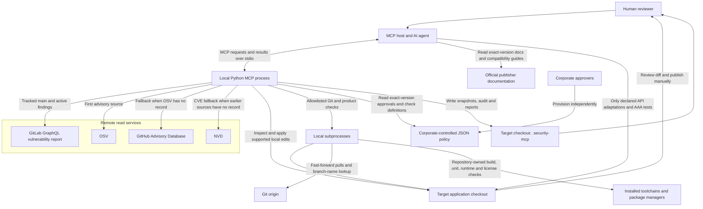
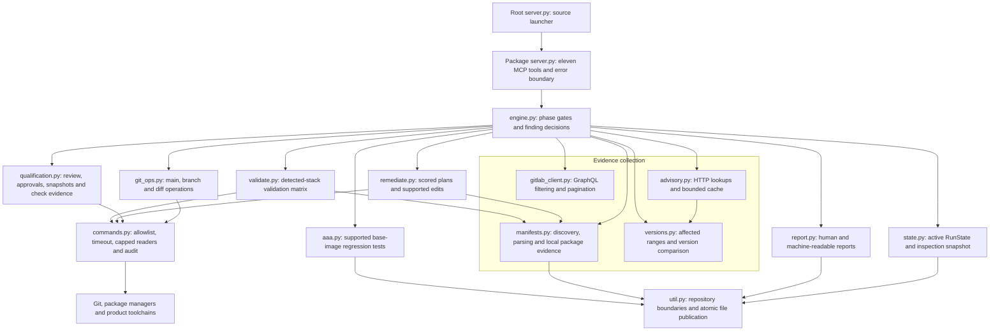
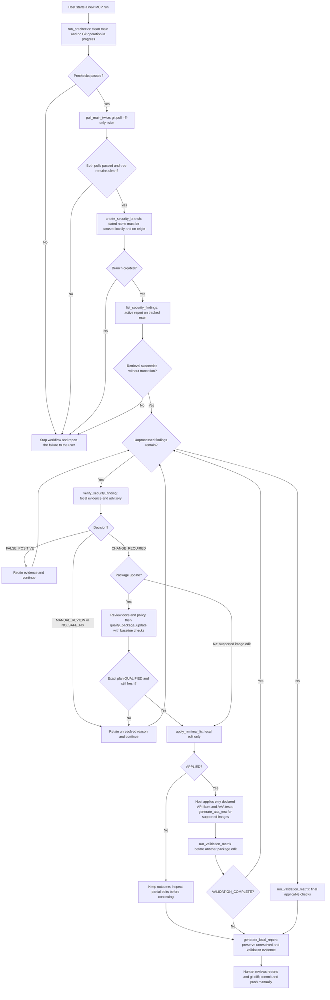
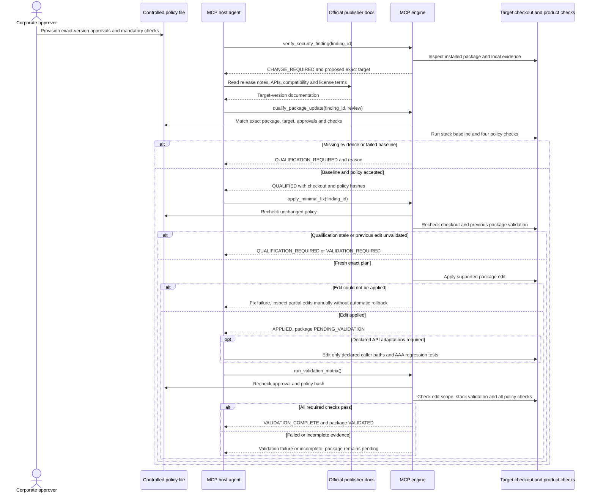

# GitLab Security MCP

An MCP server for evidence-based security remediation in a local GitLab checkout.
It retrieves active findings, verifies installed dependencies against public
advisories, qualifies compatible package updates, applies supported minimal edits,
and produces local Markdown and JSON reports.

The MCP host starts this Python process and calls its eleven tools over stdio.
There is no HTTP listener. "Local" describes execution and where edits are kept,
not offline operation: GitLab and advisory lookups, Git pulls, and product checks
can use the network. The server does not commit, push, open merge requests, dismiss
findings, or write to the GitLab security API. You review and publish changes.

## Contents

- [Architecture](#architecture)
- [Workflow](#workflow)
- [Safety boundaries](#safety-boundaries)
- [Requirements and qualification](#requirements-and-qualification)
- [Building the local MCP server](#building-the-local-mcp-server)
- [Installing the local MCP server](#installing-the-local-mcp-server)
- [MCP configuration](#mcp-configuration)
- [Running within Cursor](#running-within-cursor)
- [Reading output in Cursor](#reading-output-in-cursor)
- [Running remediation](#running-remediation)
- [Supported fixes](#supported-fixes)
- [Validation](#validation)
- [Development and tests](#development-and-tests)
- [Troubleshooting](#troubleshooting)

## Architecture

These fenced Mermaid diagrams render directly on GitHub. In an editor, use a
Markdown preview with Mermaid support. Arrows represent calls or data flow, not
separate deployed services or background queues.

### System context

The MCP host orchestrates the tools and performs documentation review. Corporate
approvers own the license policy; neither the server nor the host AI grants
approval. Repository scripts and wrappers execute locally and must be trusted.



Advisory fallback is not a three-source consensus vote. A record can still
produce manual review when package identity, affected versions, or a safe target
cannot be established. Publisher review is supplied by the host as structured
evidence; the server does not independently read every documentation page.

### Internal components

All components below live in the same Python process. `Engine` owns phase and
decision state and serializes public tool calls with a reentrant lock. HTTP
clients and the command runner have their own serialized operations.



The snapshot is not a resume database. A restarted process creates a new
`RunState`; it never reloads the saved snapshot. There is no cross-process lock,
job scheduler, automatic rollback, or multi-file transaction.

## Workflow

This is the recommended host-agent flow, not an autonomous loop inside the
server. Stop on a failed run gate or validation requirement. Findings without a
safe fix are recorded and may be followed by other eligible findings.



### Tool reference

| Tool | Responsibility and gate |
| --- | --- |
| `run_prechecks(repo_root=None)` | Select the absolute application checkout; require clean `main`; reject merge, rebase, cherry-pick, revert or bisect in progress. |
| `pull_main_twice()` | Require successful prechecks; perform two fast-forward-only pulls. |
| `create_security_branch()` | Require successful pulls; create `security-fixes-Month-dd-YYYY`, for example `security-fixes-November-02-2026`. |
| `list_security_findings(project_id=None)` | Require the branch; retrieve and normalize filtered findings. Do not relist after decisions or edits. |
| `verify_security_finding(finding_id)` | Record evidence, decision, proposed plan and any review prompt. |
| `qualify_package_update(finding_id, review)` | Require a verified package candidate, exact-target review, independent approval and passing baseline checks. |
| `apply_minimal_fix(finding_id)` | Apply the supported plan; require fresh qualification and validation of prior package edits. |
| `generate_aaa_test(finding_id)` | Generate supported base-image tests when a suitable oracle and framework exist; not generic package API tests. |
| `run_validation_matrix()` | Run applicable stack checks and post-update package qualifiers; retain failures and incomplete evidence. |
| `generate_local_report()` | Write local Markdown/JSON reports and return the unresolved-issues table. |
| `get_run_status()` | Return phase, counts and package-validation status; retract stale green package evidence. |

### GitLab report filters

Retrieval matches Status = Needs triage or Confirmed, Tracked ref = `main`,
Activity = Still detected. The client resolves the exact tracked branch ID,
requests `DETECTED` and `CONFIRMED`, and sets `hasResolution: false`. If tracked
`main` cannot be resolved, it fails rather than fetching unfiltered findings.
Pagination and per-finding pipeline provenance are retained. Inspect `truncated`
before treating a retrieval as complete; do not claim omitted findings were
verified or resolved.

### Fix eligibility

A finding is auto-fixed only when all of these are true:

- Local evidence shows the vulnerable package or image is present.
- An online advisory confirms it and publishes a fixed version newer than what is installed.
- The edit is a lockfile refresh, a manifest version bump, a package override, or an unpinned `FROM` tag bump.
- The fix stays within the installed major version (or the same minor for `0.x`). A major jump is skipped and listed for you.
- Package updates also pass the mandatory compatibility, corporate-approval, and before/after product-check qualifiers below. Same-major does not prove compatibility.

An advisory that names the identifier but not the package found in the repo is listed for you to review. It is not reported as a false positive, because the cause may be a naming difference.

Unknown reachability is not treated as a false positive. Secret detection and DAST findings are reported for you to handle. They are not rewritten. SAST findings are not patched by guessing at source changes.

## Safety boundaries

The command runner allows specific argument forms, not arbitrary shell commands.
Direct `git add`, `commit`, `push`, `merge`, `rebase`, `reset`, and unrelated
branch checkouts are rejected. Allowed Git mutations are the fast-forward pulls
and creation of the dated security branch. GitLab calls retrieve data only.

The allowlist is **not an operating-system sandbox**. Product scripts, package
installation hooks, and repository wrappers can execute their own code and use
the network. Review and trust the target repository before running checks. The
hosting AI's editor is also outside the server's command allowlist; its changes
must follow the declared source-edit policy.

Commands have timeouts, capped output, and audit records with output hashes rather
than raw stdout/stderr. Tool results can still contain bounded diagnostic output.
Keep credentials out of source control and avoid secrets in command arguments,
product logs, or reports. GitLab queries and advisory requests send the relevant
project or vulnerability/package identifiers to their configured services.

Snapshots, reports, and the audit log live under `.security-mcp/` in the target
repository. The server does not stage them, and its clean-tree check excludes
that directory. They are local inspection artifacts, not approval credentials
or proof that GitLab considers a finding resolved.

### Robustness

Engine tools and HTTP client operations are serialized within one process.
Shutdown waits for active operations, closes owned clients once, and rejects
later calls. Tool results are detached snapshots rather than live state.
Malformed advisory responses fail lookup; malformed local evidence requires
manual review instead of being treated as package absence. Validation read or
execution failures produce `VALIDATION_FAILED`.

State, manifests, and individual report files are replaced atomically. Generated
tests are published without replacing existing files. Command readers stop
even when descendants retain inherited pipes. This does not guarantee cleanup
of detached descendant processes, coordinate multiple MCP processes editing
the same checkout, or make the Markdown/JSON report pair a single transaction.

## Requirements and qualification

### Prerequisites

- Python 3.11 or newer and Git on Windows, macOS, or Linux.
- A GitLab token with `read_api` and access to the project's vulnerability report.
- The GitLab project path or numeric ID and a local checkout of its `main` branch.
- The package managers and toolchains required by the target application.
- Independently approved package policy and meaningful product-check scripts
  before attempting package updates.

Point `REPO_ROOT` at the application Git checkout, not this MCP project.
Validation supports split Node/.NET repositories: Node checks run at the
top-level package manifests (using each component's package manager), and .NET
checks run at solution directories or standalone project directories. A root
Node workspace manifest owns its nested packages; define workspace-wide checks
there. Arbitrary mixed monorepos are not automatically orchestrated.
Package lookup reads nested npm, pnpm, and Yarn lockfiles and retains each
component's manifest, manager, and scanner-reported installed version. Node
remediation and qualification checks use the owning component's directory.
For pnpm components with `pnpm-workspace.yaml`, transitive override plans edit
that workspace configuration while preserving comments and unrelated pins;
otherwise they use the component's `package.json`. Discovery does not waive
advisory verification, major-version review, or package qualification.
Node, .NET, Java, NGINX, and Docker
are needed only for the validation paths that apply to that checkout. Platform
support does not mean every toolchain or Python runtime has been certified.

### Package Update Qualification

Every Node, NuGet, Maven, and Gradle package update has four mandatory qualifiers:

1. The AI fully reads the target version's official documentation, release notes,
   API/migration guides, runtime/peer requirements, and license terms. It inspects
   the actual product's frameworks and callers, not only the GitLab suggestion.
2. The update must preserve product build, startup/runtime behavior, and the
   existing unit suite. Review Angular/Node/TypeScript/RxJS/Crystal compatibility,
   Quarkus platform/BOM and extension alignment, Java requirements, and .NET
   target frameworks as applicable. Never force peer resolution or change the
   product framework/runtime/BOM to disguise an incompatible package update.
3. Corporate approvers independently approve the exact package version for
   commercial distribution without license fees, documenting license expression,
   approval reference, and obligations. Free download or a familiar license name
   is not corporate approval. Review custom/composite licenses, notices,
   attribution, source-disclosure, redistribution, patent, and other conditions.
4. Baseline and post-update build, unit-test, terminating runtime-smoke, and full
   resolved-dependency license checks pass with positive, untruncated evidence.
   The license audit must verify approved actual resolved versions and terms for
   the entire graph, including newly introduced transitive packages; merely
   recognizing an SPDX string is insufficient. Unknown/unapproved terms block.

An incompatible or uncertain target is skipped for review. If documented API
changes need only small caller adaptations, the AI declares the source/test paths
in its review, applies the package update, makes those adaptations and regression
tests, then reruns validation. Source changes are limited to five supported
source/test files and 200 added/deleted lines in total. Undeclared edits or larger
migrations fail qualification. Do not weaken assertions, skip tests, or rewrite
the product to obtain passing results.

#### Package update sequence

This diagram separates host review, corporate policy, and server-enforced checks.
Every blocked or failed result must be inspected; no automatic rollback occurs.



#### Corporate policy setup

Before a remediation run, corporate approvers provision a controlled JSON policy.
Set `PACKAGE_UPDATE_POLICY` to its absolute path in the MCP process environment;
the default is `.security-mcp/package-update-policy.json` under `REPO_ROOT`.
Keep approvals access-controlled, preferably outside the AI-writable checkout.
The AI/server must never create or modify actual approvals. The server reads and
hashes this file; it cannot authenticate a corporate signer or grant legal rights.

The following is a deliberately **unapproved template**, not permission to use
a package. Corporate approvers must supply real version-specific evidence and
approve both Boolean fields before any update is permitted:

```json
{
  "schema_version": 1,
  "approvals": [{
    "ecosystem": "npm",
    "package": "PACKAGE_NAME",
    "target": "TARGET_VERSION",
    "license_expression": "REVIEWED_LICENSE_EXPRESSION",
    "approved_by": "CORPORATE_APPROVER",
    "approval_reference": "CORPORATE_APPROVAL_RECORD",
    "obligations": "REQUIRED_DISTRIBUTION_CONDITIONS",
    "commercial_distribution_approved": false,
    "no_license_fees": false,
    "license_sources": ["https://publisher.example/license"]
  }],
  "checks": {
    "npm": {
      "build": {"argv": ["npm", "run", "build"], "success_marker": "PRODUCT_BUILD_PASSED"},
      "unit_tests": {"argv": ["npm", "test"], "success_marker": "PRODUCT_UNIT_TESTS_PASSED"},
      "runtime": {"argv": ["npm", "run", "security:smoke"], "success_marker": "PRODUCT_RUNTIME_SMOKE_PASSED"},
      "license_audit": {"argv": ["npm", "run", "security:licenses"], "success_marker": "APPROVED_RESOLVED_LICENSES_PASSED"}
    }
  }
}
```

Use ecosystem keys exactly `npm`, `NuGet`, or `Maven` (Gradle also uses `Maven`).
Every entry must contain exactly the four check kinds above, using the detected
manager. Configure real repository-owned scripts/profiles/tests before starting
on clean main; they are not supplied automatically by this MCP server. Markers
must be emitted only after meaningful tests and complete license-policy checks,
never by a placeholder `echo`, an empty test run, or a generic build-success line.
Missing tools, check definitions, markers, or approvals prevent package edits.

| Manager | Build | Unit Tests | Runtime Smoke | Resolved-Graph License Audit |
| --- | --- | --- | --- | --- |
| npm/pnpm/yarn | `MANAGER run build` | `MANAGER test` | `MANAGER run security:smoke` | `MANAGER run security:licenses` |
| NuGet/.NET | `dotnet build --configuration Release --nologo` | `dotnet test --configuration Release --nologo` | Same test prefix plus category filter `SecurityRuntimeSmoke` | Same test prefix plus category filter `LicenseCompliance` |
| Maven/mvnw | `TOOL --batch-mode clean verify` | `TOOL --batch-mode test` | `TOOL --batch-mode -Psecurity-smoke verify` | `TOOL --batch-mode -Psecurity-licenses verify` |
| Gradle/gradlew | `TOOL --no-daemon build` | `TOOL --no-daemon test` | `TOOL --no-daemon securitySmoke` | `TOOL --no-daemon securityLicenses` |

For .NET, use the filter matching the actual framework: `--filter Category=NAME`
for xUnit/VSTest, `--filter TestCategory=NAME` for MSTest/NUnit,
`--filter-trait Category=NAME` for native MTP/xUnit v3, or
`--treenode-filter /*/*/*/*[Category=NAME]` for native MTP/TUnit. Native MTP
qualification filters target SDK 10+ without the SDK 8/9 `--` separator; other
unsupported platform/command combinations require manual validation. Java
wrappers are resolved inside the checkout using the current OS's wrapper form.

#### Documentation review input

Call `qualify_package_update(finding_id, review)` only after completing the
actual review. This illustrative input is not evidence for a real package:

```json
{
  "ecosystem": "npm",
  "package": "PACKAGE_NAME",
  "target": "TARGET_VERSION",
  "documentation": {
    "complete": true,
    "sources": ["https://publisher.example/version-specific-docs"],
    "summary": "Actual findings from the complete official documentation review"
  },
  "compatible": true,
  "api_changes": "Actual API changes and the smallest required caller adaptations",
  "frameworks": [{
    "name": "ACTUAL_PRODUCT_FRAMEWORK_OR_RUNTIME",
    "version": "INSTALLED_VERSION",
    "source_url": "https://publisher.example/compatibility",
    "assessment": "Evidence that the target supports this installed version"
  }],
  "source_fixes": []
}
```

Include every relevant framework/runtime/BOM and publisher source. For adaptations,
replace `source_fixes: []` with declared `{path, reason}` entries for the small
caller and regression-test changes. The host AI edits these files after package
application, not arbitrary files or manifests. Existing major-upgrade refusals
still apply; this tool does not bypass them or support guessed SAST rewrites.

`QUALIFICATION_REQUIRED` blocks an edit. `QUALIFIED` authorizes only the exact
reviewed plan on the unchanged pruned source checkout and unchanged policy.
Requalify before application if either changes. `APPLIED` means local edits only;
the package qualifier remains `PENDING_VALIDATION` until all post-checks pass.
Reports keep pending/failed updates unresolved, retain documentation/approval
references, and retract green results after later source or policy changes.
Failed/partial edits are not automatically rolled back; review them locally.

These gates enforce reviewed evidence and repository-owned checks, not a proof
of every possible runtime behavior or an independent verification that an AI
read every page. Their assurance depends on test coverage, truthful review,
correct full-graph license auditing, and authentic corporate approval. Snapshot
checks prune dependency/build/cache directories and stop at the file/size cap;
they are not cross-process locks or verification of all generated binaries.

Qualification policy reads are capped at 1 MiB and declared source-file reads
at 512 KiB, including files that grow during a read. Source comparisons trim
unchanged context and reject more than 4 million remaining line pairs before
running the quadratic diff matcher; costly migrations require manual review.
Each status refresh hashes the checkout once for all validated packages.
The advisory cache retains at most 256 records and releases them on shutdown.
Unreadable directories fail evidence collection rather than proving absence.

Official references: [Angular compatibility](https://angular.dev/reference/versions),
[Quarkus platform/BOM alignment](https://quarkus.io/guides/platform),
[npm package requirements and licenses](https://docs.npmjs.com/cli/v11/configuring-npm/package-json),
and [NuGet license metadata](https://learn.microsoft.com/en-us/nuget/reference/nuspec#license).
Read the specific updated package's documentation too; these general references
do not establish compatibility or commercial approval for an individual update.

### Repository Compatibility

| Repository | Automatic dependency fixes | Validation |
| --- | --- | --- |
| Node.js | npm, pnpm, Yarn Classic and modern Yarn; direct version bumps, supported lock refreshes, overrides/resolutions | Install, advisory audit, declared lint/build/test scripts |
| .NET 10 | NuGet project references and existing central `Directory.Packages.props` versions | SDK compatibility check, restore, Release build/test; `.sln`, `.slnx`, C#, F#, and VB project detection |
| Java 17 | Maven direct versions/properties and Gradle coordinates/supported version-catalog entries | Java 17 check, Maven verify/dependency tree or Gradle dependencies/test/build; wrappers preferred |

These are safe dependency-remediation paths, not a promise to fix every security
finding. A matching advisory, a published compatible fix, and a supported local
edit are required. Unresolved Java/NuGet transitive dependencies require review;
SAST, DAST, secrets, unsupported dependency formats, and breaking upgrades are
not patched by guessing.

Required tools must be on the server process's PATH. A missing required tool produces
`VALIDATION_INCOMPLETE`; an incompatible Java runtime or an SDK too old for
`net10.0` produces `VALIDATION_FAILED`. Install/configure the required tools and
rerun validation. A .NET SDK 10 or newer is needed for `net10.0`; Java validation
requires a Java 17 toolchain, not merely any installed Java version.

## Building the local MCP server

Python source execution needs no compilation or wheel. Use the source
installation below for local development and restart-only hotfixes. Build a
wheel when you want an installable local package or a deployment artifact.

From this MCP project's root, create the virtual environment if it does not
already exist, install dependencies, check the source, and build:

### Windows build

```powershell
python -m venv .venv
.\.venv\Scripts\python.exe -m pip install -r requirements-dev.txt
.\.venv\Scripts\python.exe -m ruff check gitlab_security_mcp server.py tests
.\.venv\Scripts\python.exe -m ruff format --check gitlab_security_mcp server.py tests
.\.venv\Scripts\python.exe -W error::DeprecationWarning -W error::ResourceWarning -m pytest -q -W error::pytest.PytestUnhandledThreadExceptionWarning
.\.venv\Scripts\python.exe -m pip wheel --no-deps --wheel-dir dist .
Get-ChildItem .\dist\*.whl
```

### macOS and Linux build

```bash
python3 -m venv .venv
.venv/bin/python -m pip install -r requirements-dev.txt
.venv/bin/python -m ruff check gitlab_security_mcp server.py tests
.venv/bin/python -m ruff format --check gitlab_security_mcp server.py tests
.venv/bin/python -W error::DeprecationWarning -W error::ResourceWarning -m pytest -q -W error::pytest.PytestUnhandledThreadExceptionWarning
.venv/bin/python -m pip wheel --no-deps --wheel-dir dist .
ls dist/*.whl
```

Stop if a check fails; building the wheel does not itself run these checks.
Live GitLab tests remain opt-in. The current version produces
`dist/gitlab_security_mcp-1.0.0-py3-none-any.whl`; use the newly built filename if
the project version changes. `--no-deps` builds only this project's artifact,
not a bundle of its dependencies. Build isolation may download build tools.
Building does not install the wheel or start an MCP process.

## Installing the local MCP server

Run these commands from this MCP project's directory, not the application
checkout. The source launcher needs the runtime dependencies; it does not need
an installed copy of this project.

### Source installation on Windows

```powershell
python -m venv .venv
.\.venv\Scripts\python.exe -m pip install -r requirements.txt
```

### Source installation on macOS and Linux

```bash
python3 -m venv .venv
.venv/bin/python -m pip install -r requirements.txt
```

Activation is optional when commands use the virtual environment's executable.
Use absolute paths in the MCP configuration so the host's working directory and
global Python installation cannot select the wrong server.

### Installing a built wheel

For an installed-package deployment, first create the virtual environment and
install runtime dependencies using the source-installation commands above.
Then install the wheel into that same environment:

```powershell
.\.venv\Scripts\python.exe -m pip install --force-reinstall --no-deps .\dist\gitlab_security_mcp-1.0.0-py3-none-any.whl
.\.venv\Scripts\python.exe -m pip show gitlab-security-mcp
.\.venv\Scripts\python.exe -m pip check
Get-Item .\.venv\Scripts\gitlab-security-mcp.exe
```

On macOS/Linux:

```bash
.venv/bin/python -m pip install --force-reinstall --no-deps dist/gitlab_security_mcp-1.0.0-py3-none-any.whl
.venv/bin/python -m pip show gitlab-security-mcp
.venv/bin/python -m pip check
ls .venv/bin/gitlab-security-mcp
```

`--force-reinstall` replaces an existing copy even if the local version number
has not changed. `--no-deps` relies on the runtime-dependency setup above; do
not skip it. Update runtime requirements when dependencies change. The installed
entry point is `gitlab-security-mcp`, not the root source launcher.

For Cursor, replace the source configuration's `command` and `args` with:

```json
{
  "command": "C:\\path\\to\\security-mcp-fixer\\.venv\\Scripts\\gitlab-security-mcp.exe",
  "args": []
}
```

This is a fragment inside the existing `mcpServers.gitlab-security` object;
retain its `env` settings. On macOS/Linux, use the absolute path to
`.venv/bin/gitlab-security-mcp`. Do not pass `server.py` to this entry point.
Restart Cursor's MCP server after installation. Wheel deployments require
rebuilding, reinstalling and restarting for code updates; source deployments
require only restarting for source-only updates. Use one launch method per
connection, not both.

## MCP configuration

The MCP host launches and owns the server process. Do not also run a separate
`python server.py` terminal instance for that connection. Stdout is reserved for
MCP messages; the server does not open a port.

### VS Code

Add the following to the target project's `.vscode/mcp.json`. Replace both local
paths and `group/project`. The password input keeps the token out of the JSON
example; enter it through VS Code's input prompt, not through agent chat. Keep
actual credential storage consistent with your organization's policy.

```json
{
  "servers": {
    "gitlab-security": {
      "type": "stdio",
      "command": "C:\\path\\to\\security-mcp-fixer\\.venv\\Scripts\\python.exe",
      "args": ["C:\\path\\to\\security-mcp-fixer\\server.py"],
      "env": {
        "GITLAB_TOKEN": "${input:gitlabToken}",
        "GITLAB_PROJECT_ID": "group/project",
        "REPO_ROOT": "C:\\path\\to\\application-repo"
      }
    }
  },
  "inputs": [
    {
      "id": "gitlabToken",
      "type": "promptString",
      "description": "GitLab read_api token",
      "password": true
    }
  ]
}
```

Start/restart the server using VS Code's MCP server controls and enable its tools
for the agent. Review any host trust prompt before permitting execution. On
macOS/Linux, use `/path/to/security-mcp-fixer/.venv/bin/python` and POSIX paths.

### Cursor

Create or edit the project file `.cursor/mcp.json` in the repository you want to remediate, or edit your user MCP config at `%USERPROFILE%\.cursor\mcp.json` on Windows (`~/.cursor/mcp.json` on macOS or Linux).

Do not put a real token in a committed project config. The examples deliberately
omit `GITLAB_TOKEN`: supply it securely in the environment inherited by Cursor,
or use an uncommitted user configuration according to corporate policy.

#### Windows configuration

```json
{
  "mcpServers": {
    "gitlab-security": {
      "command": "C:\\path\\to\\security-mcp-fixer\\.venv\\Scripts\\python.exe",
      "args": [
        "C:\\path\\to\\security-mcp-fixer\\server.py"
      ],
      "env": {
        "GITLAB_PROJECT_ID": "group/project",
        "GITLAB_API_URL": "https://gitlab.com/api/v4",
        "REPO_ROOT": "C:\\path\\to\\the\\repo\\to\\fix"
      }
    }
  }
}
```

#### macOS and Linux configuration

```json
{
  "mcpServers": {
    "gitlab-security": {
      "command": "/path/to/security-mcp-fixer/.venv/bin/python",
      "args": ["/path/to/security-mcp-fixer/server.py"],
      "env": {
        "GITLAB_PROJECT_ID": "group/project",
        "GITLAB_API_URL": "https://gitlab.com/api/v4",
        "REPO_ROOT": "/path/to/the/repo/to/fix"
      }
    }
  }
}
```

Reload MCP servers using Cursor's MCP settings/refresh control and enable
`gitlab-security`. Configuration formats differ between hosts: VS Code uses
`servers`; Cursor uses `mcpServers`. Do not interchange the two examples.

Use a literal absolute `REPO_ROOT` in user-level Cursor configuration. Do not
assume `${workspaceFolder}` is expanded: a server launched outside the active
project cannot infer that project's directory. For example, study-service uses
`C:\Users\James.Prejsnar\source\repos\study-service`, not its `backend` or
`frontend` subdirectory.

Alternatively, have the agent call
`run_prechecks(repo_root="C:\\Users\\James.Prejsnar\\source\\repos\\study-service")`.
This overrides `REPO_ROOT` for the process's run, including an unresolved
placeholder. Repository selection is locked after prechecks pass; restart the
server to switch an active run to another checkout.

Engine configuration is deferred until a tool is called, so invalid paths or
settings do not prevent MCP initialization or tool discovery. Tool errors
include the stage, repository (when available), server working directory, and
corrective action. Git precheck errors include the attempted checkout and
recovery instructions. Diagnostic logs go to stderr, never MCP stdout. If the
Python executable or dependencies prevent startup altogether, consult Cursor's
MCP server log and verify the configured interpreter and installed requirements.

### Reload code changes

Use the source launcher shown above: the virtualenv's Python with the absolute
path to `server.py`. It imports the adjacent `gitlab_security_mcp` source tree,
not an older installed copy. After changing code, restart/reload the
`gitlab-security` MCP server in your host to load the changes. No rebuild or package
reinstallation is needed for source-only changes.

This restarts the process, rather than updating an active run in place. Reload
between remediation runs: in-memory state is reset, and a new run must pass
prechecks again. Dependency changes still require installing the updated
requirements into the configured virtual environment before restarting.

### Environment variables

| Variable | Required | Purpose |
| --- | --- | --- |
| `GITLAB_TOKEN` | yes | Personal access token. `GITLAB_PERSONAL_ACCESS_TOKEN` is also accepted. |
| `GITLAB_PROJECT_ID` | yes | Path such as `group/project`, or a numeric id. |
| `REPO_ROOT` | set explicitly in the host | Absolute path of the git repo to remediate. Defaults to the process working directory. |
| `GITLAB_API_URL` | no | REST base URL. Defaults to `https://gitlab.com/api/v4`. GraphQL is derived from it. |
| `GITHUB_TOKEN` or `GH_TOKEN` | no | Raises the GitHub Advisory rate limit. |
| `NVD_API_KEY` | no | Raises the NVD rate limit. OSV is tried first and does not need a key. |
| `VALIDATION_TIMEOUT_SEC` | no | Per validation command. Defaults to 600. |
| `PACKAGE_UPDATE_POLICY` | required for package edits | Absolute path to corporation-managed exact-version approvals and mandatory product checks; defaults to `.security-mcp/package-update-policy.json` in `REPO_ROOT`. |

For a self-hosted GitLab instance, set `GITLAB_API_URL` to `https://gitlab.example.com/api/v4`.

Use the server's actual process environment, not only a terminal opened after
the host started. GitLab credentials are required for retrieval; startup alone
does not prove authentication or project access. Configure
`VALIDATION_TIMEOUT_SEC` as a positive integer and provide `PACKAGE_UPDATE_POLICY`
before requesting package qualification.

## Running within Cursor

1. Open the application repository to remediate in Cursor, not just this MCP
  project's folder. Confirm `REPO_ROOT` points to that application checkout.
2. Add the [Cursor configuration](#cursor) to the project or user MCP config.
  Choose either the absolute source launcher or installed console entry point.
3. Supply GitLab credentials securely to the Cursor process and set the project
  ID. Configure the independently provisioned policy before package updates.
4. In Cursor's MCP settings, enable/reload `gitlab-security`. Review startup
  errors there if it does not connect; UI labels vary by Cursor release.
5. Open Agent chat and enable the server's tools. Review tool approval prompts
  according to your organization's policy.
6. First use the read-only status request below to verify the connection.
7. Prepare clean `main`, approvals and product checks, then use the
  [remediation request](#running-remediation) to run the gated workflow.

Connection check in Agent chat:

```text
Use only gitlab-security.get_run_status. Show the returned status, branch,
counts and package_updates. Do not pull, create branches, retrieve findings,
apply fixes or run product commands yet.
```

For a fresh process, expect `NOT_STARTED`, no branch, and zero findings/changes.
This confirms a tool response, not GitLab access or successful remediation.
Cursor starts the server itself; no separate terminal server or URL is needed.
Do not restart in the middle of a run, because active state is not resumed.

## Reading output in Cursor

### Tool results and agent summary

Expand a tool call in Agent chat to inspect its returned structured result.
If your Cursor version hides the raw result, ask the agent to display the
relevant fields without credentials. Read the tool result as evidence rather
than relying only on a short natural-language success message.

| Result | Fields to inspect |
| --- | --- |
| Finding retrieval | `count`, `truncated`, `findings`, and pipeline provenance. A truncated list is incomplete. |
| Finding verification | `decision`, `reason`, `evidence`, `proposed_fix`, and `qualification_required`. |
| Package qualification | `status`, approval evidence, `baseline_results`, or the blocking `reason`. |
| Fix application | `status`, `change.files`, `change.detail`, and `change.qualification_status`. `APPLIED` is not validated. |
| Validation | Overall `status` and each row in `results`, including `required`, command, status and detail. |
| Report generation | `human_report`, `json_report`, `unresolved_issues`, and `unresolved_issues_table`. |
| Current status | `status`, `stop_stage`, counts, `report_path`, and `package_updates`. |

### Reading local report files

Open the returned `human_report` path in Cursor and use Markdown preview for
the human-readable report. Open `json_report` for structured evidence. The
files are in the application checkout's `.security-mcp/reports/`, not under
the MCP project unless both roots intentionally match.

To list reports from a terminal in the application checkout:

```powershell
Get-ChildItem .\.security-mcp\reports\security-remediation-report-*
```

To read a known report path returned by the tool:

```powershell
Get-Content -LiteralPath 'C:\path\to\application-repo\.security-mcp\reports\security-remediation-report-security-fixes-November-02-2026.md'
Get-Content -LiteralPath 'C:\path\to\application-repo\.security-mcp\reports\security-remediation-report-security-fixes-November-02-2026.json' -Raw | ConvertFrom-Json
```

On macOS/Linux, use `ls .security-mcp/reports/` and `cat` with the actual
returned Markdown/JSON path. The dated filename is illustrative; use your
run's returned path. Inspect changes in Cursor's Source Control diff view or
with `git diff` before staging anything yourself.

### Interpreting success, pending work and errors

`REPORT_GENERATED` means files were written, not that every finding is fixed.
Check validation evidence and require `VALIDATED` for applied package updates.
`PENDING_VALIDATION`, `QUALIFICATION_REQUIRED`, `VALIDATION_REQUIRED`, failed
checks, and incomplete required checks must not be summarized as resolved.
Review false positives separately from unresolved and unverified findings.

Example output-review request:

```text
Show the report paths and validation status. Display unresolved_issues_table
from generate_local_report verbatim at the end of your response. Include
pending package updates, failed/incomplete required checks and unverified
findings. Do not claim GitLab findings were changed, and do not commit or push.
```

For startup or transport failures, inspect Cursor's MCP connection details/log
controls. Server diagnostics are separate from structured MCP tool results;
ordinary terminal stdout is not the report channel. Never add print-based
debugging to the server's protocol stdout. Audit output hashes are not raw
command transcripts, and absence of an audit record does not prove a fix passed.

## Running remediation

1. Install runtime dependencies and configure your MCP host.
2. Provision independent corporate approvals and all mandatory product checks.
3. Check out clean `main` in `REPO_ROOT`; finish any in-progress Git operation.
4. Start/reload `gitlab-security` and enable its tools.
5. Ask the host agent to follow the workflow below.
6. Review the returned unresolved table, local reports, and `git diff`.
7. Commit and push manually only after reviewing the evidence and changes.

Example agent request:

```text
Use the gitlab-security MCP tools in order. Run prechecks, pull main twice,
create the security branch, list findings, verify each finding, apply only
eligible fixes after reviewing official package docs and calling
qualify_package_update with compatibility evidence and existing corporate
license approvals. Never create/edit approvals or force incompatible framework
versions. Make only declared surgical API fixes and AAA regression tests.
Run all product build, unit, runtime, and resolved-license checks after each
package edit before continuing, and generate the local report.
Display unresolved_issues_table at the end of your final response. Stop on
run-level failures or failed/incomplete validation. Retain finding-level
manual-review and no-safe-fix reasons; continue only with eligible findings.
Do not commit, push, dismiss findings, or claim pending edits are resolved.
```

### Reports and local artifacts

All paths below are relative to the target `REPO_ROOT`, not this MCP project.

| Artifact | Purpose |
| --- | --- |
| `.security-mcp/run-state.json` | Atomic inspection snapshot of the active run; never reloaded for resume. |
| `.security-mcp/audit.jsonl` | Command metadata and output hashes, not raw output logs. |
| `.security-mcp/reports/security-remediation-report-*.md` | Human-readable findings, changes, validation and review evidence. |
| `.security-mcp/reports/security-remediation-report-*.json` | Machine-readable companion evidence. |

The report includes these review categories:

- False positives, with the finding id and the evidence-based reason
- Issues with no solution at this time
- Findings skipped because they need your input

Those skipped findings are also returned by `verify_security_finding` and `apply_minimal_fix` as `MANUAL_REVIEW` / `SKIPPED_USER_PROMPT`. Tell the agent how you want them handled. The server will not guess a version when OSV, GitHub Advisory, and NVD do not.

The report ends with an **Unresolved Security Issues** table: severity, package,
installed version, issue identifiers/title, and the reason no package or code
update was applied. It includes no-safe-fix, manual-review, and failed-fix
outcomes, but excludes false positives and validated package fixes (or applied
non-package fixes). Pending/unqualified package updates remain unresolved. The MCP
result returns `unresolved_issues` and `unresolved_issues_table` so the agent can
display the same table at the end of its response. Unverified findings remain
listed separately; they are not assumed to be resolved or unfixable.

Report generation is not a validation gate: `REPORT_GENERATED` does not mean
`VALIDATION_COMPLETE`. Inspect the saved validation status and per-package
qualification evidence. Later source or policy changes retract validated
package results when status/report is refreshed. GitLab findings stay unchanged
until your normal publication and scanning process updates them.

## Supported fixes

| Strategy | When | Score |
| --- | --- | --- |
| Lockfile refresh | The declared npm, pnpm, or Yarn range already allows the fixed version | 1 |
| Manifest bump | `package.json`, `pom.xml`, Gradle, `libs.versions.toml`, or a NuGet `PackageReference` | 2 |
| Override or direct pin | A transitive npm, pnpm, Yarn, or NuGet package | 3 |
| Image tag | An unpinned `FROM image:tag` whose name matches the finding | 3 |

The server applies plans scoring at most 3; it does not perform arbitrary source
rewrites. Declared host-authored package API adaptations are a separate, bounded
exception under qualification, not an automated SAST patching capability.
Unsupported edits and breaking upgrades remain for manual review.

Lockfile refreshes use the package manager already selected by the repo (`npm`, `pnpm`, or `yarn`) and pass `--ignore-scripts` on that refresh. Validation then runs the project's own install and test commands.

## Validation

| Stack | Commands |
| --- | --- |
| Node | `npm ci` (or the pnpm/Yarn frozen install), `lint` / `build` / `test` when those scripts exist, and `npm audit --json` as information only |
| .NET | `dotnet restore` (`--locked-mode` when `packages.lock.json` exists), `dotnet build`, `dotnet test`. A target framework other than `net10.0` is reported, and the build still runs. |
| Java | `mvnw` or `mvn --batch-mode clean verify` and `dependency:tree`, or the Gradle wrapper's `dependencies`, `test`, and `build`. A JDK other than 17 is reported. |
| NGINX | `nginx -t` when `nginx` is installed and a config file is present |
| Container | `FROM` is required. `docker build --check` runs when Docker is available. A missing daemon is recorded as skipped. |

A failed required command sets `VALIDATION_FAILED`; a missing required tool or
incomplete required evidence yields `VALIDATION_INCOMPLETE`. Neither permits
claiming a package update is validated. Policy check failures produce required
failed rows even when other checks can still run. Edits remain local and are not
automatically reverted. The Node advisory audit is informational, not a
substitute for the mandatory compatibility and resolved-license checks.

Package qualification adds its four required checks to the detected-stack
matrix both before and after the update. A successful generic build alone is
insufficient. Validate each package edit before applying the next; new changes
can invalidate earlier receipts, so the final checkout must pass again.

## Development and tests

Run development commands from this MCP project's root. Use the equivalent
`.venv/bin/python` executable on macOS/Linux.

```powershell
.\.venv\Scripts\python.exe -m pip install -r requirements-dev.txt
.\.venv\Scripts\python.exe -m ruff check gitlab_security_mcp server.py tests
.\.venv\Scripts\python.exe -m ruff format --check gitlab_security_mcp server.py tests
.\.venv\Scripts\python.exe -W error::DeprecationWarning -W error::ResourceWarning -m pytest -q -W error::pytest.PytestUnhandledThreadExceptionWarning
```

### Python and AAA standards

The support floor remains Python 3.11. Follow [PEP 8](https://peps.python.org/pep-0008/),
[PEP 257](https://peps.python.org/pep-0257/), the official
[docstring guidance](https://docs.python.org/3/tutorial/controlflow.html#documentation-strings),
and [Python porting guidance](https://docs.python.org/3/whatsnew/3.15.html#porting-to-python-3-15)
without introducing newer-only syntax or APIs. Text I/O uses explicit UTF-8;
injected clients stay caller-owned.

Modules/classes have docstrings. Public APIs document purpose and relevant
ownership, side effects, failures, and limits. Private and nested helpers have
docstrings or leading intent comments. Tests follow Arrange-Act-Assert (AAA);
comments explain non-obvious intent instead of narrating every statement.

The standards suite checks lint, formatter compliance, Python 3.11 source
syntax, and documentation on named definitions in maintained source and tests:

```powershell
.\.venv\Scripts\python.exe -m pytest tests/test_python_standards.py -q
.\.venv\Scripts\python.exe -m ruff format gitlab_security_mcp server.py tests
```

The formatter targets 88 columns. Existing long evidence literals, templates,
and docstrings retain the line-length lint exemption; this is a project
convention, not strict 79-column standard-library formatting. Syntax checks
are not runtime certification on every supported Python version.

The offline behavioral suite covers cleanup, concurrent shutdown, inherited
pipes, worker startup failure, command timeouts, qualification bounds, edit
limits, advisory parsing, manifest changes, and report outcomes. Fatal resource
and thread warnings expose regressions; they do not prove the absence of every
possible leak/race on arbitrary workloads or certify free-threaded Python.

### Patient-web live integration checks

Live tests are skipped unless `--patient-web-live` is supplied. Set `GITLAB_TOKEN`
or `GITLAB_PERSONAL_ACCESS_TOKEN` securely in the test process environment with
`read_api` and report access. The project path is fixed to
`clario-clinical/NxT/ecoa-swift/patient-web/patient-web`; this is a specific
integration fixture, not a restriction on the server's configurable project.

Retrieval only:

```powershell
.\.venv\Scripts\python.exe -m pytest tests/test_patient_web_live.py::test_retrieve_patient_web_security_findings --patient-web-live -v -s
```

Retrieval plus local-checkout/advisory verification:

```powershell
$env:PATIENT_WEB_REPO_ROOT = 'C:\path\to\patient-web'
.\.venv\Scripts\python.exe -m pytest tests/test_patient_web_live.py --patient-web-live -v -s
```

The retrieval test requires a nonempty, untruncated active report; revise that
expectation intentionally once the project is clean. The verification test
prints decisions and fails on manual-review/no-safe-fix outcomes or proposed
targets that advisories cannot confirm are unaffected. Evidence-backed false
positives need no edit. These tests do not apply fixes, execute Git/package
commands, or write MCP state/reports into patient-web. They require real access
and network connectivity; offline unit results do not substitute for them.

### MCP inspection

For interactive inspection, activate the environment and use the MCP Inspector
when Node.js and the MCP development CLI are available:

```powershell
.\.venv\Scripts\Activate.ps1
mcp dev server.py
```

Running `python server.py` alone waits for an MCP client on stdin; silence does
not mean the server has hung. Do not send ordinary text to its protocol stream.

Source files in `gitlab_security_mcp/` are authoritative. Generated copies in
`build/` are refreshed through [wheel construction](#building-the-local-mcp-server),
not manually maintained. See [local installation](#installing-the-local-mcp-server)
for deployment and restart differences.

## Troubleshooting

| Symptom or result | Action |
| --- | --- |
| Server does not start | Check absolute launcher/Python paths, installed runtime dependencies, and host logs. Stdout must contain only MCP messages. |
| Retrieval fails or tracked main is unavailable | Check token scope/access, exact project path, GitLab URL and tracked branch. Do not use an unfiltered fallback. |
| `truncated: true` | Treat retrieval/discovery as incomplete; do not claim all findings or absent packages were verified. |
| `PRECHECK_FAILED` | Return to clean `main` and finish Git operations manually. The MCP does not discard your work. |
| Dated branch already exists | Review, rename or remove it manually; the server refuses to reuse another run's branch name. |
| `MANUAL_REVIEW` or `NO_SAFE_FIX` | Inspect local/advisory evidence and the unresolved table. Unknown reachability or a package-name mismatch does not prove a false positive. |
| `QUALIFICATION_REQUIRED` | Complete exact-version review, independent approval and all baseline checks; requalify if checkout/policy hashes changed. |
| `VALIDATION_REQUIRED` or `PENDING_VALIDATION` | Validate the previous package edit before attempting another; do not report it as resolved. |
| `VALIDATION_INCOMPLETE` or `VALIDATION_FAILED` | Inspect required rows, install missing tools or repair only permitted adaptations, then rerun. Failed edits remain local. |
| Restart loses the active run | Expected: snapshots are inspection-only. Review existing edits/branch before preparing a new clean-main run; no automatic resume or rollback exists. |
| Source hotfix appears ignored | Confirm the host uses the root source launcher and restart the MCP process between runs. |
